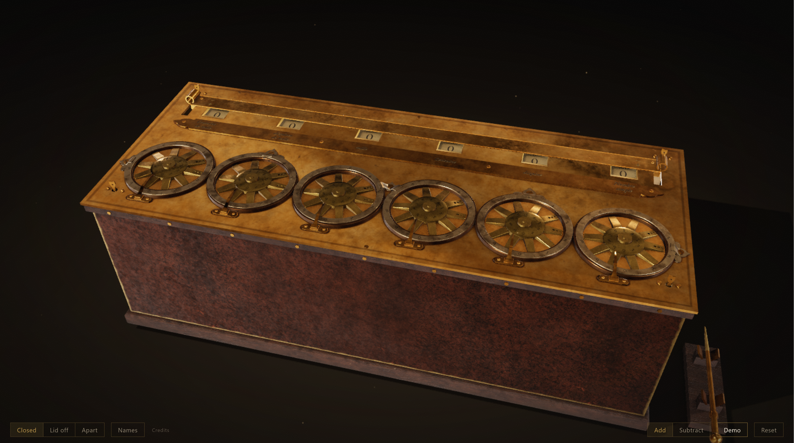
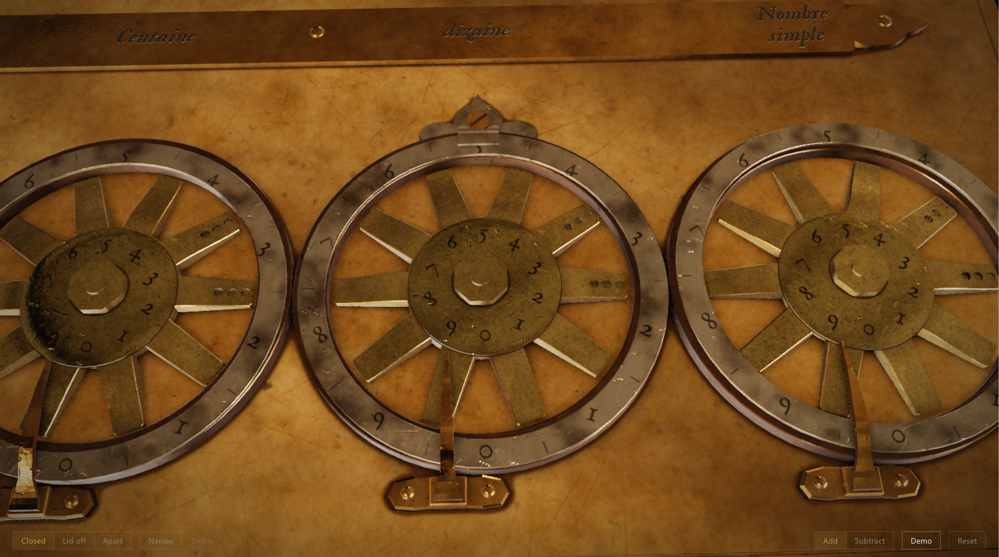
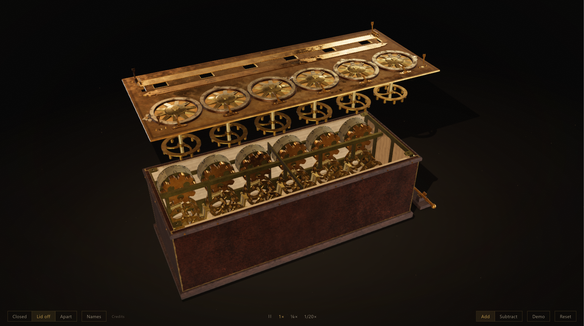
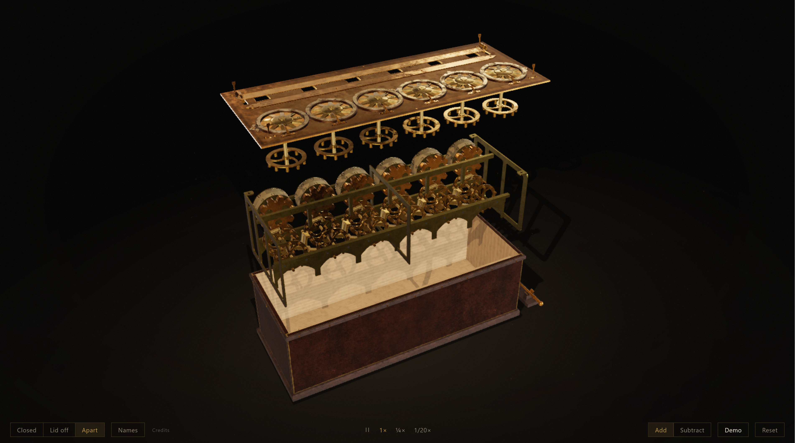
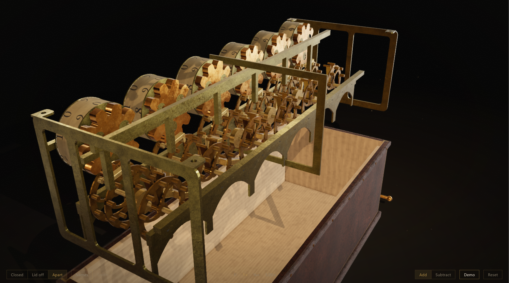
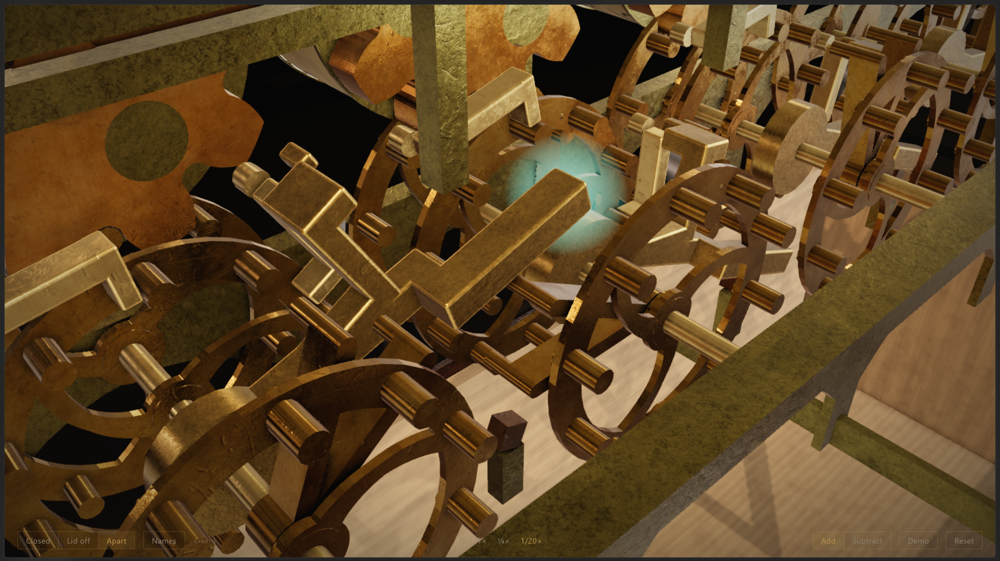

# Pascaline reconstruction

Interactive 3D && built with procedurally generated geometry.

---

## Outside

| Closed | Dials |
|:---:|:---:|
|  |  |

## Inside

| Lid off | Apart |
|:---:|:---:|
|  |  |

## Details

| Gears | Carry |
|:---:|:---:|
|  |  |

---

**Credits**

Based on the Pascaline CnAM 823-1 and the geometric reconstruction described by J. I. Rojas-Sola, G. del Río-Cidoncha, A. Fernández-de la Puente Sarriá, and V. Galiano-Delgado in [“Blaise Pascal’s Mechanical Calculator: Geometric Modelling and Virtual Reconstruction”](https://doi.org/10.3390/machines9070136), _Machines_ 9(7), 136 (2021), licensed under [CC BY 4.0](https://creativecommons.org/licenses/by/4.0/).

This project adapts the published reconstruction into an interactive 3D model.
