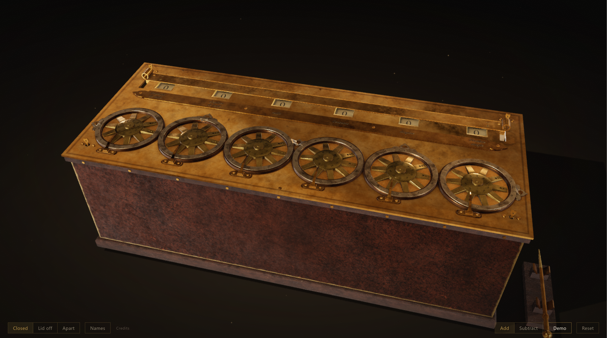
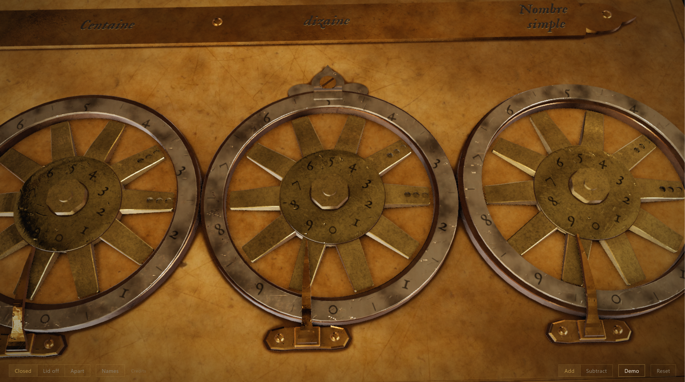
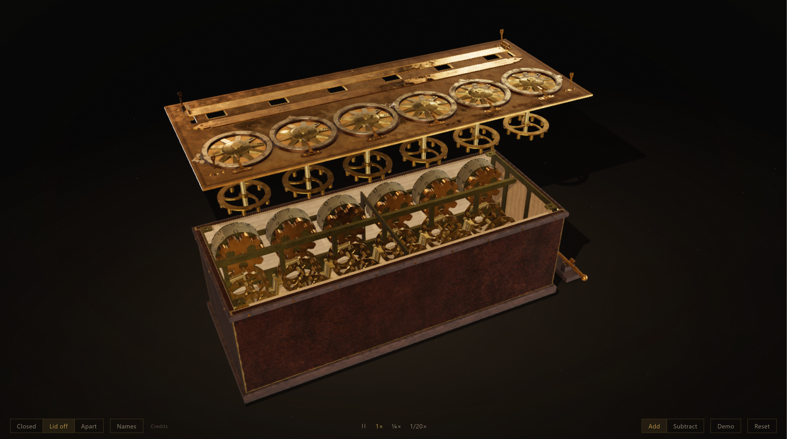
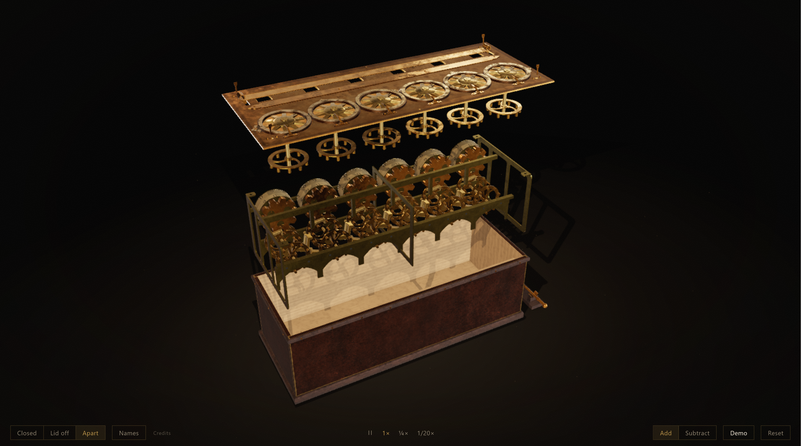
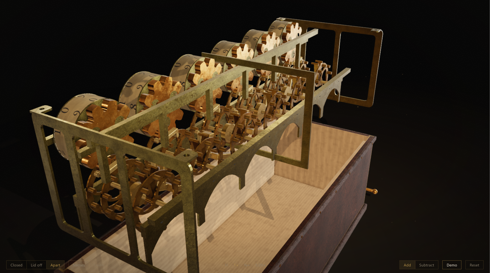
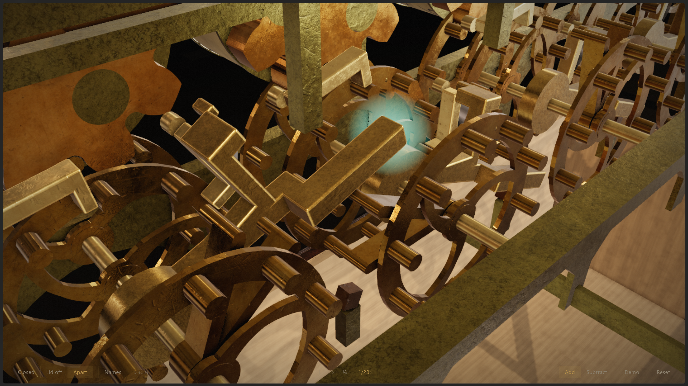

<div align="center">


[](https://kaydjen-pascaline.vercel.app)

---

https://github.com/user-attachments/assets/c7cbf71b-ffc9-4b13-9f6c-d157aa5cadf5

---

## In 3D

The machine taken apart: lid with the input wheels, frame with the drums and output gears, box. The gearing inside the frame is left out to fit the size limit of a GitHub page.

**Drag it.**

</div>

```stl
solid pascaline
facet normal 0 0 -1
outer loop
vertex -314 -125 0
vertex -314 125 0
vertex 314 125 0
endloop
endfacet
facet normal 0 0 -1
outer loop
vertex 314 125 0
vertex 314 -125 0
vertex -314 -125 0
endloop
endfacet
facet normal 0 0 1
outer loop
vertex 314 125 12
vertex -314 125 12
vertex -314 -125 12
endloop
endfacet
facet normal 0 0 1
outer loop
vertex -314 -125 12
vertex 314 -125 12
vertex 314 125 12
endloop
endfacet
facet normal 0 -1 0
outer loop
vertex -314 -125 0
vertex 314 -125 0
vertex -314 -125 12
endloop
endfacet
facet normal 0 -1 0
outer loop
vertex 314 -125 0
vertex 314 -125 12
vertex -314 -125 12
endloop
endfacet
facet normal 1 0 0
outer loop
vertex 314 -125 0
vertex 314 125 0
vertex 314 -125 12
endloop
endfacet
facet normal 1 0 0
outer loop
vertex 314 125 0
vertex 314 125 12
vertex 314 -125 12
endloop
endfacet
facet normal 0 1 0
outer loop
vertex 314 125 0
vertex -314 125 0
vertex 314 125 12
endloop
endfacet
facet normal 0 1 0
outer loop
vertex -314 125 0
vertex -314 125 12
vertex 314 125 12
endloop
endfacet
facet normal -1 0 0
outer loop
vertex -314 125 0
vertex -314 -125 0
vertex -314 125 12
endloop
endfacet
facet normal -1 0 0
outer loop
vertex -314 -125 0
vertex -314 -125 12
vertex -314 125 12
endloop
endfacet
facet normal 1 0 0
outer loop
vertex 311 -116 195
vertex 311 -123 195
vertex 311 -116 16
endloop
endfacet
facet normal 1 0 0
outer loop
vertex 311 -123 195
vertex 311 -123 16
vertex 311 -116 16
endloop
endfacet
facet normal -1 0 0
outer loop
vertex -311 -116 16
vertex -311 -123 16
vertex -311 -116 195
endloop
endfacet
facet normal -1 0 0
outer loop
vertex -311 -123 16
vertex -311 -123 195
vertex -311 -116 195
endloop
endfacet
facet normal 0 1 0
outer loop
vertex -311 -116 16
vertex -311 -116 195
vertex 311 -116 16
endloop
endfacet
facet normal 0 1 0
outer loop
vertex -311 -116 195
vertex 311 -116 195
vertex 311 -116 16
endloop
endfacet
facet normal 0 -1 0
outer loop
vertex -311 -123 195
vertex -311 -123 16
vertex 311 -123 195
endloop
endfacet
facet normal 0 -1 0
outer loop
vertex -311 -123 16
vertex 311 -123 16
vertex 311 -123 195
endloop
endfacet
facet normal 0 0 1
outer loop
vertex -311 -116 195
vertex -311 -123 195
vertex 311 -116 195
endloop
endfacet
facet normal 0 0 1
outer loop
vertex -311 -123 195
vertex 311 -123 195
vertex 311 -116 195
endloop
endfacet
facet normal 0 0 -1
outer loop
vertex 311 -116 16
vertex 311 -123 16
vertex -311 -116 16
endloop
endfacet
facet normal 0 0 -1
outer loop
vertex 311 -123 16
vertex -311 -123 16
vertex -311 -116 16
endloop
endfacet
facet normal 1 0 0
outer loop
vertex 304 -114 195
vertex 304 -115 195
vertex 304 -114 26
endloop
endfacet
facet normal 1 0 0
outer loop
vertex 304 -115 195
vertex 304 -115 26
vertex 304 -114 26
endloop
endfacet
facet normal -1 0 0
outer loop
vertex -304 -114 26
vertex -304 -115 26
vertex -304 -114 195
endloop
endfacet
facet normal -1 0 0
outer loop
vertex -304 -115 26
vertex -304 -115 195
vertex -304 -114 195
endloop
endfacet
facet normal 0 1 0
outer loop
vertex -304 -114 26
vertex -304 -114 195
vertex 304 -114 26
endloop
endfacet
facet normal 0 1 0
outer loop
vertex -304 -114 195
vertex 304 -114 195
vertex 304 -114 26
endloop
endfacet
facet normal 0 -1 0
outer loop
vertex -304 -115 195
vertex -304 -115 26
vertex 304 -115 195
endloop
endfacet
facet normal 0 -1 0
outer loop
vertex -304 -115 26
vertex 304 -115 26
vertex 304 -115 195
endloop
endfacet
facet normal 0 0 1
outer loop
vertex -304 -114 195
vertex -304 -115 195
vertex 304 -114 195
endloop
endfacet
facet normal 0 0 1
outer loop
vertex -304 -115 195
vertex 304 -115 195
vertex 304 -114 195
endloop
endfacet
facet normal 0 0 -1
outer loop
vertex 304 -114 26
vertex 304 -115 26
vertex -304 -114 26
endloop
endfacet
facet normal 0 0 -1
outer loop
vertex 304 -115 26
vertex -304 -115 26
vertex -304 -114 26
endloop
endfacet
facet normal 1 0 0
outer loop
vertex 280 -109 195
vertex 280 -115 195
vertex 280 -109 185
endloop
endfacet
facet normal 1 0 0
outer loop
vertex 280 -115 195
vertex 280 -115 185
vertex 280 -109 185
endloop
endfacet
facet normal -1 0 0
outer loop
vertex -280 -109 185
vertex -280 -115 185
vertex -280 -109 195
endloop
endfacet
facet normal -1 0 0
outer loop
vertex -280 -115 185
vertex -280 -115 195
vertex -280 -109 195
endloop
endfacet
facet normal 0 1 0
outer loop
vertex -280 -109 185
vertex -280 -109 195
vertex 280 -109 185
endloop
endfacet
facet normal 0 1 0
outer loop
vertex -280 -109 195
vertex 280 -109 195
vertex 280 -109 185
endloop
endfacet
facet normal 0 -1 0
outer loop
vertex -280 -115 195
vertex -280 -115 185
vertex 280 -115 195
endloop
endfacet
facet normal 0 -1 0
outer loop
vertex -280 -115 185
vertex 280 -115 185
vertex 280 -115 195
endloop
endfacet
facet normal 0 0 1
outer loop
vertex -280 -109 195
vertex -280 -115 195
vertex 280 -109 195
endloop
endfacet
facet normal 0 0 1
outer loop
vertex -280 -115 195
vertex 280 -115 195
vertex 280 -109 195
endloop
endfacet
facet normal 0 0 -1
outer loop
vertex 280 -109 185
vertex 280 -115 185
vertex -280 -109 185
endloop
endfacet
facet normal 0 0 -1
outer loop
vertex 280 -115 185
vertex -280 -115 185
vertex -280 -109 185
endloop
endfacet
facet normal 1 0 0
outer loop
vertex 311 123 195
vertex 311 116 195
vertex 311 123 16
endloop
endfacet
facet normal 1 0 0
outer loop
vertex 311 116 195
vertex 311 116 16
vertex 311 123 16
endloop
endfacet
facet normal -1 0 0
outer loop
vertex -311 123 16
vertex -311 116 16
vertex -311 123 195
endloop
endfacet
facet normal -1 0 0
outer loop
vertex -311 116 16
vertex -311 116 195
vertex -311 123 195
endloop
endfacet
facet normal 0 1 0
outer loop
vertex -311 123 16
vertex -311 123 195
vertex 311 123 16
endloop
endfacet
facet normal 0 1 0
outer loop
vertex -311 123 195
vertex 311 123 195
vertex 311 123 16
endloop
endfacet
facet normal 0 -1 0
outer loop
vertex -311 116 195
vertex -311 116 16
vertex 311 116 195
endloop
endfacet
facet normal 0 -1 0
outer loop
vertex -311 116 16
vertex 311 116 16
vertex 311 116 195
endloop
endfacet
facet normal 0 0 1
outer loop
vertex -311 123 195
vertex -311 116 195
vertex 311 123 195
endloop
endfacet
facet normal 0 0 1
outer loop
vertex -311 116 195
vertex 311 116 195
vertex 311 123 195
endloop
endfacet
facet normal 0 0 -1
outer loop
vertex 311 123 16
vertex 311 116 16
vertex -311 123 16
endloop
endfacet
facet normal 0 0 -1
outer loop
vertex 311 116 16
vertex -311 116 16
vertex -311 123 16
endloop
endfacet
facet normal 1 0 0
outer loop
vertex 304 115 195
vertex 304 114 195
vertex 304 115 26
endloop
endfacet
facet normal 1 0 0
outer loop
vertex 304 114 195
vertex 304 114 26
vertex 304 115 26
endloop
endfacet
facet normal -1 0 0
outer loop
vertex -304 115 26
vertex -304 114 26
vertex -304 115 195
endloop
endfacet
facet normal -1 0 0
outer loop
vertex -304 114 26
vertex -304 114 195
vertex -304 115 195
endloop
endfacet
facet normal 0 1 0
outer loop
vertex -304 115 26
vertex -304 115 195
vertex 304 115 26
endloop
endfacet
facet normal 0 1 0
outer loop
vertex -304 115 195
vertex 304 115 195
vertex 304 115 26
endloop
endfacet
facet normal 0 -1 0
outer loop
vertex -304 114 195
vertex -304 114 26
vertex 304 114 195
endloop
endfacet
facet normal 0 -1 0
outer loop
vertex -304 114 26
vertex 304 114 26
vertex 304 114 195
endloop
endfacet
facet normal 0 0 1
outer loop
vertex -304 115 195
vertex -304 114 195
vertex 304 115 195
endloop
endfacet
facet normal 0 0 1
outer loop
vertex -304 114 195
vertex 304 114 195
vertex 304 115 195
endloop
endfacet
facet normal 0 0 -1
outer loop
vertex 304 115 26
vertex 304 114 26
vertex -304 115 26
endloop
endfacet
facet normal 0 0 -1
outer loop
vertex 304 114 26
vertex -304 114 26
vertex -304 115 26
endloop
endfacet
facet normal 1 0 0
outer loop
vertex 280 115 195
vertex 280 109 195
vertex 280 115 185
endloop
endfacet
facet normal 1 0 0
outer loop
vertex 280 109 195
vertex 280 109 185
vertex 280 115 185
endloop
endfacet
facet normal -1 0 0
outer loop
vertex -280 115 185
vertex -280 109 185
vertex -280 115 195
endloop
endfacet
facet normal -1 0 0
outer loop
vertex -280 109 185
vertex -280 109 195
vertex -280 115 195
endloop
endfacet
facet normal 0 1 0
outer loop
vertex -280 115 185
vertex -280 115 195
vertex 280 115 185
endloop
endfacet
facet normal 0 1 0
outer loop
vertex -280 115 195
vertex 280 115 195
vertex 280 115 185
endloop
endfacet
facet normal 0 -1 0
outer loop
vertex -280 109 195
vertex -280 109 185
vertex 280 109 195
endloop
endfacet
facet normal 0 -1 0
outer loop
vertex -280 109 185
vertex 280 109 185
vertex 280 109 195
endloop
endfacet
facet normal 0 0 1
outer loop
vertex -280 115 195
vertex -280 109 195
vertex 280 115 195
endloop
endfacet
facet normal 0 0 1
outer loop
vertex -280 109 195
vertex 280 109 195
vertex 280 115 195
endloop
endfacet
facet normal 0 0 -1
outer loop
vertex 280 115 185
vertex 280 109 185
vertex -280 115 185
endloop
endfacet
facet normal 0 0 -1
outer loop
vertex 280 109 185
vertex -280 109 185
vertex -280 115 185
endloop
endfacet
facet normal 1 0 0
outer loop
vertex -304 115 195
vertex -304 -115 195
vertex -304 115 16
endloop
endfacet
facet normal 1 0 0
outer loop
vertex -304 -115 195
vertex -304 -115 16
vertex -304 115 16
endloop
endfacet
facet normal -1 0 0
outer loop
vertex -312 115 16
vertex -312 -115 16
vertex -312 115 195
endloop
endfacet
facet normal -1 0 0
outer loop
vertex -312 -115 16
vertex -312 -115 195
vertex -312 115 195
endloop
endfacet
facet normal 0 1 0
outer loop
vertex -312 115 16
vertex -312 115 195
vertex -304 115 16
endloop
endfacet
facet normal 0 1 0
outer loop
vertex -312 115 195
vertex -304 115 195
vertex -304 115 16
endloop
endfacet
facet normal 0 -1 0
outer loop
vertex -312 -115 195
vertex -312 -115 16
vertex -304 -115 195
endloop
endfacet
facet normal 0 -1 0
outer loop
vertex -312 -115 16
vertex -304 -115 16
vertex -304 -115 195
endloop
endfacet
facet normal 0 0 1
outer loop
vertex -312 115 195
vertex -312 -115 195
vertex -304 115 195
endloop
endfacet
facet normal 0 0 1
outer loop
vertex -312 -115 195
vertex -304 -115 195
vertex -304 115 195
endloop
endfacet
facet normal 0 0 -1
outer loop
vertex -304 115 16
vertex -304 -115 16
vertex -312 115 16
endloop
endfacet
facet normal 0 0 -1
outer loop
vertex -304 -115 16
vertex -312 -115 16
vertex -312 115 16
endloop
endfacet
facet normal 1 0 0
outer loop
vertex -303 115 195
vertex -303 -115 195
vertex -303 115 26
endloop
endfacet
facet normal 1 0 0
outer loop
vertex -303 -115 195
vertex -303 -115 26
vertex -303 115 26
endloop
endfacet
facet normal -1 0 0
outer loop
vertex -304 115 26
vertex -304 -115 26
vertex -304 115 195
endloop
endfacet
facet normal -1 0 0
outer loop
vertex -304 -115 26
vertex -304 -115 195
vertex -304 115 195
endloop
endfacet
facet normal 0 1 0
outer loop
vertex -304 115 26
vertex -304 115 195
vertex -303 115 26
endloop
endfacet
facet normal 0 1 0
outer loop
vertex -304 115 195
vertex -303 115 195
vertex -303 115 26
endloop
endfacet
facet normal 0 -1 0
outer loop
vertex -304 -115 195
vertex -304 -115 26
vertex -303 -115 195
endloop
endfacet
facet normal 0 -1 0
outer loop
vertex -304 -115 26
vertex -303 -115 26
vertex -303 -115 195
endloop
endfacet
facet normal 0 0 1
outer loop
vertex -304 115 195
vertex -304 -115 195
vertex -303 115 195
endloop
endfacet
facet normal 0 0 1
outer loop
vertex -304 -115 195
vertex -303 -115 195
vertex -303 115 195
endloop
endfacet
facet normal 0 0 -1
outer loop
vertex -303 115 26
vertex -303 -115 26
vertex -304 115 26
endloop
endfacet
facet normal 0 0 -1
outer loop
vertex -303 -115 26
vertex -304 -115 26
vertex -304 115 26
endloop
endfacet
facet normal 1 0 0
outer loop
vertex 312 115 195
vertex 312 -115 195
vertex 312 115 16
endloop
endfacet
facet normal 1 0 0
outer loop
vertex 312 -115 195
vertex 312 -115 16
vertex 312 115 16
endloop
endfacet
facet normal -1 0 0
outer loop
vertex 305 115 16
vertex 305 -115 16
vertex 305 115 195
endloop
endfacet
facet normal -1 0 0
outer loop
vertex 305 -115 16
vertex 305 -115 195
vertex 305 115 195
endloop
endfacet
facet normal 0 1 0
outer loop
vertex 305 115 16
vertex 305 115 195
vertex 312 115 16
endloop
endfacet
facet normal 0 1 0
outer loop
vertex 305 115 195
vertex 312 115 195
vertex 312 115 16
endloop
endfacet
facet normal 0 -1 0
outer loop
vertex 305 -115 195
vertex 305 -115 16
vertex 312 -115 195
endloop
endfacet
facet normal 0 -1 0
outer loop
vertex 305 -115 16
vertex 312 -115 16
vertex 312 -115 195
endloop
endfacet
facet normal 0 0 1
outer loop
vertex 305 115 195
vertex 305 -115 195
vertex 312 115 195
endloop
endfacet
facet normal 0 0 1
outer loop
vertex 305 -115 195
vertex 312 -115 195
vertex 312 115 195
endloop
endfacet
facet normal 0 0 -1
outer loop
vertex 312 115 16
vertex 312 -115 16
vertex 305 115 16
endloop
endfacet
facet normal 0 0 -1
outer loop
vertex 312 -115 16
vertex 305 -115 16
vertex 305 115 16
endloop
endfacet
facet normal 1 0 0
outer loop
vertex 304 115 195
vertex 304 -115 195
vertex 304 115 26
endloop
endfacet
facet normal 1 0 0
outer loop
vertex 304 -115 195
vertex 304 -115 26
vertex 304 115 26
endloop
endfacet
facet normal -1 0 0
outer loop
vertex 303 115 26
vertex 303 -115 26
vertex 303 115 195
endloop
endfacet
facet normal -1 0 0
outer loop
vertex 303 -115 26
vertex 303 -115 195
vertex 303 115 195
endloop
endfacet
facet normal 0 1 0
outer loop
vertex 303 115 26
vertex 303 115 195
vertex 304 115 26
endloop
endfacet
facet normal 0 1 0
outer loop
vertex 303 115 195
vertex 304 115 195
vertex 304 115 26
endloop
endfacet
facet normal 0 -1 0
outer loop
vertex 303 -115 195
vertex 303 -115 26
vertex 304 -115 195
endloop
endfacet
facet normal 0 -1 0
outer loop
vertex 303 -115 26
vertex 304 -115 26
vertex 304 -115 195
endloop
endfacet
facet normal 0 0 1
outer loop
vertex 303 115 195
vertex 303 -115 195
vertex 304 115 195
endloop
endfacet
facet normal 0 0 1
outer loop
vertex 303 -115 195
vertex 304 -115 195
vertex 304 115 195
endloop
endfacet
facet normal 0 0 -1
outer loop
vertex 304 115 26
vertex 304 -115 26
vertex 303 115 26
endloop
endfacet
facet normal 0 0 -1
outer loop
vertex 304 -115 26
vertex 303 -115 26
vertex 303 115 26
endloop
endfacet
facet normal 0 0 -1
outer loop
vertex -306 118 186
vertex -306 -117 186
vertex -313 -124 186
endloop
endfacet
facet normal 0 0 -1
outer loop
vertex -313 -124 186
vertex -306 -117 186
vertex 306 -117 186
endloop
endfacet
facet normal 0 0 -1
outer loop
vertex -306 118 186
vertex -313 -124 186
vertex -313 124 186
endloop
endfacet
facet normal 0 0 -1
outer loop
vertex 313 -124 186
vertex -313 -124 186
vertex 306 -117 186
endloop
endfacet
facet normal 0 0 -1
outer loop
vertex -306 118 186
vertex -313 124 186
vertex 313 124 186
endloop
endfacet
facet normal 0 0 -1
outer loop
vertex 313 -124 186
vertex 306 -117 186
vertex 306 118 186
endloop
endfacet
facet normal 0 0 -1
outer loop
vertex 306 118 186
vertex -306 118 186
vertex 313 124 186
endloop
endfacet
facet normal 0 0 -1
outer loop
vertex 313 124 186
vertex 313 -124 186
vertex 306 118 186
endloop
endfacet
facet normal 0 0 1
outer loop
vertex -313 -124 192
vertex -306 -117 192
vertex -306 118 192
endloop
endfacet
facet normal 0 0 1
outer loop
vertex 306 -117 192
vertex -306 -117 192
vertex -313 -124 192
endloop
endfacet
facet normal 0 0 1
outer loop
vertex -313 124 192
vertex -313 -124 192
vertex -306 118 192
endloop
endfacet
facet normal 0 0 1
outer loop
vertex 306 -117 192
vertex -313 -124 192
vertex 313 -124 192
endloop
endfacet
facet normal 0 0 1
outer loop
vertex 313 124 192
vertex -313 124 192
vertex -306 118 192
endloop
endfacet
facet normal 0 0 1
outer loop
vertex 306 118 192
vertex 306 -117 192
vertex 313 -124 192
endloop
endfacet
facet normal 0 0 1
outer loop
vertex 313 124 192
vertex -306 118 192
vertex 306 118 192
endloop
endfacet
facet normal 0 0 1
outer loop
vertex 306 118 192
vertex 313 -124 192
vertex 313 124 192
endloop
endfacet
facet normal 0 -1 0
outer loop
vertex -313 -124 186
vertex 313 -124 186
vertex -313 -124 192
endloop
endfacet
facet normal 0 -1 0
outer loop
vertex 313 -124 186
vertex 313 -124 192
vertex -313 -124 192
endloop
endfacet
facet normal 1 0 0
outer loop
vertex 313 -124 186
vertex 313 124 186
vertex 313 -124 192
endloop
endfacet
facet normal 1 0 0
outer loop
vertex 313 124 186
vertex 313 124 192
vertex 313 -124 192
endloop
endfacet
facet normal 0 1 0
outer loop
vertex 313 124 186
vertex -313 124 186
vertex 313 124 192
endloop
endfacet
facet normal 0 1 0
outer loop
vertex -313 124 186
vertex -313 124 192
vertex 313 124 192
endloop
endfacet
facet normal -1 0 0
outer loop
vertex -313 124 186
vertex -313 -124 186
vertex -313 124 192
endloop
endfacet
facet normal -1 0 0
outer loop
vertex -313 -124 186
vertex -313 -124 192
vertex -313 124 192
endloop
endfacet
facet normal 1 0 0
outer loop
vertex -306 -117 186
vertex -306 118 186
vertex -306 -117 192
endloop
endfacet
facet normal 1 0 0
outer loop
vertex -306 118 186
vertex -306 118 192
vertex -306 -117 192
endloop
endfacet
facet normal 0 -1 0
outer loop
vertex -306 118 186
vertex 306 118 186
vertex -306 118 192
endloop
endfacet
facet normal 0 -1 0
outer loop
vertex 306 118 186
vertex 306 118 192
vertex -306 118 192
endloop
endfacet
facet normal -1 0 0
outer loop
vertex 306 118 186
vertex 306 -117 186
vertex 306 118 192
endloop
endfacet
facet normal -1 0 0
outer loop
vertex 306 -117 186
vertex 306 -117 192
vertex 306 118 192
endloop
endfacet
facet normal 0 1 0
outer loop
vertex 306 -117 186
vertex -306 -117 186
vertex 306 -117 192
endloop
endfacet
facet normal 0 1 0
outer loop
vertex -306 -117 186
vertex -306 -117 192
vertex 306 -117 192
endloop
endfacet
facet normal 1 0 0
outer loop
vertex 300 29 414
vertex 300 21 414
vertex 300 29 404
endloop
endfacet
facet normal 1 0 0
outer loop
vertex 300 21 414
vertex 300 21 404
vertex 300 29 404
endloop
endfacet
facet normal -1 0 0
outer loop
vertex -300 29 404
vertex -300 21 404
vertex -300 29 414
endloop
endfacet
facet normal -1 0 0
outer loop
vertex -300 21 404
vertex -300 21 414
vertex -300 29 414
endloop
endfacet
facet normal 0 1 0
outer loop
vertex -300 29 404
vertex -300 29 414
vertex 300 29 404
endloop
endfacet
facet normal 0 1 0
outer loop
vertex -300 29 414
vertex 300 29 414
vertex 300 29 404
endloop
endfacet
facet normal 0 -1 0
outer loop
vertex -300 21 414
vertex -300 21 404
vertex 300 21 414
endloop
endfacet
facet normal 0 -1 0
outer loop
vertex -300 21 404
vertex 300 21 404
vertex 300 21 414
endloop
endfacet
facet normal 0 0 1
outer loop
vertex -300 29 414
vertex -300 21 414
vertex 300 29 414
endloop
endfacet
facet normal 0 0 1
outer loop
vertex -300 21 414
vertex 300 21 414
vertex 300 29 414
endloop
endfacet
facet normal 0 0 -1
outer loop
vertex 300 29 404
vertex 300 21 404
vertex -300 29 404
endloop
endfacet
facet normal 0 0 -1
outer loop
vertex 300 21 404
vertex -300 21 404
vertex -300 29 404
endloop
endfacet
facet normal 1 0 0
outer loop
vertex 300 -35 326
vertex 300 -42 326
vertex 300 -35 311
endloop
endfacet
facet normal 1 0 0
outer loop
vertex 300 -42 326
vertex 300 -42 311
vertex 300 -35 311
endloop
endfacet
facet normal -1 0 0
outer loop
vertex -300 -35 311
vertex -300 -42 311
vertex -300 -35 326
endloop
endfacet
facet normal -1 0 0
outer loop
vertex -300 -42 311
vertex -300 -42 326
vertex -300 -35 326
endloop
endfacet
facet normal 0 1 0
outer loop
vertex -300 -35 311
vertex -300 -35 326
vertex 300 -35 311
endloop
endfacet
facet normal 0 1 0
outer loop
vertex -300 -35 326
vertex 300 -35 326
vertex 300 -35 311
endloop
endfacet
facet normal 0 -1 0
outer loop
vertex -300 -42 326
vertex -300 -42 311
vertex 300 -42 326
endloop
endfacet
facet normal 0 -1 0
outer loop
vertex -300 -42 311
vertex 300 -42 311
vertex 300 -42 326
endloop
endfacet
facet normal 0 0 1
outer loop
vertex -300 -35 326
vertex -300 -42 326
vertex 300 -35 326
endloop
endfacet
facet normal 0 0 1
outer loop
vertex -300 -42 326
vertex 300 -42 326
vertex 300 -35 326
endloop
endfacet
facet normal 0 0 -1
outer loop
vertex 300 -35 311
vertex 300 -42 311
vertex -300 -35 311
endloop
endfacet
facet normal 0 0 -1
outer loop
vertex 300 -42 311
vertex -300 -42 311
vertex -300 -35 311
endloop
endfacet
facet normal 1 0 0
outer loop
vertex 300 73 326
vertex 300 65 326
vertex 300 73 311
endloop
endfacet
facet normal 1 0 0
outer loop
vertex 300 65 326
vertex 300 65 311
vertex 300 73 311
endloop
endfacet
facet normal -1 0 0
outer loop
vertex -300 73 311
vertex -300 65 311
vertex -300 73 326
endloop
endfacet
facet normal -1 0 0
outer loop
vertex -300 65 311
vertex -300 65 326
vertex -300 73 326
endloop
endfacet
facet normal 0 1 0
outer loop
vertex -300 73 311
vertex -300 73 326
vertex 300 73 311
endloop
endfacet
facet normal 0 1 0
outer loop
vertex -300 73 326
vertex 300 73 326
vertex 300 73 311
endloop
endfacet
facet normal 0 -1 0
outer loop
vertex -300 65 326
vertex -300 65 311
vertex 300 65 326
endloop
endfacet
facet normal 0 -1 0
outer loop
vertex -300 65 311
vertex 300 65 311
vertex 300 65 326
endloop
endfacet
facet normal 0 0 1
outer loop
vertex -300 73 326
vertex -300 65 326
vertex 300 73 326
endloop
endfacet
facet normal 0 0 1
outer loop
vertex -300 65 326
vertex 300 65 326
vertex 300 73 326
endloop
endfacet
facet normal 0 0 -1
outer loop
vertex 300 73 311
vertex 300 65 311
vertex -300 73 311
endloop
endfacet
facet normal 0 0 -1
outer loop
vertex 300 65 311
vertex -300 65 311
vertex -300 73 311
endloop
endfacet
facet normal 1 0 0
outer loop
vertex 300 -47 341
vertex 300 -57 341
vertex 300 -47 334
endloop
endfacet
facet normal 1 0 0
outer loop
vertex 300 -57 341
vertex 300 -57 334
vertex 300 -47 334
endloop
endfacet
facet normal -1 0 0
outer loop
vertex -300 -47 334
vertex -300 -57 334
vertex -300 -47 341
endloop
endfacet
facet normal -1 0 0
outer loop
vertex -300 -57 334
vertex -300 -57 341
vertex -300 -47 341
endloop
endfacet
facet normal 0 1 0
outer loop
vertex -300 -47 334
vertex -300 -47 341
vertex 300 -47 334
endloop
endfacet
facet normal 0 1 0
outer loop
vertex -300 -47 341
vertex 300 -47 341
vertex 300 -47 334
endloop
endfacet
facet normal 0 -1 0
outer loop
vertex -300 -57 341
vertex -300 -57 334
vertex 300 -57 341
endloop
endfacet
facet normal 0 -1 0
outer loop
vertex -300 -57 334
vertex 300 -57 334
vertex 300 -57 341
endloop
endfacet
facet normal 0 0 1
outer loop
vertex -300 -47 341
vertex -300 -57 341
vertex 300 -47 341
endloop
endfacet
facet normal 0 0 1
outer loop
vertex -300 -57 341
vertex 300 -57 341
vertex 300 -47 341
endloop
endfacet
facet normal 0 0 -1
outer loop
vertex 300 -47 334
vertex 300 -57 334
vertex -300 -47 334
endloop
endfacet
facet normal 0 0 -1
outer loop
vertex 300 -57 334
vertex -300 -57 334
vertex -300 -47 334
endloop
endfacet
facet normal 1 0 0
outer loop
vertex 300 50 392
vertex 300 43 392
vertex 300 50 385
endloop
endfacet
facet normal 1 0 0
outer loop
vertex 300 43 392
vertex 300 43 385
vertex 300 50 385
endloop
endfacet
facet normal -1 0 0
outer loop
vertex -300 50 385
vertex -300 43 385
vertex -300 50 392
endloop
endfacet
facet normal -1 0 0
outer loop
vertex -300 43 385
vertex -300 43 392
vertex -300 50 392
endloop
endfacet
facet normal 0 1 0
outer loop
vertex -300 50 385
vertex -300 50 392
vertex 300 50 385
endloop
endfacet
facet normal 0 1 0
outer loop
vertex -300 50 392
vertex 300 50 392
vertex 300 50 385
endloop
endfacet
facet normal 0 -1 0
outer loop
vertex -300 43 392
vertex -300 43 385
vertex 300 43 392
endloop
endfacet
facet normal 0 -1 0
outer loop
vertex -300 43 385
vertex 300 43 385
vertex 300 43 392
endloop
endfacet
facet normal 0 0 1
outer loop
vertex -300 50 392
vertex -300 43 392
vertex 300 50 392
endloop
endfacet
facet normal 0 0 1
outer loop
vertex -300 43 392
vertex 300 43 392
vertex 300 50 392
endloop
endfacet
facet normal 0 0 -1
outer loop
vertex 300 50 385
vertex 300 43 385
vertex -300 50 385
endloop
endfacet
facet normal 0 0 -1
outer loop
vertex 300 43 385
vertex -300 43 385
vertex -300 50 385
endloop
endfacet
facet normal 1 0 0
outer loop
vertex 300 108 392
vertex 300 100 392
vertex 300 108 385
endloop
endfacet
facet normal 1 0 0
outer loop
vertex 300 100 392
vertex 300 100 385
vertex 300 108 385
endloop
endfacet
facet normal -1 0 0
outer loop
vertex -300 108 385
vertex -300 100 385
vertex -300 108 392
endloop
endfacet
facet normal -1 0 0
outer loop
vertex -300 100 385
vertex -300 100 392
vertex -300 108 392
endloop
endfacet
facet normal 0 1 0
outer loop
vertex -300 108 385
vertex -300 108 392
vertex 300 108 385
endloop
endfacet
facet normal 0 1 0
outer loop
vertex -300 108 392
vertex 300 108 392
vertex 300 108 385
endloop
endfacet
facet normal 0 -1 0
outer loop
vertex -300 100 392
vertex -300 100 385
vertex 300 100 392
endloop
endfacet
facet normal 0 -1 0
outer loop
vertex -300 100 385
vertex 300 100 385
vertex 300 100 392
endloop
endfacet
facet normal 0 0 1
outer loop
vertex -300 108 392
vertex -300 100 392
vertex 300 108 392
endloop
endfacet
facet normal 0 0 1
outer loop
vertex -300 100 392
vertex 300 100 392
vertex 300 108 392
endloop
endfacet
facet normal 0 0 -1
outer loop
vertex 300 108 385
vertex 300 100 385
vertex -300 108 385
endloop
endfacet
facet normal 0 0 -1
outer loop
vertex 300 100 385
vertex -300 100 385
vertex -300 108 385
endloop
endfacet
facet normal 0 1 0
outer loop
vertex -279 -37 297
vertex -300 -37 264
vertex -300 -37 315
endloop
endfacet
facet normal 0 1 0
outer loop
vertex -194 -37 284
vertex -194 -37 264
vertex -250 -37 307
endloop
endfacet
facet normal 0 1 0
outer loop
vertex -94 -37 284
vertex -94 -37 264
vertex -150 -37 307
endloop
endfacet
facet normal 0 1 0
outer loop
vertex 6 -37 284
vertex 6 -37 264
vertex -50 -37 307
endloop
endfacet
facet normal 0 1 0
outer loop
vertex 106 -37 284
vertex 106 -37 264
vertex 50 -37 307
endloop
endfacet
facet normal 0 1 0
outer loop
vertex 206 -37 284
vertex 206 -37 264
vertex 150 -37 307
endloop
endfacet
facet normal 0 1 0
outer loop
vertex 300 -37 315
vertex 300 -37 264
vertex 279 -37 297
endloop
endfacet
facet normal 0 1 0
outer loop
vertex -250 -37 307
vertex -279 -37 297
vertex -300 -37 315
endloop
endfacet
facet normal 0 1 0
outer loop
vertex -150 -37 307
vertex -194 -37 284
vertex -250 -37 307
endloop
endfacet
facet normal 0 1 0
outer loop
vertex -50 -37 307
vertex -94 -37 284
vertex -150 -37 307
endloop
endfacet
facet normal 0 1 0
outer loop
vertex 50 -37 307
vertex 6 -37 284
vertex -50 -37 307
endloop
endfacet
facet normal 0 1 0
outer loop
vertex 150 -37 307
vertex 106 -37 284
vertex 50 -37 307
endloop
endfacet
facet normal 0 1 0
outer loop
vertex 250 -37 307
vertex 206 -37 284
vertex 150 -37 307
endloop
endfacet
facet normal 0 1 0
outer loop
vertex 300 -37 315
vertex 279 -37 297
vertex 250 -37 307
endloop
endfacet
facet normal 0 1 0
outer loop
vertex -250 -37 307
vertex -300 -37 315
vertex 300 -37 315
endloop
endfacet
facet normal 0 1 0
outer loop
vertex 300 -37 315
vertex 250 -37 307
vertex 150 -37 307
endloop
endfacet
facet normal 0 1 0
outer loop
vertex -150 -37 307
vertex -250 -37 307
vertex 300 -37 315
endloop
endfacet
facet normal 0 1 0
outer loop
vertex 300 -37 315
vertex 150 -37 307
vertex 50 -37 307
endloop
endfacet
facet normal 0 1 0
outer loop
vertex -50 -37 307
vertex -150 -37 307
vertex 300 -37 315
endloop
endfacet
facet normal 0 1 0
outer loop
vertex 300 -37 315
vertex 50 -37 307
vertex -50 -37 307
endloop
endfacet
facet normal 0 -1 0
outer loop
vertex -300 -40 315
vertex -300 -40 264
vertex -279 -40 297
endloop
endfacet
facet normal 0 -1 0
outer loop
vertex -250 -40 307
vertex -194 -40 264
vertex -194 -40 284
endloop
endfacet
facet normal 0 -1 0
outer loop
vertex -150 -40 307
vertex -94 -40 264
vertex -94 -40 284
endloop
endfacet
facet normal 0 -1 0
outer loop
vertex -50 -40 307
vertex 6 -40 264
vertex 6 -40 284
endloop
endfacet
facet normal 0 -1 0
outer loop
vertex 50 -40 307
vertex 106 -40 264
vertex 106 -40 284
endloop
endfacet
facet normal 0 -1 0
outer loop
vertex 150 -40 307
vertex 206 -40 264
vertex 206 -40 284
endloop
endfacet
facet normal 0 -1 0
outer loop
vertex 279 -40 297
vertex 300 -40 264
vertex 300 -40 315
endloop
endfacet
facet normal 0 -1 0
outer loop
vertex -300 -40 315
vertex -279 -40 297
vertex -250 -40 307
endloop
endfacet
facet normal 0 -1 0
outer loop
vertex -250 -40 307
vertex -194 -40 284
vertex -150 -40 307
endloop
endfacet
facet normal 0 -1 0
outer loop
vertex -150 -40 307
vertex -94 -40 284
vertex -50 -40 307
endloop
endfacet
facet normal 0 -1 0
outer loop
vertex -50 -40 307
vertex 6 -40 284
vertex 50 -40 307
endloop
endfacet
facet normal 0 -1 0
outer loop
vertex 50 -40 307
vertex 106 -40 284
vertex 150 -40 307
endloop
endfacet
facet normal 0 -1 0
outer loop
vertex 150 -40 307
vertex 206 -40 284
vertex 250 -40 307
endloop
endfacet
facet normal 0 -1 0
outer loop
vertex 250 -40 307
vertex 279 -40 297
vertex 300 -40 315
endloop
endfacet
facet normal 0 -1 0
outer loop
vertex 300 -40 315
vertex -300 -40 315
vertex -250 -40 307
endloop
endfacet
facet normal 0 -1 0
outer loop
vertex 150 -40 307
vertex 250 -40 307
vertex 300 -40 315
endloop
endfacet
facet normal 0 -1 0
outer loop
vertex 300 -40 315
vertex -250 -40 307
vertex -150 -40 307
endloop
endfacet
facet normal 0 -1 0
outer loop
vertex 50 -40 307
vertex 150 -40 307
vertex 300 -40 315
endloop
endfacet
facet normal 0 -1 0
outer loop
vertex 300 -40 315
vertex -150 -40 307
vertex -50 -40 307
endloop
endfacet
facet normal 0 -1 0
outer loop
vertex -50 -40 307
vertex 50 -40 307
vertex 300 -40 315
endloop
endfacet
facet normal 0.8 0 -0.5
outer loop
vertex -300 -37 264
vertex -279 -37 297
vertex -300 -40 264
endloop
endfacet
facet normal 0.8 0 -0.5
outer loop
vertex -279 -37 297
vertex -279 -40 297
vertex -300 -40 264
endloop
endfacet
facet normal 0.3 0 -0.9
outer loop
vertex -279 -37 297
vertex -250 -37 307
vertex -279 -40 297
endloop
endfacet
facet normal 0.3 0 -0.9
outer loop
vertex -250 -37 307
vertex -250 -40 307
vertex -279 -40 297
endloop
endfacet
facet normal -0.6 0 -0.8
outer loop
vertex -250 -37 307
vertex -194 -37 264
vertex -250 -40 307
endloop
endfacet
facet normal -0.6 0 -0.8
outer loop
vertex -194 -37 264
vertex -194 -40 264
vertex -250 -40 307
endloop
endfacet
facet normal 1 0 0
outer loop
vertex -194 -37 264
vertex -194 -37 284
vertex -194 -40 264
endloop
endfacet
facet normal 1 0 0
outer loop
vertex -194 -37 284
vertex -194 -40 284
vertex -194 -40 264
endloop
endfacet
facet normal 0.5 0 -0.9
outer loop
vertex -194 -37 284
vertex -150 -37 307
vertex -194 -40 284
endloop
endfacet
facet normal 0.5 0 -0.9
outer loop
vertex -150 -37 307
vertex -150 -40 307
vertex -194 -40 284
endloop
endfacet
facet normal -0.6 0 -0.8
outer loop
vertex -150 -37 307
vertex -94 -37 264
vertex -150 -40 307
endloop
endfacet
facet normal -0.6 0 -0.8
outer loop
vertex -94 -37 264
vertex -94 -40 264
vertex -150 -40 307
endloop
endfacet
facet normal 1 0 0
outer loop
vertex -94 -37 264
vertex -94 -37 284
vertex -94 -40 264
endloop
endfacet
facet normal 1 0 0
outer loop
vertex -94 -37 284
vertex -94 -40 284
vertex -94 -40 264
endloop
endfacet
facet normal 0.5 0 -0.9
outer loop
vertex -94 -37 284
vertex -50 -37 307
vertex -94 -40 284
endloop
endfacet
facet normal 0.5 0 -0.9
outer loop
vertex -50 -37 307
vertex -50 -40 307
vertex -94 -40 284
endloop
endfacet
facet normal -0.6 0 -0.8
outer loop
vertex -50 -37 307
vertex 6 -37 264
vertex -50 -40 307
endloop
endfacet
facet normal -0.6 0 -0.8
outer loop
vertex 6 -37 264
vertex 6 -40 264
vertex -50 -40 307
endloop
endfacet
facet normal 1 0 0
outer loop
vertex 6 -37 264
vertex 6 -37 284
vertex 6 -40 264
endloop
endfacet
facet normal 1 0 0
outer loop
vertex 6 -37 284
vertex 6 -40 284
vertex 6 -40 264
endloop
endfacet
facet normal 0.5 0 -0.9
outer loop
vertex 6 -37 284
vertex 50 -37 307
vertex 6 -40 284
endloop
endfacet
facet normal 0.5 0 -0.9
outer loop
vertex 50 -37 307
vertex 50 -40 307
vertex 6 -40 284
endloop
endfacet
facet normal -0.6 0 -0.8
outer loop
vertex 50 -37 307
vertex 106 -37 264
vertex 50 -40 307
endloop
endfacet
facet normal -0.6 0 -0.8
outer loop
vertex 106 -37 264
vertex 106 -40 264
vertex 50 -40 307
endloop
endfacet
facet normal 1 0 0
outer loop
vertex 106 -37 264
vertex 106 -37 284
vertex 106 -40 264
endloop
endfacet
facet normal 1 0 0
outer loop
vertex 106 -37 284
vertex 106 -40 284
vertex 106 -40 264
endloop
endfacet
facet normal 0.5 0 -0.9
outer loop
vertex 106 -37 284
vertex 150 -37 307
vertex 106 -40 284
endloop
endfacet
facet normal 0.5 0 -0.9
outer loop
vertex 150 -37 307
vertex 150 -40 307
vertex 106 -40 284
endloop
endfacet
facet normal -0.6 0 -0.8
outer loop
vertex 150 -37 307
vertex 206 -37 264
vertex 150 -40 307
endloop
endfacet
facet normal -0.6 0 -0.8
outer loop
vertex 206 -37 264
vertex 206 -40 264
vertex 150 -40 307
endloop
endfacet
facet normal 1 0 0
outer loop
vertex 206 -37 264
vertex 206 -37 284
vertex 206 -40 264
endloop
endfacet
facet normal 1 0 0
outer loop
vertex 206 -37 284
vertex 206 -40 284
vertex 206 -40 264
endloop
endfacet
facet normal 0.5 0 -0.9
outer loop
vertex 206 -37 284
vertex 250 -37 307
vertex 206 -40 284
endloop
endfacet
facet normal 0.5 0 -0.9
outer loop
vertex 250 -37 307
vertex 250 -40 307
vertex 206 -40 284
endloop
endfacet
facet normal -0.3 0 -0.9
outer loop
vertex 250 -37 307
vertex 279 -37 297
vertex 250 -40 307
endloop
endfacet
facet normal -0.3 0 -0.9
outer loop
vertex 279 -37 297
vertex 279 -40 297
vertex 250 -40 307
endloop
endfacet
facet normal -0.8 0 -0.5
outer loop
vertex 279 -37 297
vertex 300 -37 264
vertex 279 -40 297
endloop
endfacet
facet normal -0.8 0 -0.5
outer loop
vertex 300 -37 264
vertex 300 -40 264
vertex 279 -40 297
endloop
endfacet
facet normal 1 0 0
outer loop
vertex 300 -37 264
vertex 300 -37 315
vertex 300 -40 264
endloop
endfacet
facet normal 1 0 0
outer loop
vertex 300 -37 315
vertex 300 -40 315
vertex 300 -40 264
endloop
endfacet
facet normal 0 0 1
outer loop
vertex 300 -37 315
vertex -300 -37 315
vertex 300 -40 315
endloop
endfacet
facet normal 0 0 1
outer loop
vertex -300 -37 315
vertex -300 -40 315
vertex 300 -40 315
endloop
endfacet
facet normal -1 0 0
outer loop
vertex -300 -37 315
vertex -300 -37 264
vertex -300 -40 315
endloop
endfacet
facet normal -1 0 0
outer loop
vertex -300 -37 264
vertex -300 -40 264
vertex -300 -40 315
endloop
endfacet
facet normal 0 1 0
outer loop
vertex -279 70 297
vertex -300 70 264
vertex -300 70 315
endloop
endfacet
facet normal 0 1 0
outer loop
vertex -194 70 284
vertex -194 70 264
vertex -250 70 307
endloop
endfacet
facet normal 0 1 0
outer loop
vertex -94 70 284
vertex -94 70 264
vertex -150 70 307
endloop
endfacet
facet normal 0 1 0
outer loop
vertex 6 70 284
vertex 6 70 264
vertex -50 70 307
endloop
endfacet
facet normal 0 1 0
outer loop
vertex 106 70 284
vertex 106 70 264
vertex 50 70 307
endloop
endfacet
facet normal 0 1 0
outer loop
vertex 206 70 284
vertex 206 70 264
vertex 150 70 307
endloop
endfacet
facet normal 0 1 0
outer loop
vertex 300 70 315
vertex 300 70 264
vertex 279 70 297
endloop
endfacet
facet normal 0 1 0
outer loop
vertex -250 70 307
vertex -279 70 297
vertex -300 70 315
endloop
endfacet
facet normal 0 1 0
outer loop
vertex -150 70 307
vertex -194 70 284
vertex -250 70 307
endloop
endfacet
facet normal 0 1 0
outer loop
vertex -50 70 307
vertex -94 70 284
vertex -150 70 307
endloop
endfacet
facet normal 0 1 0
outer loop
vertex 50 70 307
vertex 6 70 284
vertex -50 70 307
endloop
endfacet
facet normal 0 1 0
outer loop
vertex 150 70 307
vertex 106 70 284
vertex 50 70 307
endloop
endfacet
facet normal 0 1 0
outer loop
vertex 250 70 307
vertex 206 70 284
vertex 150 70 307
endloop
endfacet
facet normal 0 1 0
outer loop
vertex 300 70 315
vertex 279 70 297
vertex 250 70 307
endloop
endfacet
facet normal 0 1 0
outer loop
vertex -250 70 307
vertex -300 70 315
vertex 300 70 315
endloop
endfacet
facet normal 0 1 0
outer loop
vertex 300 70 315
vertex 250 70 307
vertex 150 70 307
endloop
endfacet
facet normal 0 1 0
outer loop
vertex -150 70 307
vertex -250 70 307
vertex 300 70 315
endloop
endfacet
facet normal 0 1 0
outer loop
vertex 300 70 315
vertex 150 70 307
vertex 50 70 307
endloop
endfacet
facet normal 0 1 0
outer loop
vertex -50 70 307
vertex -150 70 307
vertex 300 70 315
endloop
endfacet
facet normal 0 1 0
outer loop
vertex 300 70 315
vertex 50 70 307
vertex -50 70 307
endloop
endfacet
facet normal 0 -1 0
outer loop
vertex -300 67 315
vertex -300 67 264
vertex -279 67 297
endloop
endfacet
facet normal 0 -1 0
outer loop
vertex -250 67 307
vertex -194 67 264
vertex -194 67 284
endloop
endfacet
facet normal 0 -1 0
outer loop
vertex -150 67 307
vertex -94 67 264
vertex -94 67 284
endloop
endfacet
facet normal 0 -1 0
outer loop
vertex -50 67 307
vertex 6 67 264
vertex 6 67 284
endloop
endfacet
facet normal 0 -1 0
outer loop
vertex 50 67 307
vertex 106 67 264
vertex 106 67 284
endloop
endfacet
facet normal 0 -1 0
outer loop
vertex 150 67 307
vertex 206 67 264
vertex 206 67 284
endloop
endfacet
facet normal 0 -1 0
outer loop
vertex 279 67 297
vertex 300 67 264
vertex 300 67 315
endloop
endfacet
facet normal 0 -1 0
outer loop
vertex -300 67 315
vertex -279 67 297
vertex -250 67 307
endloop
endfacet
facet normal 0 -1 0
outer loop
vertex -250 67 307
vertex -194 67 284
vertex -150 67 307
endloop
endfacet
facet normal 0 -1 0
outer loop
vertex -150 67 307
vertex -94 67 284
vertex -50 67 307
endloop
endfacet
facet normal 0 -1 0
outer loop
vertex -50 67 307
vertex 6 67 284
vertex 50 67 307
endloop
endfacet
facet normal 0 -1 0
outer loop
vertex 50 67 307
vertex 106 67 284
vertex 150 67 307
endloop
endfacet
facet normal 0 -1 0
outer loop
vertex 150 67 307
vertex 206 67 284
vertex 250 67 307
endloop
endfacet
facet normal 0 -1 0
outer loop
vertex 250 67 307
vertex 279 67 297
vertex 300 67 315
endloop
endfacet
facet normal 0 -1 0
outer loop
vertex 300 67 315
vertex -300 67 315
vertex -250 67 307
endloop
endfacet
facet normal 0 -1 0
outer loop
vertex 150 67 307
vertex 250 67 307
vertex 300 67 315
endloop
endfacet
facet normal 0 -1 0
outer loop
vertex 300 67 315
vertex -250 67 307
vertex -150 67 307
endloop
endfacet
facet normal 0 -1 0
outer loop
vertex 50 67 307
vertex 150 67 307
vertex 300 67 315
endloop
endfacet
facet normal 0 -1 0
outer loop
vertex 300 67 315
vertex -150 67 307
vertex -50 67 307
endloop
endfacet
facet normal 0 -1 0
outer loop
vertex -50 67 307
vertex 50 67 307
vertex 300 67 315
endloop
endfacet
facet normal 0.8 0 -0.5
outer loop
vertex -300 70 264
vertex -279 70 297
vertex -300 67 264
endloop
endfacet
facet normal 0.8 0 -0.5
outer loop
vertex -279 70 297
vertex -279 67 297
vertex -300 67 264
endloop
endfacet
facet normal 0.3 0 -0.9
outer loop
vertex -279 70 297
vertex -250 70 307
vertex -279 67 297
endloop
endfacet
facet normal 0.3 0 -0.9
outer loop
vertex -250 70 307
vertex -250 67 307
vertex -279 67 297
endloop
endfacet
facet normal -0.6 0 -0.8
outer loop
vertex -250 70 307
vertex -194 70 264
vertex -250 67 307
endloop
endfacet
facet normal -0.6 0 -0.8
outer loop
vertex -194 70 264
vertex -194 67 264
vertex -250 67 307
endloop
endfacet
facet normal 1 0 0
outer loop
vertex -194 70 264
vertex -194 70 284
vertex -194 67 264
endloop
endfacet
facet normal 1 0 0
outer loop
vertex -194 70 284
vertex -194 67 284
vertex -194 67 264
endloop
endfacet
facet normal 0.5 0 -0.9
outer loop
vertex -194 70 284
vertex -150 70 307
vertex -194 67 284
endloop
endfacet
facet normal 0.5 0 -0.9
outer loop
vertex -150 70 307
vertex -150 67 307
vertex -194 67 284
endloop
endfacet
facet normal -0.6 0 -0.8
outer loop
vertex -150 70 307
vertex -94 70 264
vertex -150 67 307
endloop
endfacet
facet normal -0.6 0 -0.8
outer loop
vertex -94 70 264
vertex -94 67 264
vertex -150 67 307
endloop
endfacet
facet normal 1 0 0
outer loop
vertex -94 70 264
vertex -94 70 284
vertex -94 67 264
endloop
endfacet
facet normal 1 0 0
outer loop
vertex -94 70 284
vertex -94 67 284
vertex -94 67 264
endloop
endfacet
facet normal 0.5 0 -0.9
outer loop
vertex -94 70 284
vertex -50 70 307
vertex -94 67 284
endloop
endfacet
facet normal 0.5 0 -0.9
outer loop
vertex -50 70 307
vertex -50 67 307
vertex -94 67 284
endloop
endfacet
facet normal -0.6 0 -0.8
outer loop
vertex -50 70 307
vertex 6 70 264
vertex -50 67 307
endloop
endfacet
facet normal -0.6 0 -0.8
outer loop
vertex 6 70 264
vertex 6 67 264
vertex -50 67 307
endloop
endfacet
facet normal 1 0 0
outer loop
vertex 6 70 264
vertex 6 70 284
vertex 6 67 264
endloop
endfacet
facet normal 1 0 0
outer loop
vertex 6 70 284
vertex 6 67 284
vertex 6 67 264
endloop
endfacet
facet normal 0.5 0 -0.9
outer loop
vertex 6 70 284
vertex 50 70 307
vertex 6 67 284
endloop
endfacet
facet normal 0.5 0 -0.9
outer loop
vertex 50 70 307
vertex 50 67 307
vertex 6 67 284
endloop
endfacet
facet normal -0.6 0 -0.8
outer loop
vertex 50 70 307
vertex 106 70 264
vertex 50 67 307
endloop
endfacet
facet normal -0.6 0 -0.8
outer loop
vertex 106 70 264
vertex 106 67 264
vertex 50 67 307
endloop
endfacet
facet normal 1 0 0
outer loop
vertex 106 70 264
vertex 106 70 284
vertex 106 67 264
endloop
endfacet
facet normal 1 0 0
outer loop
vertex 106 70 284
vertex 106 67 284
vertex 106 67 264
endloop
endfacet
facet normal 0.5 0 -0.9
outer loop
vertex 106 70 284
vertex 150 70 307
vertex 106 67 284
endloop
endfacet
facet normal 0.5 0 -0.9
outer loop
vertex 150 70 307
vertex 150 67 307
vertex 106 67 284
endloop
endfacet
facet normal -0.6 0 -0.8
outer loop
vertex 150 70 307
vertex 206 70 264
vertex 150 67 307
endloop
endfacet
facet normal -0.6 0 -0.8
outer loop
vertex 206 70 264
vertex 206 67 264
vertex 150 67 307
endloop
endfacet
facet normal 1 0 0
outer loop
vertex 206 70 264
vertex 206 70 284
vertex 206 67 264
endloop
endfacet
facet normal 1 0 0
outer loop
vertex 206 70 284
vertex 206 67 284
vertex 206 67 264
endloop
endfacet
facet normal 0.5 0 -0.9
outer loop
vertex 206 70 284
vertex 250 70 307
vertex 206 67 284
endloop
endfacet
facet normal 0.5 0 -0.9
outer loop
vertex 250 70 307
vertex 250 67 307
vertex 206 67 284
endloop
endfacet
facet normal -0.3 0 -0.9
outer loop
vertex 250 70 307
vertex 279 70 297
vertex 250 67 307
endloop
endfacet
facet normal -0.3 0 -0.9
outer loop
vertex 279 70 297
vertex 279 67 297
vertex 250 67 307
endloop
endfacet
facet normal -0.8 0 -0.5
outer loop
vertex 279 70 297
vertex 300 70 264
vertex 279 67 297
endloop
endfacet
facet normal -0.8 0 -0.5
outer loop
vertex 300 70 264
vertex 300 67 264
vertex 279 67 297
endloop
endfacet
facet normal 1 0 0
outer loop
vertex 300 70 264
vertex 300 70 315
vertex 300 67 264
endloop
endfacet
facet normal 1 0 0
outer loop
vertex 300 70 315
vertex 300 67 315
vertex 300 67 264
endloop
endfacet
facet normal 0 0 1
outer loop
vertex 300 70 315
vertex -300 70 315
vertex 300 67 315
endloop
endfacet
facet normal 0 0 1
outer loop
vertex -300 70 315
vertex -300 67 315
vertex 300 67 315
endloop
endfacet
facet normal -1 0 0
outer loop
vertex -300 70 315
vertex -300 70 264
vertex -300 67 315
endloop
endfacet
facet normal -1 0 0
outer loop
vertex -300 70 264
vertex -300 67 264
vertex -300 67 315
endloop
endfacet
facet normal -1 0 0
outer loop
vertex -303 97 414
vertex -303 60 410
vertex -303 45 414
endloop
endfacet
facet normal -1 0 0
outer loop
vertex -303 -110 426
vertex -303 -100 411
vertex -303 -94 276
endloop
endfacet
facet normal -1 0 0
outer loop
vertex -303 -100 411
vertex -303 -110 426
vertex -303 110 426
endloop
endfacet
facet normal -1 0 0
outer loop
vertex -303 45 414
vertex -303 -17 412
vertex -303 -30 414
endloop
endfacet
facet normal -1 0 0
outer loop
vertex -303 -107 264
vertex -303 -110 426
vertex -303 -94 276
endloop
endfacet
facet normal -1 0 0
outer loop
vertex -303 -30 414
vertex -303 -100 411
vertex -303 110 426
endloop
endfacet
facet normal -1 0 0
outer loop
vertex -303 -30 414
vertex -303 -17 412
vertex -303 -12 276
endloop
endfacet
facet normal -1 0 0
outer loop
vertex -303 -107 264
vertex -303 -94 276
vertex -303 -28 279
endloop
endfacet
facet normal -1 0 0
outer loop
vertex -303 45 414
vertex -303 -30 414
vertex -303 110 426
endloop
endfacet
facet normal -1 0 0
outer loop
vertex -303 45 414
vertex -303 60 410
vertex -303 65 276
endloop
endfacet
facet normal -1 0 0
outer loop
vertex -303 -28 279
vertex -303 -30 414
vertex -303 -12 276
endloop
endfacet
facet normal -1 0 0
outer loop
vertex -303 97 414
vertex -303 45 414
vertex -303 110 426
endloop
endfacet
facet normal -1 0 0
outer loop
vertex -303 47 279
vertex -303 45 414
vertex -303 65 276
endloop
endfacet
facet normal -1 0 0
outer loop
vertex -303 -107 264
vertex -303 -28 279
vertex -303 -12 276
endloop
endfacet
facet normal -1 0 0
outer loop
vertex -303 97 414
vertex -303 110 426
vertex -303 109 265
endloop
endfacet
facet normal -1 0 0
outer loop
vertex -303 -12 276
vertex -303 47 279
vertex -303 65 276
endloop
endfacet
facet normal -1 0 0
outer loop
vertex -303 109 265
vertex -303 -107 264
vertex -303 -12 276
endloop
endfacet
facet normal -1 0 0
outer loop
vertex -303 100 280
vertex -303 97 414
vertex -303 109 265
endloop
endfacet
facet normal -1 0 0
outer loop
vertex -303 109 265
vertex -303 -12 276
vertex -303 65 276
endloop
endfacet
facet normal -1 0 0
outer loop
vertex -303 65 276
vertex -303 100 280
vertex -303 109 265
endloop
endfacet
facet normal 1 0 0
outer loop
vertex -300 45 414
vertex -300 60 410
vertex -300 97 414
endloop
endfacet
facet normal 1 0 0
outer loop
vertex -300 -94 276
vertex -300 -100 411
vertex -300 -110 426
endloop
endfacet
facet normal 1 0 0
outer loop
vertex -300 110 426
vertex -300 -110 426
vertex -300 -100 411
endloop
endfacet
facet normal 1 0 0
outer loop
vertex -300 -30 414
vertex -300 -17 412
vertex -300 45 414
endloop
endfacet
facet normal 1 0 0
outer loop
vertex -300 -94 276
vertex -300 -110 426
vertex -300 -107 264
endloop
endfacet
facet normal 1 0 0
outer loop
vertex -300 110 426
vertex -300 -100 411
vertex -300 -30 414
endloop
endfacet
facet normal 1 0 0
outer loop
vertex -300 -12 276
vertex -300 -17 412
vertex -300 -30 414
endloop
endfacet
facet normal 1 0 0
outer loop
vertex -300 -28 279
vertex -300 -94 276
vertex -300 -107 264
endloop
endfacet
facet normal 1 0 0
outer loop
vertex -300 110 426
vertex -300 -30 414
vertex -300 45 414
endloop
endfacet
facet normal 1 0 0
outer loop
vertex -300 65 276
vertex -300 60 410
vertex -300 45 414
endloop
endfacet
facet normal 1 0 0
outer loop
vertex -300 -12 276
vertex -300 -30 414
vertex -300 -28 279
endloop
endfacet
facet normal 1 0 0
outer loop
vertex -300 110 426
vertex -300 45 414
vertex -300 97 414
endloop
endfacet
facet normal 1 0 0
outer loop
vertex -300 65 276
vertex -300 45 414
vertex -300 47 279
endloop
endfacet
facet normal 1 0 0
outer loop
vertex -300 -12 276
vertex -300 -28 279
vertex -300 -107 264
endloop
endfacet
facet normal 1 0 0
outer loop
vertex -300 109 265
vertex -300 110 426
vertex -300 97 414
endloop
endfacet
facet normal 1 0 0
outer loop
vertex -300 65 276
vertex -300 47 279
vertex -300 -12 276
endloop
endfacet
facet normal 1 0 0
outer loop
vertex -300 -12 276
vertex -300 -107 264
vertex -300 109 265
endloop
endfacet
facet normal 1 0 0
outer loop
vertex -300 109 265
vertex -300 97 414
vertex -300 100 280
endloop
endfacet
facet normal 1 0 0
outer loop
vertex -300 65 276
vertex -300 -12 276
vertex -300 109 265
endloop
endfacet
facet normal 1 0 0
outer loop
vertex -300 109 265
vertex -300 100 280
vertex -300 65 276
endloop
endfacet
facet normal 0 0 -1
outer loop
vertex -303 -107 264
vertex -303 109 265
vertex -300 -107 264
endloop
endfacet
facet normal 0 0 -1
outer loop
vertex -303 109 265
vertex -300 109 265
vertex -300 -107 264
endloop
endfacet
facet normal 0 1 0
outer loop
vertex -303 109 265
vertex -303 110 426
vertex -300 109 265
endloop
endfacet
facet normal 0 1 0
outer loop
vertex -303 110 426
vertex -300 110 426
vertex -300 109 265
endloop
endfacet
facet normal 0 0 1
outer loop
vertex -303 110 426
vertex -303 -110 426
vertex -300 110 426
endloop
endfacet
facet normal 0 0 1
outer loop
vertex -303 -110 426
vertex -300 -110 426
vertex -300 110 426
endloop
endfacet
facet normal 0 -1 0
outer loop
vertex -303 -110 426
vertex -303 -107 264
vertex -300 -110 426
endloop
endfacet
facet normal 0 -1 0
outer loop
vertex -303 -107 264
vertex -300 -107 264
vertex -300 -110 426
endloop
endfacet
facet normal 0 1 0
outer loop
vertex -303 -94 276
vertex -303 -100 411
vertex -300 -94 276
endloop
endfacet
facet normal 0 1 0
outer loop
vertex -303 -100 411
vertex -300 -100 411
vertex -300 -94 276
endloop
endfacet
facet normal 0 0 -1
outer loop
vertex -303 -100 411
vertex -303 -30 414
vertex -300 -100 411
endloop
endfacet
facet normal 0 0 -1
outer loop
vertex -303 -30 414
vertex -300 -30 414
vertex -300 -100 411
endloop
endfacet
facet normal 0 -1 0
outer loop
vertex -303 -30 414
vertex -303 -28 279
vertex -300 -30 414
endloop
endfacet
facet normal 0 -1 0
outer loop
vertex -303 -28 279
vertex -300 -28 279
vertex -300 -30 414
endloop
endfacet
facet normal 0 0 1
outer loop
vertex -303 -28 279
vertex -303 -94 276
vertex -300 -28 279
endloop
endfacet
facet normal 0 0 1
outer loop
vertex -303 -94 276
vertex -300 -94 276
vertex -300 -28 279
endloop
endfacet
facet normal 0 1 0
outer loop
vertex -303 -12 276
vertex -303 -17 412
vertex -300 -12 276
endloop
endfacet
facet normal 0 1 0
outer loop
vertex -303 -17 412
vertex -300 -17 412
vertex -300 -12 276
endloop
endfacet
facet normal 0 0 -1
outer loop
vertex -303 -17 412
vertex -303 45 414
vertex -300 -17 412
endloop
endfacet
facet normal 0 0 -1
outer loop
vertex -303 45 414
vertex -300 45 414
vertex -300 -17 412
endloop
endfacet
facet normal 0 -1 0
outer loop
vertex -303 45 414
vertex -303 47 279
vertex -300 45 414
endloop
endfacet
facet normal 0 -1 0
outer loop
vertex -303 47 279
vertex -300 47 279
vertex -300 45 414
endloop
endfacet
facet normal 0 -0.1 1
outer loop
vertex -303 47 279
vertex -303 -12 276
vertex -300 47 279
endloop
endfacet
facet normal 0 -0.1 1
outer loop
vertex -303 -12 276
vertex -300 -12 276
vertex -300 47 279
endloop
endfacet
facet normal 0 1 0
outer loop
vertex -303 65 276
vertex -303 60 410
vertex -300 65 276
endloop
endfacet
facet normal 0 1 0
outer loop
vertex -303 60 410
vertex -300 60 410
vertex -300 65 276
endloop
endfacet
facet normal 0 0.1 -1
outer loop
vertex -303 60 410
vertex -303 97 414
vertex -300 60 410
endloop
endfacet
facet normal 0 0.1 -1
outer loop
vertex -303 97 414
vertex -300 97 414
vertex -300 60 410
endloop
endfacet
facet normal 0 -1 0
outer loop
vertex -303 97 414
vertex -303 100 280
vertex -300 97 414
endloop
endfacet
facet normal 0 -1 0
outer loop
vertex -303 100 280
vertex -300 100 280
vertex -300 97 414
endloop
endfacet
facet normal 0 -0.1 1
outer loop
vertex -303 100 280
vertex -303 65 276
vertex -300 100 280
endloop
endfacet
facet normal 0 -0.1 1
outer loop
vertex -303 65 276
vertex -300 65 276
vertex -300 100 280
endloop
endfacet
facet normal 0 0 -1
outer loop
vertex -293 -97 425
vertex -295 -100 425
vertex -303 -107 425
endloop
endfacet
facet normal 0 0 -1
outer loop
vertex -303 -107 425
vertex -295 -100 425
vertex -293 -103 425
endloop
endfacet
facet normal 0 0 -1
outer loop
vertex -293 -97 425
vertex -303 -107 425
vertex -303 -92 425
endloop
endfacet
facet normal 0 0 -1
outer loop
vertex -285 -107 425
vertex -303 -107 425
vertex -293 -103 425
endloop
endfacet
facet normal 0 0 -1
outer loop
vertex -293 -97 425
vertex -303 -92 425
vertex -284 -95 425
endloop
endfacet
facet normal 0 0 -1
outer loop
vertex -285 -107 425
vertex -293 -103 425
vertex -290 -100 425
endloop
endfacet
facet normal 0 0 -1
outer loop
vertex -290 -100 425
vertex -293 -97 425
vertex -284 -95 425
endloop
endfacet
facet normal 0 0 -1
outer loop
vertex -284 -95 425
vertex -285 -107 425
vertex -290 -100 425
endloop
endfacet
facet normal 0 0 1
outer loop
vertex -303 -107 427
vertex -295 -100 427
vertex -293 -97 427
endloop
endfacet
facet normal 0 0 1
outer loop
vertex -293 -103 427
vertex -295 -100 427
vertex -303 -107 427
endloop
endfacet
facet normal 0 0 1
outer loop
vertex -303 -92 427
vertex -303 -107 427
vertex -293 -97 427
endloop
endfacet
facet normal 0 0 1
outer loop
vertex -293 -103 427
vertex -303 -107 427
vertex -285 -107 427
endloop
endfacet
facet normal 0 0 1
outer loop
vertex -284 -95 427
vertex -303 -92 427
vertex -293 -97 427
endloop
endfacet
facet normal 0 0 1
outer loop
vertex -290 -100 427
vertex -293 -103 427
vertex -285 -107 427
endloop
endfacet
facet normal 0 0 1
outer loop
vertex -284 -95 427
vertex -293 -97 427
vertex -290 -100 427
endloop
endfacet
facet normal 0 0 1
outer loop
vertex -290 -100 427
vertex -285 -107 427
vertex -284 -95 427
endloop
endfacet
facet normal 0 -1 0
outer loop
vertex -303 -107 425
vertex -285 -107 425
vertex -303 -107 427
endloop
endfacet
facet normal 0 -1 0
outer loop
vertex -285 -107 425
vertex -285 -107 427
vertex -303 -107 427
endloop
endfacet
facet normal 1 -0.1 0
outer loop
vertex -285 -107 425
vertex -284 -95 425
vertex -285 -107 427
endloop
endfacet
facet normal 1 -0.1 0
outer loop
vertex -284 -95 425
vertex -284 -95 427
vertex -285 -107 427
endloop
endfacet
facet normal 0.2 1 0
outer loop
vertex -284 -95 425
vertex -303 -92 425
vertex -284 -95 427
endloop
endfacet
facet normal 0.2 1 0
outer loop
vertex -303 -92 425
vertex -303 -92 427
vertex -284 -95 427
endloop
endfacet
facet normal -1 0 0
outer loop
vertex -303 -92 425
vertex -303 -107 425
vertex -303 -92 427
endloop
endfacet
facet normal -1 0 0
outer loop
vertex -303 -107 425
vertex -303 -107 427
vertex -303 -92 427
endloop
endfacet
facet normal -0.7 0.7 0
outer loop
vertex -290 -100 425
vertex -293 -103 425
vertex -290 -100 427
endloop
endfacet
facet normal -0.7 0.7 0
outer loop
vertex -293 -103 425
vertex -293 -103 427
vertex -290 -100 427
endloop
endfacet
facet normal 0.8 0.6 0
outer loop
vertex -293 -103 425
vertex -295 -100 425
vertex -293 -103 427
endloop
endfacet
facet normal 0.8 0.6 0
outer loop
vertex -295 -100 425
vertex -295 -100 427
vertex -293 -103 427
endloop
endfacet
facet normal 0.8 -0.6 0
outer loop
vertex -295 -100 425
vertex -293 -97 425
vertex -295 -100 427
endloop
endfacet
facet normal 0.8 -0.6 0
outer loop
vertex -293 -97 425
vertex -293 -97 427
vertex -295 -100 427
endloop
endfacet
facet normal -0.7 -0.7 0
outer loop
vertex -293 -97 425
vertex -290 -100 425
vertex -293 -97 427
endloop
endfacet
facet normal -0.7 -0.7 0
outer loop
vertex -290 -100 425
vertex -290 -100 427
vertex -293 -97 427
endloop
endfacet
facet normal 0 0 -1
outer loop
vertex -293 109 425
vertex -295 106 425
vertex -303 99 425
endloop
endfacet
facet normal 0 0 -1
outer loop
vertex -303 99 425
vertex -295 106 425
vertex -293 104 425
endloop
endfacet
facet normal 0 0 -1
outer loop
vertex -293 109 425
vertex -303 99 425
vertex -303 114 425
endloop
endfacet
facet normal 0 0 -1
outer loop
vertex -285 99 425
vertex -303 99 425
vertex -293 104 425
endloop
endfacet
facet normal 0 0 -1
outer loop
vertex -293 109 425
vertex -303 114 425
vertex -284 112 425
endloop
endfacet
facet normal 0 0 -1
outer loop
vertex -285 99 425
vertex -293 104 425
vertex -290 106 425
endloop
endfacet
facet normal 0 0 -1
outer loop
vertex -290 106 425
vertex -293 109 425
vertex -284 112 425
endloop
endfacet
facet normal 0 0 -1
outer loop
vertex -284 112 425
vertex -285 99 425
vertex -290 106 425
endloop
endfacet
facet normal 0 0 1
outer loop
vertex -303 99 427
vertex -295 106 427
vertex -293 109 427
endloop
endfacet
facet normal 0 0 1
outer loop
vertex -293 104 427
vertex -295 106 427
vertex -303 99 427
endloop
endfacet
facet normal 0 0 1
outer loop
vertex -303 114 427
vertex -303 99 427
vertex -293 109 427
endloop
endfacet
facet normal 0 0 1
outer loop
vertex -293 104 427
vertex -303 99 427
vertex -285 99 427
endloop
endfacet
facet normal 0 0 1
outer loop
vertex -284 112 427
vertex -303 114 427
vertex -293 109 427
endloop
endfacet
facet normal 0 0 1
outer loop
vertex -290 106 427
vertex -293 104 427
vertex -285 99 427
endloop
endfacet
facet normal 0 0 1
outer loop
vertex -284 112 427
vertex -293 109 427
vertex -290 106 427
endloop
endfacet
facet normal 0 0 1
outer loop
vertex -290 106 427
vertex -285 99 427
vertex -284 112 427
endloop
endfacet
facet normal 0 -1 0
outer loop
vertex -303 99 425
vertex -285 99 425
vertex -303 99 427
endloop
endfacet
facet normal 0 -1 0
outer loop
vertex -285 99 425
vertex -285 99 427
vertex -303 99 427
endloop
endfacet
facet normal 1 -0.1 0
outer loop
vertex -285 99 425
vertex -284 112 425
vertex -285 99 427
endloop
endfacet
facet normal 1 -0.1 0
outer loop
vertex -284 112 425
vertex -284 112 427
vertex -285 99 427
endloop
endfacet
facet normal 0.1 1 0
outer loop
vertex -284 112 425
vertex -303 114 425
vertex -284 112 427
endloop
endfacet
facet normal 0.1 1 0
outer loop
vertex -303 114 425
vertex -303 114 427
vertex -284 112 427
endloop
endfacet
facet normal -1 0 0
outer loop
vertex -303 114 425
vertex -303 99 425
vertex -303 114 427
endloop
endfacet
facet normal -1 0 0
outer loop
vertex -303 99 425
vertex -303 99 427
vertex -303 114 427
endloop
endfacet
facet normal -0.6 0.8 0
outer loop
vertex -290 106 425
vertex -293 104 425
vertex -290 106 427
endloop
endfacet
facet normal -0.6 0.8 0
outer loop
vertex -293 104 425
vertex -293 104 427
vertex -290 106 427
endloop
endfacet
facet normal 0.7 0.7 0
outer loop
vertex -293 104 425
vertex -295 106 425
vertex -293 104 427
endloop
endfacet
facet normal 0.7 0.7 0
outer loop
vertex -295 106 425
vertex -295 106 427
vertex -293 104 427
endloop
endfacet
facet normal 0.8 -0.6 0
outer loop
vertex -295 106 425
vertex -293 109 425
vertex -295 106 427
endloop
endfacet
facet normal 0.8 -0.6 0
outer loop
vertex -293 109 425
vertex -293 109 427
vertex -295 106 427
endloop
endfacet
facet normal -0.7 -0.7 0
outer loop
vertex -293 109 425
vertex -290 106 425
vertex -293 109 427
endloop
endfacet
facet normal -0.7 -0.7 0
outer loop
vertex -290 106 425
vertex -290 106 427
vertex -293 109 427
endloop
endfacet
facet normal -1 0 0
outer loop
vertex 300 97 414
vertex 300 60 410
vertex 300 45 414
endloop
endfacet
facet normal -1 0 0
outer loop
vertex 300 -110 426
vertex 300 -100 411
vertex 300 -94 276
endloop
endfacet
facet normal -1 0 0
outer loop
vertex 300 -100 411
vertex 300 -110 426
vertex 300 110 426
endloop
endfacet
facet normal -1 0 0
outer loop
vertex 300 45 414
vertex 300 -17 412
vertex 300 -30 414
endloop
endfacet
facet normal -1 0 0
outer loop
vertex 300 -107 264
vertex 300 -110 426
vertex 300 -94 276
endloop
endfacet
facet normal -1 0 0
outer loop
vertex 300 -30 414
vertex 300 -100 411
vertex 300 110 426
endloop
endfacet
facet normal -1 0 0
outer loop
vertex 300 -30 414
vertex 300 -17 412
vertex 300 -12 276
endloop
endfacet
facet normal -1 0 0
outer loop
vertex 300 -107 264
vertex 300 -94 276
vertex 300 -28 279
endloop
endfacet
facet normal -1 0 0
outer loop
vertex 300 45 414
vertex 300 -30 414
vertex 300 110 426
endloop
endfacet
facet normal -1 0 0
outer loop
vertex 300 45 414
vertex 300 60 410
vertex 300 65 276
endloop
endfacet
facet normal -1 0 0
outer loop
vertex 300 -28 279
vertex 300 -30 414
vertex 300 -12 276
endloop
endfacet
facet normal -1 0 0
outer loop
vertex 300 97 414
vertex 300 45 414
vertex 300 110 426
endloop
endfacet
facet normal -1 0 0
outer loop
vertex 300 47 279
vertex 300 45 414
vertex 300 65 276
endloop
endfacet
facet normal -1 0 0
outer loop
vertex 300 -107 264
vertex 300 -28 279
vertex 300 -12 276
endloop
endfacet
facet normal -1 0 0
outer loop
vertex 300 97 414
vertex 300 110 426
vertex 300 109 265
endloop
endfacet
facet normal -1 0 0
outer loop
vertex 300 -12 276
vertex 300 47 279
vertex 300 65 276
endloop
endfacet
facet normal -1 0 0
outer loop
vertex 300 109 265
vertex 300 -107 264
vertex 300 -12 276
endloop
endfacet
facet normal -1 0 0
outer loop
vertex 300 100 280
vertex 300 97 414
vertex 300 109 265
endloop
endfacet
facet normal -1 0 0
outer loop
vertex 300 109 265
vertex 300 -12 276
vertex 300 65 276
endloop
endfacet
facet normal -1 0 0
outer loop
vertex 300 65 276
vertex 300 100 280
vertex 300 109 265
endloop
endfacet
facet normal 1 0 0
outer loop
vertex 303 45 414
vertex 303 60 410
vertex 303 97 414
endloop
endfacet
facet normal 1 0 0
outer loop
vertex 303 -94 276
vertex 303 -100 411
vertex 303 -110 426
endloop
endfacet
facet normal 1 0 0
outer loop
vertex 303 110 426
vertex 303 -110 426
vertex 303 -100 411
endloop
endfacet
facet normal 1 0 0
outer loop
vertex 303 -30 414
vertex 303 -17 412
vertex 303 45 414
endloop
endfacet
facet normal 1 0 0
outer loop
vertex 303 -94 276
vertex 303 -110 426
vertex 303 -107 264
endloop
endfacet
facet normal 1 0 0
outer loop
vertex 303 110 426
vertex 303 -100 411
vertex 303 -30 414
endloop
endfacet
facet normal 1 0 0
outer loop
vertex 303 -12 276
vertex 303 -17 412
vertex 303 -30 414
endloop
endfacet
facet normal 1 0 0
outer loop
vertex 303 -28 279
vertex 303 -94 276
vertex 303 -107 264
endloop
endfacet
facet normal 1 0 0
outer loop
vertex 303 110 426
vertex 303 -30 414
vertex 303 45 414
endloop
endfacet
facet normal 1 0 0
outer loop
vertex 303 65 276
vertex 303 60 410
vertex 303 45 414
endloop
endfacet
facet normal 1 0 0
outer loop
vertex 303 -12 276
vertex 303 -30 414
vertex 303 -28 279
endloop
endfacet
facet normal 1 0 0
outer loop
vertex 303 110 426
vertex 303 45 414
vertex 303 97 414
endloop
endfacet
facet normal 1 0 0
outer loop
vertex 303 65 276
vertex 303 45 414
vertex 303 47 279
endloop
endfacet
facet normal 1 0 0
outer loop
vertex 303 -12 276
vertex 303 -28 279
vertex 303 -107 264
endloop
endfacet
facet normal 1 0 0
outer loop
vertex 303 109 265
vertex 303 110 426
vertex 303 97 414
endloop
endfacet
facet normal 1 0 0
outer loop
vertex 303 65 276
vertex 303 47 279
vertex 303 -12 276
endloop
endfacet
facet normal 1 0 0
outer loop
vertex 303 -12 276
vertex 303 -107 264
vertex 303 109 265
endloop
endfacet
facet normal 1 0 0
outer loop
vertex 303 109 265
vertex 303 97 414
vertex 303 100 280
endloop
endfacet
facet normal 1 0 0
outer loop
vertex 303 65 276
vertex 303 -12 276
vertex 303 109 265
endloop
endfacet
facet normal 1 0 0
outer loop
vertex 303 109 265
vertex 303 100 280
vertex 303 65 276
endloop
endfacet
facet normal 0 0 -1
outer loop
vertex 300 -107 264
vertex 300 109 265
vertex 303 -107 264
endloop
endfacet
facet normal 0 0 -1
outer loop
vertex 300 109 265
vertex 303 109 265
vertex 303 -107 264
endloop
endfacet
facet normal 0 1 0
outer loop
vertex 300 109 265
vertex 300 110 426
vertex 303 109 265
endloop
endfacet
facet normal 0 1 0
outer loop
vertex 300 110 426
vertex 303 110 426
vertex 303 109 265
endloop
endfacet
facet normal 0 0 1
outer loop
vertex 300 110 426
vertex 300 -110 426
vertex 303 110 426
endloop
endfacet
facet normal 0 0 1
outer loop
vertex 300 -110 426
vertex 303 -110 426
vertex 303 110 426
endloop
endfacet
facet normal 0 -1 0
outer loop
vertex 300 -110 426
vertex 300 -107 264
vertex 303 -110 426
endloop
endfacet
facet normal 0 -1 0
outer loop
vertex 300 -107 264
vertex 303 -107 264
vertex 303 -110 426
endloop
endfacet
facet normal 0 1 0
outer loop
vertex 300 -94 276
vertex 300 -100 411
vertex 303 -94 276
endloop
endfacet
facet normal 0 1 0
outer loop
vertex 300 -100 411
vertex 303 -100 411
vertex 303 -94 276
endloop
endfacet
facet normal 0 0 -1
outer loop
vertex 300 -100 411
vertex 300 -30 414
vertex 303 -100 411
endloop
endfacet
facet normal 0 0 -1
outer loop
vertex 300 -30 414
vertex 303 -30 414
vertex 303 -100 411
endloop
endfacet
facet normal 0 -1 0
outer loop
vertex 300 -30 414
vertex 300 -28 279
vertex 303 -30 414
endloop
endfacet
facet normal 0 -1 0
outer loop
vertex 300 -28 279
vertex 303 -28 279
vertex 303 -30 414
endloop
endfacet
facet normal 0 0 1
outer loop
vertex 300 -28 279
vertex 300 -94 276
vertex 303 -28 279
endloop
endfacet
facet normal 0 0 1
outer loop
vertex 300 -94 276
vertex 303 -94 276
vertex 303 -28 279
endloop
endfacet
facet normal 0 1 0
outer loop
vertex 300 -12 276
vertex 300 -17 412
vertex 303 -12 276
endloop
endfacet
facet normal 0 1 0
outer loop
vertex 300 -17 412
vertex 303 -17 412
vertex 303 -12 276
endloop
endfacet
facet normal 0 0 -1
outer loop
vertex 300 -17 412
vertex 300 45 414
vertex 303 -17 412
endloop
endfacet
facet normal 0 0 -1
outer loop
vertex 300 45 414
vertex 303 45 414
vertex 303 -17 412
endloop
endfacet
facet normal 0 -1 0
outer loop
vertex 300 45 414
vertex 300 47 279
vertex 303 45 414
endloop
endfacet
facet normal 0 -1 0
outer loop
vertex 300 47 279
vertex 303 47 279
vertex 303 45 414
endloop
endfacet
facet normal 0 -0.1 1
outer loop
vertex 300 47 279
vertex 300 -12 276
vertex 303 47 279
endloop
endfacet
facet normal 0 -0.1 1
outer loop
vertex 300 -12 276
vertex 303 -12 276
vertex 303 47 279
endloop
endfacet
facet normal 0 1 0
outer loop
vertex 300 65 276
vertex 300 60 410
vertex 303 65 276
endloop
endfacet
facet normal 0 1 0
outer loop
vertex 300 60 410
vertex 303 60 410
vertex 303 65 276
endloop
endfacet
facet normal 0 0.1 -1
outer loop
vertex 300 60 410
vertex 300 97 414
vertex 303 60 410
endloop
endfacet
facet normal 0 0.1 -1
outer loop
vertex 300 97 414
vertex 303 97 414
vertex 303 60 410
endloop
endfacet
facet normal 0 -1 0
outer loop
vertex 300 97 414
vertex 300 100 280
vertex 303 97 414
endloop
endfacet
facet normal 0 -1 0
outer loop
vertex 300 100 280
vertex 303 100 280
vertex 303 97 414
endloop
endfacet
facet normal 0 -0.1 1
outer loop
vertex 300 100 280
vertex 300 65 276
vertex 303 100 280
endloop
endfacet
facet normal 0 -0.1 1
outer loop
vertex 300 65 276
vertex 303 65 276
vertex 303 100 280
endloop
endfacet
facet normal 0 0 -1
outer loop
vertex 293 -103 425
vertex 295 -100 425
vertex 303 -92 425
endloop
endfacet
facet normal 0 0 -1
outer loop
vertex 303 -92 425
vertex 295 -100 425
vertex 293 -97 425
endloop
endfacet
facet normal 0 0 -1
outer loop
vertex 293 -103 425
vertex 303 -92 425
vertex 303 -107 425
endloop
endfacet
facet normal 0 0 -1
outer loop
vertex 285 -93 425
vertex 303 -92 425
vertex 293 -97 425
endloop
endfacet
facet normal 0 0 -1
outer loop
vertex 293 -103 425
vertex 303 -107 425
vertex 284 -105 425
endloop
endfacet
facet normal 0 0 -1
outer loop
vertex 285 -93 425
vertex 293 -97 425
vertex 290 -100 425
endloop
endfacet
facet normal 0 0 -1
outer loop
vertex 290 -100 425
vertex 293 -103 425
vertex 284 -105 425
endloop
endfacet
facet normal 0 0 -1
outer loop
vertex 284 -105 425
vertex 285 -93 425
vertex 290 -100 425
endloop
endfacet
facet normal 0 0 1
outer loop
vertex 303 -92 427
vertex 295 -100 427
vertex 293 -103 427
endloop
endfacet
facet normal 0 0 1
outer loop
vertex 293 -97 427
vertex 295 -100 427
vertex 303 -92 427
endloop
endfacet
facet normal 0 0 1
outer loop
vertex 303 -107 427
vertex 303 -92 427
vertex 293 -103 427
endloop
endfacet
facet normal 0 0 1
outer loop
vertex 293 -97 427
vertex 303 -92 427
vertex 285 -93 427
endloop
endfacet
facet normal 0 0 1
outer loop
vertex 284 -105 427
vertex 303 -107 427
vertex 293 -103 427
endloop
endfacet
facet normal 0 0 1
outer loop
vertex 290 -100 427
vertex 293 -97 427
vertex 285 -93 427
endloop
endfacet
facet normal 0 0 1
outer loop
vertex 284 -105 427
vertex 293 -103 427
vertex 290 -100 427
endloop
endfacet
facet normal 0 0 1
outer loop
vertex 290 -100 427
vertex 285 -93 427
vertex 284 -105 427
endloop
endfacet
facet normal -0.1 1 0
outer loop
vertex 303 -92 425
vertex 285 -93 425
vertex 303 -92 427
endloop
endfacet
facet normal -0.1 1 0
outer loop
vertex 285 -93 425
vertex 285 -93 427
vertex 303 -92 427
endloop
endfacet
facet normal -1 0.1 0
outer loop
vertex 285 -93 425
vertex 284 -105 425
vertex 285 -93 427
endloop
endfacet
facet normal -1 0.1 0
outer loop
vertex 284 -105 425
vertex 284 -105 427
vertex 285 -93 427
endloop
endfacet
facet normal -0.1 -1 0
outer loop
vertex 284 -105 425
vertex 303 -107 425
vertex 284 -105 427
endloop
endfacet
facet normal -0.1 -1 0
outer loop
vertex 303 -107 425
vertex 303 -107 427
vertex 284 -105 427
endloop
endfacet
facet normal 1 0 0
outer loop
vertex 303 -107 425
vertex 303 -92 425
vertex 303 -107 427
endloop
endfacet
facet normal 1 0 0
outer loop
vertex 303 -92 425
vertex 303 -92 427
vertex 303 -107 427
endloop
endfacet
facet normal 0.7 -0.7 0
outer loop
vertex 290 -100 425
vertex 293 -97 425
vertex 290 -100 427
endloop
endfacet
facet normal 0.7 -0.7 0
outer loop
vertex 293 -97 425
vertex 293 -97 427
vertex 290 -100 427
endloop
endfacet
facet normal -0.8 -0.6 0
outer loop
vertex 293 -97 425
vertex 295 -100 425
vertex 293 -97 427
endloop
endfacet
facet normal -0.8 -0.6 0
outer loop
vertex 295 -100 425
vertex 295 -100 427
vertex 293 -97 427
endloop
endfacet
facet normal -0.8 0.6 0
outer loop
vertex 295 -100 425
vertex 293 -103 425
vertex 295 -100 427
endloop
endfacet
facet normal -0.8 0.6 0
outer loop
vertex 293 -103 425
vertex 293 -103 427
vertex 295 -100 427
endloop
endfacet
facet normal 0.7 0.7 0
outer loop
vertex 293 -103 425
vertex 290 -100 425
vertex 293 -103 427
endloop
endfacet
facet normal 0.7 0.7 0
outer loop
vertex 290 -100 425
vertex 290 -100 427
vertex 293 -103 427
endloop
endfacet
facet normal 0 0 -1
outer loop
vertex 303 114 425
vertex 295 106 425
vertex 293 109 425
endloop
endfacet
facet normal 0 0 -1
outer loop
vertex 293 104 425
vertex 303 114 425
vertex 303 99 425
endloop
endfacet
facet normal 0 0 -1
outer loop
vertex 285 113 425
vertex 303 114 425
vertex 293 109 425
endloop
endfacet
facet normal 0 0 -1
outer loop
vertex 293 104 425
vertex 303 99 425
vertex 284 101 425
endloop
endfacet
facet normal 0 0 -1
outer loop
vertex 285 113 425
vertex 293 109 425
vertex 290 106 425
endloop
endfacet
facet normal 0 0 -1
outer loop
vertex 290 106 425
vertex 293 104 425
vertex 284 101 425
endloop
endfacet
facet normal 0 0 -1
outer loop
vertex 284 101 425
vertex 285 113 425
vertex 290 106 425
endloop
endfacet
facet normal 0 0 1
outer loop
vertex 293 109 427
vertex 295 106 427
vertex 303 114 427
endloop
endfacet
facet normal 0 0 1
outer loop
vertex 303 99 427
vertex 303 114 427
vertex 293 104 427
endloop
endfacet
facet normal 0 0 1
outer loop
vertex 293 109 427
vertex 303 114 427
vertex 285 113 427
endloop
endfacet
facet normal 0 0 1
outer loop
vertex 284 101 427
vertex 303 99 427
vertex 293 104 427
endloop
endfacet
facet normal 0 0 1
outer loop
vertex 290 106 427
vertex 293 109 427
vertex 285 113 427
endloop
endfacet
facet normal 0 0 1
outer loop
vertex 284 101 427
vertex 293 104 427
vertex 290 106 427
endloop
endfacet
facet normal 0 0 1
outer loop
vertex 290 106 427
vertex 285 113 427
vertex 284 101 427
endloop
endfacet
facet normal -0.1 1 0
outer loop
vertex 303 114 425
vertex 285 113 425
vertex 303 114 427
endloop
endfacet
facet normal -0.1 1 0
outer loop
vertex 285 113 425
vertex 285 113 427
vertex 303 114 427
endloop
endfacet
facet normal -1 0.1 0
outer loop
vertex 285 113 425
vertex 284 101 425
vertex 285 113 427
endloop
endfacet
facet normal -1 0.1 0
outer loop
vertex 284 101 425
vertex 284 101 427
vertex 285 113 427
endloop
endfacet
facet normal -0.1 -1 0
outer loop
vertex 284 101 425
vertex 303 99 425
vertex 284 101 427
endloop
endfacet
facet normal -0.1 -1 0
outer loop
vertex 303 99 425
vertex 303 99 427
vertex 284 101 427
endloop
endfacet
facet normal 1 0 0
outer loop
vertex 303 99 425
vertex 303 114 425
vertex 303 99 427
endloop
endfacet
facet normal 1 0 0
outer loop
vertex 303 114 425
vertex 303 114 427
vertex 303 99 427
endloop
endfacet
facet normal 0.7 -0.7 0
outer loop
vertex 290 106 425
vertex 293 109 425
vertex 290 106 427
endloop
endfacet
facet normal 0.7 -0.7 0
outer loop
vertex 293 109 425
vertex 293 109 427
vertex 290 106 427
endloop
endfacet
facet normal -0.8 -0.6 0
outer loop
vertex 293 109 425
vertex 295 106 425
vertex 293 109 427
endloop
endfacet
facet normal -0.8 -0.6 0
outer loop
vertex 295 106 425
vertex 295 106 427
vertex 293 109 427
endloop
endfacet
facet normal -0.7 0.7 0
outer loop
vertex 295 106 425
vertex 293 104 425
vertex 295 106 427
endloop
endfacet
facet normal -0.7 0.7 0
outer loop
vertex 293 104 425
vertex 293 104 427
vertex 295 106 427
endloop
endfacet
facet normal 0.6 0.8 0
outer loop
vertex 293 104 425
vertex 290 106 425
vertex 293 104 427
endloop
endfacet
facet normal 0.6 0.8 0
outer loop
vertex 290 106 425
vertex 290 106 427
vertex 293 104 427
endloop
endfacet
facet normal -1 0 0
outer loop
vertex -2 -87 414
vertex -2 -100 264
vertex -2 -100 424
endloop
endfacet
facet normal -1 0 0
outer loop
vertex -2 -100 264
vertex -2 -87 414
vertex -2 -86 274
endloop
endfacet
facet normal -1 0 0
outer loop
vertex -2 -87 414
vertex -2 -100 424
vertex -2 100 424
endloop
endfacet
facet normal -1 0 0
outer loop
vertex -2 -100 264
vertex -2 -86 274
vertex -2 87 274
endloop
endfacet
facet normal -1 0 0
outer loop
vertex -2 87 414
vertex -2 -87 414
vertex -2 100 424
endloop
endfacet
facet normal -1 0 0
outer loop
vertex -2 100 264
vertex -2 -100 264
vertex -2 87 274
endloop
endfacet
facet normal -1 0 0
outer loop
vertex -2 87 414
vertex -2 100 424
vertex -2 100 264
endloop
endfacet
facet normal -1 0 0
outer loop
vertex -2 100 264
vertex -2 87 274
vertex -2 87 414
endloop
endfacet
facet normal 1 0 0
outer loop
vertex 2 -100 424
vertex 2 -100 264
vertex 2 -87 414
endloop
endfacet
facet normal 1 0 0
outer loop
vertex 2 -86 274
vertex 2 -87 414
vertex 2 -100 264
endloop
endfacet
facet normal 1 0 0
outer loop
vertex 2 100 424
vertex 2 -100 424
vertex 2 -87 414
endloop
endfacet
facet normal 1 0 0
outer loop
vertex 2 87 274
vertex 2 -86 274
vertex 2 -100 264
endloop
endfacet
facet normal 1 0 0
outer loop
vertex 2 100 424
vertex 2 -87 414
vertex 2 87 414
endloop
endfacet
facet normal 1 0 0
outer loop
vertex 2 87 274
vertex 2 -100 264
vertex 2 100 264
endloop
endfacet
facet normal 1 0 0
outer loop
vertex 2 100 264
vertex 2 100 424
vertex 2 87 414
endloop
endfacet
facet normal 1 0 0
outer loop
vertex 2 87 414
vertex 2 87 274
vertex 2 100 264
endloop
endfacet
facet normal 0 0 -1
outer loop
vertex -2 -100 264
vertex -2 100 264
vertex 2 -100 264
endloop
endfacet
facet normal 0 0 -1
outer loop
vertex -2 100 264
vertex 2 100 264
vertex 2 -100 264
endloop
endfacet
facet normal 0 1 0
outer loop
vertex -2 100 264
vertex -2 100 424
vertex 2 100 264
endloop
endfacet
facet normal 0 1 0
outer loop
vertex -2 100 424
vertex 2 100 424
vertex 2 100 264
endloop
endfacet
facet normal 0 0 1
outer loop
vertex -2 100 424
vertex -2 -100 424
vertex 2 100 424
endloop
endfacet
facet normal 0 0 1
outer loop
vertex -2 -100 424
vertex 2 -100 424
vertex 2 100 424
endloop
endfacet
facet normal 0 -1 0
outer loop
vertex -2 -100 424
vertex -2 -100 264
vertex 2 -100 424
endloop
endfacet
facet normal 0 -1 0
outer loop
vertex -2 -100 264
vertex 2 -100 264
vertex 2 -100 424
endloop
endfacet
facet normal 0 1 0
outer loop
vertex -2 -86 274
vertex -2 -87 414
vertex 2 -86 274
endloop
endfacet
facet normal 0 1 0
outer loop
vertex -2 -87 414
vertex 2 -87 414
vertex 2 -86 274
endloop
endfacet
facet normal 0 0 -1
outer loop
vertex -2 -87 414
vertex -2 87 414
vertex 2 -87 414
endloop
endfacet
facet normal 0 0 -1
outer loop
vertex -2 87 414
vertex 2 87 414
vertex 2 -87 414
endloop
endfacet
facet normal 0 -1 0
outer loop
vertex -2 87 414
vertex -2 87 274
vertex 2 87 414
endloop
endfacet
facet normal 0 -1 0
outer loop
vertex -2 87 274
vertex 2 87 274
vertex 2 87 414
endloop
endfacet
facet normal 0 0 1
outer loop
vertex -2 87 274
vertex -2 -86 274
vertex 2 87 274
endloop
endfacet
facet normal 0 0 1
outer loop
vertex -2 -86 274
vertex 2 -86 274
vertex 2 87 274
endloop
endfacet
facet normal 0 1 0
outer loop
vertex 250 63 420
vertex 237 63 429
vertex 241 63 431
endloop
endfacet
facet normal 0 -1 0
outer loop
vertex 250 53 420
vertex 241 53 431
vertex 237 53 429
endloop
endfacet
facet normal 0 1 0
outer loop
vertex 231 63 414
vertex 215 63 414
vertex 218 63 418
endloop
endfacet
facet normal 0 -1 0
outer loop
vertex 231 53 414
vertex 218 53 418
vertex 215 53 414
endloop
endfacet
facet normal 0 1 0
outer loop
vertex 220 63 398
vertex 207 63 389
vertex 207 63 393
endloop
endfacet
facet normal 0 -1 0
outer loop
vertex 220 53 398
vertex 207 53 393
vertex 207 53 389
endloop
endfacet
facet normal 0 1 0
outer loop
vertex 220 63 379
vertex 215 63 363
vertex 213 63 367
endloop
endfacet
facet normal 0 -1 0
outer loop
vertex 220 53 379
vertex 213 53 367
vertex 215 53 363
endloop
endfacet
facet normal 0 1 0
outer loop
vertex 231 63 363
vertex 237 63 348
vertex 232 63 349
endloop
endfacet
facet normal 0 -1 0
outer loop
vertex 231 53 363
vertex 232 53 349
vertex 237 53 348
endloop
endfacet
facet normal 0 1 0
outer loop
vertex 250 63 357
vertex 263 63 348
vertex 259 63 346
endloop
endfacet
facet normal 0 -1 0
outer loop
vertex 250 53 357
vertex 259 53 346
vertex 263 53 348
endloop
endfacet
facet normal 0 1 0
outer loop
vertex 269 63 363
vertex 285 63 363
vertex 282 63 359
endloop
endfacet
facet normal 0 -1 0
outer loop
vertex 269 53 363
vertex 282 53 359
vertex 285 53 363
endloop
endfacet
facet normal 0 1 0
outer loop
vertex 280 63 379
vertex 293 63 389
vertex 293 63 384
endloop
endfacet
facet normal 0 -1 0
outer loop
vertex 280 53 379
vertex 293 53 384
vertex 293 53 389
endloop
endfacet
facet normal 0 1 0
outer loop
vertex 280 63 398
vertex 285 63 414
vertex 287 63 410
endloop
endfacet
facet normal 0 -1 0
outer loop
vertex 280 53 398
vertex 287 53 410
vertex 285 53 414
endloop
endfacet
facet normal 0 1 0
outer loop
vertex 269 63 414
vertex 263 63 429
vertex 268 63 428
endloop
endfacet
facet normal 0 -1 0
outer loop
vertex 269 53 414
vertex 268 53 428
vertex 263 53 429
endloop
endfacet
facet normal 0 1 0
outer loop
vertex 250 63 420
vertex 231 63 414
vertex 237 63 429
endloop
endfacet
facet normal 0 -1 0
outer loop
vertex 250 53 420
vertex 237 53 429
vertex 231 53 414
endloop
endfacet
facet normal 0 1 0
outer loop
vertex 231 63 414
vertex 220 63 398
vertex 215 63 414
endloop
endfacet
facet normal 0 -1 0
outer loop
vertex 231 53 414
vertex 215 53 414
vertex 220 53 398
endloop
endfacet
facet normal 0 1 0
outer loop
vertex 220 63 398
vertex 220 63 379
vertex 207 63 389
endloop
endfacet
facet normal 0 -1 0
outer loop
vertex 220 53 398
vertex 207 53 389
vertex 220 53 379
endloop
endfacet
facet normal 0 1 0
outer loop
vertex 220 63 379
vertex 231 63 363
vertex 215 63 363
endloop
endfacet
facet normal 0 -1 0
outer loop
vertex 220 53 379
vertex 215 53 363
vertex 231 53 363
endloop
endfacet
facet normal 0 1 0
outer loop
vertex 231 63 363
vertex 250 63 357
vertex 237 63 348
endloop
endfacet
facet normal 0 -1 0
outer loop
vertex 231 53 363
vertex 237 53 348
vertex 250 53 357
endloop
endfacet
facet normal 0 1 0
outer loop
vertex 250 63 357
vertex 269 63 363
vertex 263 63 348
endloop
endfacet
facet normal 0 -1 0
outer loop
vertex 250 53 357
vertex 263 53 348
vertex 269 53 363
endloop
endfacet
facet normal 0 1 0
outer loop
vertex 269 63 363
vertex 280 63 379
vertex 285 63 363
endloop
endfacet
facet normal 0 -1 0
outer loop
vertex 269 53 363
vertex 285 53 363
vertex 280 53 379
endloop
endfacet
facet normal 0 1 0
outer loop
vertex 280 63 379
vertex 280 63 398
vertex 293 63 389
endloop
endfacet
facet normal 0 -1 0
outer loop
vertex 280 53 379
vertex 293 53 389
vertex 280 53 398
endloop
endfacet
facet normal 0 1 0
outer loop
vertex 280 63 398
vertex 269 63 414
vertex 285 63 414
endloop
endfacet
facet normal 0 -1 0
outer loop
vertex 280 53 398
vertex 285 53 414
vertex 269 53 414
endloop
endfacet
facet normal 0 1 0
outer loop
vertex 269 63 414
vertex 250 63 420
vertex 263 63 429
endloop
endfacet
facet normal 0 -1 0
outer loop
vertex 269 53 414
vertex 263 53 429
vertex 250 53 420
endloop
endfacet
facet normal 0 1 0
outer loop
vertex 250 63 420
vertex 220 63 398
vertex 231 63 414
endloop
endfacet
facet normal 0 -1 0
outer loop
vertex 250 53 420
vertex 231 53 414
vertex 220 53 398
endloop
endfacet
facet normal 0 1 0
outer loop
vertex 220 63 398
vertex 231 63 363
vertex 220 63 379
endloop
endfacet
facet normal 0 -1 0
outer loop
vertex 220 53 398
vertex 220 53 379
vertex 231 53 363
endloop
endfacet
facet normal 0 1 0
outer loop
vertex 231 63 363
vertex 269 63 363
vertex 250 63 357
endloop
endfacet
facet normal 0 -1 0
outer loop
vertex 231 53 363
vertex 250 53 357
vertex 269 53 363
endloop
endfacet
facet normal 0 1 0
outer loop
vertex 269 63 363
vertex 280 63 398
vertex 280 63 379
endloop
endfacet
facet normal 0 -1 0
outer loop
vertex 269 53 363
vertex 280 53 379
vertex 280 53 398
endloop
endfacet
facet normal 0 1 0
outer loop
vertex 280 63 398
vertex 250 63 420
vertex 269 63 414
endloop
endfacet
facet normal 0 -1 0
outer loop
vertex 280 53 398
vertex 269 53 414
vertex 250 53 420
endloop
endfacet
facet normal 0 1 0
outer loop
vertex 250 63 420
vertex 231 63 363
vertex 220 63 398
endloop
endfacet
facet normal 0 -1 0
outer loop
vertex 250 53 420
vertex 220 53 398
vertex 231 53 363
endloop
endfacet
facet normal 0 1 0
outer loop
vertex 231 63 363
vertex 280 63 398
vertex 269 63 363
endloop
endfacet
facet normal 0 -1 0
outer loop
vertex 231 53 363
vertex 269 53 363
vertex 280 53 398
endloop
endfacet
facet normal 0 1 0
outer loop
vertex 280 63 398
vertex 231 63 363
vertex 250 63 420
endloop
endfacet
facet normal 0 -1 0
outer loop
vertex 280 53 398
vertex 250 53 420
vertex 231 53 363
endloop
endfacet
facet normal -0.4 0 0.9
outer loop
vertex 241 53 431
vertex 237 63 429
vertex 237 53 429
endloop
endfacet
facet normal -0.4 0 0.9
outer loop
vertex 241 53 431
vertex 241 63 431
vertex 237 63 429
endloop
endfacet
facet normal -0.9 0 0.4
outer loop
vertex 237 53 429
vertex 231 63 414
vertex 231 53 414
endloop
endfacet
facet normal -0.9 0 0.4
outer loop
vertex 237 53 429
vertex 237 63 429
vertex 231 63 414
endloop
endfacet
facet normal 0.3 0 1
outer loop
vertex 231 53 414
vertex 218 63 418
vertex 218 53 418
endloop
endfacet
facet normal 0.3 0 1
outer loop
vertex 231 53 414
vertex 231 63 414
vertex 218 63 418
endloop
endfacet
facet normal -0.8 0 0.6
outer loop
vertex 218 53 418
vertex 215 63 414
vertex 215 53 414
endloop
endfacet
facet normal -0.8 0 0.6
outer loop
vertex 218 53 418
vertex 218 63 418
vertex 215 63 414
endloop
endfacet
facet normal -1 0 -0.3
outer loop
vertex 215 53 414
vertex 220 63 398
vertex 220 53 398
endloop
endfacet
facet normal -1 0 -0.3
outer loop
vertex 215 53 414
vertex 215 63 414
vertex 220 63 398
endloop
endfacet
facet normal -0.4 0 0.9
outer loop
vertex 220 53 398
vertex 207 63 393
vertex 207 53 393
endloop
endfacet
facet normal -0.4 0 0.9
outer loop
vertex 220 53 398
vertex 220 63 398
vertex 207 63 393
endloop
endfacet
facet normal -1 0 0
outer loop
vertex 207 53 393
vertex 207 63 389
vertex 207 53 389
endloop
endfacet
facet normal -1 0 0
outer loop
vertex 207 53 393
vertex 207 63 393
vertex 207 63 389
endloop
endfacet
facet normal -0.6 0 -0.8
outer loop
vertex 207 53 389
vertex 220 63 379
vertex 220 53 379
endloop
endfacet
facet normal -0.6 0 -0.8
outer loop
vertex 207 53 389
vertex 207 63 389
vertex 220 63 379
endloop
endfacet
facet normal -0.9 0 0.5
outer loop
vertex 220 53 379
vertex 213 63 367
vertex 213 53 367
endloop
endfacet
facet normal -0.9 0 0.5
outer loop
vertex 220 53 379
vertex 220 63 379
vertex 213 63 367
endloop
endfacet
facet normal -0.9 0 -0.4
outer loop
vertex 213 53 367
vertex 215 63 363
vertex 215 53 363
endloop
endfacet
facet normal -0.9 0 -0.4
outer loop
vertex 213 53 367
vertex 213 63 367
vertex 215 63 363
endloop
endfacet
facet normal 0 0 -1
outer loop
vertex 215 53 363
vertex 231 63 363
vertex 231 53 363
endloop
endfacet
facet normal 0 0 -1
outer loop
vertex 215 53 363
vertex 215 63 363
vertex 231 63 363
endloop
endfacet
facet normal -1 0 -0.1
outer loop
vertex 231 53 363
vertex 232 63 349
vertex 232 53 349
endloop
endfacet
facet normal -1 0 -0.1
outer loop
vertex 231 53 363
vertex 231 63 363
vertex 232 63 349
endloop
endfacet
facet normal -0.2 0 -1
outer loop
vertex 232 53 349
vertex 237 63 348
vertex 237 53 348
endloop
endfacet
facet normal -0.2 0 -1
outer loop
vertex 232 53 349
vertex 232 63 349
vertex 237 63 348
endloop
endfacet
facet normal 0.6 0 -0.8
outer loop
vertex 237 53 348
vertex 250 63 357
vertex 250 53 357
endloop
endfacet
facet normal 0.6 0 -0.8
outer loop
vertex 237 53 348
vertex 237 63 348
vertex 250 63 357
endloop
endfacet
facet normal -0.8 0 -0.6
outer loop
vertex 250 53 357
vertex 259 63 346
vertex 259 53 346
endloop
endfacet
facet normal -0.8 0 -0.6
outer loop
vertex 250 53 357
vertex 250 63 357
vertex 259 63 346
endloop
endfacet
facet normal 0.4 0 -0.9
outer loop
vertex 259 53 346
vertex 263 63 348
vertex 263 53 348
endloop
endfacet
facet normal 0.4 0 -0.9
outer loop
vertex 259 53 346
vertex 259 63 346
vertex 263 63 348
endloop
endfacet
facet normal 0.9 0 -0.4
outer loop
vertex 263 53 348
vertex 269 63 363
vertex 269 53 363
endloop
endfacet
facet normal 0.9 0 -0.4
outer loop
vertex 263 53 348
vertex 263 63 348
vertex 269 63 363
endloop
endfacet
facet normal -0.3 0 -1
outer loop
vertex 269 53 363
vertex 282 63 359
vertex 282 53 359
endloop
endfacet
facet normal -0.3 0 -1
outer loop
vertex 269 53 363
vertex 269 63 363
vertex 282 63 359
endloop
endfacet
facet normal 0.8 0 -0.6
outer loop
vertex 282 53 359
vertex 285 63 363
vertex 285 53 363
endloop
endfacet
facet normal 0.8 0 -0.6
outer loop
vertex 282 53 359
vertex 282 63 359
vertex 285 63 363
endloop
endfacet
facet normal 1 0 0.3
outer loop
vertex 285 53 363
vertex 280 63 379
vertex 280 53 379
endloop
endfacet
facet normal 1 0 0.3
outer loop
vertex 285 53 363
vertex 285 63 363
vertex 280 63 379
endloop
endfacet
facet normal 0.4 0 -0.9
outer loop
vertex 280 53 379
vertex 293 63 384
vertex 293 53 384
endloop
endfacet
facet normal 0.4 0 -0.9
outer loop
vertex 280 53 379
vertex 280 63 379
vertex 293 63 384
endloop
endfacet
facet normal 1 0 0
outer loop
vertex 293 53 384
vertex 293 63 389
vertex 293 53 389
endloop
endfacet
facet normal 1 0 0
outer loop
vertex 293 53 384
vertex 293 63 384
vertex 293 63 389
endloop
endfacet
facet normal 0.6 0 0.8
outer loop
vertex 293 53 389
vertex 280 63 398
vertex 280 53 398
endloop
endfacet
facet normal 0.6 0 0.8
outer loop
vertex 293 53 389
vertex 293 63 389
vertex 280 63 398
endloop
endfacet
facet normal 0.9 0 -0.5
outer loop
vertex 280 53 398
vertex 287 63 410
vertex 287 53 410
endloop
endfacet
facet normal 0.9 0 -0.5
outer loop
vertex 280 53 398
vertex 280 63 398
vertex 287 63 410
endloop
endfacet
facet normal 0.9 0 0.4
outer loop
vertex 287 53 410
vertex 285 63 414
vertex 285 53 414
endloop
endfacet
facet normal 0.9 0 0.4
outer loop
vertex 287 53 410
vertex 287 63 410
vertex 285 63 414
endloop
endfacet
facet normal 0 0 1
outer loop
vertex 285 53 414
vertex 269 63 414
vertex 269 53 414
endloop
endfacet
facet normal 0 0 1
outer loop
vertex 285 53 414
vertex 285 63 414
vertex 269 63 414
endloop
endfacet
facet normal 1 0 0.1
outer loop
vertex 269 53 414
vertex 268 63 428
vertex 268 53 428
endloop
endfacet
facet normal 1 0 0.1
outer loop
vertex 269 53 414
vertex 269 63 414
vertex 268 63 428
endloop
endfacet
facet normal 0.2 0 1
outer loop
vertex 268 53 428
vertex 263 63 429
vertex 263 53 429
endloop
endfacet
facet normal 0.2 0 1
outer loop
vertex 268 53 428
vertex 268 63 428
vertex 263 63 429
endloop
endfacet
facet normal -0.6 0 0.8
outer loop
vertex 263 53 429
vertex 250 63 420
vertex 250 53 420
endloop
endfacet
facet normal -0.6 0 0.8
outer loop
vertex 263 53 429
vertex 263 63 429
vertex 250 63 420
endloop
endfacet
facet normal 0.8 0 0.6
outer loop
vertex 250 53 420
vertex 241 63 431
vertex 241 53 431
endloop
endfacet
facet normal 0.8 0 0.6
outer loop
vertex 250 53 420
vertex 250 63 420
vertex 241 63 431
endloop
endfacet
facet normal 0.8 0 0.6
outer loop
vertex 250 100 391
vertex 250 50 391
vertex 253 100 387
endloop
endfacet
facet normal 0.8 0 0.6
outer loop
vertex 250 50 391
vertex 253 50 387
vertex 253 100 387
endloop
endfacet
facet normal 0 0 -1
outer loop
vertex 253 100 387
vertex 253 50 387
vertex 247 100 387
endloop
endfacet
facet normal 0 0 -1
outer loop
vertex 253 50 387
vertex 247 50 387
vertex 247 100 387
endloop
endfacet
facet normal -0.8 0 0.6
outer loop
vertex 247 100 387
vertex 247 50 387
vertex 250 100 391
endloop
endfacet
facet normal -0.8 0 0.6
outer loop
vertex 247 50 387
vertex 250 50 391
vertex 250 100 391
endloop
endfacet
facet normal 0 1 0
outer loop
vertex 250 100 391
vertex 253 100 387
vertex 250 100 389
endloop
endfacet
facet normal 0 1 0
outer loop
vertex 253 100 387
vertex 247 100 387
vertex 250 100 389
endloop
endfacet
facet normal 0 1 0
outer loop
vertex 247 100 387
vertex 250 100 391
vertex 250 100 389
endloop
endfacet
facet normal 0 -1 0
outer loop
vertex 253 50 387
vertex 250 50 391
vertex 250 50 389
endloop
endfacet
facet normal 0 -1 0
outer loop
vertex 247 50 387
vertex 253 50 387
vertex 250 50 389
endloop
endfacet
facet normal 0 -1 0
outer loop
vertex 250 50 391
vertex 247 50 387
vertex 250 50 389
endloop
endfacet
facet normal 0.3 0 0.9
outer loop
vertex 250 95 431
vertex 250 65 431
vertex 277 95 421
endloop
endfacet
facet normal 0.3 0 0.9
outer loop
vertex 250 65 431
vertex 277 65 421
vertex 277 95 421
endloop
endfacet
facet normal 0.9 0 0.5
outer loop
vertex 277 95 421
vertex 277 65 421
vertex 292 95 396
endloop
endfacet
facet normal 0.9 0 0.5
outer loop
vertex 277 65 421
vertex 292 65 396
vertex 292 95 396
endloop
endfacet
facet normal 1 0 -0.2
outer loop
vertex 292 95 396
vertex 292 65 396
vertex 287 95 367
endloop
endfacet
facet normal 1 0 -0.2
outer loop
vertex 292 65 396
vertex 287 65 367
vertex 287 95 367
endloop
endfacet
facet normal 0.6 0 -0.8
outer loop
vertex 287 95 367
vertex 287 65 367
vertex 264 95 349
endloop
endfacet
facet normal 0.6 0 -0.8
outer loop
vertex 287 65 367
vertex 264 65 349
vertex 264 95 349
endloop
endfacet
facet normal 0 0 -1
outer loop
vertex 264 95 349
vertex 264 65 349
vertex 236 95 349
endloop
endfacet
facet normal 0 0 -1
outer loop
vertex 264 65 349
vertex 236 65 349
vertex 236 95 349
endloop
endfacet
facet normal -0.6 0 -0.8
outer loop
vertex 236 95 349
vertex 236 65 349
vertex 213 95 367
endloop
endfacet
facet normal -0.6 0 -0.8
outer loop
vertex 236 65 349
vertex 213 65 367
vertex 213 95 367
endloop
endfacet
facet normal -1 0 -0.2
outer loop
vertex 213 95 367
vertex 213 65 367
vertex 208 95 396
endloop
endfacet
facet normal -1 0 -0.2
outer loop
vertex 213 65 367
vertex 208 65 396
vertex 208 95 396
endloop
endfacet
facet normal -0.9 0 0.5
outer loop
vertex 208 95 396
vertex 208 65 396
vertex 223 95 421
endloop
endfacet
facet normal -0.9 0 0.5
outer loop
vertex 208 65 396
vertex 223 65 421
vertex 223 95 421
endloop
endfacet
facet normal -0.3 0 0.9
outer loop
vertex 223 95 421
vertex 223 65 421
vertex 250 95 431
endloop
endfacet
facet normal -0.3 0 0.9
outer loop
vertex 223 65 421
vertex 250 65 431
vertex 250 95 431
endloop
endfacet
facet normal 0 1 0
outer loop
vertex 250 95 431
vertex 277 95 421
vertex 250 95 389
endloop
endfacet
facet normal 0 1 0
outer loop
vertex 277 95 421
vertex 292 95 396
vertex 250 95 389
endloop
endfacet
facet normal 0 1 0
outer loop
vertex 292 95 396
vertex 287 95 367
vertex 250 95 389
endloop
endfacet
facet normal 0 1 0
outer loop
vertex 287 95 367
vertex 264 95 349
vertex 250 95 389
endloop
endfacet
facet normal 0 1 0
outer loop
vertex 264 95 349
vertex 236 95 349
vertex 250 95 389
endloop
endfacet
facet normal 0 1 0
outer loop
vertex 236 95 349
vertex 213 95 367
vertex 250 95 389
endloop
endfacet
facet normal 0 1 0
outer loop
vertex 213 95 367
vertex 208 95 396
vertex 250 95 389
endloop
endfacet
facet normal 0 1 0
outer loop
vertex 208 95 396
vertex 223 95 421
vertex 250 95 389
endloop
endfacet
facet normal 0 1 0
outer loop
vertex 223 95 421
vertex 250 95 431
vertex 250 95 389
endloop
endfacet
facet normal 0 -1 0
outer loop
vertex 277 65 421
vertex 250 65 431
vertex 250 65 389
endloop
endfacet
facet normal 0 -1 0
outer loop
vertex 292 65 396
vertex 277 65 421
vertex 250 65 389
endloop
endfacet
facet normal 0 -1 0
outer loop
vertex 287 65 367
vertex 292 65 396
vertex 250 65 389
endloop
endfacet
facet normal 0 -1 0
outer loop
vertex 264 65 349
vertex 287 65 367
vertex 250 65 389
endloop
endfacet
facet normal 0 -1 0
outer loop
vertex 236 65 349
vertex 264 65 349
vertex 250 65 389
endloop
endfacet
facet normal 0 -1 0
outer loop
vertex 213 65 367
vertex 236 65 349
vertex 250 65 389
endloop
endfacet
facet normal 0 -1 0
outer loop
vertex 208 65 396
vertex 213 65 367
vertex 250 65 389
endloop
endfacet
facet normal 0 -1 0
outer loop
vertex 223 65 421
vertex 208 65 396
vertex 250 65 389
endloop
endfacet
facet normal 0 -1 0
outer loop
vertex 250 65 431
vertex 223 65 421
vertex 250 65 389
endloop
endfacet
facet normal 0.5 0 0.8
outer loop
vertex 250 66 396
vertex 250 49 396
vertex 258 66 391
endloop
endfacet
facet normal 0.5 0 0.8
outer loop
vertex 250 49 396
vertex 258 49 391
vertex 258 66 391
endloop
endfacet
facet normal 0.9 0 -0.3
outer loop
vertex 258 66 391
vertex 258 49 391
vertex 255 66 382
endloop
endfacet
facet normal 0.9 0 -0.3
outer loop
vertex 258 49 391
vertex 255 49 382
vertex 255 66 382
endloop
endfacet
facet normal 0 0 -1
outer loop
vertex 255 66 382
vertex 255 49 382
vertex 245 66 382
endloop
endfacet
facet normal 0 0 -1
outer loop
vertex 255 49 382
vertex 245 49 382
vertex 245 66 382
endloop
endfacet
facet normal -0.9 0 -0.3
outer loop
vertex 245 66 382
vertex 245 49 382
vertex 242 66 391
endloop
endfacet
facet normal -0.9 0 -0.3
outer loop
vertex 245 49 382
vertex 242 49 391
vertex 242 66 391
endloop
endfacet
facet normal -0.5 0 0.8
outer loop
vertex 242 66 391
vertex 242 49 391
vertex 250 66 396
endloop
endfacet
facet normal -0.5 0 0.8
outer loop
vertex 242 49 391
vertex 250 49 396
vertex 250 66 396
endloop
endfacet
facet normal 0 1 0
outer loop
vertex 250 66 396
vertex 258 66 391
vertex 250 66 389
endloop
endfacet
facet normal 0 1 0
outer loop
vertex 258 66 391
vertex 255 66 382
vertex 250 66 389
endloop
endfacet
facet normal 0 1 0
outer loop
vertex 255 66 382
vertex 245 66 382
vertex 250 66 389
endloop
endfacet
facet normal 0 1 0
outer loop
vertex 245 66 382
vertex 242 66 391
vertex 250 66 389
endloop
endfacet
facet normal 0 1 0
outer loop
vertex 242 66 391
vertex 250 66 396
vertex 250 66 389
endloop
endfacet
facet normal 0 -1 0
outer loop
vertex 258 49 391
vertex 250 49 396
vertex 250 49 389
endloop
endfacet
facet normal 0 -1 0
outer loop
vertex 255 49 382
vertex 258 49 391
vertex 250 49 389
endloop
endfacet
facet normal 0 -1 0
outer loop
vertex 245 49 382
vertex 255 49 382
vertex 250 49 389
endloop
endfacet
facet normal 0 -1 0
outer loop
vertex 242 49 391
vertex 245 49 382
vertex 250 49 389
endloop
endfacet
facet normal 0 -1 0
outer loop
vertex 250 49 396
vertex 242 49 391
vertex 250 49 389
endloop
endfacet
facet normal 0 1 0
outer loop
vertex 150 63 420
vertex 137 63 429
vertex 141 63 431
endloop
endfacet
facet normal 0 -1 0
outer loop
vertex 150 53 420
vertex 141 53 431
vertex 137 53 429
endloop
endfacet
facet normal 0 1 0
outer loop
vertex 131 63 414
vertex 115 63 414
vertex 118 63 418
endloop
endfacet
facet normal 0 -1 0
outer loop
vertex 131 53 414
vertex 118 53 418
vertex 115 53 414
endloop
endfacet
facet normal 0 1 0
outer loop
vertex 120 63 398
vertex 107 63 389
vertex 107 63 393
endloop
endfacet
facet normal 0 -1 0
outer loop
vertex 120 53 398
vertex 107 53 393
vertex 107 53 389
endloop
endfacet
facet normal 0 1 0
outer loop
vertex 120 63 379
vertex 115 63 363
vertex 113 63 367
endloop
endfacet
facet normal 0 -1 0
outer loop
vertex 120 53 379
vertex 113 53 367
vertex 115 53 363
endloop
endfacet
facet normal 0 1 0
outer loop
vertex 131 63 363
vertex 137 63 348
vertex 132 63 349
endloop
endfacet
facet normal 0 -1 0
outer loop
vertex 131 53 363
vertex 132 53 349
vertex 137 53 348
endloop
endfacet
facet normal 0 1 0
outer loop
vertex 150 63 357
vertex 163 63 348
vertex 159 63 346
endloop
endfacet
facet normal 0 -1 0
outer loop
vertex 150 53 357
vertex 159 53 346
vertex 163 53 348
endloop
endfacet
facet normal 0 1 0
outer loop
vertex 169 63 363
vertex 185 63 363
vertex 182 63 359
endloop
endfacet
facet normal 0 -1 0
outer loop
vertex 169 53 363
vertex 182 53 359
vertex 185 53 363
endloop
endfacet
facet normal 0 1 0
outer loop
vertex 180 63 379
vertex 193 63 389
vertex 193 63 384
endloop
endfacet
facet normal 0 -1 0
outer loop
vertex 180 53 379
vertex 193 53 384
vertex 193 53 389
endloop
endfacet
facet normal 0 1 0
outer loop
vertex 180 63 398
vertex 185 63 414
vertex 187 63 410
endloop
endfacet
facet normal 0 -1 0
outer loop
vertex 180 53 398
vertex 187 53 410
vertex 185 53 414
endloop
endfacet
facet normal 0 1 0
outer loop
vertex 169 63 414
vertex 163 63 429
vertex 168 63 428
endloop
endfacet
facet normal 0 -1 0
outer loop
vertex 169 53 414
vertex 168 53 428
vertex 163 53 429
endloop
endfacet
facet normal 0 1 0
outer loop
vertex 150 63 420
vertex 131 63 414
vertex 137 63 429
endloop
endfacet
facet normal 0 -1 0
outer loop
vertex 150 53 420
vertex 137 53 429
vertex 131 53 414
endloop
endfacet
facet normal 0 1 0
outer loop
vertex 131 63 414
vertex 120 63 398
vertex 115 63 414
endloop
endfacet
facet normal 0 -1 0
outer loop
vertex 131 53 414
vertex 115 53 414
vertex 120 53 398
endloop
endfacet
facet normal 0 1 0
outer loop
vertex 120 63 398
vertex 120 63 379
vertex 107 63 389
endloop
endfacet
facet normal 0 -1 0
outer loop
vertex 120 53 398
vertex 107 53 389
vertex 120 53 379
endloop
endfacet
facet normal 0 1 0
outer loop
vertex 120 63 379
vertex 131 63 363
vertex 115 63 363
endloop
endfacet
facet normal 0 -1 0
outer loop
vertex 120 53 379
vertex 115 53 363
vertex 131 53 363
endloop
endfacet
facet normal 0 1 0
outer loop
vertex 131 63 363
vertex 150 63 357
vertex 137 63 348
endloop
endfacet
facet normal 0 -1 0
outer loop
vertex 131 53 363
vertex 137 53 348
vertex 150 53 357
endloop
endfacet
facet normal 0 1 0
outer loop
vertex 150 63 357
vertex 169 63 363
vertex 163 63 348
endloop
endfacet
facet normal 0 -1 0
outer loop
vertex 150 53 357
vertex 163 53 348
vertex 169 53 363
endloop
endfacet
facet normal 0 1 0
outer loop
vertex 169 63 363
vertex 180 63 379
vertex 185 63 363
endloop
endfacet
facet normal 0 -1 0
outer loop
vertex 169 53 363
vertex 185 53 363
vertex 180 53 379
endloop
endfacet
facet normal 0 1 0
outer loop
vertex 180 63 379
vertex 180 63 398
vertex 193 63 389
endloop
endfacet
facet normal 0 -1 0
outer loop
vertex 180 53 379
vertex 193 53 389
vertex 180 53 398
endloop
endfacet
facet normal 0 1 0
outer loop
vertex 180 63 398
vertex 169 63 414
vertex 185 63 414
endloop
endfacet
facet normal 0 -1 0
outer loop
vertex 180 53 398
vertex 185 53 414
vertex 169 53 414
endloop
endfacet
facet normal 0 1 0
outer loop
vertex 169 63 414
vertex 150 63 420
vertex 163 63 429
endloop
endfacet
facet normal 0 -1 0
outer loop
vertex 169 53 414
vertex 163 53 429
vertex 150 53 420
endloop
endfacet
facet normal 0 1 0
outer loop
vertex 150 63 420
vertex 120 63 398
vertex 131 63 414
endloop
endfacet
facet normal 0 -1 0
outer loop
vertex 150 53 420
vertex 131 53 414
vertex 120 53 398
endloop
endfacet
facet normal 0 1 0
outer loop
vertex 120 63 398
vertex 131 63 363
vertex 120 63 379
endloop
endfacet
facet normal 0 -1 0
outer loop
vertex 120 53 398
vertex 120 53 379
vertex 131 53 363
endloop
endfacet
facet normal 0 1 0
outer loop
vertex 131 63 363
vertex 169 63 363
vertex 150 63 357
endloop
endfacet
facet normal 0 -1 0
outer loop
vertex 131 53 363
vertex 150 53 357
vertex 169 53 363
endloop
endfacet
facet normal 0 1 0
outer loop
vertex 169 63 363
vertex 180 63 398
vertex 180 63 379
endloop
endfacet
facet normal 0 -1 0
outer loop
vertex 169 53 363
vertex 180 53 379
vertex 180 53 398
endloop
endfacet
facet normal 0 1 0
outer loop
vertex 180 63 398
vertex 150 63 420
vertex 169 63 414
endloop
endfacet
facet normal 0 -1 0
outer loop
vertex 180 53 398
vertex 169 53 414
vertex 150 53 420
endloop
endfacet
facet normal 0 1 0
outer loop
vertex 150 63 420
vertex 131 63 363
vertex 120 63 398
endloop
endfacet
facet normal 0 -1 0
outer loop
vertex 150 53 420
vertex 120 53 398
vertex 131 53 363
endloop
endfacet
facet normal 0 1 0
outer loop
vertex 131 63 363
vertex 180 63 398
vertex 169 63 363
endloop
endfacet
facet normal 0 -1 0
outer loop
vertex 131 53 363
vertex 169 53 363
vertex 180 53 398
endloop
endfacet
facet normal 0 1 0
outer loop
vertex 180 63 398
vertex 131 63 363
vertex 150 63 420
endloop
endfacet
facet normal 0 -1 0
outer loop
vertex 180 53 398
vertex 150 53 420
vertex 131 53 363
endloop
endfacet
facet normal -0.4 0 0.9
outer loop
vertex 141 53 431
vertex 137 63 429
vertex 137 53 429
endloop
endfacet
facet normal -0.4 0 0.9
outer loop
vertex 141 53 431
vertex 141 63 431
vertex 137 63 429
endloop
endfacet
facet normal -0.9 0 0.4
outer loop
vertex 137 53 429
vertex 131 63 414
vertex 131 53 414
endloop
endfacet
facet normal -0.9 0 0.4
outer loop
vertex 137 53 429
vertex 137 63 429
vertex 131 63 414
endloop
endfacet
facet normal 0.3 0 1
outer loop
vertex 131 53 414
vertex 118 63 418
vertex 118 53 418
endloop
endfacet
facet normal 0.3 0 1
outer loop
vertex 131 53 414
vertex 131 63 414
vertex 118 63 418
endloop
endfacet
facet normal -0.8 0 0.6
outer loop
vertex 118 53 418
vertex 115 63 414
vertex 115 53 414
endloop
endfacet
facet normal -0.8 0 0.6
outer loop
vertex 118 53 418
vertex 118 63 418
vertex 115 63 414
endloop
endfacet
facet normal -1 0 -0.3
outer loop
vertex 115 53 414
vertex 120 63 398
vertex 120 53 398
endloop
endfacet
facet normal -1 0 -0.3
outer loop
vertex 115 53 414
vertex 115 63 414
vertex 120 63 398
endloop
endfacet
facet normal -0.4 0 0.9
outer loop
vertex 120 53 398
vertex 107 63 393
vertex 107 53 393
endloop
endfacet
facet normal -0.4 0 0.9
outer loop
vertex 120 53 398
vertex 120 63 398
vertex 107 63 393
endloop
endfacet
facet normal -1 0 0
outer loop
vertex 107 53 393
vertex 107 63 389
vertex 107 53 389
endloop
endfacet
facet normal -1 0 0
outer loop
vertex 107 53 393
vertex 107 63 393
vertex 107 63 389
endloop
endfacet
facet normal -0.6 0 -0.8
outer loop
vertex 107 53 389
vertex 120 63 379
vertex 120 53 379
endloop
endfacet
facet normal -0.6 0 -0.8
outer loop
vertex 107 53 389
vertex 107 63 389
vertex 120 63 379
endloop
endfacet
facet normal -0.9 0 0.5
outer loop
vertex 120 53 379
vertex 113 63 367
vertex 113 53 367
endloop
endfacet
facet normal -0.9 0 0.5
outer loop
vertex 120 53 379
vertex 120 63 379
vertex 113 63 367
endloop
endfacet
facet normal -0.9 0 -0.4
outer loop
vertex 113 53 367
vertex 115 63 363
vertex 115 53 363
endloop
endfacet
facet normal -0.9 0 -0.4
outer loop
vertex 113 53 367
vertex 113 63 367
vertex 115 63 363
endloop
endfacet
facet normal 0 0 -1
outer loop
vertex 115 53 363
vertex 131 63 363
vertex 131 53 363
endloop
endfacet
facet normal 0 0 -1
outer loop
vertex 115 53 363
vertex 115 63 363
vertex 131 63 363
endloop
endfacet
facet normal -1 0 -0.1
outer loop
vertex 131 53 363
vertex 132 63 349
vertex 132 53 349
endloop
endfacet
facet normal -1 0 -0.1
outer loop
vertex 131 53 363
vertex 131 63 363
vertex 132 63 349
endloop
endfacet
facet normal -0.2 0 -1
outer loop
vertex 132 53 349
vertex 137 63 348
vertex 137 53 348
endloop
endfacet
facet normal -0.2 0 -1
outer loop
vertex 132 53 349
vertex 132 63 349
vertex 137 63 348
endloop
endfacet
facet normal 0.6 0 -0.8
outer loop
vertex 137 53 348
vertex 150 63 357
vertex 150 53 357
endloop
endfacet
facet normal 0.6 0 -0.8
outer loop
vertex 137 53 348
vertex 137 63 348
vertex 150 63 357
endloop
endfacet
facet normal -0.8 0 -0.6
outer loop
vertex 150 53 357
vertex 159 63 346
vertex 159 53 346
endloop
endfacet
facet normal -0.8 0 -0.6
outer loop
vertex 150 53 357
vertex 150 63 357
vertex 159 63 346
endloop
endfacet
facet normal 0.4 0 -0.9
outer loop
vertex 159 53 346
vertex 163 63 348
vertex 163 53 348
endloop
endfacet
facet normal 0.4 0 -0.9
outer loop
vertex 159 53 346
vertex 159 63 346
vertex 163 63 348
endloop
endfacet
facet normal 0.9 0 -0.4
outer loop
vertex 163 53 348
vertex 169 63 363
vertex 169 53 363
endloop
endfacet
facet normal 0.9 0 -0.4
outer loop
vertex 163 53 348
vertex 163 63 348
vertex 169 63 363
endloop
endfacet
facet normal -0.3 0 -1
outer loop
vertex 169 53 363
vertex 182 63 359
vertex 182 53 359
endloop
endfacet
facet normal -0.3 0 -1
outer loop
vertex 169 53 363
vertex 169 63 363
vertex 182 63 359
endloop
endfacet
facet normal 0.8 0 -0.6
outer loop
vertex 182 53 359
vertex 185 63 363
vertex 185 53 363
endloop
endfacet
facet normal 0.8 0 -0.6
outer loop
vertex 182 53 359
vertex 182 63 359
vertex 185 63 363
endloop
endfacet
facet normal 1 0 0.3
outer loop
vertex 185 53 363
vertex 180 63 379
vertex 180 53 379
endloop
endfacet
facet normal 1 0 0.3
outer loop
vertex 185 53 363
vertex 185 63 363
vertex 180 63 379
endloop
endfacet
facet normal 0.4 0 -0.9
outer loop
vertex 180 53 379
vertex 193 63 384
vertex 193 53 384
endloop
endfacet
facet normal 0.4 0 -0.9
outer loop
vertex 180 53 379
vertex 180 63 379
vertex 193 63 384
endloop
endfacet
facet normal 1 0 0
outer loop
vertex 193 53 384
vertex 193 63 389
vertex 193 53 389
endloop
endfacet
facet normal 1 0 0
outer loop
vertex 193 53 384
vertex 193 63 384
vertex 193 63 389
endloop
endfacet
facet normal 0.6 0 0.8
outer loop
vertex 193 53 389
vertex 180 63 398
vertex 180 53 398
endloop
endfacet
facet normal 0.6 0 0.8
outer loop
vertex 193 53 389
vertex 193 63 389
vertex 180 63 398
endloop
endfacet
facet normal 0.9 0 -0.5
outer loop
vertex 180 53 398
vertex 187 63 410
vertex 187 53 410
endloop
endfacet
facet normal 0.9 0 -0.5
outer loop
vertex 180 53 398
vertex 180 63 398
vertex 187 63 410
endloop
endfacet
facet normal 0.9 0 0.4
outer loop
vertex 187 53 410
vertex 185 63 414
vertex 185 53 414
endloop
endfacet
facet normal 0.9 0 0.4
outer loop
vertex 187 53 410
vertex 187 63 410
vertex 185 63 414
endloop
endfacet
facet normal 0 0 1
outer loop
vertex 185 53 414
vertex 169 63 414
vertex 169 53 414
endloop
endfacet
facet normal 0 0 1
outer loop
vertex 185 53 414
vertex 185 63 414
vertex 169 63 414
endloop
endfacet
facet normal 1 0 0.1
outer loop
vertex 169 53 414
vertex 168 63 428
vertex 168 53 428
endloop
endfacet
facet normal 1 0 0.1
outer loop
vertex 169 53 414
vertex 169 63 414
vertex 168 63 428
endloop
endfacet
facet normal 0.2 0 1
outer loop
vertex 168 53 428
vertex 163 63 429
vertex 163 53 429
endloop
endfacet
facet normal 0.2 0 1
outer loop
vertex 168 53 428
vertex 168 63 428
vertex 163 63 429
endloop
endfacet
facet normal -0.6 0 0.8
outer loop
vertex 163 53 429
vertex 150 63 420
vertex 150 53 420
endloop
endfacet
facet normal -0.6 0 0.8
outer loop
vertex 163 53 429
vertex 163 63 429
vertex 150 63 420
endloop
endfacet
facet normal 0.8 0 0.6
outer loop
vertex 150 53 420
vertex 141 63 431
vertex 141 53 431
endloop
endfacet
facet normal 0.8 0 0.6
outer loop
vertex 150 53 420
vertex 150 63 420
vertex 141 63 431
endloop
endfacet
facet normal 0.8 0 0.6
outer loop
vertex 150 100 391
vertex 150 50 391
vertex 153 100 387
endloop
endfacet
facet normal 0.8 0 0.6
outer loop
vertex 150 50 391
vertex 153 50 387
vertex 153 100 387
endloop
endfacet
facet normal 0 0 -1
outer loop
vertex 153 100 387
vertex 153 50 387
vertex 147 100 387
endloop
endfacet
facet normal 0 0 -1
outer loop
vertex 153 50 387
vertex 147 50 387
vertex 147 100 387
endloop
endfacet
facet normal -0.8 0 0.6
outer loop
vertex 147 100 387
vertex 147 50 387
vertex 150 100 391
endloop
endfacet
facet normal -0.8 0 0.6
outer loop
vertex 147 50 387
vertex 150 50 391
vertex 150 100 391
endloop
endfacet
facet normal 0 1 0
outer loop
vertex 150 100 391
vertex 153 100 387
vertex 150 100 389
endloop
endfacet
facet normal 0 1 0
outer loop
vertex 153 100 387
vertex 147 100 387
vertex 150 100 389
endloop
endfacet
facet normal 0 1 0
outer loop
vertex 147 100 387
vertex 150 100 391
vertex 150 100 389
endloop
endfacet
facet normal 0 -1 0
outer loop
vertex 153 50 387
vertex 150 50 391
vertex 150 50 389
endloop
endfacet
facet normal 0 -1 0
outer loop
vertex 147 50 387
vertex 153 50 387
vertex 150 50 389
endloop
endfacet
facet normal 0 -1 0
outer loop
vertex 150 50 391
vertex 147 50 387
vertex 150 50 389
endloop
endfacet
facet normal 0.3 0 0.9
outer loop
vertex 150 95 431
vertex 150 65 431
vertex 177 95 421
endloop
endfacet
facet normal 0.3 0 0.9
outer loop
vertex 150 65 431
vertex 177 65 421
vertex 177 95 421
endloop
endfacet
facet normal 0.9 0 0.5
outer loop
vertex 177 95 421
vertex 177 65 421
vertex 192 95 396
endloop
endfacet
facet normal 0.9 0 0.5
outer loop
vertex 177 65 421
vertex 192 65 396
vertex 192 95 396
endloop
endfacet
facet normal 1 0 -0.2
outer loop
vertex 192 95 396
vertex 192 65 396
vertex 187 95 367
endloop
endfacet
facet normal 1 0 -0.2
outer loop
vertex 192 65 396
vertex 187 65 367
vertex 187 95 367
endloop
endfacet
facet normal 0.6 0 -0.8
outer loop
vertex 187 95 367
vertex 187 65 367
vertex 164 95 349
endloop
endfacet
facet normal 0.6 0 -0.8
outer loop
vertex 187 65 367
vertex 164 65 349
vertex 164 95 349
endloop
endfacet
facet normal 0 0 -1
outer loop
vertex 164 95 349
vertex 164 65 349
vertex 136 95 349
endloop
endfacet
facet normal 0 0 -1
outer loop
vertex 164 65 349
vertex 136 65 349
vertex 136 95 349
endloop
endfacet
facet normal -0.6 0 -0.8
outer loop
vertex 136 95 349
vertex 136 65 349
vertex 113 95 367
endloop
endfacet
facet normal -0.6 0 -0.8
outer loop
vertex 136 65 349
vertex 113 65 367
vertex 113 95 367
endloop
endfacet
facet normal -1 0 -0.2
outer loop
vertex 113 95 367
vertex 113 65 367
vertex 108 95 396
endloop
endfacet
facet normal -1 0 -0.2
outer loop
vertex 113 65 367
vertex 108 65 396
vertex 108 95 396
endloop
endfacet
facet normal -0.9 0 0.5
outer loop
vertex 108 95 396
vertex 108 65 396
vertex 123 95 421
endloop
endfacet
facet normal -0.9 0 0.5
outer loop
vertex 108 65 396
vertex 123 65 421
vertex 123 95 421
endloop
endfacet
facet normal -0.3 0 0.9
outer loop
vertex 123 95 421
vertex 123 65 421
vertex 150 95 431
endloop
endfacet
facet normal -0.3 0 0.9
outer loop
vertex 123 65 421
vertex 150 65 431
vertex 150 95 431
endloop
endfacet
facet normal 0 1 0
outer loop
vertex 150 95 431
vertex 177 95 421
vertex 150 95 389
endloop
endfacet
facet normal 0 1 0
outer loop
vertex 177 95 421
vertex 192 95 396
vertex 150 95 389
endloop
endfacet
facet normal 0 1 0
outer loop
vertex 192 95 396
vertex 187 95 367
vertex 150 95 389
endloop
endfacet
facet normal 0 1 0
outer loop
vertex 187 95 367
vertex 164 95 349
vertex 150 95 389
endloop
endfacet
facet normal 0 1 0
outer loop
vertex 164 95 349
vertex 136 95 349
vertex 150 95 389
endloop
endfacet
facet normal 0 1 0
outer loop
vertex 136 95 349
vertex 113 95 367
vertex 150 95 389
endloop
endfacet
facet normal 0 1 0
outer loop
vertex 113 95 367
vertex 108 95 396
vertex 150 95 389
endloop
endfacet
facet normal 0 1 0
outer loop
vertex 108 95 396
vertex 123 95 421
vertex 150 95 389
endloop
endfacet
facet normal 0 1 0
outer loop
vertex 123 95 421
vertex 150 95 431
vertex 150 95 389
endloop
endfacet
facet normal 0 -1 0
outer loop
vertex 177 65 421
vertex 150 65 431
vertex 150 65 389
endloop
endfacet
facet normal 0 -1 0
outer loop
vertex 192 65 396
vertex 177 65 421
vertex 150 65 389
endloop
endfacet
facet normal 0 -1 0
outer loop
vertex 187 65 367
vertex 192 65 396
vertex 150 65 389
endloop
endfacet
facet normal 0 -1 0
outer loop
vertex 164 65 349
vertex 187 65 367
vertex 150 65 389
endloop
endfacet
facet normal 0 -1 0
outer loop
vertex 136 65 349
vertex 164 65 349
vertex 150 65 389
endloop
endfacet
facet normal 0 -1 0
outer loop
vertex 113 65 367
vertex 136 65 349
vertex 150 65 389
endloop
endfacet
facet normal 0 -1 0
outer loop
vertex 108 65 396
vertex 113 65 367
vertex 150 65 389
endloop
endfacet
facet normal 0 -1 0
outer loop
vertex 123 65 421
vertex 108 65 396
vertex 150 65 389
endloop
endfacet
facet normal 0 -1 0
outer loop
vertex 150 65 431
vertex 123 65 421
vertex 150 65 389
endloop
endfacet
facet normal 0.5 0 0.8
outer loop
vertex 150 66 396
vertex 150 49 396
vertex 158 66 391
endloop
endfacet
facet normal 0.5 0 0.8
outer loop
vertex 150 49 396
vertex 158 49 391
vertex 158 66 391
endloop
endfacet
facet normal 0.9 0 -0.3
outer loop
vertex 158 66 391
vertex 158 49 391
vertex 155 66 382
endloop
endfacet
facet normal 0.9 0 -0.3
outer loop
vertex 158 49 391
vertex 155 49 382
vertex 155 66 382
endloop
endfacet
facet normal 0 0 -1
outer loop
vertex 155 66 382
vertex 155 49 382
vertex 145 66 382
endloop
endfacet
facet normal 0 0 -1
outer loop
vertex 155 49 382
vertex 145 49 382
vertex 145 66 382
endloop
endfacet
facet normal -0.9 0 -0.3
outer loop
vertex 145 66 382
vertex 145 49 382
vertex 142 66 391
endloop
endfacet
facet normal -0.9 0 -0.3
outer loop
vertex 145 49 382
vertex 142 49 391
vertex 142 66 391
endloop
endfacet
facet normal -0.5 0 0.8
outer loop
vertex 142 66 391
vertex 142 49 391
vertex 150 66 396
endloop
endfacet
facet normal -0.5 0 0.8
outer loop
vertex 142 49 391
vertex 150 49 396
vertex 150 66 396
endloop
endfacet
facet normal 0 1 0
outer loop
vertex 150 66 396
vertex 158 66 391
vertex 150 66 389
endloop
endfacet
facet normal 0 1 0
outer loop
vertex 158 66 391
vertex 155 66 382
vertex 150 66 389
endloop
endfacet
facet normal 0 1 0
outer loop
vertex 155 66 382
vertex 145 66 382
vertex 150 66 389
endloop
endfacet
facet normal 0 1 0
outer loop
vertex 145 66 382
vertex 142 66 391
vertex 150 66 389
endloop
endfacet
facet normal 0 1 0
outer loop
vertex 142 66 391
vertex 150 66 396
vertex 150 66 389
endloop
endfacet
facet normal 0 -1 0
outer loop
vertex 158 49 391
vertex 150 49 396
vertex 150 49 389
endloop
endfacet
facet normal 0 -1 0
outer loop
vertex 155 49 382
vertex 158 49 391
vertex 150 49 389
endloop
endfacet
facet normal 0 -1 0
outer loop
vertex 145 49 382
vertex 155 49 382
vertex 150 49 389
endloop
endfacet
facet normal 0 -1 0
outer loop
vertex 142 49 391
vertex 145 49 382
vertex 150 49 389
endloop
endfacet
facet normal 0 -1 0
outer loop
vertex 150 49 396
vertex 142 49 391
vertex 150 49 389
endloop
endfacet
facet normal 0 1 0
outer loop
vertex 50 63 420
vertex 37 63 429
vertex 42 63 431
endloop
endfacet
facet normal 0 -1 0
outer loop
vertex 50 53 420
vertex 42 53 431
vertex 37 53 429
endloop
endfacet
facet normal 0 1 0
outer loop
vertex 31 63 414
vertex 15 63 414
vertex 18 63 418
endloop
endfacet
facet normal 0 -1 0
outer loop
vertex 31 53 414
vertex 18 53 418
vertex 15 53 414
endloop
endfacet
facet normal 0 1 0
outer loop
vertex 20 63 398
vertex 7 63 389
vertex 7 63 393
endloop
endfacet
facet normal 0 -1 0
outer loop
vertex 20 53 398
vertex 7 53 393
vertex 7 53 389
endloop
endfacet
facet normal 0 1 0
outer loop
vertex 20 63 379
vertex 15 63 363
vertex 13 63 367
endloop
endfacet
facet normal 0 -1 0
outer loop
vertex 20 53 379
vertex 13 53 367
vertex 15 53 363
endloop
endfacet
facet normal 0 1 0
outer loop
vertex 31 63 363
vertex 37 63 348
vertex 32 63 349
endloop
endfacet
facet normal 0 -1 0
outer loop
vertex 31 53 363
vertex 32 53 349
vertex 37 53 348
endloop
endfacet
facet normal 0 1 0
outer loop
vertex 50 63 357
vertex 63 63 348
vertex 58 63 346
endloop
endfacet
facet normal 0 -1 0
outer loop
vertex 50 53 357
vertex 58 53 346
vertex 63 53 348
endloop
endfacet
facet normal 0 1 0
outer loop
vertex 69 63 363
vertex 85 63 363
vertex 82 63 359
endloop
endfacet
facet normal 0 -1 0
outer loop
vertex 69 53 363
vertex 82 53 359
vertex 85 53 363
endloop
endfacet
facet normal 0 1 0
outer loop
vertex 80 63 379
vertex 93 63 389
vertex 93 63 384
endloop
endfacet
facet normal 0 -1 0
outer loop
vertex 80 53 379
vertex 93 53 384
vertex 93 53 389
endloop
endfacet
facet normal 0 1 0
outer loop
vertex 80 63 398
vertex 85 63 414
vertex 87 63 410
endloop
endfacet
facet normal 0 -1 0
outer loop
vertex 80 53 398
vertex 87 53 410
vertex 85 53 414
endloop
endfacet
facet normal 0 1 0
outer loop
vertex 69 63 414
vertex 63 63 429
vertex 68 63 428
endloop
endfacet
facet normal 0 -1 0
outer loop
vertex 69 53 414
vertex 68 53 428
vertex 63 53 429
endloop
endfacet
facet normal 0 1 0
outer loop
vertex 50 63 420
vertex 31 63 414
vertex 37 63 429
endloop
endfacet
facet normal 0 -1 0
outer loop
vertex 50 53 420
vertex 37 53 429
vertex 31 53 414
endloop
endfacet
facet normal 0 1 0
outer loop
vertex 31 63 414
vertex 20 63 398
vertex 15 63 414
endloop
endfacet
facet normal 0 -1 0
outer loop
vertex 31 53 414
vertex 15 53 414
vertex 20 53 398
endloop
endfacet
facet normal 0 1 0
outer loop
vertex 20 63 398
vertex 20 63 379
vertex 7 63 389
endloop
endfacet
facet normal 0 -1 0
outer loop
vertex 20 53 398
vertex 7 53 389
vertex 20 53 379
endloop
endfacet
facet normal 0 1 0
outer loop
vertex 20 63 379
vertex 31 63 363
vertex 15 63 363
endloop
endfacet
facet normal 0 -1 0
outer loop
vertex 20 53 379
vertex 15 53 363
vertex 31 53 363
endloop
endfacet
facet normal 0 1 0
outer loop
vertex 31 63 363
vertex 50 63 357
vertex 37 63 348
endloop
endfacet
facet normal 0 -1 0
outer loop
vertex 31 53 363
vertex 37 53 348
vertex 50 53 357
endloop
endfacet
facet normal 0 1 0
outer loop
vertex 50 63 357
vertex 69 63 363
vertex 63 63 348
endloop
endfacet
facet normal 0 -1 0
outer loop
vertex 50 53 357
vertex 63 53 348
vertex 69 53 363
endloop
endfacet
facet normal 0 1 0
outer loop
vertex 69 63 363
vertex 80 63 379
vertex 85 63 363
endloop
endfacet
facet normal 0 -1 0
outer loop
vertex 69 53 363
vertex 85 53 363
vertex 80 53 379
endloop
endfacet
facet normal 0 1 0
outer loop
vertex 80 63 379
vertex 80 63 398
vertex 93 63 389
endloop
endfacet
facet normal 0 -1 0
outer loop
vertex 80 53 379
vertex 93 53 389
vertex 80 53 398
endloop
endfacet
facet normal 0 1 0
outer loop
vertex 80 63 398
vertex 69 63 414
vertex 85 63 414
endloop
endfacet
facet normal 0 -1 0
outer loop
vertex 80 53 398
vertex 85 53 414
vertex 69 53 414
endloop
endfacet
facet normal 0 1 0
outer loop
vertex 69 63 414
vertex 50 63 420
vertex 63 63 429
endloop
endfacet
facet normal 0 -1 0
outer loop
vertex 69 53 414
vertex 63 53 429
vertex 50 53 420
endloop
endfacet
facet normal 0 1 0
outer loop
vertex 50 63 420
vertex 20 63 398
vertex 31 63 414
endloop
endfacet
facet normal 0 -1 0
outer loop
vertex 50 53 420
vertex 31 53 414
vertex 20 53 398
endloop
endfacet
facet normal 0 1 0
outer loop
vertex 20 63 398
vertex 31 63 363
vertex 20 63 379
endloop
endfacet
facet normal 0 -1 0
outer loop
vertex 20 53 398
vertex 20 53 379
vertex 31 53 363
endloop
endfacet
facet normal 0 1 0
outer loop
vertex 31 63 363
vertex 69 63 363
vertex 50 63 357
endloop
endfacet
facet normal 0 -1 0
outer loop
vertex 31 53 363
vertex 50 53 357
vertex 69 53 363
endloop
endfacet
facet normal 0 1 0
outer loop
vertex 69 63 363
vertex 80 63 398
vertex 80 63 379
endloop
endfacet
facet normal 0 -1 0
outer loop
vertex 69 53 363
vertex 80 53 379
vertex 80 53 398
endloop
endfacet
facet normal 0 1 0
outer loop
vertex 80 63 398
vertex 50 63 420
vertex 69 63 414
endloop
endfacet
facet normal 0 -1 0
outer loop
vertex 80 53 398
vertex 69 53 414
vertex 50 53 420
endloop
endfacet
facet normal 0 1 0
outer loop
vertex 50 63 420
vertex 31 63 363
vertex 20 63 398
endloop
endfacet
facet normal 0 -1 0
outer loop
vertex 50 53 420
vertex 20 53 398
vertex 31 53 363
endloop
endfacet
facet normal 0 1 0
outer loop
vertex 31 63 363
vertex 80 63 398
vertex 69 63 363
endloop
endfacet
facet normal 0 -1 0
outer loop
vertex 31 53 363
vertex 69 53 363
vertex 80 53 398
endloop
endfacet
facet normal 0 1 0
outer loop
vertex 80 63 398
vertex 31 63 363
vertex 50 63 420
endloop
endfacet
facet normal 0 -1 0
outer loop
vertex 80 53 398
vertex 50 53 420
vertex 31 53 363
endloop
endfacet
facet normal -0.4 0 0.9
outer loop
vertex 42 53 431
vertex 37 63 429
vertex 37 53 429
endloop
endfacet
facet normal -0.4 0 0.9
outer loop
vertex 42 53 431
vertex 42 63 431
vertex 37 63 429
endloop
endfacet
facet normal -0.9 0 0.4
outer loop
vertex 37 53 429
vertex 31 63 414
vertex 31 53 414
endloop
endfacet
facet normal -0.9 0 0.4
outer loop
vertex 37 53 429
vertex 37 63 429
vertex 31 63 414
endloop
endfacet
facet normal 0.3 0 1
outer loop
vertex 31 53 414
vertex 18 63 418
vertex 18 53 418
endloop
endfacet
facet normal 0.3 0 1
outer loop
vertex 31 53 414
vertex 31 63 414
vertex 18 63 418
endloop
endfacet
facet normal -0.8 0 0.6
outer loop
vertex 18 53 418
vertex 15 63 414
vertex 15 53 414
endloop
endfacet
facet normal -0.8 0 0.6
outer loop
vertex 18 53 418
vertex 18 63 418
vertex 15 63 414
endloop
endfacet
facet normal -1 0 -0.3
outer loop
vertex 15 53 414
vertex 20 63 398
vertex 20 53 398
endloop
endfacet
facet normal -1 0 -0.3
outer loop
vertex 15 53 414
vertex 15 63 414
vertex 20 63 398
endloop
endfacet
facet normal -0.4 0 0.9
outer loop
vertex 20 53 398
vertex 7 63 393
vertex 7 53 393
endloop
endfacet
facet normal -0.4 0 0.9
outer loop
vertex 20 53 398
vertex 20 63 398
vertex 7 63 393
endloop
endfacet
facet normal -1 0 0
outer loop
vertex 7 53 393
vertex 7 63 389
vertex 7 53 389
endloop
endfacet
facet normal -1 0 0
outer loop
vertex 7 53 393
vertex 7 63 393
vertex 7 63 389
endloop
endfacet
facet normal -0.6 0 -0.8
outer loop
vertex 7 53 389
vertex 20 63 379
vertex 20 53 379
endloop
endfacet
facet normal -0.6 0 -0.8
outer loop
vertex 7 53 389
vertex 7 63 389
vertex 20 63 379
endloop
endfacet
facet normal -0.9 0 0.5
outer loop
vertex 20 53 379
vertex 13 63 367
vertex 13 53 367
endloop
endfacet
facet normal -0.9 0 0.5
outer loop
vertex 20 53 379
vertex 20 63 379
vertex 13 63 367
endloop
endfacet
facet normal -0.9 0 -0.4
outer loop
vertex 13 53 367
vertex 15 63 363
vertex 15 53 363
endloop
endfacet
facet normal -0.9 0 -0.4
outer loop
vertex 13 53 367
vertex 13 63 367
vertex 15 63 363
endloop
endfacet
facet normal 0 0 -1
outer loop
vertex 15 53 363
vertex 31 63 363
vertex 31 53 363
endloop
endfacet
facet normal 0 0 -1
outer loop
vertex 15 53 363
vertex 15 63 363
vertex 31 63 363
endloop
endfacet
facet normal -1 0 -0.1
outer loop
vertex 31 53 363
vertex 32 63 349
vertex 32 53 349
endloop
endfacet
facet normal -1 0 -0.1
outer loop
vertex 31 53 363
vertex 31 63 363
vertex 32 63 349
endloop
endfacet
facet normal -0.2 0 -1
outer loop
vertex 32 53 349
vertex 37 63 348
vertex 37 53 348
endloop
endfacet
facet normal -0.2 0 -1
outer loop
vertex 32 53 349
vertex 32 63 349
vertex 37 63 348
endloop
endfacet
facet normal 0.6 0 -0.8
outer loop
vertex 37 53 348
vertex 50 63 357
vertex 50 53 357
endloop
endfacet
facet normal 0.6 0 -0.8
outer loop
vertex 37 53 348
vertex 37 63 348
vertex 50 63 357
endloop
endfacet
facet normal -0.8 0 -0.6
outer loop
vertex 50 53 357
vertex 58 63 346
vertex 58 53 346
endloop
endfacet
facet normal -0.8 0 -0.6
outer loop
vertex 50 53 357
vertex 50 63 357
vertex 58 63 346
endloop
endfacet
facet normal 0.4 0 -0.9
outer loop
vertex 58 53 346
vertex 63 63 348
vertex 63 53 348
endloop
endfacet
facet normal 0.4 0 -0.9
outer loop
vertex 58 53 346
vertex 58 63 346
vertex 63 63 348
endloop
endfacet
facet normal 0.9 0 -0.4
outer loop
vertex 63 53 348
vertex 69 63 363
vertex 69 53 363
endloop
endfacet
facet normal 0.9 0 -0.4
outer loop
vertex 63 53 348
vertex 63 63 348
vertex 69 63 363
endloop
endfacet
facet normal -0.3 0 -1
outer loop
vertex 69 53 363
vertex 82 63 359
vertex 82 53 359
endloop
endfacet
facet normal -0.3 0 -1
outer loop
vertex 69 53 363
vertex 69 63 363
vertex 82 63 359
endloop
endfacet
facet normal 0.8 0 -0.6
outer loop
vertex 82 53 359
vertex 85 63 363
vertex 85 53 363
endloop
endfacet
facet normal 0.8 0 -0.6
outer loop
vertex 82 53 359
vertex 82 63 359
vertex 85 63 363
endloop
endfacet
facet normal 1 0 0.3
outer loop
vertex 85 53 363
vertex 80 63 379
vertex 80 53 379
endloop
endfacet
facet normal 1 0 0.3
outer loop
vertex 85 53 363
vertex 85 63 363
vertex 80 63 379
endloop
endfacet
facet normal 0.4 0 -0.9
outer loop
vertex 80 53 379
vertex 93 63 384
vertex 93 53 384
endloop
endfacet
facet normal 0.4 0 -0.9
outer loop
vertex 80 53 379
vertex 80 63 379
vertex 93 63 384
endloop
endfacet
facet normal 1 0 0
outer loop
vertex 93 53 384
vertex 93 63 389
vertex 93 53 389
endloop
endfacet
facet normal 1 0 0
outer loop
vertex 93 53 384
vertex 93 63 384
vertex 93 63 389
endloop
endfacet
facet normal 0.6 0 0.8
outer loop
vertex 93 53 389
vertex 80 63 398
vertex 80 53 398
endloop
endfacet
facet normal 0.6 0 0.8
outer loop
vertex 93 53 389
vertex 93 63 389
vertex 80 63 398
endloop
endfacet
facet normal 0.9 0 -0.5
outer loop
vertex 80 53 398
vertex 87 63 410
vertex 87 53 410
endloop
endfacet
facet normal 0.9 0 -0.5
outer loop
vertex 80 53 398
vertex 80 63 398
vertex 87 63 410
endloop
endfacet
facet normal 0.9 0 0.4
outer loop
vertex 87 53 410
vertex 85 63 414
vertex 85 53 414
endloop
endfacet
facet normal 0.9 0 0.4
outer loop
vertex 87 53 410
vertex 87 63 410
vertex 85 63 414
endloop
endfacet
facet normal 0 0 1
outer loop
vertex 85 53 414
vertex 69 63 414
vertex 69 53 414
endloop
endfacet
facet normal 0 0 1
outer loop
vertex 85 53 414
vertex 85 63 414
vertex 69 63 414
endloop
endfacet
facet normal 1 0 0.1
outer loop
vertex 69 53 414
vertex 68 63 428
vertex 68 53 428
endloop
endfacet
facet normal 1 0 0.1
outer loop
vertex 69 53 414
vertex 69 63 414
vertex 68 63 428
endloop
endfacet
facet normal 0.2 0 1
outer loop
vertex 68 53 428
vertex 63 63 429
vertex 63 53 429
endloop
endfacet
facet normal 0.2 0 1
outer loop
vertex 68 53 428
vertex 68 63 428
vertex 63 63 429
endloop
endfacet
facet normal -0.6 0 0.8
outer loop
vertex 63 53 429
vertex 50 63 420
vertex 50 53 420
endloop
endfacet
facet normal -0.6 0 0.8
outer loop
vertex 63 53 429
vertex 63 63 429
vertex 50 63 420
endloop
endfacet
facet normal 0.8 0 0.6
outer loop
vertex 50 53 420
vertex 42 63 431
vertex 42 53 431
endloop
endfacet
facet normal 0.8 0 0.6
outer loop
vertex 50 53 420
vertex 50 63 420
vertex 42 63 431
endloop
endfacet
facet normal 0.8 0 0.6
outer loop
vertex 50 100 391
vertex 50 50 391
vertex 53 100 387
endloop
endfacet
facet normal 0.8 0 0.6
outer loop
vertex 50 50 391
vertex 53 50 387
vertex 53 100 387
endloop
endfacet
facet normal 0 0 -1
outer loop
vertex 53 100 387
vertex 53 50 387
vertex 47 100 387
endloop
endfacet
facet normal 0 0 -1
outer loop
vertex 53 50 387
vertex 47 50 387
vertex 47 100 387
endloop
endfacet
facet normal -0.8 0 0.6
outer loop
vertex 47 100 387
vertex 47 50 387
vertex 50 100 391
endloop
endfacet
facet normal -0.8 0 0.6
outer loop
vertex 47 50 387
vertex 50 50 391
vertex 50 100 391
endloop
endfacet
facet normal 0 1 0
outer loop
vertex 50 100 391
vertex 53 100 387
vertex 50 100 389
endloop
endfacet
facet normal 0 1 0
outer loop
vertex 53 100 387
vertex 47 100 387
vertex 50 100 389
endloop
endfacet
facet normal 0 1 0
outer loop
vertex 47 100 387
vertex 50 100 391
vertex 50 100 389
endloop
endfacet
facet normal 0 -1 0
outer loop
vertex 53 50 387
vertex 50 50 391
vertex 50 50 389
endloop
endfacet
facet normal 0 -1 0
outer loop
vertex 47 50 387
vertex 53 50 387
vertex 50 50 389
endloop
endfacet
facet normal 0 -1 0
outer loop
vertex 50 50 391
vertex 47 50 387
vertex 50 50 389
endloop
endfacet
facet normal 0.3 0 0.9
outer loop
vertex 50 95 431
vertex 50 65 431
vertex 77 95 421
endloop
endfacet
facet normal 0.3 0 0.9
outer loop
vertex 50 65 431
vertex 77 65 421
vertex 77 95 421
endloop
endfacet
facet normal 0.9 0 0.5
outer loop
vertex 77 95 421
vertex 77 65 421
vertex 92 95 396
endloop
endfacet
facet normal 0.9 0 0.5
outer loop
vertex 77 65 421
vertex 92 65 396
vertex 92 95 396
endloop
endfacet
facet normal 1 0 -0.2
outer loop
vertex 92 95 396
vertex 92 65 396
vertex 87 95 367
endloop
endfacet
facet normal 1 0 -0.2
outer loop
vertex 92 65 396
vertex 87 65 367
vertex 87 95 367
endloop
endfacet
facet normal 0.6 0 -0.8
outer loop
vertex 87 95 367
vertex 87 65 367
vertex 64 95 349
endloop
endfacet
facet normal 0.6 0 -0.8
outer loop
vertex 87 65 367
vertex 64 65 349
vertex 64 95 349
endloop
endfacet
facet normal 0 0 -1
outer loop
vertex 64 95 349
vertex 64 65 349
vertex 36 95 349
endloop
endfacet
facet normal 0 0 -1
outer loop
vertex 64 65 349
vertex 36 65 349
vertex 36 95 349
endloop
endfacet
facet normal -0.6 0 -0.8
outer loop
vertex 36 95 349
vertex 36 65 349
vertex 13 95 367
endloop
endfacet
facet normal -0.6 0 -0.8
outer loop
vertex 36 65 349
vertex 13 65 367
vertex 13 95 367
endloop
endfacet
facet normal -1 0 -0.2
outer loop
vertex 13 95 367
vertex 13 65 367
vertex 8 95 396
endloop
endfacet
facet normal -1 0 -0.2
outer loop
vertex 13 65 367
vertex 8 65 396
vertex 8 95 396
endloop
endfacet
facet normal -0.9 0 0.5
outer loop
vertex 8 95 396
vertex 8 65 396
vertex 23 95 421
endloop
endfacet
facet normal -0.9 0 0.5
outer loop
vertex 8 65 396
vertex 23 65 421
vertex 23 95 421
endloop
endfacet
facet normal -0.3 0 0.9
outer loop
vertex 23 95 421
vertex 23 65 421
vertex 50 95 431
endloop
endfacet
facet normal -0.3 0 0.9
outer loop
vertex 23 65 421
vertex 50 65 431
vertex 50 95 431
endloop
endfacet
facet normal 0 1 0
outer loop
vertex 50 95 431
vertex 77 95 421
vertex 50 95 389
endloop
endfacet
facet normal 0 1 0
outer loop
vertex 77 95 421
vertex 92 95 396
vertex 50 95 389
endloop
endfacet
facet normal 0 1 0
outer loop
vertex 92 95 396
vertex 87 95 367
vertex 50 95 389
endloop
endfacet
facet normal 0 1 0
outer loop
vertex 87 95 367
vertex 64 95 349
vertex 50 95 389
endloop
endfacet
facet normal 0 1 0
outer loop
vertex 64 95 349
vertex 36 95 349
vertex 50 95 389
endloop
endfacet
facet normal 0 1 0
outer loop
vertex 36 95 349
vertex 13 95 367
vertex 50 95 389
endloop
endfacet
facet normal 0 1 0
outer loop
vertex 13 95 367
vertex 8 95 396
vertex 50 95 389
endloop
endfacet
facet normal 0 1 0
outer loop
vertex 8 95 396
vertex 23 95 421
vertex 50 95 389
endloop
endfacet
facet normal 0 1 0
outer loop
vertex 23 95 421
vertex 50 95 431
vertex 50 95 389
endloop
endfacet
facet normal 0 -1 0
outer loop
vertex 77 65 421
vertex 50 65 431
vertex 50 65 389
endloop
endfacet
facet normal 0 -1 0
outer loop
vertex 92 65 396
vertex 77 65 421
vertex 50 65 389
endloop
endfacet
facet normal 0 -1 0
outer loop
vertex 87 65 367
vertex 92 65 396
vertex 50 65 389
endloop
endfacet
facet normal 0 -1 0
outer loop
vertex 64 65 349
vertex 87 65 367
vertex 50 65 389
endloop
endfacet
facet normal 0 -1 0
outer loop
vertex 36 65 349
vertex 64 65 349
vertex 50 65 389
endloop
endfacet
facet normal 0 -1 0
outer loop
vertex 13 65 367
vertex 36 65 349
vertex 50 65 389
endloop
endfacet
facet normal 0 -1 0
outer loop
vertex 8 65 396
vertex 13 65 367
vertex 50 65 389
endloop
endfacet
facet normal 0 -1 0
outer loop
vertex 23 65 421
vertex 8 65 396
vertex 50 65 389
endloop
endfacet
facet normal 0 -1 0
outer loop
vertex 50 65 431
vertex 23 65 421
vertex 50 65 389
endloop
endfacet
facet normal 0.9 0 0.5
outer loop
vertex 50 65 432
vertex 50 64 432
vertex 88 65 367
endloop
endfacet
facet normal 0.9 0 0.5
outer loop
vertex 50 64 432
vertex 88 64 367
vertex 88 65 367
endloop
endfacet
facet normal 0 0 -1
outer loop
vertex 88 65 367
vertex 88 64 367
vertex 12 65 367
endloop
endfacet
facet normal 0 0 -1
outer loop
vertex 88 64 367
vertex 12 64 367
vertex 12 65 367
endloop
endfacet
facet normal -0.9 0 0.5
outer loop
vertex 12 65 367
vertex 12 64 367
vertex 50 65 432
endloop
endfacet
facet normal -0.9 0 0.5
outer loop
vertex 12 64 367
vertex 50 64 432
vertex 50 65 432
endloop
endfacet
facet normal 0 1 0
outer loop
vertex 50 65 432
vertex 88 65 367
vertex 50 65 389
endloop
endfacet
facet normal 0 1 0
outer loop
vertex 88 65 367
vertex 12 65 367
vertex 50 65 389
endloop
endfacet
facet normal 0 1 0
outer loop
vertex 12 65 367
vertex 50 65 432
vertex 50 65 389
endloop
endfacet
facet normal 0 -1 0
outer loop
vertex 88 64 367
vertex 50 64 432
vertex 50 64 389
endloop
endfacet
facet normal 0 -1 0
outer loop
vertex 12 64 367
vertex 88 64 367
vertex 50 64 389
endloop
endfacet
facet normal 0 -1 0
outer loop
vertex 50 64 432
vertex 12 64 367
vertex 50 64 389
endloop
endfacet
facet normal 0.9 0 0.5
outer loop
vertex 50 96 432
vertex 50 95 432
vertex 88 96 367
endloop
endfacet
facet normal 0.9 0 0.5
outer loop
vertex 50 95 432
vertex 88 95 367
vertex 88 96 367
endloop
endfacet
facet normal 0 0 -1
outer loop
vertex 88 96 367
vertex 88 95 367
vertex 12 96 367
endloop
endfacet
facet normal 0 0 -1
outer loop
vertex 88 95 367
vertex 12 95 367
vertex 12 96 367
endloop
endfacet
facet normal -0.9 0 0.5
outer loop
vertex 12 96 367
vertex 12 95 367
vertex 50 96 432
endloop
endfacet
facet normal -0.9 0 0.5
outer loop
vertex 12 95 367
vertex 50 95 432
vertex 50 96 432
endloop
endfacet
facet normal 0 1 0
outer loop
vertex 50 96 432
vertex 88 96 367
vertex 50 96 389
endloop
endfacet
facet normal 0 1 0
outer loop
vertex 88 96 367
vertex 12 96 367
vertex 50 96 389
endloop
endfacet
facet normal 0 1 0
outer loop
vertex 12 96 367
vertex 50 96 432
vertex 50 96 389
endloop
endfacet
facet normal 0 -1 0
outer loop
vertex 88 95 367
vertex 50 95 432
vertex 50 95 389
endloop
endfacet
facet normal 0 -1 0
outer loop
vertex 12 95 367
vertex 88 95 367
vertex 50 95 389
endloop
endfacet
facet normal 0 -1 0
outer loop
vertex 50 95 432
vertex 12 95 367
vertex 50 95 389
endloop
endfacet
facet normal 0.5 0 0.8
outer loop
vertex 50 66 396
vertex 50 49 396
vertex 58 66 391
endloop
endfacet
facet normal 0.5 0 0.8
outer loop
vertex 50 49 396
vertex 58 49 391
vertex 58 66 391
endloop
endfacet
facet normal 0.9 0 -0.3
outer loop
vertex 58 66 391
vertex 58 49 391
vertex 55 66 382
endloop
endfacet
facet normal 0.9 0 -0.3
outer loop
vertex 58 49 391
vertex 55 49 382
vertex 55 66 382
endloop
endfacet
facet normal 0 0 -1
outer loop
vertex 55 66 382
vertex 55 49 382
vertex 45 66 382
endloop
endfacet
facet normal 0 0 -1
outer loop
vertex 55 49 382
vertex 45 49 382
vertex 45 66 382
endloop
endfacet
facet normal -0.9 0 -0.3
outer loop
vertex 45 66 382
vertex 45 49 382
vertex 42 66 391
endloop
endfacet
facet normal -0.9 0 -0.3
outer loop
vertex 45 49 382
vertex 42 49 391
vertex 42 66 391
endloop
endfacet
facet normal -0.5 0 0.8
outer loop
vertex 42 66 391
vertex 42 49 391
vertex 50 66 396
endloop
endfacet
facet normal -0.5 0 0.8
outer loop
vertex 42 49 391
vertex 50 49 396
vertex 50 66 396
endloop
endfacet
facet normal 0 1 0
outer loop
vertex 50 66 396
vertex 58 66 391
vertex 50 66 389
endloop
endfacet
facet normal 0 1 0
outer loop
vertex 58 66 391
vertex 55 66 382
vertex 50 66 389
endloop
endfacet
facet normal 0 1 0
outer loop
vertex 55 66 382
vertex 45 66 382
vertex 50 66 389
endloop
endfacet
facet normal 0 1 0
outer loop
vertex 45 66 382
vertex 42 66 391
vertex 50 66 389
endloop
endfacet
facet normal 0 1 0
outer loop
vertex 42 66 391
vertex 50 66 396
vertex 50 66 389
endloop
endfacet
facet normal 0 -1 0
outer loop
vertex 58 49 391
vertex 50 49 396
vertex 50 49 389
endloop
endfacet
facet normal 0 -1 0
outer loop
vertex 55 49 382
vertex 58 49 391
vertex 50 49 389
endloop
endfacet
facet normal 0 -1 0
outer loop
vertex 45 49 382
vertex 55 49 382
vertex 50 49 389
endloop
endfacet
facet normal 0 -1 0
outer loop
vertex 42 49 391
vertex 45 49 382
vertex 50 49 389
endloop
endfacet
facet normal 0 -1 0
outer loop
vertex 50 49 396
vertex 42 49 391
vertex 50 49 389
endloop
endfacet
facet normal 0 1 0
outer loop
vertex -50 63 420
vertex -63 63 429
vertex -58 63 431
endloop
endfacet
facet normal 0 -1 0
outer loop
vertex -50 53 420
vertex -58 53 431
vertex -63 53 429
endloop
endfacet
facet normal 0 1 0
outer loop
vertex -69 63 414
vertex -85 63 414
vertex -82 63 418
endloop
endfacet
facet normal 0 -1 0
outer loop
vertex -69 53 414
vertex -82 53 418
vertex -85 53 414
endloop
endfacet
facet normal 0 1 0
outer loop
vertex -80 63 398
vertex -93 63 389
vertex -93 63 393
endloop
endfacet
facet normal 0 -1 0
outer loop
vertex -80 53 398
vertex -93 53 393
vertex -93 53 389
endloop
endfacet
facet normal 0 1 0
outer loop
vertex -80 63 379
vertex -85 63 363
vertex -87 63 367
endloop
endfacet
facet normal 0 -1 0
outer loop
vertex -80 53 379
vertex -87 53 367
vertex -85 53 363
endloop
endfacet
facet normal 0 1 0
outer loop
vertex -69 63 363
vertex -63 63 348
vertex -68 63 349
endloop
endfacet
facet normal 0 -1 0
outer loop
vertex -69 53 363
vertex -68 53 349
vertex -63 53 348
endloop
endfacet
facet normal 0 1 0
outer loop
vertex -50 63 357
vertex -37 63 348
vertex -42 63 346
endloop
endfacet
facet normal 0 -1 0
outer loop
vertex -50 53 357
vertex -42 53 346
vertex -37 53 348
endloop
endfacet
facet normal 0 1 0
outer loop
vertex -31 63 363
vertex -15 63 363
vertex -18 63 359
endloop
endfacet
facet normal 0 -1 0
outer loop
vertex -31 53 363
vertex -18 53 359
vertex -15 53 363
endloop
endfacet
facet normal 0 1 0
outer loop
vertex -20 63 379
vertex -7 63 389
vertex -7 63 384
endloop
endfacet
facet normal 0 -1 0
outer loop
vertex -20 53 379
vertex -7 53 384
vertex -7 53 389
endloop
endfacet
facet normal 0 1 0
outer loop
vertex -20 63 398
vertex -15 63 414
vertex -13 63 410
endloop
endfacet
facet normal 0 -1 0
outer loop
vertex -20 53 398
vertex -13 53 410
vertex -15 53 414
endloop
endfacet
facet normal 0 1 0
outer loop
vertex -31 63 414
vertex -37 63 429
vertex -32 63 428
endloop
endfacet
facet normal 0 -1 0
outer loop
vertex -31 53 414
vertex -32 53 428
vertex -37 53 429
endloop
endfacet
facet normal 0 1 0
outer loop
vertex -50 63 420
vertex -69 63 414
vertex -63 63 429
endloop
endfacet
facet normal 0 -1 0
outer loop
vertex -50 53 420
vertex -63 53 429
vertex -69 53 414
endloop
endfacet
facet normal 0 1 0
outer loop
vertex -69 63 414
vertex -80 63 398
vertex -85 63 414
endloop
endfacet
facet normal 0 -1 0
outer loop
vertex -69 53 414
vertex -85 53 414
vertex -80 53 398
endloop
endfacet
facet normal 0 1 0
outer loop
vertex -80 63 398
vertex -80 63 379
vertex -93 63 389
endloop
endfacet
facet normal 0 -1 0
outer loop
vertex -80 53 398
vertex -93 53 389
vertex -80 53 379
endloop
endfacet
facet normal 0 1 0
outer loop
vertex -80 63 379
vertex -69 63 363
vertex -85 63 363
endloop
endfacet
facet normal 0 -1 0
outer loop
vertex -80 53 379
vertex -85 53 363
vertex -69 53 363
endloop
endfacet
facet normal 0 1 0
outer loop
vertex -69 63 363
vertex -50 63 357
vertex -63 63 348
endloop
endfacet
facet normal 0 -1 0
outer loop
vertex -69 53 363
vertex -63 53 348
vertex -50 53 357
endloop
endfacet
facet normal 0 1 0
outer loop
vertex -50 63 357
vertex -31 63 363
vertex -37 63 348
endloop
endfacet
facet normal 0 -1 0
outer loop
vertex -50 53 357
vertex -37 53 348
vertex -31 53 363
endloop
endfacet
facet normal 0 1 0
outer loop
vertex -31 63 363
vertex -20 63 379
vertex -15 63 363
endloop
endfacet
facet normal 0 -1 0
outer loop
vertex -31 53 363
vertex -15 53 363
vertex -20 53 379
endloop
endfacet
facet normal 0 1 0
outer loop
vertex -20 63 379
vertex -20 63 398
vertex -7 63 389
endloop
endfacet
facet normal 0 -1 0
outer loop
vertex -20 53 379
vertex -7 53 389
vertex -20 53 398
endloop
endfacet
facet normal 0 1 0
outer loop
vertex -20 63 398
vertex -31 63 414
vertex -15 63 414
endloop
endfacet
facet normal 0 -1 0
outer loop
vertex -20 53 398
vertex -15 53 414
vertex -31 53 414
endloop
endfacet
facet normal 0 1 0
outer loop
vertex -31 63 414
vertex -50 63 420
vertex -37 63 429
endloop
endfacet
facet normal 0 -1 0
outer loop
vertex -31 53 414
vertex -37 53 429
vertex -50 53 420
endloop
endfacet
facet normal 0 1 0
outer loop
vertex -50 63 420
vertex -80 63 398
vertex -69 63 414
endloop
endfacet
facet normal 0 -1 0
outer loop
vertex -50 53 420
vertex -69 53 414
vertex -80 53 398
endloop
endfacet
facet normal 0 1 0
outer loop
vertex -80 63 398
vertex -69 63 363
vertex -80 63 379
endloop
endfacet
facet normal 0 -1 0
outer loop
vertex -80 53 398
vertex -80 53 379
vertex -69 53 363
endloop
endfacet
facet normal 0 1 0
outer loop
vertex -69 63 363
vertex -31 63 363
vertex -50 63 357
endloop
endfacet
facet normal 0 -1 0
outer loop
vertex -69 53 363
vertex -50 53 357
vertex -31 53 363
endloop
endfacet
facet normal 0 1 0
outer loop
vertex -31 63 363
vertex -20 63 398
vertex -20 63 379
endloop
endfacet
facet normal 0 -1 0
outer loop
vertex -31 53 363
vertex -20 53 379
vertex -20 53 398
endloop
endfacet
facet normal 0 1 0
outer loop
vertex -20 63 398
vertex -50 63 420
vertex -31 63 414
endloop
endfacet
facet normal 0 -1 0
outer loop
vertex -20 53 398
vertex -31 53 414
vertex -50 53 420
endloop
endfacet
facet normal 0 1 0
outer loop
vertex -50 63 420
vertex -69 63 363
vertex -80 63 398
endloop
endfacet
facet normal 0 -1 0
outer loop
vertex -50 53 420
vertex -80 53 398
vertex -69 53 363
endloop
endfacet
facet normal 0 1 0
outer loop
vertex -69 63 363
vertex -20 63 398
vertex -31 63 363
endloop
endfacet
facet normal 0 -1 0
outer loop
vertex -69 53 363
vertex -31 53 363
vertex -20 53 398
endloop
endfacet
facet normal 0 1 0
outer loop
vertex -20 63 398
vertex -69 63 363
vertex -50 63 420
endloop
endfacet
facet normal 0 -1 0
outer loop
vertex -20 53 398
vertex -50 53 420
vertex -69 53 363
endloop
endfacet
facet normal -0.4 0 0.9
outer loop
vertex -58 53 431
vertex -63 63 429
vertex -63 53 429
endloop
endfacet
facet normal -0.4 0 0.9
outer loop
vertex -58 53 431
vertex -58 63 431
vertex -63 63 429
endloop
endfacet
facet normal -0.9 0 0.4
outer loop
vertex -63 53 429
vertex -69 63 414
vertex -69 53 414
endloop
endfacet
facet normal -0.9 0 0.4
outer loop
vertex -63 53 429
vertex -63 63 429
vertex -69 63 414
endloop
endfacet
facet normal 0.3 0 1
outer loop
vertex -69 53 414
vertex -82 63 418
vertex -82 53 418
endloop
endfacet
facet normal 0.3 0 1
outer loop
vertex -69 53 414
vertex -69 63 414
vertex -82 63 418
endloop
endfacet
facet normal -0.8 0 0.6
outer loop
vertex -82 53 418
vertex -85 63 414
vertex -85 53 414
endloop
endfacet
facet normal -0.8 0 0.6
outer loop
vertex -82 53 418
vertex -82 63 418
vertex -85 63 414
endloop
endfacet
facet normal -1 0 -0.3
outer loop
vertex -85 53 414
vertex -80 63 398
vertex -80 53 398
endloop
endfacet
facet normal -1 0 -0.3
outer loop
vertex -85 53 414
vertex -85 63 414
vertex -80 63 398
endloop
endfacet
facet normal -0.4 0 0.9
outer loop
vertex -80 53 398
vertex -93 63 393
vertex -93 53 393
endloop
endfacet
facet normal -0.4 0 0.9
outer loop
vertex -80 53 398
vertex -80 63 398
vertex -93 63 393
endloop
endfacet
facet normal -1 0 0
outer loop
vertex -93 53 393
vertex -93 63 389
vertex -93 53 389
endloop
endfacet
facet normal -1 0 0
outer loop
vertex -93 53 393
vertex -93 63 393
vertex -93 63 389
endloop
endfacet
facet normal -0.6 0 -0.8
outer loop
vertex -93 53 389
vertex -80 63 379
vertex -80 53 379
endloop
endfacet
facet normal -0.6 0 -0.8
outer loop
vertex -93 53 389
vertex -93 63 389
vertex -80 63 379
endloop
endfacet
facet normal -0.9 0 0.5
outer loop
vertex -80 53 379
vertex -87 63 367
vertex -87 53 367
endloop
endfacet
facet normal -0.9 0 0.5
outer loop
vertex -80 53 379
vertex -80 63 379
vertex -87 63 367
endloop
endfacet
facet normal -0.9 0 -0.4
outer loop
vertex -87 53 367
vertex -85 63 363
vertex -85 53 363
endloop
endfacet
facet normal -0.9 0 -0.4
outer loop
vertex -87 53 367
vertex -87 63 367
vertex -85 63 363
endloop
endfacet
facet normal 0 0 -1
outer loop
vertex -85 53 363
vertex -69 63 363
vertex -69 53 363
endloop
endfacet
facet normal 0 0 -1
outer loop
vertex -85 53 363
vertex -85 63 363
vertex -69 63 363
endloop
endfacet
facet normal -1 0 -0.1
outer loop
vertex -69 53 363
vertex -68 63 349
vertex -68 53 349
endloop
endfacet
facet normal -1 0 -0.1
outer loop
vertex -69 53 363
vertex -69 63 363
vertex -68 63 349
endloop
endfacet
facet normal -0.2 0 -1
outer loop
vertex -68 53 349
vertex -63 63 348
vertex -63 53 348
endloop
endfacet
facet normal -0.2 0 -1
outer loop
vertex -68 53 349
vertex -68 63 349
vertex -63 63 348
endloop
endfacet
facet normal 0.6 0 -0.8
outer loop
vertex -63 53 348
vertex -50 63 357
vertex -50 53 357
endloop
endfacet
facet normal 0.6 0 -0.8
outer loop
vertex -63 53 348
vertex -63 63 348
vertex -50 63 357
endloop
endfacet
facet normal -0.8 0 -0.6
outer loop
vertex -50 53 357
vertex -42 63 346
vertex -42 53 346
endloop
endfacet
facet normal -0.8 0 -0.6
outer loop
vertex -50 53 357
vertex -50 63 357
vertex -42 63 346
endloop
endfacet
facet normal 0.4 0 -0.9
outer loop
vertex -42 53 346
vertex -37 63 348
vertex -37 53 348
endloop
endfacet
facet normal 0.4 0 -0.9
outer loop
vertex -42 53 346
vertex -42 63 346
vertex -37 63 348
endloop
endfacet
facet normal 0.9 0 -0.4
outer loop
vertex -37 53 348
vertex -31 63 363
vertex -31 53 363
endloop
endfacet
facet normal 0.9 0 -0.4
outer loop
vertex -37 53 348
vertex -37 63 348
vertex -31 63 363
endloop
endfacet
facet normal -0.3 0 -1
outer loop
vertex -31 53 363
vertex -18 63 359
vertex -18 53 359
endloop
endfacet
facet normal -0.3 0 -1
outer loop
vertex -31 53 363
vertex -31 63 363
vertex -18 63 359
endloop
endfacet
facet normal 0.8 0 -0.6
outer loop
vertex -18 53 359
vertex -15 63 363
vertex -15 53 363
endloop
endfacet
facet normal 0.8 0 -0.6
outer loop
vertex -18 53 359
vertex -18 63 359
vertex -15 63 363
endloop
endfacet
facet normal 1 0 0.3
outer loop
vertex -15 53 363
vertex -20 63 379
vertex -20 53 379
endloop
endfacet
facet normal 1 0 0.3
outer loop
vertex -15 53 363
vertex -15 63 363
vertex -20 63 379
endloop
endfacet
facet normal 0.4 0 -0.9
outer loop
vertex -20 53 379
vertex -7 63 384
vertex -7 53 384
endloop
endfacet
facet normal 0.4 0 -0.9
outer loop
vertex -20 53 379
vertex -20 63 379
vertex -7 63 384
endloop
endfacet
facet normal 1 0 0
outer loop
vertex -7 53 384
vertex -7 63 389
vertex -7 53 389
endloop
endfacet
facet normal 1 0 0
outer loop
vertex -7 53 384
vertex -7 63 384
vertex -7 63 389
endloop
endfacet
facet normal 0.6 0 0.8
outer loop
vertex -7 53 389
vertex -20 63 398
vertex -20 53 398
endloop
endfacet
facet normal 0.6 0 0.8
outer loop
vertex -7 53 389
vertex -7 63 389
vertex -20 63 398
endloop
endfacet
facet normal 0.9 0 -0.5
outer loop
vertex -20 53 398
vertex -13 63 410
vertex -13 53 410
endloop
endfacet
facet normal 0.9 0 -0.5
outer loop
vertex -20 53 398
vertex -20 63 398
vertex -13 63 410
endloop
endfacet
facet normal 0.9 0 0.4
outer loop
vertex -13 53 410
vertex -15 63 414
vertex -15 53 414
endloop
endfacet
facet normal 0.9 0 0.4
outer loop
vertex -13 53 410
vertex -13 63 410
vertex -15 63 414
endloop
endfacet
facet normal 0 0 1
outer loop
vertex -15 53 414
vertex -31 63 414
vertex -31 53 414
endloop
endfacet
facet normal 0 0 1
outer loop
vertex -15 53 414
vertex -15 63 414
vertex -31 63 414
endloop
endfacet
facet normal 1 0 0.1
outer loop
vertex -31 53 414
vertex -32 63 428
vertex -32 53 428
endloop
endfacet
facet normal 1 0 0.1
outer loop
vertex -31 53 414
vertex -31 63 414
vertex -32 63 428
endloop
endfacet
facet normal 0.2 0 1
outer loop
vertex -32 53 428
vertex -37 63 429
vertex -37 53 429
endloop
endfacet
facet normal 0.2 0 1
outer loop
vertex -32 53 428
vertex -32 63 428
vertex -37 63 429
endloop
endfacet
facet normal -0.6 0 0.8
outer loop
vertex -37 53 429
vertex -50 63 420
vertex -50 53 420
endloop
endfacet
facet normal -0.6 0 0.8
outer loop
vertex -37 53 429
vertex -37 63 429
vertex -50 63 420
endloop
endfacet
facet normal 0.8 0 0.6
outer loop
vertex -50 53 420
vertex -58 63 431
vertex -58 53 431
endloop
endfacet
facet normal 0.8 0 0.6
outer loop
vertex -50 53 420
vertex -50 63 420
vertex -58 63 431
endloop
endfacet
facet normal 0.8 0 0.6
outer loop
vertex -50 100 391
vertex -50 50 391
vertex -47 100 387
endloop
endfacet
facet normal 0.8 0 0.6
outer loop
vertex -50 50 391
vertex -47 50 387
vertex -47 100 387
endloop
endfacet
facet normal 0 0 -1
outer loop
vertex -47 100 387
vertex -47 50 387
vertex -53 100 387
endloop
endfacet
facet normal 0 0 -1
outer loop
vertex -47 50 387
vertex -53 50 387
vertex -53 100 387
endloop
endfacet
facet normal -0.8 0 0.6
outer loop
vertex -53 100 387
vertex -53 50 387
vertex -50 100 391
endloop
endfacet
facet normal -0.8 0 0.6
outer loop
vertex -53 50 387
vertex -50 50 391
vertex -50 100 391
endloop
endfacet
facet normal 0 1 0
outer loop
vertex -50 100 391
vertex -47 100 387
vertex -50 100 389
endloop
endfacet
facet normal 0 1 0
outer loop
vertex -47 100 387
vertex -53 100 387
vertex -50 100 389
endloop
endfacet
facet normal 0 1 0
outer loop
vertex -53 100 387
vertex -50 100 391
vertex -50 100 389
endloop
endfacet
facet normal 0 -1 0
outer loop
vertex -47 50 387
vertex -50 50 391
vertex -50 50 389
endloop
endfacet
facet normal 0 -1 0
outer loop
vertex -53 50 387
vertex -47 50 387
vertex -50 50 389
endloop
endfacet
facet normal 0 -1 0
outer loop
vertex -50 50 391
vertex -53 50 387
vertex -50 50 389
endloop
endfacet
facet normal 0.3 0 0.9
outer loop
vertex -50 95 431
vertex -50 65 431
vertex -23 95 421
endloop
endfacet
facet normal 0.3 0 0.9
outer loop
vertex -50 65 431
vertex -23 65 421
vertex -23 95 421
endloop
endfacet
facet normal 0.9 0 0.5
outer loop
vertex -23 95 421
vertex -23 65 421
vertex -8 95 396
endloop
endfacet
facet normal 0.9 0 0.5
outer loop
vertex -23 65 421
vertex -8 65 396
vertex -8 95 396
endloop
endfacet
facet normal 1 0 -0.2
outer loop
vertex -8 95 396
vertex -8 65 396
vertex -13 95 367
endloop
endfacet
facet normal 1 0 -0.2
outer loop
vertex -8 65 396
vertex -13 65 367
vertex -13 95 367
endloop
endfacet
facet normal 0.6 0 -0.8
outer loop
vertex -13 95 367
vertex -13 65 367
vertex -36 95 349
endloop
endfacet
facet normal 0.6 0 -0.8
outer loop
vertex -13 65 367
vertex -36 65 349
vertex -36 95 349
endloop
endfacet
facet normal 0 0 -1
outer loop
vertex -36 95 349
vertex -36 65 349
vertex -64 95 349
endloop
endfacet
facet normal 0 0 -1
outer loop
vertex -36 65 349
vertex -64 65 349
vertex -64 95 349
endloop
endfacet
facet normal -0.6 0 -0.8
outer loop
vertex -64 95 349
vertex -64 65 349
vertex -87 95 367
endloop
endfacet
facet normal -0.6 0 -0.8
outer loop
vertex -64 65 349
vertex -87 65 367
vertex -87 95 367
endloop
endfacet
facet normal -1 0 -0.2
outer loop
vertex -87 95 367
vertex -87 65 367
vertex -92 95 396
endloop
endfacet
facet normal -1 0 -0.2
outer loop
vertex -87 65 367
vertex -92 65 396
vertex -92 95 396
endloop
endfacet
facet normal -0.9 0 0.5
outer loop
vertex -92 95 396
vertex -92 65 396
vertex -77 95 421
endloop
endfacet
facet normal -0.9 0 0.5
outer loop
vertex -92 65 396
vertex -77 65 421
vertex -77 95 421
endloop
endfacet
facet normal -0.3 0 0.9
outer loop
vertex -77 95 421
vertex -77 65 421
vertex -50 95 431
endloop
endfacet
facet normal -0.3 0 0.9
outer loop
vertex -77 65 421
vertex -50 65 431
vertex -50 95 431
endloop
endfacet
facet normal 0 1 0
outer loop
vertex -50 95 431
vertex -23 95 421
vertex -50 95 389
endloop
endfacet
facet normal 0 1 0
outer loop
vertex -23 95 421
vertex -8 95 396
vertex -50 95 389
endloop
endfacet
facet normal 0 1 0
outer loop
vertex -8 95 396
vertex -13 95 367
vertex -50 95 389
endloop
endfacet
facet normal 0 1 0
outer loop
vertex -13 95 367
vertex -36 95 349
vertex -50 95 389
endloop
endfacet
facet normal 0 1 0
outer loop
vertex -36 95 349
vertex -64 95 349
vertex -50 95 389
endloop
endfacet
facet normal 0 1 0
outer loop
vertex -64 95 349
vertex -87 95 367
vertex -50 95 389
endloop
endfacet
facet normal 0 1 0
outer loop
vertex -87 95 367
vertex -92 95 396
vertex -50 95 389
endloop
endfacet
facet normal 0 1 0
outer loop
vertex -92 95 396
vertex -77 95 421
vertex -50 95 389
endloop
endfacet
facet normal 0 1 0
outer loop
vertex -77 95 421
vertex -50 95 431
vertex -50 95 389
endloop
endfacet
facet normal 0 -1 0
outer loop
vertex -23 65 421
vertex -50 65 431
vertex -50 65 389
endloop
endfacet
facet normal 0 -1 0
outer loop
vertex -8 65 396
vertex -23 65 421
vertex -50 65 389
endloop
endfacet
facet normal 0 -1 0
outer loop
vertex -13 65 367
vertex -8 65 396
vertex -50 65 389
endloop
endfacet
facet normal 0 -1 0
outer loop
vertex -36 65 349
vertex -13 65 367
vertex -50 65 389
endloop
endfacet
facet normal 0 -1 0
outer loop
vertex -64 65 349
vertex -36 65 349
vertex -50 65 389
endloop
endfacet
facet normal 0 -1 0
outer loop
vertex -87 65 367
vertex -64 65 349
vertex -50 65 389
endloop
endfacet
facet normal 0 -1 0
outer loop
vertex -92 65 396
vertex -87 65 367
vertex -50 65 389
endloop
endfacet
facet normal 0 -1 0
outer loop
vertex -77 65 421
vertex -92 65 396
vertex -50 65 389
endloop
endfacet
facet normal 0 -1 0
outer loop
vertex -50 65 431
vertex -77 65 421
vertex -50 65 389
endloop
endfacet
facet normal 0.9 0 0.5
outer loop
vertex -50 65 432
vertex -50 64 432
vertex -12 65 367
endloop
endfacet
facet normal 0.9 0 0.5
outer loop
vertex -50 64 432
vertex -12 64 367
vertex -12 65 367
endloop
endfacet
facet normal 0 0 -1
outer loop
vertex -12 65 367
vertex -12 64 367
vertex -88 65 367
endloop
endfacet
facet normal 0 0 -1
outer loop
vertex -12 64 367
vertex -88 64 367
vertex -88 65 367
endloop
endfacet
facet normal -0.9 0 0.5
outer loop
vertex -88 65 367
vertex -88 64 367
vertex -50 65 432
endloop
endfacet
facet normal -0.9 0 0.5
outer loop
vertex -88 64 367
vertex -50 64 432
vertex -50 65 432
endloop
endfacet
facet normal 0 1 0
outer loop
vertex -50 65 432
vertex -12 65 367
vertex -50 65 389
endloop
endfacet
facet normal 0 1 0
outer loop
vertex -12 65 367
vertex -88 65 367
vertex -50 65 389
endloop
endfacet
facet normal 0 1 0
outer loop
vertex -88 65 367
vertex -50 65 432
vertex -50 65 389
endloop
endfacet
facet normal 0 -1 0
outer loop
vertex -12 64 367
vertex -50 64 432
vertex -50 64 389
endloop
endfacet
facet normal 0 -1 0
outer loop
vertex -88 64 367
vertex -12 64 367
vertex -50 64 389
endloop
endfacet
facet normal 0 -1 0
outer loop
vertex -50 64 432
vertex -88 64 367
vertex -50 64 389
endloop
endfacet
facet normal 0.9 0 0.5
outer loop
vertex -50 96 432
vertex -50 95 432
vertex -12 96 367
endloop
endfacet
facet normal 0.9 0 0.5
outer loop
vertex -50 95 432
vertex -12 95 367
vertex -12 96 367
endloop
endfacet
facet normal 0 0 -1
outer loop
vertex -12 96 367
vertex -12 95 367
vertex -88 96 367
endloop
endfacet
facet normal 0 0 -1
outer loop
vertex -12 95 367
vertex -88 95 367
vertex -88 96 367
endloop
endfacet
facet normal -0.9 0 0.5
outer loop
vertex -88 96 367
vertex -88 95 367
vertex -50 96 432
endloop
endfacet
facet normal -0.9 0 0.5
outer loop
vertex -88 95 367
vertex -50 95 432
vertex -50 96 432
endloop
endfacet
facet normal 0 1 0
outer loop
vertex -50 96 432
vertex -12 96 367
vertex -50 96 389
endloop
endfacet
facet normal 0 1 0
outer loop
vertex -12 96 367
vertex -88 96 367
vertex -50 96 389
endloop
endfacet
facet normal 0 1 0
outer loop
vertex -88 96 367
vertex -50 96 432
vertex -50 96 389
endloop
endfacet
facet normal 0 -1 0
outer loop
vertex -12 95 367
vertex -50 95 432
vertex -50 95 389
endloop
endfacet
facet normal 0 -1 0
outer loop
vertex -88 95 367
vertex -12 95 367
vertex -50 95 389
endloop
endfacet
facet normal 0 -1 0
outer loop
vertex -50 95 432
vertex -88 95 367
vertex -50 95 389
endloop
endfacet
facet normal 0.5 0 0.8
outer loop
vertex -50 66 396
vertex -50 49 396
vertex -42 66 391
endloop
endfacet
facet normal 0.5 0 0.8
outer loop
vertex -50 49 396
vertex -42 49 391
vertex -42 66 391
endloop
endfacet
facet normal 0.9 0 -0.3
outer loop
vertex -42 66 391
vertex -42 49 391
vertex -45 66 382
endloop
endfacet
facet normal 0.9 0 -0.3
outer loop
vertex -42 49 391
vertex -45 49 382
vertex -45 66 382
endloop
endfacet
facet normal 0 0 -1
outer loop
vertex -45 66 382
vertex -45 49 382
vertex -55 66 382
endloop
endfacet
facet normal 0 0 -1
outer loop
vertex -45 49 382
vertex -55 49 382
vertex -55 66 382
endloop
endfacet
facet normal -0.9 0 -0.3
outer loop
vertex -55 66 382
vertex -55 49 382
vertex -58 66 391
endloop
endfacet
facet normal -0.9 0 -0.3
outer loop
vertex -55 49 382
vertex -58 49 391
vertex -58 66 391
endloop
endfacet
facet normal -0.5 0 0.8
outer loop
vertex -58 66 391
vertex -58 49 391
vertex -50 66 396
endloop
endfacet
facet normal -0.5 0 0.8
outer loop
vertex -58 49 391
vertex -50 49 396
vertex -50 66 396
endloop
endfacet
facet normal 0 1 0
outer loop
vertex -50 66 396
vertex -42 66 391
vertex -50 66 389
endloop
endfacet
facet normal 0 1 0
outer loop
vertex -42 66 391
vertex -45 66 382
vertex -50 66 389
endloop
endfacet
facet normal 0 1 0
outer loop
vertex -45 66 382
vertex -55 66 382
vertex -50 66 389
endloop
endfacet
facet normal 0 1 0
outer loop
vertex -55 66 382
vertex -58 66 391
vertex -50 66 389
endloop
endfacet
facet normal 0 1 0
outer loop
vertex -58 66 391
vertex -50 66 396
vertex -50 66 389
endloop
endfacet
facet normal 0 -1 0
outer loop
vertex -42 49 391
vertex -50 49 396
vertex -50 49 389
endloop
endfacet
facet normal 0 -1 0
outer loop
vertex -45 49 382
vertex -42 49 391
vertex -50 49 389
endloop
endfacet
facet normal 0 -1 0
outer loop
vertex -55 49 382
vertex -45 49 382
vertex -50 49 389
endloop
endfacet
facet normal 0 -1 0
outer loop
vertex -58 49 391
vertex -55 49 382
vertex -50 49 389
endloop
endfacet
facet normal 0 -1 0
outer loop
vertex -50 49 396
vertex -58 49 391
vertex -50 49 389
endloop
endfacet
facet normal 0 1 0
outer loop
vertex -150 63 420
vertex -163 63 429
vertex -159 63 431
endloop
endfacet
facet normal 0 -1 0
outer loop
vertex -150 53 420
vertex -159 53 431
vertex -163 53 429
endloop
endfacet
facet normal 0 1 0
outer loop
vertex -169 63 414
vertex -185 63 414
vertex -182 63 418
endloop
endfacet
facet normal 0 -1 0
outer loop
vertex -169 53 414
vertex -182 53 418
vertex -185 53 414
endloop
endfacet
facet normal 0 1 0
outer loop
vertex -180 63 398
vertex -193 63 389
vertex -193 63 393
endloop
endfacet
facet normal 0 -1 0
outer loop
vertex -180 53 398
vertex -193 53 393
vertex -193 53 389
endloop
endfacet
facet normal 0 1 0
outer loop
vertex -180 63 379
vertex -185 63 363
vertex -187 63 367
endloop
endfacet
facet normal 0 -1 0
outer loop
vertex -180 53 379
vertex -187 53 367
vertex -185 53 363
endloop
endfacet
facet normal 0 1 0
outer loop
vertex -169 63 363
vertex -163 63 348
vertex -168 63 349
endloop
endfacet
facet normal 0 -1 0
outer loop
vertex -169 53 363
vertex -168 53 349
vertex -163 53 348
endloop
endfacet
facet normal 0 1 0
outer loop
vertex -150 63 357
vertex -137 63 348
vertex -141 63 346
endloop
endfacet
facet normal 0 -1 0
outer loop
vertex -150 53 357
vertex -141 53 346
vertex -137 53 348
endloop
endfacet
facet normal 0 1 0
outer loop
vertex -131 63 363
vertex -115 63 363
vertex -118 63 359
endloop
endfacet
facet normal 0 -1 0
outer loop
vertex -131 53 363
vertex -118 53 359
vertex -115 53 363
endloop
endfacet
facet normal 0 1 0
outer loop
vertex -120 63 379
vertex -107 63 389
vertex -107 63 384
endloop
endfacet
facet normal 0 -1 0
outer loop
vertex -120 53 379
vertex -107 53 384
vertex -107 53 389
endloop
endfacet
facet normal 0 1 0
outer loop
vertex -120 63 398
vertex -115 63 414
vertex -113 63 410
endloop
endfacet
facet normal 0 -1 0
outer loop
vertex -120 53 398
vertex -113 53 410
vertex -115 53 414
endloop
endfacet
facet normal 0 1 0
outer loop
vertex -131 63 414
vertex -137 63 429
vertex -132 63 428
endloop
endfacet
facet normal 0 -1 0
outer loop
vertex -131 53 414
vertex -132 53 428
vertex -137 53 429
endloop
endfacet
facet normal 0 1 0
outer loop
vertex -150 63 420
vertex -169 63 414
vertex -163 63 429
endloop
endfacet
facet normal 0 -1 0
outer loop
vertex -150 53 420
vertex -163 53 429
vertex -169 53 414
endloop
endfacet
facet normal 0 1 0
outer loop
vertex -169 63 414
vertex -180 63 398
vertex -185 63 414
endloop
endfacet
facet normal 0 -1 0
outer loop
vertex -169 53 414
vertex -185 53 414
vertex -180 53 398
endloop
endfacet
facet normal 0 1 0
outer loop
vertex -180 63 398
vertex -180 63 379
vertex -193 63 389
endloop
endfacet
facet normal 0 -1 0
outer loop
vertex -180 53 398
vertex -193 53 389
vertex -180 53 379
endloop
endfacet
facet normal 0 1 0
outer loop
vertex -180 63 379
vertex -169 63 363
vertex -185 63 363
endloop
endfacet
facet normal 0 -1 0
outer loop
vertex -180 53 379
vertex -185 53 363
vertex -169 53 363
endloop
endfacet
facet normal 0 1 0
outer loop
vertex -169 63 363
vertex -150 63 357
vertex -163 63 348
endloop
endfacet
facet normal 0 -1 0
outer loop
vertex -169 53 363
vertex -163 53 348
vertex -150 53 357
endloop
endfacet
facet normal 0 1 0
outer loop
vertex -150 63 357
vertex -131 63 363
vertex -137 63 348
endloop
endfacet
facet normal 0 -1 0
outer loop
vertex -150 53 357
vertex -137 53 348
vertex -131 53 363
endloop
endfacet
facet normal 0 1 0
outer loop
vertex -131 63 363
vertex -120 63 379
vertex -115 63 363
endloop
endfacet
facet normal 0 -1 0
outer loop
vertex -131 53 363
vertex -115 53 363
vertex -120 53 379
endloop
endfacet
facet normal 0 1 0
outer loop
vertex -120 63 379
vertex -120 63 398
vertex -107 63 389
endloop
endfacet
facet normal 0 -1 0
outer loop
vertex -120 53 379
vertex -107 53 389
vertex -120 53 398
endloop
endfacet
facet normal 0 1 0
outer loop
vertex -120 63 398
vertex -131 63 414
vertex -115 63 414
endloop
endfacet
facet normal 0 -1 0
outer loop
vertex -120 53 398
vertex -115 53 414
vertex -131 53 414
endloop
endfacet
facet normal 0 1 0
outer loop
vertex -131 63 414
vertex -150 63 420
vertex -137 63 429
endloop
endfacet
facet normal 0 -1 0
outer loop
vertex -131 53 414
vertex -137 53 429
vertex -150 53 420
endloop
endfacet
facet normal 0 1 0
outer loop
vertex -150 63 420
vertex -180 63 398
vertex -169 63 414
endloop
endfacet
facet normal 0 -1 0
outer loop
vertex -150 53 420
vertex -169 53 414
vertex -180 53 398
endloop
endfacet
facet normal 0 1 0
outer loop
vertex -180 63 398
vertex -169 63 363
vertex -180 63 379
endloop
endfacet
facet normal 0 -1 0
outer loop
vertex -180 53 398
vertex -180 53 379
vertex -169 53 363
endloop
endfacet
facet normal 0 1 0
outer loop
vertex -169 63 363
vertex -131 63 363
vertex -150 63 357
endloop
endfacet
facet normal 0 -1 0
outer loop
vertex -169 53 363
vertex -150 53 357
vertex -131 53 363
endloop
endfacet
facet normal 0 1 0
outer loop
vertex -131 63 363
vertex -120 63 398
vertex -120 63 379
endloop
endfacet
facet normal 0 -1 0
outer loop
vertex -131 53 363
vertex -120 53 379
vertex -120 53 398
endloop
endfacet
facet normal 0 1 0
outer loop
vertex -120 63 398
vertex -150 63 420
vertex -131 63 414
endloop
endfacet
facet normal 0 -1 0
outer loop
vertex -120 53 398
vertex -131 53 414
vertex -150 53 420
endloop
endfacet
facet normal 0 1 0
outer loop
vertex -150 63 420
vertex -169 63 363
vertex -180 63 398
endloop
endfacet
facet normal 0 -1 0
outer loop
vertex -150 53 420
vertex -180 53 398
vertex -169 53 363
endloop
endfacet
facet normal 0 1 0
outer loop
vertex -169 63 363
vertex -120 63 398
vertex -131 63 363
endloop
endfacet
facet normal 0 -1 0
outer loop
vertex -169 53 363
vertex -131 53 363
vertex -120 53 398
endloop
endfacet
facet normal 0 1 0
outer loop
vertex -120 63 398
vertex -169 63 363
vertex -150 63 420
endloop
endfacet
facet normal 0 -1 0
outer loop
vertex -120 53 398
vertex -150 53 420
vertex -169 53 363
endloop
endfacet
facet normal -0.4 0 0.9
outer loop
vertex -159 53 431
vertex -163 63 429
vertex -163 53 429
endloop
endfacet
facet normal -0.4 0 0.9
outer loop
vertex -159 53 431
vertex -159 63 431
vertex -163 63 429
endloop
endfacet
facet normal -0.9 0 0.4
outer loop
vertex -163 53 429
vertex -169 63 414
vertex -169 53 414
endloop
endfacet
facet normal -0.9 0 0.4
outer loop
vertex -163 53 429
vertex -163 63 429
vertex -169 63 414
endloop
endfacet
facet normal 0.3 0 1
outer loop
vertex -169 53 414
vertex -182 63 418
vertex -182 53 418
endloop
endfacet
facet normal 0.3 0 1
outer loop
vertex -169 53 414
vertex -169 63 414
vertex -182 63 418
endloop
endfacet
facet normal -0.8 0 0.6
outer loop
vertex -182 53 418
vertex -185 63 414
vertex -185 53 414
endloop
endfacet
facet normal -0.8 0 0.6
outer loop
vertex -182 53 418
vertex -182 63 418
vertex -185 63 414
endloop
endfacet
facet normal -1 0 -0.3
outer loop
vertex -185 53 414
vertex -180 63 398
vertex -180 53 398
endloop
endfacet
facet normal -1 0 -0.3
outer loop
vertex -185 53 414
vertex -185 63 414
vertex -180 63 398
endloop
endfacet
facet normal -0.4 0 0.9
outer loop
vertex -180 53 398
vertex -193 63 393
vertex -193 53 393
endloop
endfacet
facet normal -0.4 0 0.9
outer loop
vertex -180 53 398
vertex -180 63 398
vertex -193 63 393
endloop
endfacet
facet normal -1 0 0
outer loop
vertex -193 53 393
vertex -193 63 389
vertex -193 53 389
endloop
endfacet
facet normal -1 0 0
outer loop
vertex -193 53 393
vertex -193 63 393
vertex -193 63 389
endloop
endfacet
facet normal -0.6 0 -0.8
outer loop
vertex -193 53 389
vertex -180 63 379
vertex -180 53 379
endloop
endfacet
facet normal -0.6 0 -0.8
outer loop
vertex -193 53 389
vertex -193 63 389
vertex -180 63 379
endloop
endfacet
facet normal -0.9 0 0.5
outer loop
vertex -180 53 379
vertex -187 63 367
vertex -187 53 367
endloop
endfacet
facet normal -0.9 0 0.5
outer loop
vertex -180 53 379
vertex -180 63 379
vertex -187 63 367
endloop
endfacet
facet normal -0.9 0 -0.4
outer loop
vertex -187 53 367
vertex -185 63 363
vertex -185 53 363
endloop
endfacet
facet normal -0.9 0 -0.4
outer loop
vertex -187 53 367
vertex -187 63 367
vertex -185 63 363
endloop
endfacet
facet normal 0 0 -1
outer loop
vertex -185 53 363
vertex -169 63 363
vertex -169 53 363
endloop
endfacet
facet normal 0 0 -1
outer loop
vertex -185 53 363
vertex -185 63 363
vertex -169 63 363
endloop
endfacet
facet normal -1 0 -0.1
outer loop
vertex -169 53 363
vertex -168 63 349
vertex -168 53 349
endloop
endfacet
facet normal -1 0 -0.1
outer loop
vertex -169 53 363
vertex -169 63 363
vertex -168 63 349
endloop
endfacet
facet normal -0.2 0 -1
outer loop
vertex -168 53 349
vertex -163 63 348
vertex -163 53 348
endloop
endfacet
facet normal -0.2 0 -1
outer loop
vertex -168 53 349
vertex -168 63 349
vertex -163 63 348
endloop
endfacet
facet normal 0.6 0 -0.8
outer loop
vertex -163 53 348
vertex -150 63 357
vertex -150 53 357
endloop
endfacet
facet normal 0.6 0 -0.8
outer loop
vertex -163 53 348
vertex -163 63 348
vertex -150 63 357
endloop
endfacet
facet normal -0.8 0 -0.6
outer loop
vertex -150 53 357
vertex -141 63 346
vertex -141 53 346
endloop
endfacet
facet normal -0.8 0 -0.6
outer loop
vertex -150 53 357
vertex -150 63 357
vertex -141 63 346
endloop
endfacet
facet normal 0.4 0 -0.9
outer loop
vertex -141 53 346
vertex -137 63 348
vertex -137 53 348
endloop
endfacet
facet normal 0.4 0 -0.9
outer loop
vertex -141 53 346
vertex -141 63 346
vertex -137 63 348
endloop
endfacet
facet normal 0.9 0 -0.4
outer loop
vertex -137 53 348
vertex -131 63 363
vertex -131 53 363
endloop
endfacet
facet normal 0.9 0 -0.4
outer loop
vertex -137 53 348
vertex -137 63 348
vertex -131 63 363
endloop
endfacet
facet normal -0.3 0 -1
outer loop
vertex -131 53 363
vertex -118 63 359
vertex -118 53 359
endloop
endfacet
facet normal -0.3 0 -1
outer loop
vertex -131 53 363
vertex -131 63 363
vertex -118 63 359
endloop
endfacet
facet normal 0.8 0 -0.6
outer loop
vertex -118 53 359
vertex -115 63 363
vertex -115 53 363
endloop
endfacet
facet normal 0.8 0 -0.6
outer loop
vertex -118 53 359
vertex -118 63 359
vertex -115 63 363
endloop
endfacet
facet normal 1 0 0.3
outer loop
vertex -115 53 363
vertex -120 63 379
vertex -120 53 379
endloop
endfacet
facet normal 1 0 0.3
outer loop
vertex -115 53 363
vertex -115 63 363
vertex -120 63 379
endloop
endfacet
facet normal 0.4 0 -0.9
outer loop
vertex -120 53 379
vertex -107 63 384
vertex -107 53 384
endloop
endfacet
facet normal 0.4 0 -0.9
outer loop
vertex -120 53 379
vertex -120 63 379
vertex -107 63 384
endloop
endfacet
facet normal 1 0 0
outer loop
vertex -107 53 384
vertex -107 63 389
vertex -107 53 389
endloop
endfacet
facet normal 1 0 0
outer loop
vertex -107 53 384
vertex -107 63 384
vertex -107 63 389
endloop
endfacet
facet normal 0.6 0 0.8
outer loop
vertex -107 53 389
vertex -120 63 398
vertex -120 53 398
endloop
endfacet
facet normal 0.6 0 0.8
outer loop
vertex -107 53 389
vertex -107 63 389
vertex -120 63 398
endloop
endfacet
facet normal 0.9 0 -0.5
outer loop
vertex -120 53 398
vertex -113 63 410
vertex -113 53 410
endloop
endfacet
facet normal 0.9 0 -0.5
outer loop
vertex -120 53 398
vertex -120 63 398
vertex -113 63 410
endloop
endfacet
facet normal 0.9 0 0.4
outer loop
vertex -113 53 410
vertex -115 63 414
vertex -115 53 414
endloop
endfacet
facet normal 0.9 0 0.4
outer loop
vertex -113 53 410
vertex -113 63 410
vertex -115 63 414
endloop
endfacet
facet normal 0 0 1
outer loop
vertex -115 53 414
vertex -131 63 414
vertex -131 53 414
endloop
endfacet
facet normal 0 0 1
outer loop
vertex -115 53 414
vertex -115 63 414
vertex -131 63 414
endloop
endfacet
facet normal 1 0 0.1
outer loop
vertex -131 53 414
vertex -132 63 428
vertex -132 53 428
endloop
endfacet
facet normal 1 0 0.1
outer loop
vertex -131 53 414
vertex -131 63 414
vertex -132 63 428
endloop
endfacet
facet normal 0.2 0 1
outer loop
vertex -132 53 428
vertex -137 63 429
vertex -137 53 429
endloop
endfacet
facet normal 0.2 0 1
outer loop
vertex -132 53 428
vertex -132 63 428
vertex -137 63 429
endloop
endfacet
facet normal -0.6 0 0.8
outer loop
vertex -137 53 429
vertex -150 63 420
vertex -150 53 420
endloop
endfacet
facet normal -0.6 0 0.8
outer loop
vertex -137 53 429
vertex -137 63 429
vertex -150 63 420
endloop
endfacet
facet normal 0.8 0 0.6
outer loop
vertex -150 53 420
vertex -159 63 431
vertex -159 53 431
endloop
endfacet
facet normal 0.8 0 0.6
outer loop
vertex -150 53 420
vertex -150 63 420
vertex -159 63 431
endloop
endfacet
facet normal 0.8 0 0.6
outer loop
vertex -150 100 391
vertex -150 50 391
vertex -147 100 387
endloop
endfacet
facet normal 0.8 0 0.6
outer loop
vertex -150 50 391
vertex -147 50 387
vertex -147 100 387
endloop
endfacet
facet normal 0 0 -1
outer loop
vertex -147 100 387
vertex -147 50 387
vertex -153 100 387
endloop
endfacet
facet normal 0 0 -1
outer loop
vertex -147 50 387
vertex -153 50 387
vertex -153 100 387
endloop
endfacet
facet normal -0.8 0 0.6
outer loop
vertex -153 100 387
vertex -153 50 387
vertex -150 100 391
endloop
endfacet
facet normal -0.8 0 0.6
outer loop
vertex -153 50 387
vertex -150 50 391
vertex -150 100 391
endloop
endfacet
facet normal 0 1 0
outer loop
vertex -150 100 391
vertex -147 100 387
vertex -150 100 389
endloop
endfacet
facet normal 0 1 0
outer loop
vertex -147 100 387
vertex -153 100 387
vertex -150 100 389
endloop
endfacet
facet normal 0 1 0
outer loop
vertex -153 100 387
vertex -150 100 391
vertex -150 100 389
endloop
endfacet
facet normal 0 -1 0
outer loop
vertex -147 50 387
vertex -150 50 391
vertex -150 50 389
endloop
endfacet
facet normal 0 -1 0
outer loop
vertex -153 50 387
vertex -147 50 387
vertex -150 50 389
endloop
endfacet
facet normal 0 -1 0
outer loop
vertex -150 50 391
vertex -153 50 387
vertex -150 50 389
endloop
endfacet
facet normal 0.3 0 0.9
outer loop
vertex -150 95 431
vertex -150 65 431
vertex -123 95 421
endloop
endfacet
facet normal 0.3 0 0.9
outer loop
vertex -150 65 431
vertex -123 65 421
vertex -123 95 421
endloop
endfacet
facet normal 0.9 0 0.5
outer loop
vertex -123 95 421
vertex -123 65 421
vertex -108 95 396
endloop
endfacet
facet normal 0.9 0 0.5
outer loop
vertex -123 65 421
vertex -108 65 396
vertex -108 95 396
endloop
endfacet
facet normal 1 0 -0.2
outer loop
vertex -108 95 396
vertex -108 65 396
vertex -113 95 367
endloop
endfacet
facet normal 1 0 -0.2
outer loop
vertex -108 65 396
vertex -113 65 367
vertex -113 95 367
endloop
endfacet
facet normal 0.6 0 -0.8
outer loop
vertex -113 95 367
vertex -113 65 367
vertex -136 95 349
endloop
endfacet
facet normal 0.6 0 -0.8
outer loop
vertex -113 65 367
vertex -136 65 349
vertex -136 95 349
endloop
endfacet
facet normal 0 0 -1
outer loop
vertex -136 95 349
vertex -136 65 349
vertex -164 95 349
endloop
endfacet
facet normal 0 0 -1
outer loop
vertex -136 65 349
vertex -164 65 349
vertex -164 95 349
endloop
endfacet
facet normal -0.6 0 -0.8
outer loop
vertex -164 95 349
vertex -164 65 349
vertex -187 95 367
endloop
endfacet
facet normal -0.6 0 -0.8
outer loop
vertex -164 65 349
vertex -187 65 367
vertex -187 95 367
endloop
endfacet
facet normal -1 0 -0.2
outer loop
vertex -187 95 367
vertex -187 65 367
vertex -192 95 396
endloop
endfacet
facet normal -1 0 -0.2
outer loop
vertex -187 65 367
vertex -192 65 396
vertex -192 95 396
endloop
endfacet
facet normal -0.9 0 0.5
outer loop
vertex -192 95 396
vertex -192 65 396
vertex -177 95 421
endloop
endfacet
facet normal -0.9 0 0.5
outer loop
vertex -192 65 396
vertex -177 65 421
vertex -177 95 421
endloop
endfacet
facet normal -0.3 0 0.9
outer loop
vertex -177 95 421
vertex -177 65 421
vertex -150 95 431
endloop
endfacet
facet normal -0.3 0 0.9
outer loop
vertex -177 65 421
vertex -150 65 431
vertex -150 95 431
endloop
endfacet
facet normal 0 1 0
outer loop
vertex -150 95 431
vertex -123 95 421
vertex -150 95 389
endloop
endfacet
facet normal 0 1 0
outer loop
vertex -123 95 421
vertex -108 95 396
vertex -150 95 389
endloop
endfacet
facet normal 0 1 0
outer loop
vertex -108 95 396
vertex -113 95 367
vertex -150 95 389
endloop
endfacet
facet normal 0 1 0
outer loop
vertex -113 95 367
vertex -136 95 349
vertex -150 95 389
endloop
endfacet
facet normal 0 1 0
outer loop
vertex -136 95 349
vertex -164 95 349
vertex -150 95 389
endloop
endfacet
facet normal 0 1 0
outer loop
vertex -164 95 349
vertex -187 95 367
vertex -150 95 389
endloop
endfacet
facet normal 0 1 0
outer loop
vertex -187 95 367
vertex -192 95 396
vertex -150 95 389
endloop
endfacet
facet normal 0 1 0
outer loop
vertex -192 95 396
vertex -177 95 421
vertex -150 95 389
endloop
endfacet
facet normal 0 1 0
outer loop
vertex -177 95 421
vertex -150 95 431
vertex -150 95 389
endloop
endfacet
facet normal 0 -1 0
outer loop
vertex -123 65 421
vertex -150 65 431
vertex -150 65 389
endloop
endfacet
facet normal 0 -1 0
outer loop
vertex -108 65 396
vertex -123 65 421
vertex -150 65 389
endloop
endfacet
facet normal 0 -1 0
outer loop
vertex -113 65 367
vertex -108 65 396
vertex -150 65 389
endloop
endfacet
facet normal 0 -1 0
outer loop
vertex -136 65 349
vertex -113 65 367
vertex -150 65 389
endloop
endfacet
facet normal 0 -1 0
outer loop
vertex -164 65 349
vertex -136 65 349
vertex -150 65 389
endloop
endfacet
facet normal 0 -1 0
outer loop
vertex -187 65 367
vertex -164 65 349
vertex -150 65 389
endloop
endfacet
facet normal 0 -1 0
outer loop
vertex -192 65 396
vertex -187 65 367
vertex -150 65 389
endloop
endfacet
facet normal 0 -1 0
outer loop
vertex -177 65 421
vertex -192 65 396
vertex -150 65 389
endloop
endfacet
facet normal 0 -1 0
outer loop
vertex -150 65 431
vertex -177 65 421
vertex -150 65 389
endloop
endfacet
facet normal 0.9 0 0.5
outer loop
vertex -150 65 432
vertex -150 64 432
vertex -112 65 367
endloop
endfacet
facet normal 0.9 0 0.5
outer loop
vertex -150 64 432
vertex -112 64 367
vertex -112 65 367
endloop
endfacet
facet normal 0 0 -1
outer loop
vertex -112 65 367
vertex -112 64 367
vertex -188 65 367
endloop
endfacet
facet normal 0 0 -1
outer loop
vertex -112 64 367
vertex -188 64 367
vertex -188 65 367
endloop
endfacet
facet normal -0.9 0 0.5
outer loop
vertex -188 65 367
vertex -188 64 367
vertex -150 65 432
endloop
endfacet
facet normal -0.9 0 0.5
outer loop
vertex -188 64 367
vertex -150 64 432
vertex -150 65 432
endloop
endfacet
facet normal 0 1 0
outer loop
vertex -150 65 432
vertex -112 65 367
vertex -150 65 389
endloop
endfacet
facet normal 0 1 0
outer loop
vertex -112 65 367
vertex -188 65 367
vertex -150 65 389
endloop
endfacet
facet normal 0 1 0
outer loop
vertex -188 65 367
vertex -150 65 432
vertex -150 65 389
endloop
endfacet
facet normal 0 -1 0
outer loop
vertex -112 64 367
vertex -150 64 432
vertex -150 64 389
endloop
endfacet
facet normal 0 -1 0
outer loop
vertex -188 64 367
vertex -112 64 367
vertex -150 64 389
endloop
endfacet
facet normal 0 -1 0
outer loop
vertex -150 64 432
vertex -188 64 367
vertex -150 64 389
endloop
endfacet
facet normal 0.9 0 0.5
outer loop
vertex -150 96 432
vertex -150 95 432
vertex -112 96 367
endloop
endfacet
facet normal 0.9 0 0.5
outer loop
vertex -150 95 432
vertex -112 95 367
vertex -112 96 367
endloop
endfacet
facet normal 0 0 -1
outer loop
vertex -112 96 367
vertex -112 95 367
vertex -188 96 367
endloop
endfacet
facet normal 0 0 -1
outer loop
vertex -112 95 367
vertex -188 95 367
vertex -188 96 367
endloop
endfacet
facet normal -0.9 0 0.5
outer loop
vertex -188 96 367
vertex -188 95 367
vertex -150 96 432
endloop
endfacet
facet normal -0.9 0 0.5
outer loop
vertex -188 95 367
vertex -150 95 432
vertex -150 96 432
endloop
endfacet
facet normal 0 1 0
outer loop
vertex -150 96 432
vertex -112 96 367
vertex -150 96 389
endloop
endfacet
facet normal 0 1 0
outer loop
vertex -112 96 367
vertex -188 96 367
vertex -150 96 389
endloop
endfacet
facet normal 0 1 0
outer loop
vertex -188 96 367
vertex -150 96 432
vertex -150 96 389
endloop
endfacet
facet normal 0 -1 0
outer loop
vertex -112 95 367
vertex -150 95 432
vertex -150 95 389
endloop
endfacet
facet normal 0 -1 0
outer loop
vertex -188 95 367
vertex -112 95 367
vertex -150 95 389
endloop
endfacet
facet normal 0 -1 0
outer loop
vertex -150 95 432
vertex -188 95 367
vertex -150 95 389
endloop
endfacet
facet normal 0.5 0 0.8
outer loop
vertex -150 66 396
vertex -150 49 396
vertex -142 66 391
endloop
endfacet
facet normal 0.5 0 0.8
outer loop
vertex -150 49 396
vertex -142 49 391
vertex -142 66 391
endloop
endfacet
facet normal 0.9 0 -0.3
outer loop
vertex -142 66 391
vertex -142 49 391
vertex -145 66 382
endloop
endfacet
facet normal 0.9 0 -0.3
outer loop
vertex -142 49 391
vertex -145 49 382
vertex -145 66 382
endloop
endfacet
facet normal 0 0 -1
outer loop
vertex -145 66 382
vertex -145 49 382
vertex -155 66 382
endloop
endfacet
facet normal 0 0 -1
outer loop
vertex -145 49 382
vertex -155 49 382
vertex -155 66 382
endloop
endfacet
facet normal -0.9 0 -0.3
outer loop
vertex -155 66 382
vertex -155 49 382
vertex -158 66 391
endloop
endfacet
facet normal -0.9 0 -0.3
outer loop
vertex -155 49 382
vertex -158 49 391
vertex -158 66 391
endloop
endfacet
facet normal -0.5 0 0.8
outer loop
vertex -158 66 391
vertex -158 49 391
vertex -150 66 396
endloop
endfacet
facet normal -0.5 0 0.8
outer loop
vertex -158 49 391
vertex -150 49 396
vertex -150 66 396
endloop
endfacet
facet normal 0 1 0
outer loop
vertex -150 66 396
vertex -142 66 391
vertex -150 66 389
endloop
endfacet
facet normal 0 1 0
outer loop
vertex -142 66 391
vertex -145 66 382
vertex -150 66 389
endloop
endfacet
facet normal 0 1 0
outer loop
vertex -145 66 382
vertex -155 66 382
vertex -150 66 389
endloop
endfacet
facet normal 0 1 0
outer loop
vertex -155 66 382
vertex -158 66 391
vertex -150 66 389
endloop
endfacet
facet normal 0 1 0
outer loop
vertex -158 66 391
vertex -150 66 396
vertex -150 66 389
endloop
endfacet
facet normal 0 -1 0
outer loop
vertex -142 49 391
vertex -150 49 396
vertex -150 49 389
endloop
endfacet
facet normal 0 -1 0
outer loop
vertex -145 49 382
vertex -142 49 391
vertex -150 49 389
endloop
endfacet
facet normal 0 -1 0
outer loop
vertex -155 49 382
vertex -145 49 382
vertex -150 49 389
endloop
endfacet
facet normal 0 -1 0
outer loop
vertex -158 49 391
vertex -155 49 382
vertex -150 49 389
endloop
endfacet
facet normal 0 -1 0
outer loop
vertex -150 49 396
vertex -158 49 391
vertex -150 49 389
endloop
endfacet
facet normal 0 1 0
outer loop
vertex -250 63 420
vertex -263 63 429
vertex -259 63 431
endloop
endfacet
facet normal 0 -1 0
outer loop
vertex -250 53 420
vertex -259 53 431
vertex -263 53 429
endloop
endfacet
facet normal 0 1 0
outer loop
vertex -269 63 414
vertex -285 63 414
vertex -282 63 418
endloop
endfacet
facet normal 0 -1 0
outer loop
vertex -269 53 414
vertex -282 53 418
vertex -285 53 414
endloop
endfacet
facet normal 0 1 0
outer loop
vertex -280 63 398
vertex -293 63 389
vertex -293 63 393
endloop
endfacet
facet normal 0 -1 0
outer loop
vertex -280 53 398
vertex -293 53 393
vertex -293 53 389
endloop
endfacet
facet normal 0 1 0
outer loop
vertex -280 63 379
vertex -285 63 363
vertex -287 63 367
endloop
endfacet
facet normal 0 -1 0
outer loop
vertex -280 53 379
vertex -287 53 367
vertex -285 53 363
endloop
endfacet
facet normal 0 1 0
outer loop
vertex -269 63 363
vertex -263 63 348
vertex -268 63 349
endloop
endfacet
facet normal 0 -1 0
outer loop
vertex -269 53 363
vertex -268 53 349
vertex -263 53 348
endloop
endfacet
facet normal 0 1 0
outer loop
vertex -250 63 357
vertex -237 63 348
vertex -241 63 346
endloop
endfacet
facet normal 0 -1 0
outer loop
vertex -250 53 357
vertex -241 53 346
vertex -237 53 348
endloop
endfacet
facet normal 0 1 0
outer loop
vertex -231 63 363
vertex -215 63 363
vertex -218 63 359
endloop
endfacet
facet normal 0 -1 0
outer loop
vertex -231 53 363
vertex -218 53 359
vertex -215 53 363
endloop
endfacet
facet normal 0 1 0
outer loop
vertex -220 63 379
vertex -207 63 389
vertex -207 63 384
endloop
endfacet
facet normal 0 -1 0
outer loop
vertex -220 53 379
vertex -207 53 384
vertex -207 53 389
endloop
endfacet
facet normal 0 1 0
outer loop
vertex -220 63 398
vertex -215 63 414
vertex -213 63 410
endloop
endfacet
facet normal 0 -1 0
outer loop
vertex -220 53 398
vertex -213 53 410
vertex -215 53 414
endloop
endfacet
facet normal 0 1 0
outer loop
vertex -231 63 414
vertex -237 63 429
vertex -232 63 428
endloop
endfacet
facet normal 0 -1 0
outer loop
vertex -231 53 414
vertex -232 53 428
vertex -237 53 429
endloop
endfacet
facet normal 0 1 0
outer loop
vertex -250 63 420
vertex -269 63 414
vertex -263 63 429
endloop
endfacet
facet normal 0 -1 0
outer loop
vertex -250 53 420
vertex -263 53 429
vertex -269 53 414
endloop
endfacet
facet normal 0 1 0
outer loop
vertex -269 63 414
vertex -280 63 398
vertex -285 63 414
endloop
endfacet
facet normal 0 -1 0
outer loop
vertex -269 53 414
vertex -285 53 414
vertex -280 53 398
endloop
endfacet
facet normal 0 1 0
outer loop
vertex -280 63 398
vertex -280 63 379
vertex -293 63 389
endloop
endfacet
facet normal 0 -1 0
outer loop
vertex -280 53 398
vertex -293 53 389
vertex -280 53 379
endloop
endfacet
facet normal 0 1 0
outer loop
vertex -280 63 379
vertex -269 63 363
vertex -285 63 363
endloop
endfacet
facet normal 0 -1 0
outer loop
vertex -280 53 379
vertex -285 53 363
vertex -269 53 363
endloop
endfacet
facet normal 0 1 0
outer loop
vertex -269 63 363
vertex -250 63 357
vertex -263 63 348
endloop
endfacet
facet normal 0 -1 0
outer loop
vertex -269 53 363
vertex -263 53 348
vertex -250 53 357
endloop
endfacet
facet normal 0 1 0
outer loop
vertex -250 63 357
vertex -231 63 363
vertex -237 63 348
endloop
endfacet
facet normal 0 -1 0
outer loop
vertex -250 53 357
vertex -237 53 348
vertex -231 53 363
endloop
endfacet
facet normal 0 1 0
outer loop
vertex -231 63 363
vertex -220 63 379
vertex -215 63 363
endloop
endfacet
facet normal 0 -1 0
outer loop
vertex -231 53 363
vertex -215 53 363
vertex -220 53 379
endloop
endfacet
facet normal 0 1 0
outer loop
vertex -220 63 379
vertex -220 63 398
vertex -207 63 389
endloop
endfacet
facet normal 0 -1 0
outer loop
vertex -220 53 379
vertex -207 53 389
vertex -220 53 398
endloop
endfacet
facet normal 0 1 0
outer loop
vertex -220 63 398
vertex -231 63 414
vertex -215 63 414
endloop
endfacet
facet normal 0 -1 0
outer loop
vertex -220 53 398
vertex -215 53 414
vertex -231 53 414
endloop
endfacet
facet normal 0 1 0
outer loop
vertex -231 63 414
vertex -250 63 420
vertex -237 63 429
endloop
endfacet
facet normal 0 -1 0
outer loop
vertex -231 53 414
vertex -237 53 429
vertex -250 53 420
endloop
endfacet
facet normal 0 1 0
outer loop
vertex -250 63 420
vertex -280 63 398
vertex -269 63 414
endloop
endfacet
facet normal 0 -1 0
outer loop
vertex -250 53 420
vertex -269 53 414
vertex -280 53 398
endloop
endfacet
facet normal 0 1 0
outer loop
vertex -280 63 398
vertex -269 63 363
vertex -280 63 379
endloop
endfacet
facet normal 0 -1 0
outer loop
vertex -280 53 398
vertex -280 53 379
vertex -269 53 363
endloop
endfacet
facet normal 0 1 0
outer loop
vertex -269 63 363
vertex -231 63 363
vertex -250 63 357
endloop
endfacet
facet normal 0 -1 0
outer loop
vertex -269 53 363
vertex -250 53 357
vertex -231 53 363
endloop
endfacet
facet normal 0 1 0
outer loop
vertex -231 63 363
vertex -220 63 398
vertex -220 63 379
endloop
endfacet
facet normal 0 -1 0
outer loop
vertex -231 53 363
vertex -220 53 379
vertex -220 53 398
endloop
endfacet
facet normal 0 1 0
outer loop
vertex -220 63 398
vertex -250 63 420
vertex -231 63 414
endloop
endfacet
facet normal 0 -1 0
outer loop
vertex -220 53 398
vertex -231 53 414
vertex -250 53 420
endloop
endfacet
facet normal 0 1 0
outer loop
vertex -250 63 420
vertex -269 63 363
vertex -280 63 398
endloop
endfacet
facet normal 0 -1 0
outer loop
vertex -250 53 420
vertex -280 53 398
vertex -269 53 363
endloop
endfacet
facet normal 0 1 0
outer loop
vertex -269 63 363
vertex -220 63 398
vertex -231 63 363
endloop
endfacet
facet normal 0 -1 0
outer loop
vertex -269 53 363
vertex -231 53 363
vertex -220 53 398
endloop
endfacet
facet normal 0 1 0
outer loop
vertex -220 63 398
vertex -269 63 363
vertex -250 63 420
endloop
endfacet
facet normal 0 -1 0
outer loop
vertex -220 53 398
vertex -250 53 420
vertex -269 53 363
endloop
endfacet
facet normal -0.4 0 0.9
outer loop
vertex -259 53 431
vertex -263 63 429
vertex -263 53 429
endloop
endfacet
facet normal -0.4 0 0.9
outer loop
vertex -259 53 431
vertex -259 63 431
vertex -263 63 429
endloop
endfacet
facet normal -0.9 0 0.4
outer loop
vertex -263 53 429
vertex -269 63 414
vertex -269 53 414
endloop
endfacet
facet normal -0.9 0 0.4
outer loop
vertex -263 53 429
vertex -263 63 429
vertex -269 63 414
endloop
endfacet
facet normal 0.3 0 1
outer loop
vertex -269 53 414
vertex -282 63 418
vertex -282 53 418
endloop
endfacet
facet normal 0.3 0 1
outer loop
vertex -269 53 414
vertex -269 63 414
vertex -282 63 418
endloop
endfacet
facet normal -0.8 0 0.6
outer loop
vertex -282 53 418
vertex -285 63 414
vertex -285 53 414
endloop
endfacet
facet normal -0.8 0 0.6
outer loop
vertex -282 53 418
vertex -282 63 418
vertex -285 63 414
endloop
endfacet
facet normal -1 0 -0.3
outer loop
vertex -285 53 414
vertex -280 63 398
vertex -280 53 398
endloop
endfacet
facet normal -1 0 -0.3
outer loop
vertex -285 53 414
vertex -285 63 414
vertex -280 63 398
endloop
endfacet
facet normal -0.4 0 0.9
outer loop
vertex -280 53 398
vertex -293 63 393
vertex -293 53 393
endloop
endfacet
facet normal -0.4 0 0.9
outer loop
vertex -280 53 398
vertex -280 63 398
vertex -293 63 393
endloop
endfacet
facet normal -1 0 0
outer loop
vertex -293 53 393
vertex -293 63 389
vertex -293 53 389
endloop
endfacet
facet normal -1 0 0
outer loop
vertex -293 53 393
vertex -293 63 393
vertex -293 63 389
endloop
endfacet
facet normal -0.6 0 -0.8
outer loop
vertex -293 53 389
vertex -280 63 379
vertex -280 53 379
endloop
endfacet
facet normal -0.6 0 -0.8
outer loop
vertex -293 53 389
vertex -293 63 389
vertex -280 63 379
endloop
endfacet
facet normal -0.9 0 0.5
outer loop
vertex -280 53 379
vertex -287 63 367
vertex -287 53 367
endloop
endfacet
facet normal -0.9 0 0.5
outer loop
vertex -280 53 379
vertex -280 63 379
vertex -287 63 367
endloop
endfacet
facet normal -0.9 0 -0.4
outer loop
vertex -287 53 367
vertex -285 63 363
vertex -285 53 363
endloop
endfacet
facet normal -0.9 0 -0.4
outer loop
vertex -287 53 367
vertex -287 63 367
vertex -285 63 363
endloop
endfacet
facet normal 0 0 -1
outer loop
vertex -285 53 363
vertex -269 63 363
vertex -269 53 363
endloop
endfacet
facet normal 0 0 -1
outer loop
vertex -285 53 363
vertex -285 63 363
vertex -269 63 363
endloop
endfacet
facet normal -1 0 -0.1
outer loop
vertex -269 53 363
vertex -268 63 349
vertex -268 53 349
endloop
endfacet
facet normal -1 0 -0.1
outer loop
vertex -269 53 363
vertex -269 63 363
vertex -268 63 349
endloop
endfacet
facet normal -0.2 0 -1
outer loop
vertex -268 53 349
vertex -263 63 348
vertex -263 53 348
endloop
endfacet
facet normal -0.2 0 -1
outer loop
vertex -268 53 349
vertex -268 63 349
vertex -263 63 348
endloop
endfacet
facet normal 0.6 0 -0.8
outer loop
vertex -263 53 348
vertex -250 63 357
vertex -250 53 357
endloop
endfacet
facet normal 0.6 0 -0.8
outer loop
vertex -263 53 348
vertex -263 63 348
vertex -250 63 357
endloop
endfacet
facet normal -0.8 0 -0.6
outer loop
vertex -250 53 357
vertex -241 63 346
vertex -241 53 346
endloop
endfacet
facet normal -0.8 0 -0.6
outer loop
vertex -250 53 357
vertex -250 63 357
vertex -241 63 346
endloop
endfacet
facet normal 0.4 0 -0.9
outer loop
vertex -241 53 346
vertex -237 63 348
vertex -237 53 348
endloop
endfacet
facet normal 0.4 0 -0.9
outer loop
vertex -241 53 346
vertex -241 63 346
vertex -237 63 348
endloop
endfacet
facet normal 0.9 0 -0.4
outer loop
vertex -237 53 348
vertex -231 63 363
vertex -231 53 363
endloop
endfacet
facet normal 0.9 0 -0.4
outer loop
vertex -237 53 348
vertex -237 63 348
vertex -231 63 363
endloop
endfacet
facet normal -0.3 0 -1
outer loop
vertex -231 53 363
vertex -218 63 359
vertex -218 53 359
endloop
endfacet
facet normal -0.3 0 -1
outer loop
vertex -231 53 363
vertex -231 63 363
vertex -218 63 359
endloop
endfacet
facet normal 0.8 0 -0.6
outer loop
vertex -218 53 359
vertex -215 63 363
vertex -215 53 363
endloop
endfacet
facet normal 0.8 0 -0.6
outer loop
vertex -218 53 359
vertex -218 63 359
vertex -215 63 363
endloop
endfacet
facet normal 1 0 0.3
outer loop
vertex -215 53 363
vertex -220 63 379
vertex -220 53 379
endloop
endfacet
facet normal 1 0 0.3
outer loop
vertex -215 53 363
vertex -215 63 363
vertex -220 63 379
endloop
endfacet
facet normal 0.4 0 -0.9
outer loop
vertex -220 53 379
vertex -207 63 384
vertex -207 53 384
endloop
endfacet
facet normal 0.4 0 -0.9
outer loop
vertex -220 53 379
vertex -220 63 379
vertex -207 63 384
endloop
endfacet
facet normal 1 0 0
outer loop
vertex -207 53 384
vertex -207 63 389
vertex -207 53 389
endloop
endfacet
facet normal 1 0 0
outer loop
vertex -207 53 384
vertex -207 63 384
vertex -207 63 389
endloop
endfacet
facet normal 0.6 0 0.8
outer loop
vertex -207 53 389
vertex -220 63 398
vertex -220 53 398
endloop
endfacet
facet normal 0.6 0 0.8
outer loop
vertex -207 53 389
vertex -207 63 389
vertex -220 63 398
endloop
endfacet
facet normal 0.9 0 -0.5
outer loop
vertex -220 53 398
vertex -213 63 410
vertex -213 53 410
endloop
endfacet
facet normal 0.9 0 -0.5
outer loop
vertex -220 53 398
vertex -220 63 398
vertex -213 63 410
endloop
endfacet
facet normal 0.9 0 0.4
outer loop
vertex -213 53 410
vertex -215 63 414
vertex -215 53 414
endloop
endfacet
facet normal 0.9 0 0.4
outer loop
vertex -213 53 410
vertex -213 63 410
vertex -215 63 414
endloop
endfacet
facet normal 0 0 1
outer loop
vertex -215 53 414
vertex -231 63 414
vertex -231 53 414
endloop
endfacet
facet normal 0 0 1
outer loop
vertex -215 53 414
vertex -215 63 414
vertex -231 63 414
endloop
endfacet
facet normal 1 0 0.1
outer loop
vertex -231 53 414
vertex -232 63 428
vertex -232 53 428
endloop
endfacet
facet normal 1 0 0.1
outer loop
vertex -231 53 414
vertex -231 63 414
vertex -232 63 428
endloop
endfacet
facet normal 0.2 0 1
outer loop
vertex -232 53 428
vertex -237 63 429
vertex -237 53 429
endloop
endfacet
facet normal 0.2 0 1
outer loop
vertex -232 53 428
vertex -232 63 428
vertex -237 63 429
endloop
endfacet
facet normal -0.6 0 0.8
outer loop
vertex -237 53 429
vertex -250 63 420
vertex -250 53 420
endloop
endfacet
facet normal -0.6 0 0.8
outer loop
vertex -237 53 429
vertex -237 63 429
vertex -250 63 420
endloop
endfacet
facet normal 0.8 0 0.6
outer loop
vertex -250 53 420
vertex -259 63 431
vertex -259 53 431
endloop
endfacet
facet normal 0.8 0 0.6
outer loop
vertex -250 53 420
vertex -250 63 420
vertex -259 63 431
endloop
endfacet
facet normal 0.8 0 0.6
outer loop
vertex -250 100 391
vertex -250 50 391
vertex -247 100 387
endloop
endfacet
facet normal 0.8 0 0.6
outer loop
vertex -250 50 391
vertex -247 50 387
vertex -247 100 387
endloop
endfacet
facet normal 0 0 -1
outer loop
vertex -247 100 387
vertex -247 50 387
vertex -253 100 387
endloop
endfacet
facet normal 0 0 -1
outer loop
vertex -247 50 387
vertex -253 50 387
vertex -253 100 387
endloop
endfacet
facet normal -0.8 0 0.6
outer loop
vertex -253 100 387
vertex -253 50 387
vertex -250 100 391
endloop
endfacet
facet normal -0.8 0 0.6
outer loop
vertex -253 50 387
vertex -250 50 391
vertex -250 100 391
endloop
endfacet
facet normal 0 1 0
outer loop
vertex -250 100 391
vertex -247 100 387
vertex -250 100 389
endloop
endfacet
facet normal 0 1 0
outer loop
vertex -247 100 387
vertex -253 100 387
vertex -250 100 389
endloop
endfacet
facet normal 0 1 0
outer loop
vertex -253 100 387
vertex -250 100 391
vertex -250 100 389
endloop
endfacet
facet normal 0 -1 0
outer loop
vertex -247 50 387
vertex -250 50 391
vertex -250 50 389
endloop
endfacet
facet normal 0 -1 0
outer loop
vertex -253 50 387
vertex -247 50 387
vertex -250 50 389
endloop
endfacet
facet normal 0 -1 0
outer loop
vertex -250 50 391
vertex -253 50 387
vertex -250 50 389
endloop
endfacet
facet normal 0.3 0 0.9
outer loop
vertex -250 95 431
vertex -250 65 431
vertex -223 95 421
endloop
endfacet
facet normal 0.3 0 0.9
outer loop
vertex -250 65 431
vertex -223 65 421
vertex -223 95 421
endloop
endfacet
facet normal 0.9 0 0.5
outer loop
vertex -223 95 421
vertex -223 65 421
vertex -208 95 396
endloop
endfacet
facet normal 0.9 0 0.5
outer loop
vertex -223 65 421
vertex -208 65 396
vertex -208 95 396
endloop
endfacet
facet normal 1 0 -0.2
outer loop
vertex -208 95 396
vertex -208 65 396
vertex -213 95 367
endloop
endfacet
facet normal 1 0 -0.2
outer loop
vertex -208 65 396
vertex -213 65 367
vertex -213 95 367
endloop
endfacet
facet normal 0.6 0 -0.8
outer loop
vertex -213 95 367
vertex -213 65 367
vertex -236 95 349
endloop
endfacet
facet normal 0.6 0 -0.8
outer loop
vertex -213 65 367
vertex -236 65 349
vertex -236 95 349
endloop
endfacet
facet normal 0 0 -1
outer loop
vertex -236 95 349
vertex -236 65 349
vertex -264 95 349
endloop
endfacet
facet normal 0 0 -1
outer loop
vertex -236 65 349
vertex -264 65 349
vertex -264 95 349
endloop
endfacet
facet normal -0.6 0 -0.8
outer loop
vertex -264 95 349
vertex -264 65 349
vertex -287 95 367
endloop
endfacet
facet normal -0.6 0 -0.8
outer loop
vertex -264 65 349
vertex -287 65 367
vertex -287 95 367
endloop
endfacet
facet normal -1 0 -0.2
outer loop
vertex -287 95 367
vertex -287 65 367
vertex -292 95 396
endloop
endfacet
facet normal -1 0 -0.2
outer loop
vertex -287 65 367
vertex -292 65 396
vertex -292 95 396
endloop
endfacet
facet normal -0.9 0 0.5
outer loop
vertex -292 95 396
vertex -292 65 396
vertex -277 95 421
endloop
endfacet
facet normal -0.9 0 0.5
outer loop
vertex -292 65 396
vertex -277 65 421
vertex -277 95 421
endloop
endfacet
facet normal -0.3 0 0.9
outer loop
vertex -277 95 421
vertex -277 65 421
vertex -250 95 431
endloop
endfacet
facet normal -0.3 0 0.9
outer loop
vertex -277 65 421
vertex -250 65 431
vertex -250 95 431
endloop
endfacet
facet normal 0 1 0
outer loop
vertex -250 95 431
vertex -223 95 421
vertex -250 95 389
endloop
endfacet
facet normal 0 1 0
outer loop
vertex -223 95 421
vertex -208 95 396
vertex -250 95 389
endloop
endfacet
facet normal 0 1 0
outer loop
vertex -208 95 396
vertex -213 95 367
vertex -250 95 389
endloop
endfacet
facet normal 0 1 0
outer loop
vertex -213 95 367
vertex -236 95 349
vertex -250 95 389
endloop
endfacet
facet normal 0 1 0
outer loop
vertex -236 95 349
vertex -264 95 349
vertex -250 95 389
endloop
endfacet
facet normal 0 1 0
outer loop
vertex -264 95 349
vertex -287 95 367
vertex -250 95 389
endloop
endfacet
facet normal 0 1 0
outer loop
vertex -287 95 367
vertex -292 95 396
vertex -250 95 389
endloop
endfacet
facet normal 0 1 0
outer loop
vertex -292 95 396
vertex -277 95 421
vertex -250 95 389
endloop
endfacet
facet normal 0 1 0
outer loop
vertex -277 95 421
vertex -250 95 431
vertex -250 95 389
endloop
endfacet
facet normal 0 -1 0
outer loop
vertex -223 65 421
vertex -250 65 431
vertex -250 65 389
endloop
endfacet
facet normal 0 -1 0
outer loop
vertex -208 65 396
vertex -223 65 421
vertex -250 65 389
endloop
endfacet
facet normal 0 -1 0
outer loop
vertex -213 65 367
vertex -208 65 396
vertex -250 65 389
endloop
endfacet
facet normal 0 -1 0
outer loop
vertex -236 65 349
vertex -213 65 367
vertex -250 65 389
endloop
endfacet
facet normal 0 -1 0
outer loop
vertex -264 65 349
vertex -236 65 349
vertex -250 65 389
endloop
endfacet
facet normal 0 -1 0
outer loop
vertex -287 65 367
vertex -264 65 349
vertex -250 65 389
endloop
endfacet
facet normal 0 -1 0
outer loop
vertex -292 65 396
vertex -287 65 367
vertex -250 65 389
endloop
endfacet
facet normal 0 -1 0
outer loop
vertex -277 65 421
vertex -292 65 396
vertex -250 65 389
endloop
endfacet
facet normal 0 -1 0
outer loop
vertex -250 65 431
vertex -277 65 421
vertex -250 65 389
endloop
endfacet
facet normal 0.9 0 0.5
outer loop
vertex -250 65 432
vertex -250 64 432
vertex -212 65 367
endloop
endfacet
facet normal 0.9 0 0.5
outer loop
vertex -250 64 432
vertex -212 64 367
vertex -212 65 367
endloop
endfacet
facet normal 0 0 -1
outer loop
vertex -212 65 367
vertex -212 64 367
vertex -288 65 367
endloop
endfacet
facet normal 0 0 -1
outer loop
vertex -212 64 367
vertex -288 64 367
vertex -288 65 367
endloop
endfacet
facet normal -0.9 0 0.5
outer loop
vertex -288 65 367
vertex -288 64 367
vertex -250 65 432
endloop
endfacet
facet normal -0.9 0 0.5
outer loop
vertex -288 64 367
vertex -250 64 432
vertex -250 65 432
endloop
endfacet
facet normal 0 1 0
outer loop
vertex -250 65 432
vertex -212 65 367
vertex -250 65 389
endloop
endfacet
facet normal 0 1 0
outer loop
vertex -212 65 367
vertex -288 65 367
vertex -250 65 389
endloop
endfacet
facet normal 0 1 0
outer loop
vertex -288 65 367
vertex -250 65 432
vertex -250 65 389
endloop
endfacet
facet normal 0 -1 0
outer loop
vertex -212 64 367
vertex -250 64 432
vertex -250 64 389
endloop
endfacet
facet normal 0 -1 0
outer loop
vertex -288 64 367
vertex -212 64 367
vertex -250 64 389
endloop
endfacet
facet normal 0 -1 0
outer loop
vertex -250 64 432
vertex -288 64 367
vertex -250 64 389
endloop
endfacet
facet normal 0.9 0 0.5
outer loop
vertex -250 96 432
vertex -250 95 432
vertex -212 96 367
endloop
endfacet
facet normal 0.9 0 0.5
outer loop
vertex -250 95 432
vertex -212 95 367
vertex -212 96 367
endloop
endfacet
facet normal 0 0 -1
outer loop
vertex -212 96 367
vertex -212 95 367
vertex -288 96 367
endloop
endfacet
facet normal 0 0 -1
outer loop
vertex -212 95 367
vertex -288 95 367
vertex -288 96 367
endloop
endfacet
facet normal -0.9 0 0.5
outer loop
vertex -288 96 367
vertex -288 95 367
vertex -250 96 432
endloop
endfacet
facet normal -0.9 0 0.5
outer loop
vertex -288 95 367
vertex -250 95 432
vertex -250 96 432
endloop
endfacet
facet normal 0 1 0
outer loop
vertex -250 96 432
vertex -212 96 367
vertex -250 96 389
endloop
endfacet
facet normal 0 1 0
outer loop
vertex -212 96 367
vertex -288 96 367
vertex -250 96 389
endloop
endfacet
facet normal 0 1 0
outer loop
vertex -288 96 367
vertex -250 96 432
vertex -250 96 389
endloop
endfacet
facet normal 0 -1 0
outer loop
vertex -212 95 367
vertex -250 95 432
vertex -250 95 389
endloop
endfacet
facet normal 0 -1 0
outer loop
vertex -288 95 367
vertex -212 95 367
vertex -250 95 389
endloop
endfacet
facet normal 0 -1 0
outer loop
vertex -250 95 432
vertex -288 95 367
vertex -250 95 389
endloop
endfacet
facet normal 0.5 0 0.8
outer loop
vertex -250 66 396
vertex -250 49 396
vertex -242 66 391
endloop
endfacet
facet normal 0.5 0 0.8
outer loop
vertex -250 49 396
vertex -242 49 391
vertex -242 66 391
endloop
endfacet
facet normal 0.9 0 -0.3
outer loop
vertex -242 66 391
vertex -242 49 391
vertex -245 66 382
endloop
endfacet
facet normal 0.9 0 -0.3
outer loop
vertex -242 49 391
vertex -245 49 382
vertex -245 66 382
endloop
endfacet
facet normal 0 0 -1
outer loop
vertex -245 66 382
vertex -245 49 382
vertex -255 66 382
endloop
endfacet
facet normal 0 0 -1
outer loop
vertex -245 49 382
vertex -255 49 382
vertex -255 66 382
endloop
endfacet
facet normal -0.9 0 -0.3
outer loop
vertex -255 66 382
vertex -255 49 382
vertex -258 66 391
endloop
endfacet
facet normal -0.9 0 -0.3
outer loop
vertex -255 49 382
vertex -258 49 391
vertex -258 66 391
endloop
endfacet
facet normal -0.5 0 0.8
outer loop
vertex -258 66 391
vertex -258 49 391
vertex -250 66 396
endloop
endfacet
facet normal -0.5 0 0.8
outer loop
vertex -258 49 391
vertex -250 49 396
vertex -250 66 396
endloop
endfacet
facet normal 0 1 0
outer loop
vertex -250 66 396
vertex -242 66 391
vertex -250 66 389
endloop
endfacet
facet normal 0 1 0
outer loop
vertex -242 66 391
vertex -245 66 382
vertex -250 66 389
endloop
endfacet
facet normal 0 1 0
outer loop
vertex -245 66 382
vertex -255 66 382
vertex -250 66 389
endloop
endfacet
facet normal 0 1 0
outer loop
vertex -255 66 382
vertex -258 66 391
vertex -250 66 389
endloop
endfacet
facet normal 0 1 0
outer loop
vertex -258 66 391
vertex -250 66 396
vertex -250 66 389
endloop
endfacet
facet normal 0 -1 0
outer loop
vertex -242 49 391
vertex -250 49 396
vertex -250 49 389
endloop
endfacet
facet normal 0 -1 0
outer loop
vertex -245 49 382
vertex -242 49 391
vertex -250 49 389
endloop
endfacet
facet normal 0 -1 0
outer loop
vertex -255 49 382
vertex -245 49 382
vertex -250 49 389
endloop
endfacet
facet normal 0 -1 0
outer loop
vertex -258 49 391
vertex -255 49 382
vertex -250 49 389
endloop
endfacet
facet normal 0 -1 0
outer loop
vertex -250 49 396
vertex -258 49 391
vertex -250 49 389
endloop
endfacet
facet normal 0 0 1
outer loop
vertex 266 -17 665
vertex 258 -14 665
vertex 250 -31 665
endloop
endfacet
facet normal 0 0 1
outer loop
vertex 250 -31 665
vertex 242 -14 665
vertex 234 -17 665
endloop
endfacet
facet normal 0 0 1
outer loop
vertex 238 -35 665
vertex 221 -27 665
vertex 216 -33 665
endloop
endfacet
facet normal 0 0 1
outer loop
vertex 230 -46 665
vertex 211 -49 665
vertex 211 -56 665
endloop
endfacet
facet normal 0 0 1
outer loop
vertex 230 -59 665
vertex 216 -72 665
vertex 221 -78 665
endloop
endfacet
facet normal 0 0 1
outer loop
vertex 238 -69 665
vertex 234 -88 665
vertex 242 -91 665
endloop
endfacet
facet normal 0 0 1
outer loop
vertex 250 -73 665
vertex 258 -91 665
vertex 266 -88 665
endloop
endfacet
facet normal 0 0 1
outer loop
vertex 262 -69 665
vertex 279 -78 665
vertex 284 -72 665
endloop
endfacet
facet normal 0 0 1
outer loop
vertex 270 -59 665
vertex 289 -56 665
vertex 289 -49 665
endloop
endfacet
facet normal 0 0 1
outer loop
vertex 270 -46 665
vertex 284 -33 665
vertex 279 -27 665
endloop
endfacet
facet normal 0 0 1
outer loop
vertex 262 -35 665
vertex 266 -17 665
vertex 250 -31 665
endloop
endfacet
facet normal 0 0 1
outer loop
vertex 250 -31 665
vertex 234 -17 665
vertex 238 -35 665
endloop
endfacet
facet normal 0 0 1
outer loop
vertex 238 -35 665
vertex 216 -33 665
vertex 230 -46 665
endloop
endfacet
facet normal 0 0 1
outer loop
vertex 230 -46 665
vertex 211 -56 665
vertex 230 -59 665
endloop
endfacet
facet normal 0 0 1
outer loop
vertex 230 -59 665
vertex 221 -78 665
vertex 238 -69 665
endloop
endfacet
facet normal 0 0 1
outer loop
vertex 238 -69 665
vertex 242 -91 665
vertex 250 -73 665
endloop
endfacet
facet normal 0 0 1
outer loop
vertex 250 -73 665
vertex 266 -88 665
vertex 262 -69 665
endloop
endfacet
facet normal 0 0 1
outer loop
vertex 262 -69 665
vertex 284 -72 665
vertex 270 -59 665
endloop
endfacet
facet normal 0 0 1
outer loop
vertex 270 -59 665
vertex 289 -49 665
vertex 270 -46 665
endloop
endfacet
facet normal 0 0 1
outer loop
vertex 270 -46 665
vertex 279 -27 665
vertex 262 -35 665
endloop
endfacet
facet normal 0 0 1
outer loop
vertex 262 -35 665
vertex 250 -31 665
vertex 238 -35 665
endloop
endfacet
facet normal 0 0 1
outer loop
vertex 238 -35 665
vertex 230 -46 665
vertex 230 -59 665
endloop
endfacet
facet normal 0 0 1
outer loop
vertex 230 -59 665
vertex 238 -69 665
vertex 250 -73 665
endloop
endfacet
facet normal 0 0 1
outer loop
vertex 250 -73 665
vertex 262 -69 665
vertex 270 -59 665
endloop
endfacet
facet normal 0 0 1
outer loop
vertex 270 -59 665
vertex 270 -46 665
vertex 262 -35 665
endloop
endfacet
facet normal 0 0 1
outer loop
vertex 262 -35 665
vertex 238 -35 665
vertex 230 -59 665
endloop
endfacet
facet normal 0 0 1
outer loop
vertex 230 -59 665
vertex 250 -73 665
vertex 270 -59 665
endloop
endfacet
facet normal 0 0 1
outer loop
vertex 270 -59 665
vertex 262 -35 665
vertex 230 -59 665
endloop
endfacet
facet normal 0.9 0.4 0
outer loop
vertex 250 -31 661
vertex 242 -14 661
vertex 242 -14 665
endloop
endfacet
facet normal 0.9 0.4 0
outer loop
vertex 250 -31 661
vertex 242 -14 665
vertex 250 -31 665
endloop
endfacet
facet normal -0.4 0.9 0
outer loop
vertex 242 -14 661
vertex 234 -17 661
vertex 234 -17 665
endloop
endfacet
facet normal -0.4 0.9 0
outer loop
vertex 242 -14 661
vertex 234 -17 665
vertex 242 -14 665
endloop
endfacet
facet normal -1 -0.2 0
outer loop
vertex 234 -17 661
vertex 238 -35 661
vertex 238 -35 665
endloop
endfacet
facet normal -1 -0.2 0
outer loop
vertex 234 -17 661
vertex 238 -35 665
vertex 234 -17 665
endloop
endfacet
facet normal 0.4 0.9 0
outer loop
vertex 238 -35 661
vertex 221 -27 661
vertex 221 -27 665
endloop
endfacet
facet normal 0.4 0.9 0
outer loop
vertex 238 -35 661
vertex 221 -27 665
vertex 238 -35 665
endloop
endfacet
facet normal -0.8 0.6 0
outer loop
vertex 221 -27 661
vertex 216 -33 661
vertex 216 -33 665
endloop
endfacet
facet normal -0.8 0.6 0
outer loop
vertex 221 -27 661
vertex 216 -33 665
vertex 221 -27 665
endloop
endfacet
facet normal -0.7 -0.7 0
outer loop
vertex 216 -33 661
vertex 230 -46 661
vertex 230 -46 665
endloop
endfacet
facet normal -0.7 -0.7 0
outer loop
vertex 216 -33 661
vertex 230 -46 665
vertex 216 -33 665
endloop
endfacet
facet normal -0.2 1 0
outer loop
vertex 230 -46 661
vertex 211 -49 661
vertex 211 -49 665
endloop
endfacet
facet normal -0.2 1 0
outer loop
vertex 230 -46 661
vertex 211 -49 665
vertex 230 -46 665
endloop
endfacet
facet normal -1 0 0
outer loop
vertex 211 -49 661
vertex 211 -56 661
vertex 211 -56 665
endloop
endfacet
facet normal -1 0 0
outer loop
vertex 211 -49 661
vertex 211 -56 665
vertex 211 -49 665
endloop
endfacet
facet normal -0.2 -1 0
outer loop
vertex 211 -56 661
vertex 230 -59 661
vertex 230 -59 665
endloop
endfacet
facet normal -0.2 -1 0
outer loop
vertex 211 -56 661
vertex 230 -59 665
vertex 211 -56 665
endloop
endfacet
facet normal -0.7 0.7 0
outer loop
vertex 230 -59 661
vertex 216 -72 661
vertex 216 -72 665
endloop
endfacet
facet normal -0.7 0.7 0
outer loop
vertex 230 -59 661
vertex 216 -72 665
vertex 230 -59 665
endloop
endfacet
facet normal -0.8 -0.6 0
outer loop
vertex 216 -72 661
vertex 221 -78 661
vertex 221 -78 665
endloop
endfacet
facet normal -0.8 -0.6 0
outer loop
vertex 216 -72 661
vertex 221 -78 665
vertex 216 -72 665
endloop
endfacet
facet normal 0.5 -0.9 0
outer loop
vertex 221 -78 661
vertex 238 -69 661
vertex 238 -69 665
endloop
endfacet
facet normal 0.5 -0.9 0
outer loop
vertex 221 -78 661
vertex 238 -69 665
vertex 221 -78 665
endloop
endfacet
facet normal -1 0.2 0
outer loop
vertex 238 -69 661
vertex 234 -88 661
vertex 234 -88 665
endloop
endfacet
facet normal -1 0.2 0
outer loop
vertex 238 -69 661
vertex 234 -88 665
vertex 238 -69 665
endloop
endfacet
facet normal -0.4 -0.9 0
outer loop
vertex 234 -88 661
vertex 242 -91 661
vertex 242 -91 665
endloop
endfacet
facet normal -0.4 -0.9 0
outer loop
vertex 234 -88 661
vertex 242 -91 665
vertex 234 -88 665
endloop
endfacet
facet normal 0.9 -0.4 0
outer loop
vertex 242 -91 661
vertex 250 -73 661
vertex 250 -73 665
endloop
endfacet
facet normal 0.9 -0.4 0
outer loop
vertex 242 -91 661
vertex 250 -73 665
vertex 242 -91 665
endloop
endfacet
facet normal -0.9 -0.4 0
outer loop
vertex 250 -73 661
vertex 258 -91 661
vertex 258 -91 665
endloop
endfacet
facet normal -0.9 -0.4 0
outer loop
vertex 250 -73 661
vertex 258 -91 665
vertex 250 -73 665
endloop
endfacet
facet normal 0.4 -0.9 0
outer loop
vertex 258 -91 661
vertex 266 -88 661
vertex 266 -88 665
endloop
endfacet
facet normal 0.4 -0.9 0
outer loop
vertex 258 -91 661
vertex 266 -88 665
vertex 258 -91 665
endloop
endfacet
facet normal 1 0.2 0
outer loop
vertex 266 -88 661
vertex 262 -69 661
vertex 262 -69 665
endloop
endfacet
facet normal 1 0.2 0
outer loop
vertex 266 -88 661
vertex 262 -69 665
vertex 266 -88 665
endloop
endfacet
facet normal -0.5 -0.9 0
outer loop
vertex 262 -69 661
vertex 279 -78 661
vertex 279 -78 665
endloop
endfacet
facet normal -0.5 -0.9 0
outer loop
vertex 262 -69 661
vertex 279 -78 665
vertex 262 -69 665
endloop
endfacet
facet normal 0.8 -0.6 0
outer loop
vertex 279 -78 661
vertex 284 -72 661
vertex 284 -72 665
endloop
endfacet
facet normal 0.8 -0.6 0
outer loop
vertex 279 -78 661
vertex 284 -72 665
vertex 279 -78 665
endloop
endfacet
facet normal 0.7 0.7 0
outer loop
vertex 284 -72 661
vertex 270 -59 661
vertex 270 -59 665
endloop
endfacet
facet normal 0.7 0.7 0
outer loop
vertex 284 -72 661
vertex 270 -59 665
vertex 284 -72 665
endloop
endfacet
facet normal 0.2 -1 0
outer loop
vertex 270 -59 661
vertex 289 -56 661
vertex 289 -56 665
endloop
endfacet
facet normal 0.2 -1 0
outer loop
vertex 270 -59 661
vertex 289 -56 665
vertex 270 -59 665
endloop
endfacet
facet normal 1 0 0
outer loop
vertex 289 -56 661
vertex 289 -49 661
vertex 289 -49 665
endloop
endfacet
facet normal 1 0 0
outer loop
vertex 289 -56 661
vertex 289 -49 665
vertex 289 -56 665
endloop
endfacet
facet normal 0.2 1 0
outer loop
vertex 289 -49 661
vertex 270 -46 661
vertex 270 -46 665
endloop
endfacet
facet normal 0.2 1 0
outer loop
vertex 289 -49 661
vertex 270 -46 665
vertex 289 -49 665
endloop
endfacet
facet normal 0.7 -0.7 0
outer loop
vertex 270 -46 661
vertex 284 -33 661
vertex 284 -33 665
endloop
endfacet
facet normal 0.7 -0.7 0
outer loop
vertex 270 -46 661
vertex 284 -33 665
vertex 270 -46 665
endloop
endfacet
facet normal 0.8 0.6 0
outer loop
vertex 284 -33 661
vertex 279 -27 661
vertex 279 -27 665
endloop
endfacet
facet normal 0.8 0.6 0
outer loop
vertex 284 -33 661
vertex 279 -27 665
vertex 284 -33 665
endloop
endfacet
facet normal -0.4 0.9 0
outer loop
vertex 279 -27 661
vertex 262 -35 661
vertex 262 -35 665
endloop
endfacet
facet normal -0.4 0.9 0
outer loop
vertex 279 -27 661
vertex 262 -35 665
vertex 279 -27 665
endloop
endfacet
facet normal 1 -0.2 0
outer loop
vertex 262 -35 661
vertex 266 -17 661
vertex 266 -17 665
endloop
endfacet
facet normal 1 -0.2 0
outer loop
vertex 262 -35 661
vertex 266 -17 665
vertex 262 -35 665
endloop
endfacet
facet normal 0.4 0.9 0
outer loop
vertex 266 -17 661
vertex 258 -14 661
vertex 258 -14 665
endloop
endfacet
facet normal 0.4 0.9 0
outer loop
vertex 266 -17 661
vertex 258 -14 665
vertex 266 -17 665
endloop
endfacet
facet normal -0.9 0.4 0
outer loop
vertex 258 -14 661
vertex 250 -31 661
vertex 250 -31 665
endloop
endfacet
facet normal -0.9 0.4 0
outer loop
vertex 258 -14 661
vertex 250 -31 665
vertex 258 -14 665
endloop
endfacet
facet normal 0 0 1
outer loop
vertex 166 -17 665
vertex 158 -14 665
vertex 150 -31 665
endloop
endfacet
facet normal 0 0 1
outer loop
vertex 150 -31 665
vertex 142 -14 665
vertex 134 -17 665
endloop
endfacet
facet normal 0 0 1
outer loop
vertex 138 -35 665
vertex 121 -27 665
vertex 116 -33 665
endloop
endfacet
facet normal 0 0 1
outer loop
vertex 130 -46 665
vertex 111 -49 665
vertex 111 -56 665
endloop
endfacet
facet normal 0 0 1
outer loop
vertex 130 -59 665
vertex 116 -72 665
vertex 121 -78 665
endloop
endfacet
facet normal 0 0 1
outer loop
vertex 138 -69 665
vertex 134 -88 665
vertex 142 -91 665
endloop
endfacet
facet normal 0 0 1
outer loop
vertex 150 -73 665
vertex 158 -91 665
vertex 166 -88 665
endloop
endfacet
facet normal 0 0 1
outer loop
vertex 162 -69 665
vertex 179 -78 665
vertex 184 -72 665
endloop
endfacet
facet normal 0 0 1
outer loop
vertex 170 -59 665
vertex 189 -56 665
vertex 189 -49 665
endloop
endfacet
facet normal 0 0 1
outer loop
vertex 170 -46 665
vertex 184 -33 665
vertex 179 -27 665
endloop
endfacet
facet normal 0 0 1
outer loop
vertex 162 -35 665
vertex 166 -17 665
vertex 150 -31 665
endloop
endfacet
facet normal 0 0 1
outer loop
vertex 150 -31 665
vertex 134 -17 665
vertex 138 -35 665
endloop
endfacet
facet normal 0 0 1
outer loop
vertex 138 -35 665
vertex 116 -33 665
vertex 130 -46 665
endloop
endfacet
facet normal 0 0 1
outer loop
vertex 130 -46 665
vertex 111 -56 665
vertex 130 -59 665
endloop
endfacet
facet normal 0 0 1
outer loop
vertex 130 -59 665
vertex 121 -78 665
vertex 138 -69 665
endloop
endfacet
facet normal 0 0 1
outer loop
vertex 138 -69 665
vertex 142 -91 665
vertex 150 -73 665
endloop
endfacet
facet normal 0 0 1
outer loop
vertex 150 -73 665
vertex 166 -88 665
vertex 162 -69 665
endloop
endfacet
facet normal 0 0 1
outer loop
vertex 162 -69 665
vertex 184 -72 665
vertex 170 -59 665
endloop
endfacet
facet normal 0 0 1
outer loop
vertex 170 -59 665
vertex 189 -49 665
vertex 170 -46 665
endloop
endfacet
facet normal 0 0 1
outer loop
vertex 170 -46 665
vertex 179 -27 665
vertex 162 -35 665
endloop
endfacet
facet normal 0 0 1
outer loop
vertex 162 -35 665
vertex 150 -31 665
vertex 138 -35 665
endloop
endfacet
facet normal 0 0 1
outer loop
vertex 138 -35 665
vertex 130 -46 665
vertex 130 -59 665
endloop
endfacet
facet normal 0 0 1
outer loop
vertex 130 -59 665
vertex 138 -69 665
vertex 150 -73 665
endloop
endfacet
facet normal 0 0 1
outer loop
vertex 150 -73 665
vertex 162 -69 665
vertex 170 -59 665
endloop
endfacet
facet normal 0 0 1
outer loop
vertex 170 -59 665
vertex 170 -46 665
vertex 162 -35 665
endloop
endfacet
facet normal 0 0 1
outer loop
vertex 162 -35 665
vertex 138 -35 665
vertex 130 -59 665
endloop
endfacet
facet normal 0 0 1
outer loop
vertex 130 -59 665
vertex 150 -73 665
vertex 170 -59 665
endloop
endfacet
facet normal 0 0 1
outer loop
vertex 170 -59 665
vertex 162 -35 665
vertex 130 -59 665
endloop
endfacet
facet normal 0.9 0.4 0
outer loop
vertex 150 -31 661
vertex 142 -14 661
vertex 142 -14 665
endloop
endfacet
facet normal 0.9 0.4 0
outer loop
vertex 150 -31 661
vertex 142 -14 665
vertex 150 -31 665
endloop
endfacet
facet normal -0.4 0.9 0
outer loop
vertex 142 -14 661
vertex 134 -17 661
vertex 134 -17 665
endloop
endfacet
facet normal -0.4 0.9 0
outer loop
vertex 142 -14 661
vertex 134 -17 665
vertex 142 -14 665
endloop
endfacet
facet normal -1 -0.2 0
outer loop
vertex 134 -17 661
vertex 138 -35 661
vertex 138 -35 665
endloop
endfacet
facet normal -1 -0.2 0
outer loop
vertex 134 -17 661
vertex 138 -35 665
vertex 134 -17 665
endloop
endfacet
facet normal 0.4 0.9 0
outer loop
vertex 138 -35 661
vertex 121 -27 661
vertex 121 -27 665
endloop
endfacet
facet normal 0.4 0.9 0
outer loop
vertex 138 -35 661
vertex 121 -27 665
vertex 138 -35 665
endloop
endfacet
facet normal -0.8 0.6 0
outer loop
vertex 121 -27 661
vertex 116 -33 661
vertex 116 -33 665
endloop
endfacet
facet normal -0.8 0.6 0
outer loop
vertex 121 -27 661
vertex 116 -33 665
vertex 121 -27 665
endloop
endfacet
facet normal -0.7 -0.7 0
outer loop
vertex 116 -33 661
vertex 130 -46 661
vertex 130 -46 665
endloop
endfacet
facet normal -0.7 -0.7 0
outer loop
vertex 116 -33 661
vertex 130 -46 665
vertex 116 -33 665
endloop
endfacet
facet normal -0.2 1 0
outer loop
vertex 130 -46 661
vertex 111 -49 661
vertex 111 -49 665
endloop
endfacet
facet normal -0.2 1 0
outer loop
vertex 130 -46 661
vertex 111 -49 665
vertex 130 -46 665
endloop
endfacet
facet normal -1 0 0
outer loop
vertex 111 -49 661
vertex 111 -56 661
vertex 111 -56 665
endloop
endfacet
facet normal -1 0 0
outer loop
vertex 111 -49 661
vertex 111 -56 665
vertex 111 -49 665
endloop
endfacet
facet normal -0.2 -1 0
outer loop
vertex 111 -56 661
vertex 130 -59 661
vertex 130 -59 665
endloop
endfacet
facet normal -0.2 -1 0
outer loop
vertex 111 -56 661
vertex 130 -59 665
vertex 111 -56 665
endloop
endfacet
facet normal -0.7 0.7 0
outer loop
vertex 130 -59 661
vertex 116 -72 661
vertex 116 -72 665
endloop
endfacet
facet normal -0.7 0.7 0
outer loop
vertex 130 -59 661
vertex 116 -72 665
vertex 130 -59 665
endloop
endfacet
facet normal -0.8 -0.6 0
outer loop
vertex 116 -72 661
vertex 121 -78 661
vertex 121 -78 665
endloop
endfacet
facet normal -0.8 -0.6 0
outer loop
vertex 116 -72 661
vertex 121 -78 665
vertex 116 -72 665
endloop
endfacet
facet normal 0.5 -0.9 0
outer loop
vertex 121 -78 661
vertex 138 -69 661
vertex 138 -69 665
endloop
endfacet
facet normal 0.5 -0.9 0
outer loop
vertex 121 -78 661
vertex 138 -69 665
vertex 121 -78 665
endloop
endfacet
facet normal -1 0.2 0
outer loop
vertex 138 -69 661
vertex 134 -88 661
vertex 134 -88 665
endloop
endfacet
facet normal -1 0.2 0
outer loop
vertex 138 -69 661
vertex 134 -88 665
vertex 138 -69 665
endloop
endfacet
facet normal -0.4 -0.9 0
outer loop
vertex 134 -88 661
vertex 142 -91 661
vertex 142 -91 665
endloop
endfacet
facet normal -0.4 -0.9 0
outer loop
vertex 134 -88 661
vertex 142 -91 665
vertex 134 -88 665
endloop
endfacet
facet normal 0.9 -0.4 0
outer loop
vertex 142 -91 661
vertex 150 -73 661
vertex 150 -73 665
endloop
endfacet
facet normal 0.9 -0.4 0
outer loop
vertex 142 -91 661
vertex 150 -73 665
vertex 142 -91 665
endloop
endfacet
facet normal -0.9 -0.4 0
outer loop
vertex 150 -73 661
vertex 158 -91 661
vertex 158 -91 665
endloop
endfacet
facet normal -0.9 -0.4 0
outer loop
vertex 150 -73 661
vertex 158 -91 665
vertex 150 -73 665
endloop
endfacet
facet normal 0.4 -0.9 0
outer loop
vertex 158 -91 661
vertex 166 -88 661
vertex 166 -88 665
endloop
endfacet
facet normal 0.4 -0.9 0
outer loop
vertex 158 -91 661
vertex 166 -88 665
vertex 158 -91 665
endloop
endfacet
facet normal 1 0.2 0
outer loop
vertex 166 -88 661
vertex 162 -69 661
vertex 162 -69 665
endloop
endfacet
facet normal 1 0.2 0
outer loop
vertex 166 -88 661
vertex 162 -69 665
vertex 166 -88 665
endloop
endfacet
facet normal -0.5 -0.9 0
outer loop
vertex 162 -69 661
vertex 179 -78 661
vertex 179 -78 665
endloop
endfacet
facet normal -0.5 -0.9 0
outer loop
vertex 162 -69 661
vertex 179 -78 665
vertex 162 -69 665
endloop
endfacet
facet normal 0.8 -0.6 0
outer loop
vertex 179 -78 661
vertex 184 -72 661
vertex 184 -72 665
endloop
endfacet
facet normal 0.8 -0.6 0
outer loop
vertex 179 -78 661
vertex 184 -72 665
vertex 179 -78 665
endloop
endfacet
facet normal 0.7 0.7 0
outer loop
vertex 184 -72 661
vertex 170 -59 661
vertex 170 -59 665
endloop
endfacet
facet normal 0.7 0.7 0
outer loop
vertex 184 -72 661
vertex 170 -59 665
vertex 184 -72 665
endloop
endfacet
facet normal 0.2 -1 0
outer loop
vertex 170 -59 661
vertex 189 -56 661
vertex 189 -56 665
endloop
endfacet
facet normal 0.2 -1 0
outer loop
vertex 170 -59 661
vertex 189 -56 665
vertex 170 -59 665
endloop
endfacet
facet normal 1 0 0
outer loop
vertex 189 -56 661
vertex 189 -49 661
vertex 189 -49 665
endloop
endfacet
facet normal 1 0 0
outer loop
vertex 189 -56 661
vertex 189 -49 665
vertex 189 -56 665
endloop
endfacet
facet normal 0.2 1 0
outer loop
vertex 189 -49 661
vertex 170 -46 661
vertex 170 -46 665
endloop
endfacet
facet normal 0.2 1 0
outer loop
vertex 189 -49 661
vertex 170 -46 665
vertex 189 -49 665
endloop
endfacet
facet normal 0.7 -0.7 0
outer loop
vertex 170 -46 661
vertex 184 -33 661
vertex 184 -33 665
endloop
endfacet
facet normal 0.7 -0.7 0
outer loop
vertex 170 -46 661
vertex 184 -33 665
vertex 170 -46 665
endloop
endfacet
facet normal 0.8 0.6 0
outer loop
vertex 184 -33 661
vertex 179 -27 661
vertex 179 -27 665
endloop
endfacet
facet normal 0.8 0.6 0
outer loop
vertex 184 -33 661
vertex 179 -27 665
vertex 184 -33 665
endloop
endfacet
facet normal -0.4 0.9 0
outer loop
vertex 179 -27 661
vertex 162 -35 661
vertex 162 -35 665
endloop
endfacet
facet normal -0.4 0.9 0
outer loop
vertex 179 -27 661
vertex 162 -35 665
vertex 179 -27 665
endloop
endfacet
facet normal 1 -0.2 0
outer loop
vertex 162 -35 661
vertex 166 -17 661
vertex 166 -17 665
endloop
endfacet
facet normal 1 -0.2 0
outer loop
vertex 162 -35 661
vertex 166 -17 665
vertex 162 -35 665
endloop
endfacet
facet normal 0.4 0.9 0
outer loop
vertex 166 -17 661
vertex 158 -14 661
vertex 158 -14 665
endloop
endfacet
facet normal 0.4 0.9 0
outer loop
vertex 166 -17 661
vertex 158 -14 665
vertex 166 -17 665
endloop
endfacet
facet normal -0.9 0.4 0
outer loop
vertex 158 -14 661
vertex 150 -31 661
vertex 150 -31 665
endloop
endfacet
facet normal -0.9 0.4 0
outer loop
vertex 158 -14 661
vertex 150 -31 665
vertex 158 -14 665
endloop
endfacet
facet normal 0 0 1
outer loop
vertex 66 -17 665
vertex 58 -14 665
vertex 50 -31 665
endloop
endfacet
facet normal 0 0 1
outer loop
vertex 50 -31 665
vertex 42 -14 665
vertex 34 -17 665
endloop
endfacet
facet normal 0 0 1
outer loop
vertex 38 -35 665
vertex 21 -27 665
vertex 16 -33 665
endloop
endfacet
facet normal 0 0 1
outer loop
vertex 30 -46 665
vertex 11 -49 665
vertex 11 -56 665
endloop
endfacet
facet normal 0 0 1
outer loop
vertex 30 -59 665
vertex 16 -72 665
vertex 21 -78 665
endloop
endfacet
facet normal 0 0 1
outer loop
vertex 38 -69 665
vertex 34 -88 665
vertex 42 -91 665
endloop
endfacet
facet normal 0 0 1
outer loop
vertex 50 -73 665
vertex 58 -91 665
vertex 66 -88 665
endloop
endfacet
facet normal 0 0 1
outer loop
vertex 62 -69 665
vertex 79 -78 665
vertex 84 -72 665
endloop
endfacet
facet normal 0 0 1
outer loop
vertex 70 -59 665
vertex 89 -56 665
vertex 89 -49 665
endloop
endfacet
facet normal 0 0 1
outer loop
vertex 70 -46 665
vertex 84 -33 665
vertex 79 -27 665
endloop
endfacet
facet normal 0 0 1
outer loop
vertex 62 -35 665
vertex 66 -17 665
vertex 50 -31 665
endloop
endfacet
facet normal 0 0 1
outer loop
vertex 50 -31 665
vertex 34 -17 665
vertex 38 -35 665
endloop
endfacet
facet normal 0 0 1
outer loop
vertex 38 -35 665
vertex 16 -33 665
vertex 30 -46 665
endloop
endfacet
facet normal 0 0 1
outer loop
vertex 30 -46 665
vertex 11 -56 665
vertex 30 -59 665
endloop
endfacet
facet normal 0 0 1
outer loop
vertex 30 -59 665
vertex 21 -78 665
vertex 38 -69 665
endloop
endfacet
facet normal 0 0 1
outer loop
vertex 38 -69 665
vertex 42 -91 665
vertex 50 -73 665
endloop
endfacet
facet normal 0 0 1
outer loop
vertex 50 -73 665
vertex 66 -88 665
vertex 62 -69 665
endloop
endfacet
facet normal 0 0 1
outer loop
vertex 62 -69 665
vertex 84 -72 665
vertex 70 -59 665
endloop
endfacet
facet normal 0 0 1
outer loop
vertex 70 -59 665
vertex 89 -49 665
vertex 70 -46 665
endloop
endfacet
facet normal 0 0 1
outer loop
vertex 70 -46 665
vertex 79 -27 665
vertex 62 -35 665
endloop
endfacet
facet normal 0 0 1
outer loop
vertex 62 -35 665
vertex 50 -31 665
vertex 38 -35 665
endloop
endfacet
facet normal 0 0 1
outer loop
vertex 38 -35 665
vertex 30 -46 665
vertex 30 -59 665
endloop
endfacet
facet normal 0 0 1
outer loop
vertex 30 -59 665
vertex 38 -69 665
vertex 50 -73 665
endloop
endfacet
facet normal 0 0 1
outer loop
vertex 50 -73 665
vertex 62 -69 665
vertex 70 -59 665
endloop
endfacet
facet normal 0 0 1
outer loop
vertex 70 -59 665
vertex 70 -46 665
vertex 62 -35 665
endloop
endfacet
facet normal 0 0 1
outer loop
vertex 62 -35 665
vertex 38 -35 665
vertex 30 -59 665
endloop
endfacet
facet normal 0 0 1
outer loop
vertex 30 -59 665
vertex 50 -73 665
vertex 70 -59 665
endloop
endfacet
facet normal 0 0 1
outer loop
vertex 70 -59 665
vertex 62 -35 665
vertex 30 -59 665
endloop
endfacet
facet normal 0.9 0.4 0
outer loop
vertex 50 -31 661
vertex 42 -14 661
vertex 42 -14 665
endloop
endfacet
facet normal 0.9 0.4 0
outer loop
vertex 50 -31 661
vertex 42 -14 665
vertex 50 -31 665
endloop
endfacet
facet normal -0.4 0.9 0
outer loop
vertex 42 -14 661
vertex 34 -17 661
vertex 34 -17 665
endloop
endfacet
facet normal -0.4 0.9 0
outer loop
vertex 42 -14 661
vertex 34 -17 665
vertex 42 -14 665
endloop
endfacet
facet normal -1 -0.2 0
outer loop
vertex 34 -17 661
vertex 38 -35 661
vertex 38 -35 665
endloop
endfacet
facet normal -1 -0.2 0
outer loop
vertex 34 -17 661
vertex 38 -35 665
vertex 34 -17 665
endloop
endfacet
facet normal 0.4 0.9 0
outer loop
vertex 38 -35 661
vertex 21 -27 661
vertex 21 -27 665
endloop
endfacet
facet normal 0.4 0.9 0
outer loop
vertex 38 -35 661
vertex 21 -27 665
vertex 38 -35 665
endloop
endfacet
facet normal -0.8 0.6 0
outer loop
vertex 21 -27 661
vertex 16 -33 661
vertex 16 -33 665
endloop
endfacet
facet normal -0.8 0.6 0
outer loop
vertex 21 -27 661
vertex 16 -33 665
vertex 21 -27 665
endloop
endfacet
facet normal -0.7 -0.7 0
outer loop
vertex 16 -33 661
vertex 30 -46 661
vertex 30 -46 665
endloop
endfacet
facet normal -0.7 -0.7 0
outer loop
vertex 16 -33 661
vertex 30 -46 665
vertex 16 -33 665
endloop
endfacet
facet normal -0.2 1 0
outer loop
vertex 30 -46 661
vertex 11 -49 661
vertex 11 -49 665
endloop
endfacet
facet normal -0.2 1 0
outer loop
vertex 30 -46 661
vertex 11 -49 665
vertex 30 -46 665
endloop
endfacet
facet normal -1 0 0
outer loop
vertex 11 -49 661
vertex 11 -56 661
vertex 11 -56 665
endloop
endfacet
facet normal -1 0 0
outer loop
vertex 11 -49 661
vertex 11 -56 665
vertex 11 -49 665
endloop
endfacet
facet normal -0.2 -1 0
outer loop
vertex 11 -56 661
vertex 30 -59 661
vertex 30 -59 665
endloop
endfacet
facet normal -0.2 -1 0
outer loop
vertex 11 -56 661
vertex 30 -59 665
vertex 11 -56 665
endloop
endfacet
facet normal -0.7 0.7 0
outer loop
vertex 30 -59 661
vertex 16 -72 661
vertex 16 -72 665
endloop
endfacet
facet normal -0.7 0.7 0
outer loop
vertex 30 -59 661
vertex 16 -72 665
vertex 30 -59 665
endloop
endfacet
facet normal -0.8 -0.6 0
outer loop
vertex 16 -72 661
vertex 21 -78 661
vertex 21 -78 665
endloop
endfacet
facet normal -0.8 -0.6 0
outer loop
vertex 16 -72 661
vertex 21 -78 665
vertex 16 -72 665
endloop
endfacet
facet normal 0.5 -0.9 0
outer loop
vertex 21 -78 661
vertex 38 -69 661
vertex 38 -69 665
endloop
endfacet
facet normal 0.5 -0.9 0
outer loop
vertex 21 -78 661
vertex 38 -69 665
vertex 21 -78 665
endloop
endfacet
facet normal -1 0.2 0
outer loop
vertex 38 -69 661
vertex 34 -88 661
vertex 34 -88 665
endloop
endfacet
facet normal -1 0.2 0
outer loop
vertex 38 -69 661
vertex 34 -88 665
vertex 38 -69 665
endloop
endfacet
facet normal -0.4 -0.9 0
outer loop
vertex 34 -88 661
vertex 42 -91 661
vertex 42 -91 665
endloop
endfacet
facet normal -0.4 -0.9 0
outer loop
vertex 34 -88 661
vertex 42 -91 665
vertex 34 -88 665
endloop
endfacet
facet normal 0.9 -0.4 0
outer loop
vertex 42 -91 661
vertex 50 -73 661
vertex 50 -73 665
endloop
endfacet
facet normal 0.9 -0.4 0
outer loop
vertex 42 -91 661
vertex 50 -73 665
vertex 42 -91 665
endloop
endfacet
facet normal -0.9 -0.4 0
outer loop
vertex 50 -73 661
vertex 58 -91 661
vertex 58 -91 665
endloop
endfacet
facet normal -0.9 -0.4 0
outer loop
vertex 50 -73 661
vertex 58 -91 665
vertex 50 -73 665
endloop
endfacet
facet normal 0.4 -0.9 0
outer loop
vertex 58 -91 661
vertex 66 -88 661
vertex 66 -88 665
endloop
endfacet
facet normal 0.4 -0.9 0
outer loop
vertex 58 -91 661
vertex 66 -88 665
vertex 58 -91 665
endloop
endfacet
facet normal 1 0.2 0
outer loop
vertex 66 -88 661
vertex 62 -69 661
vertex 62 -69 665
endloop
endfacet
facet normal 1 0.2 0
outer loop
vertex 66 -88 661
vertex 62 -69 665
vertex 66 -88 665
endloop
endfacet
facet normal -0.5 -0.9 0
outer loop
vertex 62 -69 661
vertex 79 -78 661
vertex 79 -78 665
endloop
endfacet
facet normal -0.5 -0.9 0
outer loop
vertex 62 -69 661
vertex 79 -78 665
vertex 62 -69 665
endloop
endfacet
facet normal 0.8 -0.6 0
outer loop
vertex 79 -78 661
vertex 84 -72 661
vertex 84 -72 665
endloop
endfacet
facet normal 0.8 -0.6 0
outer loop
vertex 79 -78 661
vertex 84 -72 665
vertex 79 -78 665
endloop
endfacet
facet normal 0.7 0.7 0
outer loop
vertex 84 -72 661
vertex 70 -59 661
vertex 70 -59 665
endloop
endfacet
facet normal 0.7 0.7 0
outer loop
vertex 84 -72 661
vertex 70 -59 665
vertex 84 -72 665
endloop
endfacet
facet normal 0.2 -1 0
outer loop
vertex 70 -59 661
vertex 89 -56 661
vertex 89 -56 665
endloop
endfacet
facet normal 0.2 -1 0
outer loop
vertex 70 -59 661
vertex 89 -56 665
vertex 70 -59 665
endloop
endfacet
facet normal 1 0 0
outer loop
vertex 89 -56 661
vertex 89 -49 661
vertex 89 -49 665
endloop
endfacet
facet normal 1 0 0
outer loop
vertex 89 -56 661
vertex 89 -49 665
vertex 89 -56 665
endloop
endfacet
facet normal 0.2 1 0
outer loop
vertex 89 -49 661
vertex 70 -46 661
vertex 70 -46 665
endloop
endfacet
facet normal 0.2 1 0
outer loop
vertex 89 -49 661
vertex 70 -46 665
vertex 89 -49 665
endloop
endfacet
facet normal 0.7 -0.7 0
outer loop
vertex 70 -46 661
vertex 84 -33 661
vertex 84 -33 665
endloop
endfacet
facet normal 0.7 -0.7 0
outer loop
vertex 70 -46 661
vertex 84 -33 665
vertex 70 -46 665
endloop
endfacet
facet normal 0.8 0.6 0
outer loop
vertex 84 -33 661
vertex 79 -27 661
vertex 79 -27 665
endloop
endfacet
facet normal 0.8 0.6 0
outer loop
vertex 84 -33 661
vertex 79 -27 665
vertex 84 -33 665
endloop
endfacet
facet normal -0.4 0.9 0
outer loop
vertex 79 -27 661
vertex 62 -35 661
vertex 62 -35 665
endloop
endfacet
facet normal -0.4 0.9 0
outer loop
vertex 79 -27 661
vertex 62 -35 665
vertex 79 -27 665
endloop
endfacet
facet normal 1 -0.2 0
outer loop
vertex 62 -35 661
vertex 66 -17 661
vertex 66 -17 665
endloop
endfacet
facet normal 1 -0.2 0
outer loop
vertex 62 -35 661
vertex 66 -17 665
vertex 62 -35 665
endloop
endfacet
facet normal 0.4 0.9 0
outer loop
vertex 66 -17 661
vertex 58 -14 661
vertex 58 -14 665
endloop
endfacet
facet normal 0.4 0.9 0
outer loop
vertex 66 -17 661
vertex 58 -14 665
vertex 66 -17 665
endloop
endfacet
facet normal -0.9 0.4 0
outer loop
vertex 58 -14 661
vertex 50 -31 661
vertex 50 -31 665
endloop
endfacet
facet normal -0.9 0.4 0
outer loop
vertex 58 -14 661
vertex 50 -31 665
vertex 58 -14 665
endloop
endfacet
facet normal 0 0 1
outer loop
vertex -34 -17 665
vertex -42 -14 665
vertex -50 -31 665
endloop
endfacet
facet normal 0 0 1
outer loop
vertex -50 -31 665
vertex -58 -14 665
vertex -66 -17 665
endloop
endfacet
facet normal 0 0 1
outer loop
vertex -62 -35 665
vertex -79 -27 665
vertex -84 -33 665
endloop
endfacet
facet normal 0 0 1
outer loop
vertex -70 -46 665
vertex -89 -49 665
vertex -89 -56 665
endloop
endfacet
facet normal 0 0 1
outer loop
vertex -70 -59 665
vertex -84 -72 665
vertex -79 -78 665
endloop
endfacet
facet normal 0 0 1
outer loop
vertex -62 -69 665
vertex -66 -88 665
vertex -58 -91 665
endloop
endfacet
facet normal 0 0 1
outer loop
vertex -50 -73 665
vertex -42 -91 665
vertex -34 -88 665
endloop
endfacet
facet normal 0 0 1
outer loop
vertex -38 -69 665
vertex -21 -78 665
vertex -16 -72 665
endloop
endfacet
facet normal 0 0 1
outer loop
vertex -30 -59 665
vertex -11 -56 665
vertex -11 -49 665
endloop
endfacet
facet normal 0 0 1
outer loop
vertex -30 -46 665
vertex -16 -33 665
vertex -21 -27 665
endloop
endfacet
facet normal 0 0 1
outer loop
vertex -38 -35 665
vertex -34 -17 665
vertex -50 -31 665
endloop
endfacet
facet normal 0 0 1
outer loop
vertex -50 -31 665
vertex -66 -17 665
vertex -62 -35 665
endloop
endfacet
facet normal 0 0 1
outer loop
vertex -62 -35 665
vertex -84 -33 665
vertex -70 -46 665
endloop
endfacet
facet normal 0 0 1
outer loop
vertex -70 -46 665
vertex -89 -56 665
vertex -70 -59 665
endloop
endfacet
facet normal 0 0 1
outer loop
vertex -70 -59 665
vertex -79 -78 665
vertex -62 -69 665
endloop
endfacet
facet normal 0 0 1
outer loop
vertex -62 -69 665
vertex -58 -91 665
vertex -50 -73 665
endloop
endfacet
facet normal 0 0 1
outer loop
vertex -50 -73 665
vertex -34 -88 665
vertex -38 -69 665
endloop
endfacet
facet normal 0 0 1
outer loop
vertex -38 -69 665
vertex -16 -72 665
vertex -30 -59 665
endloop
endfacet
facet normal 0 0 1
outer loop
vertex -30 -59 665
vertex -11 -49 665
vertex -30 -46 665
endloop
endfacet
facet normal 0 0 1
outer loop
vertex -30 -46 665
vertex -21 -27 665
vertex -38 -35 665
endloop
endfacet
facet normal 0 0 1
outer loop
vertex -38 -35 665
vertex -50 -31 665
vertex -62 -35 665
endloop
endfacet
facet normal 0 0 1
outer loop
vertex -62 -35 665
vertex -70 -46 665
vertex -70 -59 665
endloop
endfacet
facet normal 0 0 1
outer loop
vertex -70 -59 665
vertex -62 -69 665
vertex -50 -73 665
endloop
endfacet
facet normal 0 0 1
outer loop
vertex -50 -73 665
vertex -38 -69 665
vertex -30 -59 665
endloop
endfacet
facet normal 0 0 1
outer loop
vertex -30 -59 665
vertex -30 -46 665
vertex -38 -35 665
endloop
endfacet
facet normal 0 0 1
outer loop
vertex -38 -35 665
vertex -62 -35 665
vertex -70 -59 665
endloop
endfacet
facet normal 0 0 1
outer loop
vertex -70 -59 665
vertex -50 -73 665
vertex -30 -59 665
endloop
endfacet
facet normal 0 0 1
outer loop
vertex -30 -59 665
vertex -38 -35 665
vertex -70 -59 665
endloop
endfacet
facet normal 0.9 0.4 0
outer loop
vertex -50 -31 661
vertex -58 -14 661
vertex -58 -14 665
endloop
endfacet
facet normal 0.9 0.4 0
outer loop
vertex -50 -31 661
vertex -58 -14 665
vertex -50 -31 665
endloop
endfacet
facet normal -0.4 0.9 0
outer loop
vertex -58 -14 661
vertex -66 -17 661
vertex -66 -17 665
endloop
endfacet
facet normal -0.4 0.9 0
outer loop
vertex -58 -14 661
vertex -66 -17 665
vertex -58 -14 665
endloop
endfacet
facet normal -1 -0.2 0
outer loop
vertex -66 -17 661
vertex -62 -35 661
vertex -62 -35 665
endloop
endfacet
facet normal -1 -0.2 0
outer loop
vertex -66 -17 661
vertex -62 -35 665
vertex -66 -17 665
endloop
endfacet
facet normal 0.4 0.9 0
outer loop
vertex -62 -35 661
vertex -79 -27 661
vertex -79 -27 665
endloop
endfacet
facet normal 0.4 0.9 0
outer loop
vertex -62 -35 661
vertex -79 -27 665
vertex -62 -35 665
endloop
endfacet
facet normal -0.8 0.6 0
outer loop
vertex -79 -27 661
vertex -84 -33 661
vertex -84 -33 665
endloop
endfacet
facet normal -0.8 0.6 0
outer loop
vertex -79 -27 661
vertex -84 -33 665
vertex -79 -27 665
endloop
endfacet
facet normal -0.7 -0.7 0
outer loop
vertex -84 -33 661
vertex -70 -46 661
vertex -70 -46 665
endloop
endfacet
facet normal -0.7 -0.7 0
outer loop
vertex -84 -33 661
vertex -70 -46 665
vertex -84 -33 665
endloop
endfacet
facet normal -0.2 1 0
outer loop
vertex -70 -46 661
vertex -89 -49 661
vertex -89 -49 665
endloop
endfacet
facet normal -0.2 1 0
outer loop
vertex -70 -46 661
vertex -89 -49 665
vertex -70 -46 665
endloop
endfacet
facet normal -1 0 0
outer loop
vertex -89 -49 661
vertex -89 -56 661
vertex -89 -56 665
endloop
endfacet
facet normal -1 0 0
outer loop
vertex -89 -49 661
vertex -89 -56 665
vertex -89 -49 665
endloop
endfacet
facet normal -0.2 -1 0
outer loop
vertex -89 -56 661
vertex -70 -59 661
vertex -70 -59 665
endloop
endfacet
facet normal -0.2 -1 0
outer loop
vertex -89 -56 661
vertex -70 -59 665
vertex -89 -56 665
endloop
endfacet
facet normal -0.7 0.7 0
outer loop
vertex -70 -59 661
vertex -84 -72 661
vertex -84 -72 665
endloop
endfacet
facet normal -0.7 0.7 0
outer loop
vertex -70 -59 661
vertex -84 -72 665
vertex -70 -59 665
endloop
endfacet
facet normal -0.8 -0.6 0
outer loop
vertex -84 -72 661
vertex -79 -78 661
vertex -79 -78 665
endloop
endfacet
facet normal -0.8 -0.6 0
outer loop
vertex -84 -72 661
vertex -79 -78 665
vertex -84 -72 665
endloop
endfacet
facet normal 0.5 -0.9 0
outer loop
vertex -79 -78 661
vertex -62 -69 661
vertex -62 -69 665
endloop
endfacet
facet normal 0.5 -0.9 0
outer loop
vertex -79 -78 661
vertex -62 -69 665
vertex -79 -78 665
endloop
endfacet
facet normal -1 0.2 0
outer loop
vertex -62 -69 661
vertex -66 -88 661
vertex -66 -88 665
endloop
endfacet
facet normal -1 0.2 0
outer loop
vertex -62 -69 661
vertex -66 -88 665
vertex -62 -69 665
endloop
endfacet
facet normal -0.4 -0.9 0
outer loop
vertex -66 -88 661
vertex -58 -91 661
vertex -58 -91 665
endloop
endfacet
facet normal -0.4 -0.9 0
outer loop
vertex -66 -88 661
vertex -58 -91 665
vertex -66 -88 665
endloop
endfacet
facet normal 0.9 -0.4 0
outer loop
vertex -58 -91 661
vertex -50 -73 661
vertex -50 -73 665
endloop
endfacet
facet normal 0.9 -0.4 0
outer loop
vertex -58 -91 661
vertex -50 -73 665
vertex -58 -91 665
endloop
endfacet
facet normal -0.9 -0.4 0
outer loop
vertex -50 -73 661
vertex -42 -91 661
vertex -42 -91 665
endloop
endfacet
facet normal -0.9 -0.4 0
outer loop
vertex -50 -73 661
vertex -42 -91 665
vertex -50 -73 665
endloop
endfacet
facet normal 0.4 -0.9 0
outer loop
vertex -42 -91 661
vertex -34 -88 661
vertex -34 -88 665
endloop
endfacet
facet normal 0.4 -0.9 0
outer loop
vertex -42 -91 661
vertex -34 -88 665
vertex -42 -91 665
endloop
endfacet
facet normal 1 0.2 0
outer loop
vertex -34 -88 661
vertex -38 -69 661
vertex -38 -69 665
endloop
endfacet
facet normal 1 0.2 0
outer loop
vertex -34 -88 661
vertex -38 -69 665
vertex -34 -88 665
endloop
endfacet
facet normal -0.5 -0.9 0
outer loop
vertex -38 -69 661
vertex -21 -78 661
vertex -21 -78 665
endloop
endfacet
facet normal -0.5 -0.9 0
outer loop
vertex -38 -69 661
vertex -21 -78 665
vertex -38 -69 665
endloop
endfacet
facet normal 0.8 -0.6 0
outer loop
vertex -21 -78 661
vertex -16 -72 661
vertex -16 -72 665
endloop
endfacet
facet normal 0.8 -0.6 0
outer loop
vertex -21 -78 661
vertex -16 -72 665
vertex -21 -78 665
endloop
endfacet
facet normal 0.7 0.7 0
outer loop
vertex -16 -72 661
vertex -30 -59 661
vertex -30 -59 665
endloop
endfacet
facet normal 0.7 0.7 0
outer loop
vertex -16 -72 661
vertex -30 -59 665
vertex -16 -72 665
endloop
endfacet
facet normal 0.2 -1 0
outer loop
vertex -30 -59 661
vertex -11 -56 661
vertex -11 -56 665
endloop
endfacet
facet normal 0.2 -1 0
outer loop
vertex -30 -59 661
vertex -11 -56 665
vertex -30 -59 665
endloop
endfacet
facet normal 1 0 0
outer loop
vertex -11 -56 661
vertex -11 -49 661
vertex -11 -49 665
endloop
endfacet
facet normal 1 0 0
outer loop
vertex -11 -56 661
vertex -11 -49 665
vertex -11 -56 665
endloop
endfacet
facet normal 0.2 1 0
outer loop
vertex -11 -49 661
vertex -30 -46 661
vertex -30 -46 665
endloop
endfacet
facet normal 0.2 1 0
outer loop
vertex -11 -49 661
vertex -30 -46 665
vertex -11 -49 665
endloop
endfacet
facet normal 0.7 -0.7 0
outer loop
vertex -30 -46 661
vertex -16 -33 661
vertex -16 -33 665
endloop
endfacet
facet normal 0.7 -0.7 0
outer loop
vertex -30 -46 661
vertex -16 -33 665
vertex -30 -46 665
endloop
endfacet
facet normal 0.8 0.6 0
outer loop
vertex -16 -33 661
vertex -21 -27 661
vertex -21 -27 665
endloop
endfacet
facet normal 0.8 0.6 0
outer loop
vertex -16 -33 661
vertex -21 -27 665
vertex -16 -33 665
endloop
endfacet
facet normal -0.4 0.9 0
outer loop
vertex -21 -27 661
vertex -38 -35 661
vertex -38 -35 665
endloop
endfacet
facet normal -0.4 0.9 0
outer loop
vertex -21 -27 661
vertex -38 -35 665
vertex -21 -27 665
endloop
endfacet
facet normal 1 -0.2 0
outer loop
vertex -38 -35 661
vertex -34 -17 661
vertex -34 -17 665
endloop
endfacet
facet normal 1 -0.2 0
outer loop
vertex -38 -35 661
vertex -34 -17 665
vertex -38 -35 665
endloop
endfacet
facet normal 0.4 0.9 0
outer loop
vertex -34 -17 661
vertex -42 -14 661
vertex -42 -14 665
endloop
endfacet
facet normal 0.4 0.9 0
outer loop
vertex -34 -17 661
vertex -42 -14 665
vertex -34 -17 665
endloop
endfacet
facet normal -0.9 0.4 0
outer loop
vertex -42 -14 661
vertex -50 -31 661
vertex -50 -31 665
endloop
endfacet
facet normal -0.9 0.4 0
outer loop
vertex -42 -14 661
vertex -50 -31 665
vertex -42 -14 665
endloop
endfacet
facet normal 0 0 1
outer loop
vertex -134 -17 665
vertex -142 -14 665
vertex -150 -31 665
endloop
endfacet
facet normal 0 0 1
outer loop
vertex -150 -31 665
vertex -158 -14 665
vertex -166 -17 665
endloop
endfacet
facet normal 0 0 1
outer loop
vertex -162 -35 665
vertex -179 -27 665
vertex -184 -33 665
endloop
endfacet
facet normal 0 0 1
outer loop
vertex -170 -46 665
vertex -189 -49 665
vertex -189 -56 665
endloop
endfacet
facet normal 0 0 1
outer loop
vertex -170 -59 665
vertex -184 -72 665
vertex -179 -78 665
endloop
endfacet
facet normal 0 0 1
outer loop
vertex -162 -69 665
vertex -166 -88 665
vertex -158 -91 665
endloop
endfacet
facet normal 0 0 1
outer loop
vertex -150 -73 665
vertex -142 -91 665
vertex -134 -88 665
endloop
endfacet
facet normal 0 0 1
outer loop
vertex -138 -69 665
vertex -121 -78 665
vertex -116 -72 665
endloop
endfacet
facet normal 0 0 1
outer loop
vertex -130 -59 665
vertex -111 -56 665
vertex -111 -49 665
endloop
endfacet
facet normal 0 0 1
outer loop
vertex -130 -46 665
vertex -116 -33 665
vertex -121 -27 665
endloop
endfacet
facet normal 0 0 1
outer loop
vertex -138 -35 665
vertex -134 -17 665
vertex -150 -31 665
endloop
endfacet
facet normal 0 0 1
outer loop
vertex -150 -31 665
vertex -166 -17 665
vertex -162 -35 665
endloop
endfacet
facet normal 0 0 1
outer loop
vertex -162 -35 665
vertex -184 -33 665
vertex -170 -46 665
endloop
endfacet
facet normal 0 0 1
outer loop
vertex -170 -46 665
vertex -189 -56 665
vertex -170 -59 665
endloop
endfacet
facet normal 0 0 1
outer loop
vertex -170 -59 665
vertex -179 -78 665
vertex -162 -69 665
endloop
endfacet
facet normal 0 0 1
outer loop
vertex -162 -69 665
vertex -158 -91 665
vertex -150 -73 665
endloop
endfacet
facet normal 0 0 1
outer loop
vertex -150 -73 665
vertex -134 -88 665
vertex -138 -69 665
endloop
endfacet
facet normal 0 0 1
outer loop
vertex -138 -69 665
vertex -116 -72 665
vertex -130 -59 665
endloop
endfacet
facet normal 0 0 1
outer loop
vertex -130 -59 665
vertex -111 -49 665
vertex -130 -46 665
endloop
endfacet
facet normal 0 0 1
outer loop
vertex -130 -46 665
vertex -121 -27 665
vertex -138 -35 665
endloop
endfacet
facet normal 0 0 1
outer loop
vertex -138 -35 665
vertex -150 -31 665
vertex -162 -35 665
endloop
endfacet
facet normal 0 0 1
outer loop
vertex -162 -35 665
vertex -170 -46 665
vertex -170 -59 665
endloop
endfacet
facet normal 0 0 1
outer loop
vertex -170 -59 665
vertex -162 -69 665
vertex -150 -73 665
endloop
endfacet
facet normal 0 0 1
outer loop
vertex -150 -73 665
vertex -138 -69 665
vertex -130 -59 665
endloop
endfacet
facet normal 0 0 1
outer loop
vertex -130 -59 665
vertex -130 -46 665
vertex -138 -35 665
endloop
endfacet
facet normal 0 0 1
outer loop
vertex -138 -35 665
vertex -162 -35 665
vertex -170 -59 665
endloop
endfacet
facet normal 0 0 1
outer loop
vertex -170 -59 665
vertex -150 -73 665
vertex -130 -59 665
endloop
endfacet
facet normal 0 0 1
outer loop
vertex -130 -59 665
vertex -138 -35 665
vertex -170 -59 665
endloop
endfacet
facet normal 0.9 0.4 0
outer loop
vertex -150 -31 661
vertex -158 -14 661
vertex -158 -14 665
endloop
endfacet
facet normal 0.9 0.4 0
outer loop
vertex -150 -31 661
vertex -158 -14 665
vertex -150 -31 665
endloop
endfacet
facet normal -0.4 0.9 0
outer loop
vertex -158 -14 661
vertex -166 -17 661
vertex -166 -17 665
endloop
endfacet
facet normal -0.4 0.9 0
outer loop
vertex -158 -14 661
vertex -166 -17 665
vertex -158 -14 665
endloop
endfacet
facet normal -1 -0.2 0
outer loop
vertex -166 -17 661
vertex -162 -35 661
vertex -162 -35 665
endloop
endfacet
facet normal -1 -0.2 0
outer loop
vertex -166 -17 661
vertex -162 -35 665
vertex -166 -17 665
endloop
endfacet
facet normal 0.4 0.9 0
outer loop
vertex -162 -35 661
vertex -179 -27 661
vertex -179 -27 665
endloop
endfacet
facet normal 0.4 0.9 0
outer loop
vertex -162 -35 661
vertex -179 -27 665
vertex -162 -35 665
endloop
endfacet
facet normal -0.8 0.6 0
outer loop
vertex -179 -27 661
vertex -184 -33 661
vertex -184 -33 665
endloop
endfacet
facet normal -0.8 0.6 0
outer loop
vertex -179 -27 661
vertex -184 -33 665
vertex -179 -27 665
endloop
endfacet
facet normal -0.7 -0.7 0
outer loop
vertex -184 -33 661
vertex -170 -46 661
vertex -170 -46 665
endloop
endfacet
facet normal -0.7 -0.7 0
outer loop
vertex -184 -33 661
vertex -170 -46 665
vertex -184 -33 665
endloop
endfacet
facet normal -0.2 1 0
outer loop
vertex -170 -46 661
vertex -189 -49 661
vertex -189 -49 665
endloop
endfacet
facet normal -0.2 1 0
outer loop
vertex -170 -46 661
vertex -189 -49 665
vertex -170 -46 665
endloop
endfacet
facet normal -1 0 0
outer loop
vertex -189 -49 661
vertex -189 -56 661
vertex -189 -56 665
endloop
endfacet
facet normal -1 0 0
outer loop
vertex -189 -49 661
vertex -189 -56 665
vertex -189 -49 665
endloop
endfacet
facet normal -0.2 -1 0
outer loop
vertex -189 -56 661
vertex -170 -59 661
vertex -170 -59 665
endloop
endfacet
facet normal -0.2 -1 0
outer loop
vertex -189 -56 661
vertex -170 -59 665
vertex -189 -56 665
endloop
endfacet
facet normal -0.7 0.7 0
outer loop
vertex -170 -59 661
vertex -184 -72 661
vertex -184 -72 665
endloop
endfacet
facet normal -0.7 0.7 0
outer loop
vertex -170 -59 661
vertex -184 -72 665
vertex -170 -59 665
endloop
endfacet
facet normal -0.8 -0.6 0
outer loop
vertex -184 -72 661
vertex -179 -78 661
vertex -179 -78 665
endloop
endfacet
facet normal -0.8 -0.6 0
outer loop
vertex -184 -72 661
vertex -179 -78 665
vertex -184 -72 665
endloop
endfacet
facet normal 0.5 -0.9 0
outer loop
vertex -179 -78 661
vertex -162 -69 661
vertex -162 -69 665
endloop
endfacet
facet normal 0.5 -0.9 0
outer loop
vertex -179 -78 661
vertex -162 -69 665
vertex -179 -78 665
endloop
endfacet
facet normal -1 0.2 0
outer loop
vertex -162 -69 661
vertex -166 -88 661
vertex -166 -88 665
endloop
endfacet
facet normal -1 0.2 0
outer loop
vertex -162 -69 661
vertex -166 -88 665
vertex -162 -69 665
endloop
endfacet
facet normal -0.4 -0.9 0
outer loop
vertex -166 -88 661
vertex -158 -91 661
vertex -158 -91 665
endloop
endfacet
facet normal -0.4 -0.9 0
outer loop
vertex -166 -88 661
vertex -158 -91 665
vertex -166 -88 665
endloop
endfacet
facet normal 0.9 -0.4 0
outer loop
vertex -158 -91 661
vertex -150 -73 661
vertex -150 -73 665
endloop
endfacet
facet normal 0.9 -0.4 0
outer loop
vertex -158 -91 661
vertex -150 -73 665
vertex -158 -91 665
endloop
endfacet
facet normal -0.9 -0.4 0
outer loop
vertex -150 -73 661
vertex -142 -91 661
vertex -142 -91 665
endloop
endfacet
facet normal -0.9 -0.4 0
outer loop
vertex -150 -73 661
vertex -142 -91 665
vertex -150 -73 665
endloop
endfacet
facet normal 0.4 -0.9 0
outer loop
vertex -142 -91 661
vertex -134 -88 661
vertex -134 -88 665
endloop
endfacet
facet normal 0.4 -0.9 0
outer loop
vertex -142 -91 661
vertex -134 -88 665
vertex -142 -91 665
endloop
endfacet
facet normal 1 0.2 0
outer loop
vertex -134 -88 661
vertex -138 -69 661
vertex -138 -69 665
endloop
endfacet
facet normal 1 0.2 0
outer loop
vertex -134 -88 661
vertex -138 -69 665
vertex -134 -88 665
endloop
endfacet
facet normal -0.5 -0.9 0
outer loop
vertex -138 -69 661
vertex -121 -78 661
vertex -121 -78 665
endloop
endfacet
facet normal -0.5 -0.9 0
outer loop
vertex -138 -69 661
vertex -121 -78 665
vertex -138 -69 665
endloop
endfacet
facet normal 0.8 -0.6 0
outer loop
vertex -121 -78 661
vertex -116 -72 661
vertex -116 -72 665
endloop
endfacet
facet normal 0.8 -0.6 0
outer loop
vertex -121 -78 661
vertex -116 -72 665
vertex -121 -78 665
endloop
endfacet
facet normal 0.7 0.7 0
outer loop
vertex -116 -72 661
vertex -130 -59 661
vertex -130 -59 665
endloop
endfacet
facet normal 0.7 0.7 0
outer loop
vertex -116 -72 661
vertex -130 -59 665
vertex -116 -72 665
endloop
endfacet
facet normal 0.2 -1 0
outer loop
vertex -130 -59 661
vertex -111 -56 661
vertex -111 -56 665
endloop
endfacet
facet normal 0.2 -1 0
outer loop
vertex -130 -59 661
vertex -111 -56 665
vertex -130 -59 665
endloop
endfacet
facet normal 1 0 0
outer loop
vertex -111 -56 661
vertex -111 -49 661
vertex -111 -49 665
endloop
endfacet
facet normal 1 0 0
outer loop
vertex -111 -56 661
vertex -111 -49 665
vertex -111 -56 665
endloop
endfacet
facet normal 0.2 1 0
outer loop
vertex -111 -49 661
vertex -130 -46 661
vertex -130 -46 665
endloop
endfacet
facet normal 0.2 1 0
outer loop
vertex -111 -49 661
vertex -130 -46 665
vertex -111 -49 665
endloop
endfacet
facet normal 0.7 -0.7 0
outer loop
vertex -130 -46 661
vertex -116 -33 661
vertex -116 -33 665
endloop
endfacet
facet normal 0.7 -0.7 0
outer loop
vertex -130 -46 661
vertex -116 -33 665
vertex -130 -46 665
endloop
endfacet
facet normal 0.8 0.6 0
outer loop
vertex -116 -33 661
vertex -121 -27 661
vertex -121 -27 665
endloop
endfacet
facet normal 0.8 0.6 0
outer loop
vertex -116 -33 661
vertex -121 -27 665
vertex -116 -33 665
endloop
endfacet
facet normal -0.4 0.9 0
outer loop
vertex -121 -27 661
vertex -138 -35 661
vertex -138 -35 665
endloop
endfacet
facet normal -0.4 0.9 0
outer loop
vertex -121 -27 661
vertex -138 -35 665
vertex -121 -27 665
endloop
endfacet
facet normal 1 -0.2 0
outer loop
vertex -138 -35 661
vertex -134 -17 661
vertex -134 -17 665
endloop
endfacet
facet normal 1 -0.2 0
outer loop
vertex -138 -35 661
vertex -134 -17 665
vertex -138 -35 665
endloop
endfacet
facet normal 0.4 0.9 0
outer loop
vertex -134 -17 661
vertex -142 -14 661
vertex -142 -14 665
endloop
endfacet
facet normal 0.4 0.9 0
outer loop
vertex -134 -17 661
vertex -142 -14 665
vertex -134 -17 665
endloop
endfacet
facet normal -0.9 0.4 0
outer loop
vertex -142 -14 661
vertex -150 -31 661
vertex -150 -31 665
endloop
endfacet
facet normal -0.9 0.4 0
outer loop
vertex -142 -14 661
vertex -150 -31 665
vertex -142 -14 665
endloop
endfacet
facet normal 0 0 1
outer loop
vertex -234 -17 665
vertex -242 -14 665
vertex -250 -31 665
endloop
endfacet
facet normal 0 0 1
outer loop
vertex -250 -31 665
vertex -258 -14 665
vertex -266 -17 665
endloop
endfacet
facet normal 0 0 1
outer loop
vertex -262 -35 665
vertex -279 -27 665
vertex -284 -33 665
endloop
endfacet
facet normal 0 0 1
outer loop
vertex -270 -46 665
vertex -289 -49 665
vertex -289 -56 665
endloop
endfacet
facet normal 0 0 1
outer loop
vertex -270 -59 665
vertex -284 -72 665
vertex -279 -78 665
endloop
endfacet
facet normal 0 0 1
outer loop
vertex -262 -69 665
vertex -266 -88 665
vertex -258 -91 665
endloop
endfacet
facet normal 0 0 1
outer loop
vertex -250 -73 665
vertex -242 -91 665
vertex -234 -88 665
endloop
endfacet
facet normal 0 0 1
outer loop
vertex -238 -69 665
vertex -221 -78 665
vertex -216 -72 665
endloop
endfacet
facet normal 0 0 1
outer loop
vertex -230 -59 665
vertex -211 -56 665
vertex -211 -49 665
endloop
endfacet
facet normal 0 0 1
outer loop
vertex -230 -46 665
vertex -216 -33 665
vertex -221 -27 665
endloop
endfacet
facet normal 0 0 1
outer loop
vertex -238 -35 665
vertex -234 -17 665
vertex -250 -31 665
endloop
endfacet
facet normal 0 0 1
outer loop
vertex -250 -31 665
vertex -266 -17 665
vertex -262 -35 665
endloop
endfacet
facet normal 0 0 1
outer loop
vertex -262 -35 665
vertex -284 -33 665
vertex -270 -46 665
endloop
endfacet
facet normal 0 0 1
outer loop
vertex -270 -46 665
vertex -289 -56 665
vertex -270 -59 665
endloop
endfacet
facet normal 0 0 1
outer loop
vertex -270 -59 665
vertex -279 -78 665
vertex -262 -69 665
endloop
endfacet
facet normal 0 0 1
outer loop
vertex -262 -69 665
vertex -258 -91 665
vertex -250 -73 665
endloop
endfacet
facet normal 0 0 1
outer loop
vertex -250 -73 665
vertex -234 -88 665
vertex -238 -69 665
endloop
endfacet
facet normal 0 0 1
outer loop
vertex -238 -69 665
vertex -216 -72 665
vertex -230 -59 665
endloop
endfacet
facet normal 0 0 1
outer loop
vertex -230 -59 665
vertex -211 -49 665
vertex -230 -46 665
endloop
endfacet
facet normal 0 0 1
outer loop
vertex -230 -46 665
vertex -221 -27 665
vertex -238 -35 665
endloop
endfacet
facet normal 0 0 1
outer loop
vertex -238 -35 665
vertex -250 -31 665
vertex -262 -35 665
endloop
endfacet
facet normal 0 0 1
outer loop
vertex -262 -35 665
vertex -270 -46 665
vertex -270 -59 665
endloop
endfacet
facet normal 0 0 1
outer loop
vertex -270 -59 665
vertex -262 -69 665
vertex -250 -73 665
endloop
endfacet
facet normal 0 0 1
outer loop
vertex -250 -73 665
vertex -238 -69 665
vertex -230 -59 665
endloop
endfacet
facet normal 0 0 1
outer loop
vertex -230 -59 665
vertex -230 -46 665
vertex -238 -35 665
endloop
endfacet
facet normal 0 0 1
outer loop
vertex -238 -35 665
vertex -262 -35 665
vertex -270 -59 665
endloop
endfacet
facet normal 0 0 1
outer loop
vertex -270 -59 665
vertex -250 -73 665
vertex -230 -59 665
endloop
endfacet
facet normal 0 0 1
outer loop
vertex -230 -59 665
vertex -238 -35 665
vertex -270 -59 665
endloop
endfacet
facet normal 0.9 0.4 0
outer loop
vertex -250 -31 661
vertex -258 -14 661
vertex -258 -14 665
endloop
endfacet
facet normal 0.9 0.4 0
outer loop
vertex -250 -31 661
vertex -258 -14 665
vertex -250 -31 665
endloop
endfacet
facet normal -0.4 0.9 0
outer loop
vertex -258 -14 661
vertex -266 -17 661
vertex -266 -17 665
endloop
endfacet
facet normal -0.4 0.9 0
outer loop
vertex -258 -14 661
vertex -266 -17 665
vertex -258 -14 665
endloop
endfacet
facet normal -1 -0.2 0
outer loop
vertex -266 -17 661
vertex -262 -35 661
vertex -262 -35 665
endloop
endfacet
facet normal -1 -0.2 0
outer loop
vertex -266 -17 661
vertex -262 -35 665
vertex -266 -17 665
endloop
endfacet
facet normal 0.4 0.9 0
outer loop
vertex -262 -35 661
vertex -279 -27 661
vertex -279 -27 665
endloop
endfacet
facet normal 0.4 0.9 0
outer loop
vertex -262 -35 661
vertex -279 -27 665
vertex -262 -35 665
endloop
endfacet
facet normal -0.8 0.6 0
outer loop
vertex -279 -27 661
vertex -284 -33 661
vertex -284 -33 665
endloop
endfacet
facet normal -0.8 0.6 0
outer loop
vertex -279 -27 661
vertex -284 -33 665
vertex -279 -27 665
endloop
endfacet
facet normal -0.7 -0.7 0
outer loop
vertex -284 -33 661
vertex -270 -46 661
vertex -270 -46 665
endloop
endfacet
facet normal -0.7 -0.7 0
outer loop
vertex -284 -33 661
vertex -270 -46 665
vertex -284 -33 665
endloop
endfacet
facet normal -0.2 1 0
outer loop
vertex -270 -46 661
vertex -289 -49 661
vertex -289 -49 665
endloop
endfacet
facet normal -0.2 1 0
outer loop
vertex -270 -46 661
vertex -289 -49 665
vertex -270 -46 665
endloop
endfacet
facet normal -1 0 0
outer loop
vertex -289 -49 661
vertex -289 -56 661
vertex -289 -56 665
endloop
endfacet
facet normal -1 0 0
outer loop
vertex -289 -49 661
vertex -289 -56 665
vertex -289 -49 665
endloop
endfacet
facet normal -0.2 -1 0
outer loop
vertex -289 -56 661
vertex -270 -59 661
vertex -270 -59 665
endloop
endfacet
facet normal -0.2 -1 0
outer loop
vertex -289 -56 661
vertex -270 -59 665
vertex -289 -56 665
endloop
endfacet
facet normal -0.7 0.7 0
outer loop
vertex -270 -59 661
vertex -284 -72 661
vertex -284 -72 665
endloop
endfacet
facet normal -0.7 0.7 0
outer loop
vertex -270 -59 661
vertex -284 -72 665
vertex -270 -59 665
endloop
endfacet
facet normal -0.8 -0.6 0
outer loop
vertex -284 -72 661
vertex -279 -78 661
vertex -279 -78 665
endloop
endfacet
facet normal -0.8 -0.6 0
outer loop
vertex -284 -72 661
vertex -279 -78 665
vertex -284 -72 665
endloop
endfacet
facet normal 0.5 -0.9 0
outer loop
vertex -279 -78 661
vertex -262 -69 661
vertex -262 -69 665
endloop
endfacet
facet normal 0.5 -0.9 0
outer loop
vertex -279 -78 661
vertex -262 -69 665
vertex -279 -78 665
endloop
endfacet
facet normal -1 0.2 0
outer loop
vertex -262 -69 661
vertex -266 -88 661
vertex -266 -88 665
endloop
endfacet
facet normal -1 0.2 0
outer loop
vertex -262 -69 661
vertex -266 -88 665
vertex -262 -69 665
endloop
endfacet
facet normal -0.4 -0.9 0
outer loop
vertex -266 -88 661
vertex -258 -91 661
vertex -258 -91 665
endloop
endfacet
facet normal -0.4 -0.9 0
outer loop
vertex -266 -88 661
vertex -258 -91 665
vertex -266 -88 665
endloop
endfacet
facet normal 0.9 -0.4 0
outer loop
vertex -258 -91 661
vertex -250 -73 661
vertex -250 -73 665
endloop
endfacet
facet normal 0.9 -0.4 0
outer loop
vertex -258 -91 661
vertex -250 -73 665
vertex -258 -91 665
endloop
endfacet
facet normal -0.9 -0.4 0
outer loop
vertex -250 -73 661
vertex -242 -91 661
vertex -242 -91 665
endloop
endfacet
facet normal -0.9 -0.4 0
outer loop
vertex -250 -73 661
vertex -242 -91 665
vertex -250 -73 665
endloop
endfacet
facet normal 0.4 -0.9 0
outer loop
vertex -242 -91 661
vertex -234 -88 661
vertex -234 -88 665
endloop
endfacet
facet normal 0.4 -0.9 0
outer loop
vertex -242 -91 661
vertex -234 -88 665
vertex -242 -91 665
endloop
endfacet
facet normal 1 0.2 0
outer loop
vertex -234 -88 661
vertex -238 -69 661
vertex -238 -69 665
endloop
endfacet
facet normal 1 0.2 0
outer loop
vertex -234 -88 661
vertex -238 -69 665
vertex -234 -88 665
endloop
endfacet
facet normal -0.5 -0.9 0
outer loop
vertex -238 -69 661
vertex -221 -78 661
vertex -221 -78 665
endloop
endfacet
facet normal -0.5 -0.9 0
outer loop
vertex -238 -69 661
vertex -221 -78 665
vertex -238 -69 665
endloop
endfacet
facet normal 0.8 -0.6 0
outer loop
vertex -221 -78 661
vertex -216 -72 661
vertex -216 -72 665
endloop
endfacet
facet normal 0.8 -0.6 0
outer loop
vertex -221 -78 661
vertex -216 -72 665
vertex -221 -78 665
endloop
endfacet
facet normal 0.7 0.7 0
outer loop
vertex -216 -72 661
vertex -230 -59 661
vertex -230 -59 665
endloop
endfacet
facet normal 0.7 0.7 0
outer loop
vertex -216 -72 661
vertex -230 -59 665
vertex -216 -72 665
endloop
endfacet
facet normal 0.2 -1 0
outer loop
vertex -230 -59 661
vertex -211 -56 661
vertex -211 -56 665
endloop
endfacet
facet normal 0.2 -1 0
outer loop
vertex -230 -59 661
vertex -211 -56 665
vertex -230 -59 665
endloop
endfacet
facet normal 1 0 0
outer loop
vertex -211 -56 661
vertex -211 -49 661
vertex -211 -49 665
endloop
endfacet
facet normal 1 0 0
outer loop
vertex -211 -56 661
vertex -211 -49 665
vertex -211 -56 665
endloop
endfacet
facet normal 0.2 1 0
outer loop
vertex -211 -49 661
vertex -230 -46 661
vertex -230 -46 665
endloop
endfacet
facet normal 0.2 1 0
outer loop
vertex -211 -49 661
vertex -230 -46 665
vertex -211 -49 665
endloop
endfacet
facet normal 0.7 -0.7 0
outer loop
vertex -230 -46 661
vertex -216 -33 661
vertex -216 -33 665
endloop
endfacet
facet normal 0.7 -0.7 0
outer loop
vertex -230 -46 661
vertex -216 -33 665
vertex -230 -46 665
endloop
endfacet
facet normal 0.8 0.6 0
outer loop
vertex -216 -33 661
vertex -221 -27 661
vertex -221 -27 665
endloop
endfacet
facet normal 0.8 0.6 0
outer loop
vertex -216 -33 661
vertex -221 -27 665
vertex -216 -33 665
endloop
endfacet
facet normal -0.4 0.9 0
outer loop
vertex -221 -27 661
vertex -238 -35 661
vertex -238 -35 665
endloop
endfacet
facet normal -0.4 0.9 0
outer loop
vertex -221 -27 661
vertex -238 -35 665
vertex -221 -27 665
endloop
endfacet
facet normal 1 -0.2 0
outer loop
vertex -238 -35 661
vertex -234 -17 661
vertex -234 -17 665
endloop
endfacet
facet normal 1 -0.2 0
outer loop
vertex -238 -35 661
vertex -234 -17 665
vertex -238 -35 665
endloop
endfacet
facet normal 0.4 0.9 0
outer loop
vertex -234 -17 661
vertex -242 -14 661
vertex -242 -14 665
endloop
endfacet
facet normal 0.4 0.9 0
outer loop
vertex -234 -17 661
vertex -242 -14 665
vertex -234 -17 665
endloop
endfacet
facet normal -0.9 0.4 0
outer loop
vertex -242 -14 661
vertex -250 -31 661
vertex -250 -31 665
endloop
endfacet
facet normal -0.9 0.4 0
outer loop
vertex -242 -14 661
vertex -250 -31 665
vertex -242 -14 665
endloop
endfacet
facet normal 1 0 0
outer loop
vertex 300 -47 657
vertex 300 -57 657
vertex 300 -47 649
endloop
endfacet
facet normal 1 0 0
outer loop
vertex 300 -57 657
vertex 300 -57 649
vertex 300 -47 649
endloop
endfacet
facet normal -1 0 0
outer loop
vertex -300 -47 649
vertex -300 -57 649
vertex -300 -47 657
endloop
endfacet
facet normal -1 0 0
outer loop
vertex -300 -57 649
vertex -300 -57 657
vertex -300 -47 657
endloop
endfacet
facet normal 0 1 0
outer loop
vertex -300 -47 649
vertex -300 -47 657
vertex 300 -47 649
endloop
endfacet
facet normal 0 1 0
outer loop
vertex -300 -47 657
vertex 300 -47 657
vertex 300 -47 649
endloop
endfacet
facet normal 0 -1 0
outer loop
vertex -300 -57 657
vertex -300 -57 649
vertex 300 -57 657
endloop
endfacet
facet normal 0 -1 0
outer loop
vertex -300 -57 649
vertex 300 -57 649
vertex 300 -57 657
endloop
endfacet
facet normal 0 0 1
outer loop
vertex -300 -47 657
vertex -300 -57 657
vertex 300 -47 657
endloop
endfacet
facet normal 0 0 1
outer loop
vertex -300 -57 657
vertex 300 -57 657
vertex 300 -47 657
endloop
endfacet
facet normal 0 0 -1
outer loop
vertex 300 -47 649
vertex 300 -57 649
vertex -300 -47 649
endloop
endfacet
facet normal 0 0 -1
outer loop
vertex 300 -57 649
vertex -300 -57 649
vertex -300 -47 649
endloop
endfacet
facet normal 0 0 -1
outer loop
vertex 293 109 658
vertex 290 106 658
vertex -290 106 658
endloop
endfacet
facet normal 0 0 -1
outer loop
vertex -290 106 658
vertex 290 106 658
vertex 293 103 658
endloop
endfacet
facet normal 0 0 -1
outer loop
vertex -291 54 658
vertex -317 -129 658
vertex -296 106 658
endloop
endfacet
facet normal 0 0 -1
outer loop
vertex -265 58 658
vertex -282 54 658
vertex -282 99 658
endloop
endfacet
facet normal 0 0 -1
outer loop
vertex -165 58 658
vertex -235 58 658
vertex -235 95 658
endloop
endfacet
facet normal 0 0 -1
outer loop
vertex -65 58 658
vertex -135 58 658
vertex -135 95 658
endloop
endfacet
facet normal 0 0 -1
outer loop
vertex 35 58 658
vertex -35 58 658
vertex -35 95 658
endloop
endfacet
facet normal 0 0 -1
outer loop
vertex 135 58 658
vertex 65 58 658
vertex 65 95 658
endloop
endfacet
facet normal 0 0 -1
outer loop
vertex 235 58 658
vertex 165 58 658
vertex 165 95 658
endloop
endfacet
facet normal 0 0 -1
outer loop
vertex -282 54 658
vertex -265 58 658
vertex 265 58 658
endloop
endfacet
facet normal 0 0 -1
outer loop
vertex -296 -100 658
vertex -317 -129 658
vertex -291 54 658
endloop
endfacet
facet normal 0 0 -1
outer loop
vertex 290 -100 658
vertex -290 -100 658
vertex -293 -97 658
endloop
endfacet
facet normal 0 0 -1
outer loop
vertex -290 -100 658
vertex 290 -100 658
vertex 293 -103 658
endloop
endfacet
facet normal 0 0 -1
outer loop
vertex -317 -129 658
vertex -296 -100 658
vertex -293 -103 658
endloop
endfacet
facet normal 0 0 -1
outer loop
vertex -296 106 658
vertex -317 -129 658
vertex -317 129 658
endloop
endfacet
facet normal 0 0 -1
outer loop
vertex 293 109 658
vertex -290 106 658
vertex -293 109 658
endloop
endfacet
facet normal 0 0 -1
outer loop
vertex -293 103 658
vertex -290 106 658
vertex 293 103 658
endloop
endfacet
facet normal 0 0 -1
outer loop
vertex -291 54 658
vertex -296 106 658
vertex -293 103 658
endloop
endfacet
facet normal 0 0 -1
outer loop
vertex -265 95 658
vertex -265 58 658
vertex -282 99 658
endloop
endfacet
facet normal 0 0 -1
outer loop
vertex -165 95 658
vertex -165 58 658
vertex -235 95 658
endloop
endfacet
facet normal 0 0 -1
outer loop
vertex -65 95 658
vertex -65 58 658
vertex -135 95 658
endloop
endfacet
facet normal 0 0 -1
outer loop
vertex 35 95 658
vertex 35 58 658
vertex -35 95 658
endloop
endfacet
facet normal 0 0 -1
outer loop
vertex 135 95 658
vertex 135 58 658
vertex 65 95 658
endloop
endfacet
facet normal 0 0 -1
outer loop
vertex 235 95 658
vertex 235 58 658
vertex 165 95 658
endloop
endfacet
facet normal 0 0 -1
outer loop
vertex 282 54 658
vertex -282 54 658
vertex 265 58 658
endloop
endfacet
facet normal 0 0 -1
outer loop
vertex -293 -97 658
vertex -296 -100 658
vertex -291 54 658
endloop
endfacet
facet normal 0 0 -1
outer loop
vertex 293 -97 658
vertex 290 -100 658
vertex -293 -97 658
endloop
endfacet
facet normal 0 0 -1
outer loop
vertex -293 -103 658
vertex -290 -100 658
vertex 293 -103 658
endloop
endfacet
facet normal 0 0 -1
outer loop
vertex 318 -129 658
vertex -317 -129 658
vertex -293 -103 658
endloop
endfacet
facet normal 0 0 -1
outer loop
vertex -293 109 658
vertex -296 106 658
vertex -317 129 658
endloop
endfacet
facet normal 0 0 -1
outer loop
vertex -291 99 658
vertex -291 54 658
vertex -293 103 658
endloop
endfacet
facet normal 0 0 -1
outer loop
vertex -235 95 658
vertex -265 95 658
vertex -282 99 658
endloop
endfacet
facet normal 0 0 -1
outer loop
vertex 282 54 658
vertex 265 58 658
vertex 265 95 658
endloop
endfacet
facet normal 0 0 -1
outer loop
vertex -293 -97 658
vertex -291 54 658
vertex 291 54 658
endloop
endfacet
facet normal 0 0 -1
outer loop
vertex 318 -129 658
vertex -293 -103 658
vertex 293 -103 658
endloop
endfacet
facet normal 0 0 -1
outer loop
vertex -293 109 658
vertex -317 129 658
vertex 318 129 658
endloop
endfacet
facet normal 0 0 -1
outer loop
vertex -291 99 658
vertex -293 103 658
vertex 293 103 658
endloop
endfacet
facet normal 0 0 -1
outer loop
vertex -165 95 658
vertex -235 95 658
vertex -282 99 658
endloop
endfacet
facet normal 0 0 -1
outer loop
vertex 282 99 658
vertex 282 54 658
vertex 265 95 658
endloop
endfacet
facet normal 0 0 -1
outer loop
vertex 293 -97 658
vertex -293 -97 658
vertex 291 54 658
endloop
endfacet
facet normal 0 0 -1
outer loop
vertex 318 -129 658
vertex 293 -103 658
vertex 296 -100 658
endloop
endfacet
facet normal 0 0 -1
outer loop
vertex 293 109 658
vertex -293 109 658
vertex 318 129 658
endloop
endfacet
facet normal 0 0 -1
outer loop
vertex -282 99 658
vertex -291 99 658
vertex 293 103 658
endloop
endfacet
facet normal 0 0 -1
outer loop
vertex -135 95 658
vertex -165 95 658
vertex -282 99 658
endloop
endfacet
facet normal 0 0 -1
outer loop
vertex 282 99 658
vertex 265 95 658
vertex 235 95 658
endloop
endfacet
facet normal 0 0 -1
outer loop
vertex 293 -97 658
vertex 291 54 658
vertex 291 99 658
endloop
endfacet
facet normal 0 0 -1
outer loop
vertex 318 129 658
vertex 318 -129 658
vertex 296 -100 658
endloop
endfacet
facet normal 0 0 -1
outer loop
vertex 296 106 658
vertex 293 109 658
vertex 318 129 658
endloop
endfacet
facet normal 0 0 -1
outer loop
vertex -135 95 658
vertex -282 99 658
vertex 293 103 658
endloop
endfacet
facet normal 0 0 -1
outer loop
vertex 282 99 658
vertex 235 95 658
vertex 165 95 658
endloop
endfacet
facet normal 0 0 -1
outer loop
vertex 296 -100 658
vertex 293 -97 658
vertex 291 99 658
endloop
endfacet
facet normal 0 0 -1
outer loop
vertex 296 106 658
vertex 318 129 658
vertex 296 -100 658
endloop
endfacet
facet normal 0 0 -1
outer loop
vertex -65 95 658
vertex -135 95 658
vertex 293 103 658
endloop
endfacet
facet normal 0 0 -1
outer loop
vertex 282 99 658
vertex 165 95 658
vertex 135 95 658
endloop
endfacet
facet normal 0 0 -1
outer loop
vertex 296 106 658
vertex 296 -100 658
vertex 291 99 658
endloop
endfacet
facet normal 0 0 -1
outer loop
vertex -35 95 658
vertex -65 95 658
vertex 293 103 658
endloop
endfacet
facet normal 0 0 -1
outer loop
vertex 282 99 658
vertex 135 95 658
vertex 65 95 658
endloop
endfacet
facet normal 0 0 -1
outer loop
vertex 293 103 658
vertex 296 106 658
vertex 291 99 658
endloop
endfacet
facet normal 0 0 -1
outer loop
vertex 35 95 658
vertex -35 95 658
vertex 293 103 658
endloop
endfacet
facet normal 0 0 -1
outer loop
vertex 282 99 658
vertex 65 95 658
vertex 35 95 658
endloop
endfacet
facet normal 0 0 -1
outer loop
vertex 293 103 658
vertex 291 99 658
vertex 282 99 658
endloop
endfacet
facet normal 0 0 -1
outer loop
vertex 282 99 658
vertex 35 95 658
vertex 293 103 658
endloop
endfacet
facet normal 0 0 1
outer loop
vertex -290 106 660
vertex 290 106 660
vertex 293 109 660
endloop
endfacet
facet normal 0 0 1
outer loop
vertex 293 103 660
vertex 290 106 660
vertex -290 106 660
endloop
endfacet
facet normal 0 0 1
outer loop
vertex -296 106 660
vertex -317 -129 660
vertex -291 54 660
endloop
endfacet
facet normal 0 0 1
outer loop
vertex -282 99 660
vertex -282 54 660
vertex -265 58 660
endloop
endfacet
facet normal 0 0 1
outer loop
vertex -235 95 660
vertex -235 58 660
vertex -165 58 660
endloop
endfacet
facet normal 0 0 1
outer loop
vertex -135 95 660
vertex -135 58 660
vertex -65 58 660
endloop
endfacet
facet normal 0 0 1
outer loop
vertex -35 95 660
vertex -35 58 660
vertex 35 58 660
endloop
endfacet
facet normal 0 0 1
outer loop
vertex 65 95 660
vertex 65 58 660
vertex 135 58 660
endloop
endfacet
facet normal 0 0 1
outer loop
vertex 165 95 660
vertex 165 58 660
vertex 235 58 660
endloop
endfacet
facet normal 0 0 1
outer loop
vertex 265 58 660
vertex -265 58 660
vertex -282 54 660
endloop
endfacet
facet normal 0 0 1
outer loop
vertex -291 54 660
vertex -317 -129 660
vertex -296 -100 660
endloop
endfacet
facet normal 0 0 1
outer loop
vertex -293 -97 660
vertex -290 -100 660
vertex 290 -100 660
endloop
endfacet
facet normal 0 0 1
outer loop
vertex 293 -103 660
vertex 290 -100 660
vertex -290 -100 660
endloop
endfacet
facet normal 0 0 1
outer loop
vertex -293 -103 660
vertex -296 -100 660
vertex -317 -129 660
endloop
endfacet
facet normal 0 0 1
outer loop
vertex -317 129 660
vertex -317 -129 660
vertex -296 106 660
endloop
endfacet
facet normal 0 0 1
outer loop
vertex -293 109 660
vertex -290 106 660
vertex 293 109 660
endloop
endfacet
facet normal 0 0 1
outer loop
vertex 293 103 660
vertex -290 106 660
vertex -293 103 660
endloop
endfacet
facet normal 0 0 1
outer loop
vertex -293 103 660
vertex -296 106 660
vertex -291 54 660
endloop
endfacet
facet normal 0 0 1
outer loop
vertex -282 99 660
vertex -265 58 660
vertex -265 95 660
endloop
endfacet
facet normal 0 0 1
outer loop
vertex -235 95 660
vertex -165 58 660
vertex -165 95 660
endloop
endfacet
facet normal 0 0 1
outer loop
vertex -135 95 660
vertex -65 58 660
vertex -65 95 660
endloop
endfacet
facet normal 0 0 1
outer loop
vertex -35 95 660
vertex 35 58 660
vertex 35 95 660
endloop
endfacet
facet normal 0 0 1
outer loop
vertex 65 95 660
vertex 135 58 660
vertex 135 95 660
endloop
endfacet
facet normal 0 0 1
outer loop
vertex 165 95 660
vertex 235 58 660
vertex 235 95 660
endloop
endfacet
facet normal 0 0 1
outer loop
vertex 265 58 660
vertex -282 54 660
vertex 282 54 660
endloop
endfacet
facet normal 0 0 1
outer loop
vertex -291 54 660
vertex -296 -100 660
vertex -293 -97 660
endloop
endfacet
facet normal 0 0 1
outer loop
vertex -293 -97 660
vertex 290 -100 660
vertex 293 -97 660
endloop
endfacet
facet normal 0 0 1
outer loop
vertex 293 -103 660
vertex -290 -100 660
vertex -293 -103 660
endloop
endfacet
facet normal 0 0 1
outer loop
vertex -293 -103 660
vertex -317 -129 660
vertex 318 -129 660
endloop
endfacet
facet normal 0 0 1
outer loop
vertex -317 129 660
vertex -296 106 660
vertex -293 109 660
endloop
endfacet
facet normal 0 0 1
outer loop
vertex -293 103 660
vertex -291 54 660
vertex -291 99 660
endloop
endfacet
facet normal 0 0 1
outer loop
vertex -282 99 660
vertex -265 95 660
vertex -235 95 660
endloop
endfacet
facet normal 0 0 1
outer loop
vertex 265 95 660
vertex 265 58 660
vertex 282 54 660
endloop
endfacet
facet normal 0 0 1
outer loop
vertex 291 54 660
vertex -291 54 660
vertex -293 -97 660
endloop
endfacet
facet normal 0 0 1
outer loop
vertex 293 -103 660
vertex -293 -103 660
vertex 318 -129 660
endloop
endfacet
facet normal 0 0 1
outer loop
vertex 318 129 660
vertex -317 129 660
vertex -293 109 660
endloop
endfacet
facet normal 0 0 1
outer loop
vertex 293 103 660
vertex -293 103 660
vertex -291 99 660
endloop
endfacet
facet normal 0 0 1
outer loop
vertex -282 99 660
vertex -235 95 660
vertex -165 95 660
endloop
endfacet
facet normal 0 0 1
outer loop
vertex 265 95 660
vertex 282 54 660
vertex 282 99 660
endloop
endfacet
facet normal 0 0 1
outer loop
vertex 291 54 660
vertex -293 -97 660
vertex 293 -97 660
endloop
endfacet
facet normal 0 0 1
outer loop
vertex 296 -100 660
vertex 293 -103 660
vertex 318 -129 660
endloop
endfacet
facet normal 0 0 1
outer loop
vertex 318 129 660
vertex -293 109 660
vertex 293 109 660
endloop
endfacet
facet normal 0 0 1
outer loop
vertex 293 103 660
vertex -291 99 660
vertex -282 99 660
endloop
endfacet
facet normal 0 0 1
outer loop
vertex -282 99 660
vertex -165 95 660
vertex -135 95 660
endloop
endfacet
facet normal 0 0 1
outer loop
vertex 235 95 660
vertex 265 95 660
vertex 282 99 660
endloop
endfacet
facet normal 0 0 1
outer loop
vertex 291 99 660
vertex 291 54 660
vertex 293 -97 660
endloop
endfacet
facet normal 0 0 1
outer loop
vertex 296 -100 660
vertex 318 -129 660
vertex 318 129 660
endloop
endfacet
facet normal 0 0 1
outer loop
vertex 318 129 660
vertex 293 109 660
vertex 296 106 660
endloop
endfacet
facet normal 0 0 1
outer loop
vertex 293 103 660
vertex -282 99 660
vertex -135 95 660
endloop
endfacet
facet normal 0 0 1
outer loop
vertex 165 95 660
vertex 235 95 660
vertex 282 99 660
endloop
endfacet
facet normal 0 0 1
outer loop
vertex 291 99 660
vertex 293 -97 660
vertex 296 -100 660
endloop
endfacet
facet normal 0 0 1
outer loop
vertex 296 -100 660
vertex 318 129 660
vertex 296 106 660
endloop
endfacet
facet normal 0 0 1
outer loop
vertex 293 103 660
vertex -135 95 660
vertex -65 95 660
endloop
endfacet
facet normal 0 0 1
outer loop
vertex 135 95 660
vertex 165 95 660
vertex 282 99 660
endloop
endfacet
facet normal 0 0 1
outer loop
vertex 291 99 660
vertex 296 -100 660
vertex 296 106 660
endloop
endfacet
facet normal 0 0 1
outer loop
vertex 293 103 660
vertex -65 95 660
vertex -35 95 660
endloop
endfacet
facet normal 0 0 1
outer loop
vertex 65 95 660
vertex 135 95 660
vertex 282 99 660
endloop
endfacet
facet normal 0 0 1
outer loop
vertex 291 99 660
vertex 296 106 660
vertex 293 103 660
endloop
endfacet
facet normal 0 0 1
outer loop
vertex 293 103 660
vertex -35 95 660
vertex 35 95 660
endloop
endfacet
facet normal 0 0 1
outer loop
vertex 35 95 660
vertex 65 95 660
vertex 282 99 660
endloop
endfacet
facet normal 0 0 1
outer loop
vertex 282 99 660
vertex 291 99 660
vertex 293 103 660
endloop
endfacet
facet normal 0 0 1
outer loop
vertex 293 103 660
vertex 35 95 660
vertex 282 99 660
endloop
endfacet
facet normal 0 -1 0
outer loop
vertex -317 -129 658
vertex 318 -129 658
vertex -317 -129 660
endloop
endfacet
facet normal 0 -1 0
outer loop
vertex 318 -129 658
vertex 318 -129 660
vertex -317 -129 660
endloop
endfacet
facet normal 1 0 0
outer loop
vertex 318 -129 658
vertex 318 129 658
vertex 318 -129 660
endloop
endfacet
facet normal 1 0 0
outer loop
vertex 318 129 658
vertex 318 129 660
vertex 318 -129 660
endloop
endfacet
facet normal 0 1 0
outer loop
vertex 318 129 658
vertex -317 129 658
vertex 318 129 660
endloop
endfacet
facet normal 0 1 0
outer loop
vertex -317 129 658
vertex -317 129 660
vertex 318 129 660
endloop
endfacet
facet normal -1 0 0
outer loop
vertex -317 129 658
vertex -317 -129 658
vertex -317 129 660
endloop
endfacet
facet normal -1 0 0
outer loop
vertex -317 -129 658
vertex -317 -129 660
vertex -317 129 660
endloop
endfacet
facet normal 1 0 0
outer loop
vertex 235 58 658
vertex 235 95 658
vertex 235 58 660
endloop
endfacet
facet normal 1 0 0
outer loop
vertex 235 95 658
vertex 235 95 660
vertex 235 58 660
endloop
endfacet
facet normal 0 -1 0
outer loop
vertex 235 95 658
vertex 265 95 658
vertex 235 95 660
endloop
endfacet
facet normal 0 -1 0
outer loop
vertex 265 95 658
vertex 265 95 660
vertex 235 95 660
endloop
endfacet
facet normal -1 0 0
outer loop
vertex 265 95 658
vertex 265 58 658
vertex 265 95 660
endloop
endfacet
facet normal -1 0 0
outer loop
vertex 265 58 658
vertex 265 58 660
vertex 265 95 660
endloop
endfacet
facet normal 0 1 0
outer loop
vertex 265 58 658
vertex 235 58 658
vertex 265 58 660
endloop
endfacet
facet normal 0 1 0
outer loop
vertex 235 58 658
vertex 235 58 660
vertex 265 58 660
endloop
endfacet
facet normal 1 0 0
outer loop
vertex 135 58 658
vertex 135 95 658
vertex 135 58 660
endloop
endfacet
facet normal 1 0 0
outer loop
vertex 135 95 658
vertex 135 95 660
vertex 135 58 660
endloop
endfacet
facet normal 0 -1 0
outer loop
vertex 135 95 658
vertex 165 95 658
vertex 135 95 660
endloop
endfacet
facet normal 0 -1 0
outer loop
vertex 165 95 658
vertex 165 95 660
vertex 135 95 660
endloop
endfacet
facet normal -1 0 0
outer loop
vertex 165 95 658
vertex 165 58 658
vertex 165 95 660
endloop
endfacet
facet normal -1 0 0
outer loop
vertex 165 58 658
vertex 165 58 660
vertex 165 95 660
endloop
endfacet
facet normal 0 1 0
outer loop
vertex 165 58 658
vertex 135 58 658
vertex 165 58 660
endloop
endfacet
facet normal 0 1 0
outer loop
vertex 135 58 658
vertex 135 58 660
vertex 165 58 660
endloop
endfacet
facet normal 1 0 0
outer loop
vertex 35 58 658
vertex 35 95 658
vertex 35 58 660
endloop
endfacet
facet normal 1 0 0
outer loop
vertex 35 95 658
vertex 35 95 660
vertex 35 58 660
endloop
endfacet
facet normal 0 -1 0
outer loop
vertex 35 95 658
vertex 65 95 658
vertex 35 95 660
endloop
endfacet
facet normal 0 -1 0
outer loop
vertex 65 95 658
vertex 65 95 660
vertex 35 95 660
endloop
endfacet
facet normal -1 0 0
outer loop
vertex 65 95 658
vertex 65 58 658
vertex 65 95 660
endloop
endfacet
facet normal -1 0 0
outer loop
vertex 65 58 658
vertex 65 58 660
vertex 65 95 660
endloop
endfacet
facet normal 0 1 0
outer loop
vertex 65 58 658
vertex 35 58 658
vertex 65 58 660
endloop
endfacet
facet normal 0 1 0
outer loop
vertex 35 58 658
vertex 35 58 660
vertex 65 58 660
endloop
endfacet
facet normal 1 0 0
outer loop
vertex -65 58 658
vertex -65 95 658
vertex -65 58 660
endloop
endfacet
facet normal 1 0 0
outer loop
vertex -65 95 658
vertex -65 95 660
vertex -65 58 660
endloop
endfacet
facet normal 0 -1 0
outer loop
vertex -65 95 658
vertex -35 95 658
vertex -65 95 660
endloop
endfacet
facet normal 0 -1 0
outer loop
vertex -35 95 658
vertex -35 95 660
vertex -65 95 660
endloop
endfacet
facet normal -1 0 0
outer loop
vertex -35 95 658
vertex -35 58 658
vertex -35 95 660
endloop
endfacet
facet normal -1 0 0
outer loop
vertex -35 58 658
vertex -35 58 660
vertex -35 95 660
endloop
endfacet
facet normal 0 1 0
outer loop
vertex -35 58 658
vertex -65 58 658
vertex -35 58 660
endloop
endfacet
facet normal 0 1 0
outer loop
vertex -65 58 658
vertex -65 58 660
vertex -35 58 660
endloop
endfacet
facet normal 1 0 0
outer loop
vertex -165 58 658
vertex -165 95 658
vertex -165 58 660
endloop
endfacet
facet normal 1 0 0
outer loop
vertex -165 95 658
vertex -165 95 660
vertex -165 58 660
endloop
endfacet
facet normal 0 -1 0
outer loop
vertex -165 95 658
vertex -135 95 658
vertex -165 95 660
endloop
endfacet
facet normal 0 -1 0
outer loop
vertex -135 95 658
vertex -135 95 660
vertex -165 95 660
endloop
endfacet
facet normal -1 0 0
outer loop
vertex -135 95 658
vertex -135 58 658
vertex -135 95 660
endloop
endfacet
facet normal -1 0 0
outer loop
vertex -135 58 658
vertex -135 58 660
vertex -135 95 660
endloop
endfacet
facet normal 0 1 0
outer loop
vertex -135 58 658
vertex -165 58 658
vertex -135 58 660
endloop
endfacet
facet normal 0 1 0
outer loop
vertex -165 58 658
vertex -165 58 660
vertex -135 58 660
endloop
endfacet
facet normal 1 0 0
outer loop
vertex -265 58 658
vertex -265 95 658
vertex -265 58 660
endloop
endfacet
facet normal 1 0 0
outer loop
vertex -265 95 658
vertex -265 95 660
vertex -265 58 660
endloop
endfacet
facet normal 0 -1 0
outer loop
vertex -265 95 658
vertex -235 95 658
vertex -265 95 660
endloop
endfacet
facet normal 0 -1 0
outer loop
vertex -235 95 658
vertex -235 95 660
vertex -265 95 660
endloop
endfacet
facet normal -1 0 0
outer loop
vertex -235 95 658
vertex -235 58 658
vertex -235 95 660
endloop
endfacet
facet normal -1 0 0
outer loop
vertex -235 58 658
vertex -235 58 660
vertex -235 95 660
endloop
endfacet
facet normal 0 1 0
outer loop
vertex -235 58 658
vertex -265 58 658
vertex -235 58 660
endloop
endfacet
facet normal 0 1 0
outer loop
vertex -265 58 658
vertex -265 58 660
vertex -235 58 660
endloop
endfacet
facet normal 1 0 0
outer loop
vertex -291 54 658
vertex -291 99 658
vertex -291 54 660
endloop
endfacet
facet normal 1 0 0
outer loop
vertex -291 99 658
vertex -291 99 660
vertex -291 54 660
endloop
endfacet
facet normal 0 -1 0
outer loop
vertex -291 99 658
vertex -282 99 658
vertex -291 99 660
endloop
endfacet
facet normal 0 -1 0
outer loop
vertex -282 99 658
vertex -282 99 660
vertex -291 99 660
endloop
endfacet
facet normal -1 0 0
outer loop
vertex -282 99 658
vertex -282 54 658
vertex -282 99 660
endloop
endfacet
facet normal -1 0 0
outer loop
vertex -282 54 658
vertex -282 54 660
vertex -282 99 660
endloop
endfacet
facet normal 0 1 0
outer loop
vertex -282 54 658
vertex -291 54 658
vertex -282 54 660
endloop
endfacet
facet normal 0 1 0
outer loop
vertex -291 54 658
vertex -291 54 660
vertex -282 54 660
endloop
endfacet
facet normal 1 0 0
outer loop
vertex 282 54 658
vertex 282 99 658
vertex 282 54 660
endloop
endfacet
facet normal 1 0 0
outer loop
vertex 282 99 658
vertex 282 99 660
vertex 282 54 660
endloop
endfacet
facet normal 0 -1 0
outer loop
vertex 282 99 658
vertex 291 99 658
vertex 282 99 660
endloop
endfacet
facet normal 0 -1 0
outer loop
vertex 291 99 658
vertex 291 99 660
vertex 282 99 660
endloop
endfacet
facet normal -1 0 0
outer loop
vertex 291 99 658
vertex 291 54 658
vertex 291 99 660
endloop
endfacet
facet normal -1 0 0
outer loop
vertex 291 54 658
vertex 291 54 660
vertex 291 99 660
endloop
endfacet
facet normal 0 1 0
outer loop
vertex 291 54 658
vertex 282 54 658
vertex 291 54 660
endloop
endfacet
facet normal 0 1 0
outer loop
vertex 282 54 658
vertex 282 54 660
vertex 291 54 660
endloop
endfacet
facet normal -0.7 0.7 0
outer loop
vertex -290 -100 658
vertex -293 -103 658
vertex -290 -100 660
endloop
endfacet
facet normal -0.7 0.7 0
outer loop
vertex -293 -103 658
vertex -293 -103 660
vertex -290 -100 660
endloop
endfacet
facet normal 0.7 0.7 0
outer loop
vertex -293 -103 658
vertex -296 -100 658
vertex -293 -103 660
endloop
endfacet
facet normal 0.7 0.7 0
outer loop
vertex -296 -100 658
vertex -296 -100 660
vertex -293 -103 660
endloop
endfacet
facet normal 0.7 -0.7 0
outer loop
vertex -296 -100 658
vertex -293 -97 658
vertex -296 -100 660
endloop
endfacet
facet normal 0.7 -0.7 0
outer loop
vertex -293 -97 658
vertex -293 -97 660
vertex -296 -100 660
endloop
endfacet
facet normal -0.7 -0.7 0
outer loop
vertex -293 -97 658
vertex -290 -100 658
vertex -293 -97 660
endloop
endfacet
facet normal -0.7 -0.7 0
outer loop
vertex -290 -100 658
vertex -290 -100 660
vertex -293 -97 660
endloop
endfacet
facet normal -0.7 0.7 0
outer loop
vertex -290 106 658
vertex -293 103 658
vertex -290 106 660
endloop
endfacet
facet normal -0.7 0.7 0
outer loop
vertex -293 103 658
vertex -293 103 660
vertex -290 106 660
endloop
endfacet
facet normal 0.7 0.7 0
outer loop
vertex -293 103 658
vertex -296 106 658
vertex -293 103 660
endloop
endfacet
facet normal 0.7 0.7 0
outer loop
vertex -296 106 658
vertex -296 106 660
vertex -293 103 660
endloop
endfacet
facet normal 0.7 -0.7 0
outer loop
vertex -296 106 658
vertex -293 109 658
vertex -296 106 660
endloop
endfacet
facet normal 0.7 -0.7 0
outer loop
vertex -293 109 658
vertex -293 109 660
vertex -296 106 660
endloop
endfacet
facet normal -0.7 -0.7 0
outer loop
vertex -293 109 658
vertex -290 106 658
vertex -293 109 660
endloop
endfacet
facet normal -0.7 -0.7 0
outer loop
vertex -290 106 658
vertex -290 106 660
vertex -293 109 660
endloop
endfacet
facet normal -0.7 0.7 0
outer loop
vertex 296 -100 658
vertex 293 -103 658
vertex 296 -100 660
endloop
endfacet
facet normal -0.7 0.7 0
outer loop
vertex 293 -103 658
vertex 293 -103 660
vertex 296 -100 660
endloop
endfacet
facet normal 0.7 0.7 0
outer loop
vertex 293 -103 658
vertex 290 -100 658
vertex 293 -103 660
endloop
endfacet
facet normal 0.7 0.7 0
outer loop
vertex 290 -100 658
vertex 290 -100 660
vertex 293 -103 660
endloop
endfacet
facet normal 0.7 -0.7 0
outer loop
vertex 290 -100 658
vertex 293 -97 658
vertex 290 -100 660
endloop
endfacet
facet normal 0.7 -0.7 0
outer loop
vertex 293 -97 658
vertex 293 -97 660
vertex 290 -100 660
endloop
endfacet
facet normal -0.7 -0.7 0
outer loop
vertex 293 -97 658
vertex 296 -100 658
vertex 293 -97 660
endloop
endfacet
facet normal -0.7 -0.7 0
outer loop
vertex 296 -100 658
vertex 296 -100 660
vertex 293 -97 660
endloop
endfacet
facet normal -0.7 0.7 0
outer loop
vertex 296 106 658
vertex 293 103 658
vertex 296 106 660
endloop
endfacet
facet normal -0.7 0.7 0
outer loop
vertex 293 103 658
vertex 293 103 660
vertex 296 106 660
endloop
endfacet
facet normal 0.7 0.7 0
outer loop
vertex 293 103 658
vertex 290 106 658
vertex 293 103 660
endloop
endfacet
facet normal 0.7 0.7 0
outer loop
vertex 290 106 658
vertex 290 106 660
vertex 293 103 660
endloop
endfacet
facet normal 0.7 -0.7 0
outer loop
vertex 290 106 658
vertex 293 109 658
vertex 290 106 660
endloop
endfacet
facet normal 0.7 -0.7 0
outer loop
vertex 293 109 658
vertex 293 109 660
vertex 290 106 660
endloop
endfacet
facet normal -0.7 -0.7 0
outer loop
vertex 293 109 658
vertex 296 106 658
vertex 293 109 660
endloop
endfacet
facet normal -0.7 -0.7 0
outer loop
vertex 296 106 658
vertex 296 106 660
vertex 293 109 660
endloop
endfacet
facet normal 0 0 1
outer loop
vertex 200 -52 666
vertex 209 -52 666
vertex 212 -37 666
endloop
endfacet
facet normal 0 0 1
outer loop
vertex 212 -68 666
vertex 209 -52 666
vertex 200 -52 666
endloop
endfacet
facet normal 0 0 1
outer loop
vertex 200 -52 666
vertex 204 -72 666
vertex 215 -88 666
endloop
endfacet
facet normal 0 0 1
outer loop
vertex 215 -88 666
vertex 231 -99 666
vertex 250 -102 666
endloop
endfacet
facet normal 0 0 1
outer loop
vertex 250 -102 666
vertex 269 -99 666
vertex 285 -88 666
endloop
endfacet
facet normal 0 0 1
outer loop
vertex 285 -88 666
vertex 296 -72 666
vertex 300 -52 666
endloop
endfacet
facet normal 0 0 1
outer loop
vertex 300 -52 666
vertex 296 -33 666
vertex 285 -17 666
endloop
endfacet
facet normal 0 0 1
outer loop
vertex 285 -17 666
vertex 269 -6 666
vertex 250 -3 666
endloop
endfacet
facet normal 0 0 1
outer loop
vertex 250 -3 666
vertex 231 -6 666
vertex 215 -17 666
endloop
endfacet
facet normal 0 0 1
outer loop
vertex 215 -17 666
vertex 204 -33 666
vertex 200 -52 666
endloop
endfacet
facet normal 0 0 1
outer loop
vertex 200 -52 666
vertex 212 -37 666
vertex 221 -24 666
endloop
endfacet
facet normal 0 0 1
outer loop
vertex 221 -81 666
vertex 212 -68 666
vertex 200 -52 666
endloop
endfacet
facet normal 0 0 1
outer loop
vertex 215 -17 666
vertex 200 -52 666
vertex 221 -24 666
endloop
endfacet
facet normal 0 0 1
outer loop
vertex 221 -81 666
vertex 200 -52 666
vertex 215 -88 666
endloop
endfacet
facet normal 0 0 1
outer loop
vertex 250 -3 666
vertex 215 -17 666
vertex 221 -24 666
endloop
endfacet
facet normal 0 0 1
outer loop
vertex 234 -90 666
vertex 221 -81 666
vertex 215 -88 666
endloop
endfacet
facet normal 0 0 1
outer loop
vertex 250 -3 666
vertex 221 -24 666
vertex 234 -15 666
endloop
endfacet
facet normal 0 0 1
outer loop
vertex 250 -93 666
vertex 234 -90 666
vertex 215 -88 666
endloop
endfacet
facet normal 0 0 1
outer loop
vertex 250 -3 666
vertex 234 -15 666
vertex 250 -12 666
endloop
endfacet
facet normal 0 0 1
outer loop
vertex 250 -93 666
vertex 215 -88 666
vertex 250 -102 666
endloop
endfacet
facet normal 0 0 1
outer loop
vertex 285 -17 666
vertex 250 -3 666
vertex 250 -12 666
endloop
endfacet
facet normal 0 0 1
outer loop
vertex 266 -90 666
vertex 250 -93 666
vertex 250 -102 666
endloop
endfacet
facet normal 0 0 1
outer loop
vertex 285 -17 666
vertex 250 -12 666
vertex 266 -15 666
endloop
endfacet
facet normal 0 0 1
outer loop
vertex 279 -81 666
vertex 266 -90 666
vertex 250 -102 666
endloop
endfacet
facet normal 0 0 1
outer loop
vertex 285 -17 666
vertex 266 -15 666
vertex 279 -24 666
endloop
endfacet
facet normal 0 0 1
outer loop
vertex 279 -81 666
vertex 250 -102 666
vertex 285 -88 666
endloop
endfacet
facet normal 0 0 1
outer loop
vertex 300 -52 666
vertex 285 -17 666
vertex 279 -24 666
endloop
endfacet
facet normal 0 0 1
outer loop
vertex 288 -68 666
vertex 279 -81 666
vertex 285 -88 666
endloop
endfacet
facet normal 0 0 1
outer loop
vertex 300 -52 666
vertex 279 -24 666
vertex 288 -37 666
endloop
endfacet
facet normal 0 0 1
outer loop
vertex 291 -52 666
vertex 288 -68 666
vertex 285 -88 666
endloop
endfacet
facet normal 0 0 1
outer loop
vertex 300 -52 666
vertex 288 -37 666
vertex 291 -52 666
endloop
endfacet
facet normal 0 0 1
outer loop
vertex 291 -52 666
vertex 285 -88 666
vertex 300 -52 666
endloop
endfacet
facet normal 1 0.2 0
outer loop
vertex 300 -52 660
vertex 296 -33 660
vertex 296 -33 666
endloop
endfacet
facet normal 1 0.2 0
outer loop
vertex 300 -52 660
vertex 296 -33 666
vertex 300 -52 666
endloop
endfacet
facet normal 0.8 0.6 0
outer loop
vertex 296 -33 660
vertex 285 -17 660
vertex 285 -17 666
endloop
endfacet
facet normal 0.8 0.6 0
outer loop
vertex 296 -33 660
vertex 285 -17 666
vertex 296 -33 666
endloop
endfacet
facet normal 0.6 0.8 0
outer loop
vertex 285 -17 660
vertex 269 -6 660
vertex 269 -6 666
endloop
endfacet
facet normal 0.6 0.8 0
outer loop
vertex 285 -17 660
vertex 269 -6 666
vertex 285 -17 666
endloop
endfacet
facet normal 0.2 1 0
outer loop
vertex 269 -6 660
vertex 250 -3 660
vertex 250 -3 666
endloop
endfacet
facet normal 0.2 1 0
outer loop
vertex 269 -6 660
vertex 250 -3 666
vertex 269 -6 666
endloop
endfacet
facet normal -0.2 1 0
outer loop
vertex 250 -3 660
vertex 231 -6 660
vertex 231 -6 666
endloop
endfacet
facet normal -0.2 1 0
outer loop
vertex 250 -3 660
vertex 231 -6 666
vertex 250 -3 666
endloop
endfacet
facet normal -0.6 0.8 0
outer loop
vertex 231 -6 660
vertex 215 -17 660
vertex 215 -17 666
endloop
endfacet
facet normal -0.6 0.8 0
outer loop
vertex 231 -6 660
vertex 215 -17 666
vertex 231 -6 666
endloop
endfacet
facet normal -0.8 0.6 0
outer loop
vertex 215 -17 660
vertex 204 -33 660
vertex 204 -33 666
endloop
endfacet
facet normal -0.8 0.6 0
outer loop
vertex 215 -17 660
vertex 204 -33 666
vertex 215 -17 666
endloop
endfacet
facet normal -1 0.2 0
outer loop
vertex 204 -33 660
vertex 200 -52 660
vertex 200 -52 666
endloop
endfacet
facet normal -1 0.2 0
outer loop
vertex 204 -33 660
vertex 200 -52 666
vertex 204 -33 666
endloop
endfacet
facet normal -1 -0.2 0
outer loop
vertex 200 -52 660
vertex 204 -72 660
vertex 204 -72 666
endloop
endfacet
facet normal -1 -0.2 0
outer loop
vertex 200 -52 660
vertex 204 -72 666
vertex 200 -52 666
endloop
endfacet
facet normal -0.8 -0.6 0
outer loop
vertex 204 -72 660
vertex 215 -88 660
vertex 215 -88 666
endloop
endfacet
facet normal -0.8 -0.6 0
outer loop
vertex 204 -72 660
vertex 215 -88 666
vertex 204 -72 666
endloop
endfacet
facet normal -0.6 -0.8 0
outer loop
vertex 215 -88 660
vertex 231 -99 660
vertex 231 -99 666
endloop
endfacet
facet normal -0.6 -0.8 0
outer loop
vertex 215 -88 660
vertex 231 -99 666
vertex 215 -88 666
endloop
endfacet
facet normal -0.2 -1 0
outer loop
vertex 231 -99 660
vertex 250 -102 660
vertex 250 -102 666
endloop
endfacet
facet normal -0.2 -1 0
outer loop
vertex 231 -99 660
vertex 250 -102 666
vertex 231 -99 666
endloop
endfacet
facet normal 0.2 -1 0
outer loop
vertex 250 -102 660
vertex 269 -99 660
vertex 269 -99 666
endloop
endfacet
facet normal 0.2 -1 0
outer loop
vertex 250 -102 660
vertex 269 -99 666
vertex 250 -102 666
endloop
endfacet
facet normal 0.6 -0.8 0
outer loop
vertex 269 -99 660
vertex 285 -88 660
vertex 285 -88 666
endloop
endfacet
facet normal 0.6 -0.8 0
outer loop
vertex 269 -99 660
vertex 285 -88 666
vertex 269 -99 666
endloop
endfacet
facet normal 0.8 -0.6 0
outer loop
vertex 285 -88 660
vertex 296 -72 660
vertex 296 -72 666
endloop
endfacet
facet normal 0.8 -0.6 0
outer loop
vertex 285 -88 660
vertex 296 -72 666
vertex 285 -88 666
endloop
endfacet
facet normal 1 -0.2 0
outer loop
vertex 296 -72 660
vertex 300 -52 660
vertex 300 -52 666
endloop
endfacet
facet normal 1 -0.2 0
outer loop
vertex 296 -72 660
vertex 300 -52 666
vertex 296 -72 666
endloop
endfacet
facet normal 0 0 1
outer loop
vertex 100 -52 666
vertex 109 -52 666
vertex 112 -37 666
endloop
endfacet
facet normal 0 0 1
outer loop
vertex 112 -68 666
vertex 109 -52 666
vertex 100 -52 666
endloop
endfacet
facet normal 0 0 1
outer loop
vertex 100 -52 666
vertex 104 -72 666
vertex 115 -88 666
endloop
endfacet
facet normal 0 0 1
outer loop
vertex 115 -88 666
vertex 131 -99 666
vertex 150 -102 666
endloop
endfacet
facet normal 0 0 1
outer loop
vertex 150 -102 666
vertex 169 -99 666
vertex 185 -88 666
endloop
endfacet
facet normal 0 0 1
outer loop
vertex 185 -88 666
vertex 196 -72 666
vertex 200 -52 666
endloop
endfacet
facet normal 0 0 1
outer loop
vertex 200 -52 666
vertex 196 -33 666
vertex 185 -17 666
endloop
endfacet
facet normal 0 0 1
outer loop
vertex 185 -17 666
vertex 169 -6 666
vertex 150 -3 666
endloop
endfacet
facet normal 0 0 1
outer loop
vertex 150 -3 666
vertex 131 -6 666
vertex 115 -17 666
endloop
endfacet
facet normal 0 0 1
outer loop
vertex 115 -17 666
vertex 104 -33 666
vertex 100 -52 666
endloop
endfacet
facet normal 0 0 1
outer loop
vertex 100 -52 666
vertex 112 -37 666
vertex 121 -24 666
endloop
endfacet
facet normal 0 0 1
outer loop
vertex 121 -81 666
vertex 112 -68 666
vertex 100 -52 666
endloop
endfacet
facet normal 0 0 1
outer loop
vertex 115 -17 666
vertex 100 -52 666
vertex 121 -24 666
endloop
endfacet
facet normal 0 0 1
outer loop
vertex 121 -81 666
vertex 100 -52 666
vertex 115 -88 666
endloop
endfacet
facet normal 0 0 1
outer loop
vertex 150 -3 666
vertex 115 -17 666
vertex 121 -24 666
endloop
endfacet
facet normal 0 0 1
outer loop
vertex 134 -90 666
vertex 121 -81 666
vertex 115 -88 666
endloop
endfacet
facet normal 0 0 1
outer loop
vertex 150 -3 666
vertex 121 -24 666
vertex 134 -15 666
endloop
endfacet
facet normal 0 0 1
outer loop
vertex 150 -93 666
vertex 134 -90 666
vertex 115 -88 666
endloop
endfacet
facet normal 0 0 1
outer loop
vertex 150 -3 666
vertex 134 -15 666
vertex 150 -12 666
endloop
endfacet
facet normal 0 0 1
outer loop
vertex 150 -93 666
vertex 115 -88 666
vertex 150 -102 666
endloop
endfacet
facet normal 0 0 1
outer loop
vertex 185 -17 666
vertex 150 -3 666
vertex 150 -12 666
endloop
endfacet
facet normal 0 0 1
outer loop
vertex 166 -90 666
vertex 150 -93 666
vertex 150 -102 666
endloop
endfacet
facet normal 0 0 1
outer loop
vertex 185 -17 666
vertex 150 -12 666
vertex 166 -15 666
endloop
endfacet
facet normal 0 0 1
outer loop
vertex 179 -81 666
vertex 166 -90 666
vertex 150 -102 666
endloop
endfacet
facet normal 0 0 1
outer loop
vertex 185 -17 666
vertex 166 -15 666
vertex 179 -24 666
endloop
endfacet
facet normal 0 0 1
outer loop
vertex 179 -81 666
vertex 150 -102 666
vertex 185 -88 666
endloop
endfacet
facet normal 0 0 1
outer loop
vertex 200 -52 666
vertex 185 -17 666
vertex 179 -24 666
endloop
endfacet
facet normal 0 0 1
outer loop
vertex 188 -68 666
vertex 179 -81 666
vertex 185 -88 666
endloop
endfacet
facet normal 0 0 1
outer loop
vertex 200 -52 666
vertex 179 -24 666
vertex 188 -37 666
endloop
endfacet
facet normal 0 0 1
outer loop
vertex 191 -52 666
vertex 188 -68 666
vertex 185 -88 666
endloop
endfacet
facet normal 0 0 1
outer loop
vertex 200 -52 666
vertex 188 -37 666
vertex 191 -52 666
endloop
endfacet
facet normal 0 0 1
outer loop
vertex 191 -52 666
vertex 185 -88 666
vertex 200 -52 666
endloop
endfacet
facet normal 1 0.2 0
outer loop
vertex 200 -52 660
vertex 196 -33 660
vertex 196 -33 666
endloop
endfacet
facet normal 1 0.2 0
outer loop
vertex 200 -52 660
vertex 196 -33 666
vertex 200 -52 666
endloop
endfacet
facet normal 0.8 0.6 0
outer loop
vertex 196 -33 660
vertex 185 -17 660
vertex 185 -17 666
endloop
endfacet
facet normal 0.8 0.6 0
outer loop
vertex 196 -33 660
vertex 185 -17 666
vertex 196 -33 666
endloop
endfacet
facet normal 0.6 0.8 0
outer loop
vertex 185 -17 660
vertex 169 -6 660
vertex 169 -6 666
endloop
endfacet
facet normal 0.6 0.8 0
outer loop
vertex 185 -17 660
vertex 169 -6 666
vertex 185 -17 666
endloop
endfacet
facet normal 0.2 1 0
outer loop
vertex 169 -6 660
vertex 150 -3 660
vertex 150 -3 666
endloop
endfacet
facet normal 0.2 1 0
outer loop
vertex 169 -6 660
vertex 150 -3 666
vertex 169 -6 666
endloop
endfacet
facet normal -0.2 1 0
outer loop
vertex 150 -3 660
vertex 131 -6 660
vertex 131 -6 666
endloop
endfacet
facet normal -0.2 1 0
outer loop
vertex 150 -3 660
vertex 131 -6 666
vertex 150 -3 666
endloop
endfacet
facet normal -0.6 0.8 0
outer loop
vertex 131 -6 660
vertex 115 -17 660
vertex 115 -17 666
endloop
endfacet
facet normal -0.6 0.8 0
outer loop
vertex 131 -6 660
vertex 115 -17 666
vertex 131 -6 666
endloop
endfacet
facet normal -0.8 0.6 0
outer loop
vertex 115 -17 660
vertex 104 -33 660
vertex 104 -33 666
endloop
endfacet
facet normal -0.8 0.6 0
outer loop
vertex 115 -17 660
vertex 104 -33 666
vertex 115 -17 666
endloop
endfacet
facet normal -1 0.2 0
outer loop
vertex 104 -33 660
vertex 100 -52 660
vertex 100 -52 666
endloop
endfacet
facet normal -1 0.2 0
outer loop
vertex 104 -33 660
vertex 100 -52 666
vertex 104 -33 666
endloop
endfacet
facet normal -1 -0.2 0
outer loop
vertex 100 -52 660
vertex 104 -72 660
vertex 104 -72 666
endloop
endfacet
facet normal -1 -0.2 0
outer loop
vertex 100 -52 660
vertex 104 -72 666
vertex 100 -52 666
endloop
endfacet
facet normal -0.8 -0.6 0
outer loop
vertex 104 -72 660
vertex 115 -88 660
vertex 115 -88 666
endloop
endfacet
facet normal -0.8 -0.6 0
outer loop
vertex 104 -72 660
vertex 115 -88 666
vertex 104 -72 666
endloop
endfacet
facet normal -0.6 -0.8 0
outer loop
vertex 115 -88 660
vertex 131 -99 660
vertex 131 -99 666
endloop
endfacet
facet normal -0.6 -0.8 0
outer loop
vertex 115 -88 660
vertex 131 -99 666
vertex 115 -88 666
endloop
endfacet
facet normal -0.2 -1 0
outer loop
vertex 131 -99 660
vertex 150 -102 660
vertex 150 -102 666
endloop
endfacet
facet normal -0.2 -1 0
outer loop
vertex 131 -99 660
vertex 150 -102 666
vertex 131 -99 666
endloop
endfacet
facet normal 0.2 -1 0
outer loop
vertex 150 -102 660
vertex 169 -99 660
vertex 169 -99 666
endloop
endfacet
facet normal 0.2 -1 0
outer loop
vertex 150 -102 660
vertex 169 -99 666
vertex 150 -102 666
endloop
endfacet
facet normal 0.6 -0.8 0
outer loop
vertex 169 -99 660
vertex 185 -88 660
vertex 185 -88 666
endloop
endfacet
facet normal 0.6 -0.8 0
outer loop
vertex 169 -99 660
vertex 185 -88 666
vertex 169 -99 666
endloop
endfacet
facet normal 0.8 -0.6 0
outer loop
vertex 185 -88 660
vertex 196 -72 660
vertex 196 -72 666
endloop
endfacet
facet normal 0.8 -0.6 0
outer loop
vertex 185 -88 660
vertex 196 -72 666
vertex 185 -88 666
endloop
endfacet
facet normal 1 -0.2 0
outer loop
vertex 196 -72 660
vertex 200 -52 660
vertex 200 -52 666
endloop
endfacet
facet normal 1 -0.2 0
outer loop
vertex 196 -72 660
vertex 200 -52 666
vertex 196 -72 666
endloop
endfacet
facet normal 0 0 1
outer loop
vertex 0 -52 666
vertex 9 -52 666
vertex 12 -37 666
endloop
endfacet
facet normal 0 0 1
outer loop
vertex 12 -68 666
vertex 9 -52 666
vertex 0 -52 666
endloop
endfacet
facet normal 0 0 1
outer loop
vertex 0 -52 666
vertex 4 -72 666
vertex 15 -88 666
endloop
endfacet
facet normal 0 0 1
outer loop
vertex 15 -88 666
vertex 31 -99 666
vertex 50 -102 666
endloop
endfacet
facet normal 0 0 1
outer loop
vertex 50 -102 666
vertex 69 -99 666
vertex 85 -88 666
endloop
endfacet
facet normal 0 0 1
outer loop
vertex 85 -88 666
vertex 96 -72 666
vertex 100 -52 666
endloop
endfacet
facet normal 0 0 1
outer loop
vertex 100 -52 666
vertex 96 -33 666
vertex 85 -17 666
endloop
endfacet
facet normal 0 0 1
outer loop
vertex 85 -17 666
vertex 69 -6 666
vertex 50 -3 666
endloop
endfacet
facet normal 0 0 1
outer loop
vertex 50 -3 666
vertex 31 -6 666
vertex 15 -17 666
endloop
endfacet
facet normal 0 0 1
outer loop
vertex 15 -17 666
vertex 4 -33 666
vertex 0 -52 666
endloop
endfacet
facet normal 0 0 1
outer loop
vertex 0 -52 666
vertex 12 -37 666
vertex 21 -24 666
endloop
endfacet
facet normal 0 0 1
outer loop
vertex 21 -81 666
vertex 12 -68 666
vertex 0 -52 666
endloop
endfacet
facet normal 0 0 1
outer loop
vertex 15 -17 666
vertex 0 -52 666
vertex 21 -24 666
endloop
endfacet
facet normal 0 0 1
outer loop
vertex 21 -81 666
vertex 0 -52 666
vertex 15 -88 666
endloop
endfacet
facet normal 0 0 1
outer loop
vertex 50 -3 666
vertex 15 -17 666
vertex 21 -24 666
endloop
endfacet
facet normal 0 0 1
outer loop
vertex 34 -90 666
vertex 21 -81 666
vertex 15 -88 666
endloop
endfacet
facet normal 0 0 1
outer loop
vertex 50 -3 666
vertex 21 -24 666
vertex 34 -15 666
endloop
endfacet
facet normal 0 0 1
outer loop
vertex 50 -93 666
vertex 34 -90 666
vertex 15 -88 666
endloop
endfacet
facet normal 0 0 1
outer loop
vertex 50 -3 666
vertex 34 -15 666
vertex 50 -12 666
endloop
endfacet
facet normal 0 0 1
outer loop
vertex 50 -93 666
vertex 15 -88 666
vertex 50 -102 666
endloop
endfacet
facet normal 0 0 1
outer loop
vertex 85 -17 666
vertex 50 -3 666
vertex 50 -12 666
endloop
endfacet
facet normal 0 0 1
outer loop
vertex 66 -90 666
vertex 50 -93 666
vertex 50 -102 666
endloop
endfacet
facet normal 0 0 1
outer loop
vertex 85 -17 666
vertex 50 -12 666
vertex 66 -15 666
endloop
endfacet
facet normal 0 0 1
outer loop
vertex 79 -81 666
vertex 66 -90 666
vertex 50 -102 666
endloop
endfacet
facet normal 0 0 1
outer loop
vertex 85 -17 666
vertex 66 -15 666
vertex 79 -24 666
endloop
endfacet
facet normal 0 0 1
outer loop
vertex 79 -81 666
vertex 50 -102 666
vertex 85 -88 666
endloop
endfacet
facet normal 0 0 1
outer loop
vertex 100 -52 666
vertex 85 -17 666
vertex 79 -24 666
endloop
endfacet
facet normal 0 0 1
outer loop
vertex 88 -68 666
vertex 79 -81 666
vertex 85 -88 666
endloop
endfacet
facet normal 0 0 1
outer loop
vertex 100 -52 666
vertex 79 -24 666
vertex 88 -37 666
endloop
endfacet
facet normal 0 0 1
outer loop
vertex 91 -52 666
vertex 88 -68 666
vertex 85 -88 666
endloop
endfacet
facet normal 0 0 1
outer loop
vertex 100 -52 666
vertex 88 -37 666
vertex 91 -52 666
endloop
endfacet
facet normal 0 0 1
outer loop
vertex 91 -52 666
vertex 85 -88 666
vertex 100 -52 666
endloop
endfacet
facet normal 1 0.2 0
outer loop
vertex 100 -52 660
vertex 96 -33 660
vertex 96 -33 666
endloop
endfacet
facet normal 1 0.2 0
outer loop
vertex 100 -52 660
vertex 96 -33 666
vertex 100 -52 666
endloop
endfacet
facet normal 0.8 0.6 0
outer loop
vertex 96 -33 660
vertex 85 -17 660
vertex 85 -17 666
endloop
endfacet
facet normal 0.8 0.6 0
outer loop
vertex 96 -33 660
vertex 85 -17 666
vertex 96 -33 666
endloop
endfacet
facet normal 0.6 0.8 0
outer loop
vertex 85 -17 660
vertex 69 -6 660
vertex 69 -6 666
endloop
endfacet
facet normal 0.6 0.8 0
outer loop
vertex 85 -17 660
vertex 69 -6 666
vertex 85 -17 666
endloop
endfacet
facet normal 0.2 1 0
outer loop
vertex 69 -6 660
vertex 50 -3 660
vertex 50 -3 666
endloop
endfacet
facet normal 0.2 1 0
outer loop
vertex 69 -6 660
vertex 50 -3 666
vertex 69 -6 666
endloop
endfacet
facet normal -0.2 1 0
outer loop
vertex 50 -3 660
vertex 31 -6 660
vertex 31 -6 666
endloop
endfacet
facet normal -0.2 1 0
outer loop
vertex 50 -3 660
vertex 31 -6 666
vertex 50 -3 666
endloop
endfacet
facet normal -0.6 0.8 0
outer loop
vertex 31 -6 660
vertex 15 -17 660
vertex 15 -17 666
endloop
endfacet
facet normal -0.6 0.8 0
outer loop
vertex 31 -6 660
vertex 15 -17 666
vertex 31 -6 666
endloop
endfacet
facet normal -0.8 0.6 0
outer loop
vertex 15 -17 660
vertex 4 -33 660
vertex 4 -33 666
endloop
endfacet
facet normal -0.8 0.6 0
outer loop
vertex 15 -17 660
vertex 4 -33 666
vertex 15 -17 666
endloop
endfacet
facet normal -1 0.2 0
outer loop
vertex 4 -33 660
vertex 0 -52 660
vertex 0 -52 666
endloop
endfacet
facet normal -1 0.2 0
outer loop
vertex 4 -33 660
vertex 0 -52 666
vertex 4 -33 666
endloop
endfacet
facet normal -1 -0.2 0
outer loop
vertex 0 -52 660
vertex 4 -72 660
vertex 4 -72 666
endloop
endfacet
facet normal -1 -0.2 0
outer loop
vertex 0 -52 660
vertex 4 -72 666
vertex 0 -52 666
endloop
endfacet
facet normal -0.8 -0.6 0
outer loop
vertex 4 -72 660
vertex 15 -88 660
vertex 15 -88 666
endloop
endfacet
facet normal -0.8 -0.6 0
outer loop
vertex 4 -72 660
vertex 15 -88 666
vertex 4 -72 666
endloop
endfacet
facet normal -0.6 -0.8 0
outer loop
vertex 15 -88 660
vertex 31 -99 660
vertex 31 -99 666
endloop
endfacet
facet normal -0.6 -0.8 0
outer loop
vertex 15 -88 660
vertex 31 -99 666
vertex 15 -88 666
endloop
endfacet
facet normal -0.2 -1 0
outer loop
vertex 31 -99 660
vertex 50 -102 660
vertex 50 -102 666
endloop
endfacet
facet normal -0.2 -1 0
outer loop
vertex 31 -99 660
vertex 50 -102 666
vertex 31 -99 666
endloop
endfacet
facet normal 0.2 -1 0
outer loop
vertex 50 -102 660
vertex 69 -99 660
vertex 69 -99 666
endloop
endfacet
facet normal 0.2 -1 0
outer loop
vertex 50 -102 660
vertex 69 -99 666
vertex 50 -102 666
endloop
endfacet
facet normal 0.6 -0.8 0
outer loop
vertex 69 -99 660
vertex 85 -88 660
vertex 85 -88 666
endloop
endfacet
facet normal 0.6 -0.8 0
outer loop
vertex 69 -99 660
vertex 85 -88 666
vertex 69 -99 666
endloop
endfacet
facet normal 0.8 -0.6 0
outer loop
vertex 85 -88 660
vertex 96 -72 660
vertex 96 -72 666
endloop
endfacet
facet normal 0.8 -0.6 0
outer loop
vertex 85 -88 660
vertex 96 -72 666
vertex 85 -88 666
endloop
endfacet
facet normal 1 -0.2 0
outer loop
vertex 96 -72 660
vertex 100 -52 660
vertex 100 -52 666
endloop
endfacet
facet normal 1 -0.2 0
outer loop
vertex 96 -72 660
vertex 100 -52 666
vertex 96 -72 666
endloop
endfacet
facet normal 0 0 1
outer loop
vertex -100 -52 666
vertex -91 -52 666
vertex -88 -37 666
endloop
endfacet
facet normal 0 0 1
outer loop
vertex -88 -68 666
vertex -91 -52 666
vertex -100 -52 666
endloop
endfacet
facet normal 0 0 1
outer loop
vertex -100 -52 666
vertex -96 -72 666
vertex -85 -88 666
endloop
endfacet
facet normal 0 0 1
outer loop
vertex -85 -88 666
vertex -69 -99 666
vertex -50 -102 666
endloop
endfacet
facet normal 0 0 1
outer loop
vertex -50 -102 666
vertex -31 -99 666
vertex -15 -88 666
endloop
endfacet
facet normal 0 0 1
outer loop
vertex -15 -88 666
vertex -4 -72 666
vertex 0 -52 666
endloop
endfacet
facet normal 0 0 1
outer loop
vertex 0 -52 666
vertex -4 -33 666
vertex -15 -17 666
endloop
endfacet
facet normal 0 0 1
outer loop
vertex -15 -17 666
vertex -31 -6 666
vertex -50 -3 666
endloop
endfacet
facet normal 0 0 1
outer loop
vertex -50 -3 666
vertex -69 -6 666
vertex -85 -17 666
endloop
endfacet
facet normal 0 0 1
outer loop
vertex -85 -17 666
vertex -96 -33 666
vertex -100 -52 666
endloop
endfacet
facet normal 0 0 1
outer loop
vertex -100 -52 666
vertex -88 -37 666
vertex -79 -24 666
endloop
endfacet
facet normal 0 0 1
outer loop
vertex -79 -81 666
vertex -88 -68 666
vertex -100 -52 666
endloop
endfacet
facet normal 0 0 1
outer loop
vertex -85 -17 666
vertex -100 -52 666
vertex -79 -24 666
endloop
endfacet
facet normal 0 0 1
outer loop
vertex -79 -81 666
vertex -100 -52 666
vertex -85 -88 666
endloop
endfacet
facet normal 0 0 1
outer loop
vertex -50 -3 666
vertex -85 -17 666
vertex -79 -24 666
endloop
endfacet
facet normal 0 0 1
outer loop
vertex -66 -90 666
vertex -79 -81 666
vertex -85 -88 666
endloop
endfacet
facet normal 0 0 1
outer loop
vertex -50 -3 666
vertex -79 -24 666
vertex -66 -15 666
endloop
endfacet
facet normal 0 0 1
outer loop
vertex -50 -93 666
vertex -66 -90 666
vertex -85 -88 666
endloop
endfacet
facet normal 0 0 1
outer loop
vertex -50 -3 666
vertex -66 -15 666
vertex -50 -12 666
endloop
endfacet
facet normal 0 0 1
outer loop
vertex -50 -93 666
vertex -85 -88 666
vertex -50 -102 666
endloop
endfacet
facet normal 0 0 1
outer loop
vertex -15 -17 666
vertex -50 -3 666
vertex -50 -12 666
endloop
endfacet
facet normal 0 0 1
outer loop
vertex -34 -90 666
vertex -50 -93 666
vertex -50 -102 666
endloop
endfacet
facet normal 0 0 1
outer loop
vertex -15 -17 666
vertex -50 -12 666
vertex -34 -15 666
endloop
endfacet
facet normal 0 0 1
outer loop
vertex -21 -81 666
vertex -34 -90 666
vertex -50 -102 666
endloop
endfacet
facet normal 0 0 1
outer loop
vertex -15 -17 666
vertex -34 -15 666
vertex -21 -24 666
endloop
endfacet
facet normal 0 0 1
outer loop
vertex -21 -81 666
vertex -50 -102 666
vertex -15 -88 666
endloop
endfacet
facet normal 0 0 1
outer loop
vertex 0 -52 666
vertex -15 -17 666
vertex -21 -24 666
endloop
endfacet
facet normal 0 0 1
outer loop
vertex -12 -68 666
vertex -21 -81 666
vertex -15 -88 666
endloop
endfacet
facet normal 0 0 1
outer loop
vertex 0 -52 666
vertex -21 -24 666
vertex -12 -37 666
endloop
endfacet
facet normal 0 0 1
outer loop
vertex -9 -52 666
vertex -12 -68 666
vertex -15 -88 666
endloop
endfacet
facet normal 0 0 1
outer loop
vertex 0 -52 666
vertex -12 -37 666
vertex -9 -52 666
endloop
endfacet
facet normal 0 0 1
outer loop
vertex -9 -52 666
vertex -15 -88 666
vertex 0 -52 666
endloop
endfacet
facet normal 1 0.2 0
outer loop
vertex 0 -52 660
vertex -4 -33 660
vertex -4 -33 666
endloop
endfacet
facet normal 1 0.2 0
outer loop
vertex 0 -52 660
vertex -4 -33 666
vertex 0 -52 666
endloop
endfacet
facet normal 0.8 0.6 0
outer loop
vertex -4 -33 660
vertex -15 -17 660
vertex -15 -17 666
endloop
endfacet
facet normal 0.8 0.6 0
outer loop
vertex -4 -33 660
vertex -15 -17 666
vertex -4 -33 666
endloop
endfacet
facet normal 0.6 0.8 0
outer loop
vertex -15 -17 660
vertex -31 -6 660
vertex -31 -6 666
endloop
endfacet
facet normal 0.6 0.8 0
outer loop
vertex -15 -17 660
vertex -31 -6 666
vertex -15 -17 666
endloop
endfacet
facet normal 0.2 1 0
outer loop
vertex -31 -6 660
vertex -50 -3 660
vertex -50 -3 666
endloop
endfacet
facet normal 0.2 1 0
outer loop
vertex -31 -6 660
vertex -50 -3 666
vertex -31 -6 666
endloop
endfacet
facet normal -0.2 1 0
outer loop
vertex -50 -3 660
vertex -69 -6 660
vertex -69 -6 666
endloop
endfacet
facet normal -0.2 1 0
outer loop
vertex -50 -3 660
vertex -69 -6 666
vertex -50 -3 666
endloop
endfacet
facet normal -0.6 0.8 0
outer loop
vertex -69 -6 660
vertex -85 -17 660
vertex -85 -17 666
endloop
endfacet
facet normal -0.6 0.8 0
outer loop
vertex -69 -6 660
vertex -85 -17 666
vertex -69 -6 666
endloop
endfacet
facet normal -0.8 0.6 0
outer loop
vertex -85 -17 660
vertex -96 -33 660
vertex -96 -33 666
endloop
endfacet
facet normal -0.8 0.6 0
outer loop
vertex -85 -17 660
vertex -96 -33 666
vertex -85 -17 666
endloop
endfacet
facet normal -1 0.2 0
outer loop
vertex -96 -33 660
vertex -100 -52 660
vertex -100 -52 666
endloop
endfacet
facet normal -1 0.2 0
outer loop
vertex -96 -33 660
vertex -100 -52 666
vertex -96 -33 666
endloop
endfacet
facet normal -1 -0.2 0
outer loop
vertex -100 -52 660
vertex -96 -72 660
vertex -96 -72 666
endloop
endfacet
facet normal -1 -0.2 0
outer loop
vertex -100 -52 660
vertex -96 -72 666
vertex -100 -52 666
endloop
endfacet
facet normal -0.8 -0.6 0
outer loop
vertex -96 -72 660
vertex -85 -88 660
vertex -85 -88 666
endloop
endfacet
facet normal -0.8 -0.6 0
outer loop
vertex -96 -72 660
vertex -85 -88 666
vertex -96 -72 666
endloop
endfacet
facet normal -0.6 -0.8 0
outer loop
vertex -85 -88 660
vertex -69 -99 660
vertex -69 -99 666
endloop
endfacet
facet normal -0.6 -0.8 0
outer loop
vertex -85 -88 660
vertex -69 -99 666
vertex -85 -88 666
endloop
endfacet
facet normal -0.2 -1 0
outer loop
vertex -69 -99 660
vertex -50 -102 660
vertex -50 -102 666
endloop
endfacet
facet normal -0.2 -1 0
outer loop
vertex -69 -99 660
vertex -50 -102 666
vertex -69 -99 666
endloop
endfacet
facet normal 0.2 -1 0
outer loop
vertex -50 -102 660
vertex -31 -99 660
vertex -31 -99 666
endloop
endfacet
facet normal 0.2 -1 0
outer loop
vertex -50 -102 660
vertex -31 -99 666
vertex -50 -102 666
endloop
endfacet
facet normal 0.6 -0.8 0
outer loop
vertex -31 -99 660
vertex -15 -88 660
vertex -15 -88 666
endloop
endfacet
facet normal 0.6 -0.8 0
outer loop
vertex -31 -99 660
vertex -15 -88 666
vertex -31 -99 666
endloop
endfacet
facet normal 0.8 -0.6 0
outer loop
vertex -15 -88 660
vertex -4 -72 660
vertex -4 -72 666
endloop
endfacet
facet normal 0.8 -0.6 0
outer loop
vertex -15 -88 660
vertex -4 -72 666
vertex -15 -88 666
endloop
endfacet
facet normal 1 -0.2 0
outer loop
vertex -4 -72 660
vertex 0 -52 660
vertex 0 -52 666
endloop
endfacet
facet normal 1 -0.2 0
outer loop
vertex -4 -72 660
vertex 0 -52 666
vertex -4 -72 666
endloop
endfacet
facet normal 0 0 1
outer loop
vertex -200 -52 666
vertex -191 -52 666
vertex -188 -37 666
endloop
endfacet
facet normal 0 0 1
outer loop
vertex -188 -68 666
vertex -191 -52 666
vertex -200 -52 666
endloop
endfacet
facet normal 0 0 1
outer loop
vertex -200 -52 666
vertex -196 -72 666
vertex -185 -88 666
endloop
endfacet
facet normal 0 0 1
outer loop
vertex -185 -88 666
vertex -169 -99 666
vertex -150 -102 666
endloop
endfacet
facet normal 0 0 1
outer loop
vertex -150 -102 666
vertex -131 -99 666
vertex -115 -88 666
endloop
endfacet
facet normal 0 0 1
outer loop
vertex -115 -88 666
vertex -104 -72 666
vertex -100 -52 666
endloop
endfacet
facet normal 0 0 1
outer loop
vertex -100 -52 666
vertex -104 -33 666
vertex -115 -17 666
endloop
endfacet
facet normal 0 0 1
outer loop
vertex -115 -17 666
vertex -131 -6 666
vertex -150 -3 666
endloop
endfacet
facet normal 0 0 1
outer loop
vertex -150 -3 666
vertex -169 -6 666
vertex -185 -17 666
endloop
endfacet
facet normal 0 0 1
outer loop
vertex -185 -17 666
vertex -196 -33 666
vertex -200 -52 666
endloop
endfacet
facet normal 0 0 1
outer loop
vertex -200 -52 666
vertex -188 -37 666
vertex -179 -24 666
endloop
endfacet
facet normal 0 0 1
outer loop
vertex -179 -81 666
vertex -188 -68 666
vertex -200 -52 666
endloop
endfacet
facet normal 0 0 1
outer loop
vertex -185 -17 666
vertex -200 -52 666
vertex -179 -24 666
endloop
endfacet
facet normal 0 0 1
outer loop
vertex -179 -81 666
vertex -200 -52 666
vertex -185 -88 666
endloop
endfacet
facet normal 0 0 1
outer loop
vertex -150 -3 666
vertex -185 -17 666
vertex -179 -24 666
endloop
endfacet
facet normal 0 0 1
outer loop
vertex -166 -90 666
vertex -179 -81 666
vertex -185 -88 666
endloop
endfacet
facet normal 0 0 1
outer loop
vertex -150 -3 666
vertex -179 -24 666
vertex -166 -15 666
endloop
endfacet
facet normal 0 0 1
outer loop
vertex -150 -93 666
vertex -166 -90 666
vertex -185 -88 666
endloop
endfacet
facet normal 0 0 1
outer loop
vertex -150 -3 666
vertex -166 -15 666
vertex -150 -12 666
endloop
endfacet
facet normal 0 0 1
outer loop
vertex -150 -93 666
vertex -185 -88 666
vertex -150 -102 666
endloop
endfacet
facet normal 0 0 1
outer loop
vertex -115 -17 666
vertex -150 -3 666
vertex -150 -12 666
endloop
endfacet
facet normal 0 0 1
outer loop
vertex -134 -90 666
vertex -150 -93 666
vertex -150 -102 666
endloop
endfacet
facet normal 0 0 1
outer loop
vertex -115 -17 666
vertex -150 -12 666
vertex -134 -15 666
endloop
endfacet
facet normal 0 0 1
outer loop
vertex -121 -81 666
vertex -134 -90 666
vertex -150 -102 666
endloop
endfacet
facet normal 0 0 1
outer loop
vertex -115 -17 666
vertex -134 -15 666
vertex -121 -24 666
endloop
endfacet
facet normal 0 0 1
outer loop
vertex -121 -81 666
vertex -150 -102 666
vertex -115 -88 666
endloop
endfacet
facet normal 0 0 1
outer loop
vertex -100 -52 666
vertex -115 -17 666
vertex -121 -24 666
endloop
endfacet
facet normal 0 0 1
outer loop
vertex -112 -68 666
vertex -121 -81 666
vertex -115 -88 666
endloop
endfacet
facet normal 0 0 1
outer loop
vertex -100 -52 666
vertex -121 -24 666
vertex -112 -37 666
endloop
endfacet
facet normal 0 0 1
outer loop
vertex -109 -52 666
vertex -112 -68 666
vertex -115 -88 666
endloop
endfacet
facet normal 0 0 1
outer loop
vertex -100 -52 666
vertex -112 -37 666
vertex -109 -52 666
endloop
endfacet
facet normal 0 0 1
outer loop
vertex -109 -52 666
vertex -115 -88 666
vertex -100 -52 666
endloop
endfacet
facet normal 1 0.2 0
outer loop
vertex -100 -52 660
vertex -104 -33 660
vertex -104 -33 666
endloop
endfacet
facet normal 1 0.2 0
outer loop
vertex -100 -52 660
vertex -104 -33 666
vertex -100 -52 666
endloop
endfacet
facet normal 0.8 0.6 0
outer loop
vertex -104 -33 660
vertex -115 -17 660
vertex -115 -17 666
endloop
endfacet
facet normal 0.8 0.6 0
outer loop
vertex -104 -33 660
vertex -115 -17 666
vertex -104 -33 666
endloop
endfacet
facet normal 0.6 0.8 0
outer loop
vertex -115 -17 660
vertex -131 -6 660
vertex -131 -6 666
endloop
endfacet
facet normal 0.6 0.8 0
outer loop
vertex -115 -17 660
vertex -131 -6 666
vertex -115 -17 666
endloop
endfacet
facet normal 0.2 1 0
outer loop
vertex -131 -6 660
vertex -150 -3 660
vertex -150 -3 666
endloop
endfacet
facet normal 0.2 1 0
outer loop
vertex -131 -6 660
vertex -150 -3 666
vertex -131 -6 666
endloop
endfacet
facet normal -0.2 1 0
outer loop
vertex -150 -3 660
vertex -169 -6 660
vertex -169 -6 666
endloop
endfacet
facet normal -0.2 1 0
outer loop
vertex -150 -3 660
vertex -169 -6 666
vertex -150 -3 666
endloop
endfacet
facet normal -0.6 0.8 0
outer loop
vertex -169 -6 660
vertex -185 -17 660
vertex -185 -17 666
endloop
endfacet
facet normal -0.6 0.8 0
outer loop
vertex -169 -6 660
vertex -185 -17 666
vertex -169 -6 666
endloop
endfacet
facet normal -0.8 0.6 0
outer loop
vertex -185 -17 660
vertex -196 -33 660
vertex -196 -33 666
endloop
endfacet
facet normal -0.8 0.6 0
outer loop
vertex -185 -17 660
vertex -196 -33 666
vertex -185 -17 666
endloop
endfacet
facet normal -1 0.2 0
outer loop
vertex -196 -33 660
vertex -200 -52 660
vertex -200 -52 666
endloop
endfacet
facet normal -1 0.2 0
outer loop
vertex -196 -33 660
vertex -200 -52 666
vertex -196 -33 666
endloop
endfacet
facet normal -1 -0.2 0
outer loop
vertex -200 -52 660
vertex -196 -72 660
vertex -196 -72 666
endloop
endfacet
facet normal -1 -0.2 0
outer loop
vertex -200 -52 660
vertex -196 -72 666
vertex -200 -52 666
endloop
endfacet
facet normal -0.8 -0.6 0
outer loop
vertex -196 -72 660
vertex -185 -88 660
vertex -185 -88 666
endloop
endfacet
facet normal -0.8 -0.6 0
outer loop
vertex -196 -72 660
vertex -185 -88 666
vertex -196 -72 666
endloop
endfacet
facet normal -0.6 -0.8 0
outer loop
vertex -185 -88 660
vertex -169 -99 660
vertex -169 -99 666
endloop
endfacet
facet normal -0.6 -0.8 0
outer loop
vertex -185 -88 660
vertex -169 -99 666
vertex -185 -88 666
endloop
endfacet
facet normal -0.2 -1 0
outer loop
vertex -169 -99 660
vertex -150 -102 660
vertex -150 -102 666
endloop
endfacet
facet normal -0.2 -1 0
outer loop
vertex -169 -99 660
vertex -150 -102 666
vertex -169 -99 666
endloop
endfacet
facet normal 0.2 -1 0
outer loop
vertex -150 -102 660
vertex -131 -99 660
vertex -131 -99 666
endloop
endfacet
facet normal 0.2 -1 0
outer loop
vertex -150 -102 660
vertex -131 -99 666
vertex -150 -102 666
endloop
endfacet
facet normal 0.6 -0.8 0
outer loop
vertex -131 -99 660
vertex -115 -88 660
vertex -115 -88 666
endloop
endfacet
facet normal 0.6 -0.8 0
outer loop
vertex -131 -99 660
vertex -115 -88 666
vertex -131 -99 666
endloop
endfacet
facet normal 0.8 -0.6 0
outer loop
vertex -115 -88 660
vertex -104 -72 660
vertex -104 -72 666
endloop
endfacet
facet normal 0.8 -0.6 0
outer loop
vertex -115 -88 660
vertex -104 -72 666
vertex -115 -88 666
endloop
endfacet
facet normal 1 -0.2 0
outer loop
vertex -104 -72 660
vertex -100 -52 660
vertex -100 -52 666
endloop
endfacet
facet normal 1 -0.2 0
outer loop
vertex -104 -72 660
vertex -100 -52 666
vertex -104 -72 666
endloop
endfacet
facet normal 0 0 1
outer loop
vertex -300 -52 666
vertex -291 -52 666
vertex -288 -37 666
endloop
endfacet
facet normal 0 0 1
outer loop
vertex -288 -68 666
vertex -291 -52 666
vertex -300 -52 666
endloop
endfacet
facet normal 0 0 1
outer loop
vertex -300 -52 666
vertex -296 -72 666
vertex -285 -88 666
endloop
endfacet
facet normal 0 0 1
outer loop
vertex -285 -88 666
vertex -269 -99 666
vertex -250 -102 666
endloop
endfacet
facet normal 0 0 1
outer loop
vertex -250 -102 666
vertex -231 -99 666
vertex -215 -88 666
endloop
endfacet
facet normal 0 0 1
outer loop
vertex -215 -88 666
vertex -204 -72 666
vertex -200 -52 666
endloop
endfacet
facet normal 0 0 1
outer loop
vertex -200 -52 666
vertex -204 -33 666
vertex -215 -17 666
endloop
endfacet
facet normal 0 0 1
outer loop
vertex -215 -17 666
vertex -231 -6 666
vertex -250 -3 666
endloop
endfacet
facet normal 0 0 1
outer loop
vertex -250 -3 666
vertex -269 -6 666
vertex -285 -17 666
endloop
endfacet
facet normal 0 0 1
outer loop
vertex -285 -17 666
vertex -296 -33 666
vertex -300 -52 666
endloop
endfacet
facet normal 0 0 1
outer loop
vertex -300 -52 666
vertex -288 -37 666
vertex -279 -24 666
endloop
endfacet
facet normal 0 0 1
outer loop
vertex -279 -81 666
vertex -288 -68 666
vertex -300 -52 666
endloop
endfacet
facet normal 0 0 1
outer loop
vertex -285 -17 666
vertex -300 -52 666
vertex -279 -24 666
endloop
endfacet
facet normal 0 0 1
outer loop
vertex -279 -81 666
vertex -300 -52 666
vertex -285 -88 666
endloop
endfacet
facet normal 0 0 1
outer loop
vertex -250 -3 666
vertex -285 -17 666
vertex -279 -24 666
endloop
endfacet
facet normal 0 0 1
outer loop
vertex -266 -90 666
vertex -279 -81 666
vertex -285 -88 666
endloop
endfacet
facet normal 0 0 1
outer loop
vertex -250 -3 666
vertex -279 -24 666
vertex -266 -15 666
endloop
endfacet
facet normal 0 0 1
outer loop
vertex -250 -93 666
vertex -266 -90 666
vertex -285 -88 666
endloop
endfacet
facet normal 0 0 1
outer loop
vertex -250 -3 666
vertex -266 -15 666
vertex -250 -12 666
endloop
endfacet
facet normal 0 0 1
outer loop
vertex -250 -93 666
vertex -285 -88 666
vertex -250 -102 666
endloop
endfacet
facet normal 0 0 1
outer loop
vertex -215 -17 666
vertex -250 -3 666
vertex -250 -12 666
endloop
endfacet
facet normal 0 0 1
outer loop
vertex -234 -90 666
vertex -250 -93 666
vertex -250 -102 666
endloop
endfacet
facet normal 0 0 1
outer loop
vertex -215 -17 666
vertex -250 -12 666
vertex -234 -15 666
endloop
endfacet
facet normal 0 0 1
outer loop
vertex -221 -81 666
vertex -234 -90 666
vertex -250 -102 666
endloop
endfacet
facet normal 0 0 1
outer loop
vertex -215 -17 666
vertex -234 -15 666
vertex -221 -24 666
endloop
endfacet
facet normal 0 0 1
outer loop
vertex -221 -81 666
vertex -250 -102 666
vertex -215 -88 666
endloop
endfacet
facet normal 0 0 1
outer loop
vertex -200 -52 666
vertex -215 -17 666
vertex -221 -24 666
endloop
endfacet
facet normal 0 0 1
outer loop
vertex -212 -68 666
vertex -221 -81 666
vertex -215 -88 666
endloop
endfacet
facet normal 0 0 1
outer loop
vertex -200 -52 666
vertex -221 -24 666
vertex -212 -37 666
endloop
endfacet
facet normal 0 0 1
outer loop
vertex -209 -52 666
vertex -212 -68 666
vertex -215 -88 666
endloop
endfacet
facet normal 0 0 1
outer loop
vertex -200 -52 666
vertex -212 -37 666
vertex -209 -52 666
endloop
endfacet
facet normal 0 0 1
outer loop
vertex -209 -52 666
vertex -215 -88 666
vertex -200 -52 666
endloop
endfacet
facet normal 1 0.2 0
outer loop
vertex -200 -52 660
vertex -204 -33 660
vertex -204 -33 666
endloop
endfacet
facet normal 1 0.2 0
outer loop
vertex -200 -52 660
vertex -204 -33 666
vertex -200 -52 666
endloop
endfacet
facet normal 0.8 0.6 0
outer loop
vertex -204 -33 660
vertex -215 -17 660
vertex -215 -17 666
endloop
endfacet
facet normal 0.8 0.6 0
outer loop
vertex -204 -33 660
vertex -215 -17 666
vertex -204 -33 666
endloop
endfacet
facet normal 0.6 0.8 0
outer loop
vertex -215 -17 660
vertex -231 -6 660
vertex -231 -6 666
endloop
endfacet
facet normal 0.6 0.8 0
outer loop
vertex -215 -17 660
vertex -231 -6 666
vertex -215 -17 666
endloop
endfacet
facet normal 0.2 1 0
outer loop
vertex -231 -6 660
vertex -250 -3 660
vertex -250 -3 666
endloop
endfacet
facet normal 0.2 1 0
outer loop
vertex -231 -6 660
vertex -250 -3 666
vertex -231 -6 666
endloop
endfacet
facet normal -0.2 1 0
outer loop
vertex -250 -3 660
vertex -269 -6 660
vertex -269 -6 666
endloop
endfacet
facet normal -0.2 1 0
outer loop
vertex -250 -3 660
vertex -269 -6 666
vertex -250 -3 666
endloop
endfacet
facet normal -0.6 0.8 0
outer loop
vertex -269 -6 660
vertex -285 -17 660
vertex -285 -17 666
endloop
endfacet
facet normal -0.6 0.8 0
outer loop
vertex -269 -6 660
vertex -285 -17 666
vertex -269 -6 666
endloop
endfacet
facet normal -0.8 0.6 0
outer loop
vertex -285 -17 660
vertex -296 -33 660
vertex -296 -33 666
endloop
endfacet
facet normal -0.8 0.6 0
outer loop
vertex -285 -17 660
vertex -296 -33 666
vertex -285 -17 666
endloop
endfacet
facet normal -1 0.2 0
outer loop
vertex -296 -33 660
vertex -300 -52 660
vertex -300 -52 666
endloop
endfacet
facet normal -1 0.2 0
outer loop
vertex -296 -33 660
vertex -300 -52 666
vertex -296 -33 666
endloop
endfacet
facet normal -1 -0.2 0
outer loop
vertex -300 -52 660
vertex -296 -72 660
vertex -296 -72 666
endloop
endfacet
facet normal -1 -0.2 0
outer loop
vertex -300 -52 660
vertex -296 -72 666
vertex -300 -52 666
endloop
endfacet
facet normal -0.8 -0.6 0
outer loop
vertex -296 -72 660
vertex -285 -88 660
vertex -285 -88 666
endloop
endfacet
facet normal -0.8 -0.6 0
outer loop
vertex -296 -72 660
vertex -285 -88 666
vertex -296 -72 666
endloop
endfacet
facet normal -0.6 -0.8 0
outer loop
vertex -285 -88 660
vertex -269 -99 660
vertex -269 -99 666
endloop
endfacet
facet normal -0.6 -0.8 0
outer loop
vertex -285 -88 660
vertex -269 -99 666
vertex -285 -88 666
endloop
endfacet
facet normal -0.2 -1 0
outer loop
vertex -269 -99 660
vertex -250 -102 660
vertex -250 -102 666
endloop
endfacet
facet normal -0.2 -1 0
outer loop
vertex -269 -99 660
vertex -250 -102 666
vertex -269 -99 666
endloop
endfacet
facet normal 0.2 -1 0
outer loop
vertex -250 -102 660
vertex -231 -99 660
vertex -231 -99 666
endloop
endfacet
facet normal 0.2 -1 0
outer loop
vertex -250 -102 660
vertex -231 -99 666
vertex -250 -102 666
endloop
endfacet
facet normal 0.6 -0.8 0
outer loop
vertex -231 -99 660
vertex -215 -88 660
vertex -215 -88 666
endloop
endfacet
facet normal 0.6 -0.8 0
outer loop
vertex -231 -99 660
vertex -215 -88 666
vertex -231 -99 666
endloop
endfacet
facet normal 0.8 -0.6 0
outer loop
vertex -215 -88 660
vertex -204 -72 660
vertex -204 -72 666
endloop
endfacet
facet normal 0.8 -0.6 0
outer loop
vertex -215 -88 660
vertex -204 -72 666
vertex -215 -88 666
endloop
endfacet
facet normal 1 -0.2 0
outer loop
vertex -204 -72 660
vertex -200 -52 660
vertex -200 -52 666
endloop
endfacet
facet normal 1 -0.2 0
outer loop
vertex -204 -72 660
vertex -200 -52 666
vertex -204 -72 666
endloop
endfacet
facet normal 1 0 0
outer loop
vertex 290 99 662
vertex 290 76 662
vertex 290 99 660
endloop
endfacet
facet normal 1 0 0
outer loop
vertex 290 76 662
vertex 290 76 660
vertex 290 99 660
endloop
endfacet
facet normal -1 0 0
outer loop
vertex -290 99 660
vertex -290 76 660
vertex -290 99 662
endloop
endfacet
facet normal -1 0 0
outer loop
vertex -290 76 660
vertex -290 76 662
vertex -290 99 662
endloop
endfacet
facet normal 0 1 0
outer loop
vertex -290 99 660
vertex -290 99 662
vertex 290 99 660
endloop
endfacet
facet normal 0 1 0
outer loop
vertex -290 99 662
vertex 290 99 662
vertex 290 99 660
endloop
endfacet
facet normal 0 -1 0
outer loop
vertex -290 76 662
vertex -290 76 660
vertex 290 76 662
endloop
endfacet
facet normal 0 -1 0
outer loop
vertex -290 76 660
vertex 290 76 660
vertex 290 76 662
endloop
endfacet
facet normal 0 0 1
outer loop
vertex -290 99 662
vertex -290 76 662
vertex 290 99 662
endloop
endfacet
facet normal 0 0 1
outer loop
vertex -290 76 662
vertex 290 76 662
vertex 290 99 662
endloop
endfacet
facet normal 0 0 -1
outer loop
vertex 290 99 660
vertex 290 76 660
vertex -290 99 660
endloop
endfacet
facet normal 0 0 -1
outer loop
vertex 290 76 660
vertex -290 76 660
vertex -290 99 660
endloop
endfacet
facet normal 0 1 0
outer loop
vertex -290 99 662
vertex 290 99 662
vertex -290 99 661
endloop
endfacet
facet normal 0 1 0
outer loop
vertex 290 99 662
vertex 290 99 661
vertex -290 99 661
endloop
endfacet
facet normal 0 0 -1
outer loop
vertex -290 99 661
vertex 290 99 661
vertex -290 98 661
endloop
endfacet
facet normal 0 0 -1
outer loop
vertex 290 99 661
vertex 290 98 661
vertex -290 98 661
endloop
endfacet
facet normal 0 -0.7 0.7
outer loop
vertex -290 98 661
vertex 290 98 661
vertex -290 99 662
endloop
endfacet
facet normal 0 -0.7 0.7
outer loop
vertex 290 98 661
vertex 290 99 662
vertex -290 99 662
endloop
endfacet
facet normal -1 0 0
outer loop
vertex -290 99 661
vertex -290 98 661
vertex -290 99 662
endloop
endfacet
facet normal 1 0 0
outer loop
vertex 290 98 661
vertex 290 99 661
vertex 290 99 662
endloop
endfacet
facet normal 0 1 0
outer loop
vertex 287 -11 331
vertex 250 -11 358
vertex 273 -11 350
endloop
endfacet
facet normal 0 -1 0
outer loop
vertex 287 -14 331
vertex 273 -14 350
vertex 250 -14 358
endloop
endfacet
facet normal 0 1 0
outer loop
vertex 250 -11 358
vertex 213 -11 331
vertex 227 -11 350
endloop
endfacet
facet normal 0 -1 0
outer loop
vertex 250 -14 358
vertex 227 -14 350
vertex 213 -14 331
endloop
endfacet
facet normal 0 1 0
outer loop
vertex 213 -11 331
vertex 227 -11 287
vertex 213 -11 306
endloop
endfacet
facet normal 0 -1 0
outer loop
vertex 213 -14 331
vertex 213 -14 306
vertex 227 -14 287
endloop
endfacet
facet normal 0 1 0
outer loop
vertex 227 -11 287
vertex 273 -11 287
vertex 250 -11 279
endloop
endfacet
facet normal 0 -1 0
outer loop
vertex 227 -14 287
vertex 250 -14 279
vertex 273 -14 287
endloop
endfacet
facet normal 0 1 0
outer loop
vertex 273 -11 287
vertex 287 -11 331
vertex 287 -11 306
endloop
endfacet
facet normal 0 -1 0
outer loop
vertex 273 -14 287
vertex 287 -14 306
vertex 287 -14 331
endloop
endfacet
facet normal 0 1 0
outer loop
vertex 287 -11 331
vertex 213 -11 331
vertex 250 -11 358
endloop
endfacet
facet normal 0 -1 0
outer loop
vertex 287 -14 331
vertex 250 -14 358
vertex 213 -14 331
endloop
endfacet
facet normal 0 1 0
outer loop
vertex 213 -11 331
vertex 273 -11 287
vertex 227 -11 287
endloop
endfacet
facet normal 0 -1 0
outer loop
vertex 213 -14 331
vertex 227 -14 287
vertex 273 -14 287
endloop
endfacet
facet normal 0 1 0
outer loop
vertex 273 -11 287
vertex 213 -11 331
vertex 287 -11 331
endloop
endfacet
facet normal 0 -1 0
outer loop
vertex 273 -14 287
vertex 287 -14 331
vertex 213 -14 331
endloop
endfacet
facet normal -0.3 0 0.9
outer loop
vertex 250 -14 358
vertex 227 -11 350
vertex 227 -14 350
endloop
endfacet
facet normal -0.3 0 0.9
outer loop
vertex 250 -14 358
vertex 250 -11 358
vertex 227 -11 350
endloop
endfacet
facet normal -0.8 0 0.6
outer loop
vertex 227 -14 350
vertex 213 -11 331
vertex 213 -14 331
endloop
endfacet
facet normal -0.8 0 0.6
outer loop
vertex 227 -14 350
vertex 227 -11 350
vertex 213 -11 331
endloop
endfacet
facet normal -1 0 0
outer loop
vertex 213 -14 331
vertex 213 -11 306
vertex 213 -14 306
endloop
endfacet
facet normal -1 0 0
outer loop
vertex 213 -14 331
vertex 213 -11 331
vertex 213 -11 306
endloop
endfacet
facet normal -0.8 0 -0.6
outer loop
vertex 213 -14 306
vertex 227 -11 287
vertex 227 -14 287
endloop
endfacet
facet normal -0.8 0 -0.6
outer loop
vertex 213 -14 306
vertex 213 -11 306
vertex 227 -11 287
endloop
endfacet
facet normal -0.3 0 -0.9
outer loop
vertex 227 -14 287
vertex 250 -11 279
vertex 250 -14 279
endloop
endfacet
facet normal -0.3 0 -0.9
outer loop
vertex 227 -14 287
vertex 227 -11 287
vertex 250 -11 279
endloop
endfacet
facet normal 0.3 0 -0.9
outer loop
vertex 250 -14 279
vertex 273 -11 287
vertex 273 -14 287
endloop
endfacet
facet normal 0.3 0 -0.9
outer loop
vertex 250 -14 279
vertex 250 -11 279
vertex 273 -11 287
endloop
endfacet
facet normal 0.8 0 -0.6
outer loop
vertex 273 -14 287
vertex 287 -11 306
vertex 287 -14 306
endloop
endfacet
facet normal 0.8 0 -0.6
outer loop
vertex 273 -14 287
vertex 273 -11 287
vertex 287 -11 306
endloop
endfacet
facet normal 1 0 0
outer loop
vertex 287 -14 306
vertex 287 -11 331
vertex 287 -14 331
endloop
endfacet
facet normal 1 0 0
outer loop
vertex 287 -14 306
vertex 287 -11 306
vertex 287 -11 331
endloop
endfacet
facet normal 0.8 0 0.6
outer loop
vertex 287 -14 331
vertex 273 -11 350
vertex 273 -14 350
endloop
endfacet
facet normal 0.8 0 0.6
outer loop
vertex 287 -14 331
vertex 287 -11 331
vertex 273 -11 350
endloop
endfacet
facet normal 0.3 0 0.9
outer loop
vertex 273 -14 350
vertex 250 -11 358
vertex 250 -14 358
endloop
endfacet
facet normal 0.3 0 0.9
outer loop
vertex 273 -14 350
vertex 273 -11 350
vertex 250 -11 358
endloop
endfacet
facet normal 0 1 0
outer loop
vertex 250 -12 357
vertex 253 -12 352
vertex 247 -12 352
endloop
endfacet
facet normal 0.8 -0.2 0.5
outer loop
vertex 250 -12 357
vertex 250 -22 354
vertex 253 -12 352
endloop
endfacet
facet normal 0 -0.2 -1
outer loop
vertex 253 -12 352
vertex 250 -22 354
vertex 247 -12 352
endloop
endfacet
facet normal -0.8 -0.2 0.5
outer loop
vertex 247 -12 352
vertex 250 -22 354
vertex 250 -12 357
endloop
endfacet
facet normal 0 1 0
outer loop
vertex 272 -12 349
vertex 272 -12 344
vertex 267 -12 347
endloop
endfacet
facet normal 1 -0.1 0
outer loop
vertex 272 -12 349
vertex 271 -22 347
vertex 272 -12 344
endloop
endfacet
facet normal -0.5 -0.2 -0.8
outer loop
vertex 272 -12 344
vertex 271 -22 347
vertex 267 -12 347
endloop
endfacet
facet normal -0.4 -0.1 0.9
outer loop
vertex 267 -12 347
vertex 271 -22 347
vertex 272 -12 349
endloop
endfacet
facet normal 0 1 0
outer loop
vertex 286 -12 330
vertex 283 -12 326
vertex 281 -12 331
endloop
endfacet
facet normal 0.8 -0.2 -0.6
outer loop
vertex 286 -12 330
vertex 283 -22 329
vertex 283 -12 326
endloop
endfacet
facet normal -0.9 -0.1 -0.4
outer loop
vertex 283 -12 326
vertex 283 -22 329
vertex 281 -12 331
endloop
endfacet
facet normal 0.2 -0.2 1
outer loop
vertex 281 -12 331
vertex 283 -22 329
vertex 286 -12 330
endloop
endfacet
facet normal 0 1 0
outer loop
vertex 286 -12 307
vertex 281 -12 306
vertex 283 -12 311
endloop
endfacet
facet normal 0.2 -0.2 -1
outer loop
vertex 286 -12 307
vertex 283 -22 308
vertex 281 -12 306
endloop
endfacet
facet normal -0.9 -0.1 0.4
outer loop
vertex 281 -12 306
vertex 283 -22 308
vertex 283 -12 311
endloop
endfacet
facet normal 0.8 -0.2 0.6
outer loop
vertex 283 -12 311
vertex 283 -22 308
vertex 286 -12 307
endloop
endfacet
facet normal 0 1 0
outer loop
vertex 272 -12 288
vertex 267 -12 290
vertex 272 -12 293
endloop
endfacet
facet normal -0.4 -0.1 -0.9
outer loop
vertex 272 -12 288
vertex 271 -22 290
vertex 267 -12 290
endloop
endfacet
facet normal -0.5 -0.2 0.8
outer loop
vertex 267 -12 290
vertex 271 -22 290
vertex 272 -12 293
endloop
endfacet
facet normal 1 -0.1 0
outer loop
vertex 272 -12 293
vertex 271 -22 290
vertex 272 -12 288
endloop
endfacet
facet normal 0 1 0
outer loop
vertex 250 -12 280
vertex 247 -12 285
vertex 253 -12 285
endloop
endfacet
facet normal -0.8 -0.2 -0.5
outer loop
vertex 250 -12 280
vertex 250 -22 284
vertex 247 -12 285
endloop
endfacet
facet normal 0 -0.1 1
outer loop
vertex 247 -12 285
vertex 250 -22 284
vertex 253 -12 285
endloop
endfacet
facet normal 0.8 -0.2 -0.5
outer loop
vertex 253 -12 285
vertex 250 -22 284
vertex 250 -12 280
endloop
endfacet
facet normal 0 1 0
outer loop
vertex 228 -12 288
vertex 228 -12 293
vertex 233 -12 290
endloop
endfacet
facet normal -1 -0.1 0
outer loop
vertex 228 -12 288
vertex 229 -22 290
vertex 228 -12 293
endloop
endfacet
facet normal 0.5 -0.2 0.8
outer loop
vertex 228 -12 293
vertex 229 -22 290
vertex 233 -12 290
endloop
endfacet
facet normal 0.4 -0.1 -0.9
outer loop
vertex 233 -12 290
vertex 229 -22 290
vertex 228 -12 288
endloop
endfacet
facet normal 0 1 0
outer loop
vertex 214 -12 307
vertex 217 -12 311
vertex 219 -12 306
endloop
endfacet
facet normal -0.8 -0.2 0.6
outer loop
vertex 214 -12 307
vertex 217 -22 308
vertex 217 -12 311
endloop
endfacet
facet normal 0.9 -0.1 0.4
outer loop
vertex 217 -12 311
vertex 217 -22 308
vertex 219 -12 306
endloop
endfacet
facet normal -0.2 -0.2 -1
outer loop
vertex 219 -12 306
vertex 217 -22 308
vertex 214 -12 307
endloop
endfacet
facet normal 0 1 0
outer loop
vertex 214 -12 330
vertex 219 -12 331
vertex 217 -12 326
endloop
endfacet
facet normal -0.2 -0.2 1
outer loop
vertex 214 -12 330
vertex 217 -22 329
vertex 219 -12 331
endloop
endfacet
facet normal 0.9 -0.1 -0.4
outer loop
vertex 219 -12 331
vertex 217 -22 329
vertex 217 -12 326
endloop
endfacet
facet normal -0.8 -0.2 -0.6
outer loop
vertex 217 -12 326
vertex 217 -22 329
vertex 214 -12 330
endloop
endfacet
facet normal 0 1 0
outer loop
vertex 228 -12 349
vertex 233 -12 347
vertex 228 -12 344
endloop
endfacet
facet normal 0.4 -0.1 0.9
outer loop
vertex 228 -12 349
vertex 229 -22 347
vertex 233 -12 347
endloop
endfacet
facet normal 0.5 -0.2 -0.8
outer loop
vertex 233 -12 347
vertex 229 -22 347
vertex 228 -12 344
endloop
endfacet
facet normal -1 -0.1 0
outer loop
vertex 228 -12 344
vertex 229 -22 347
vertex 228 -12 349
endloop
endfacet
facet normal 0 1 0
outer loop
vertex 287 39 331
vertex 250 39 358
vertex 273 39 350
endloop
endfacet
facet normal 0 -1 0
outer loop
vertex 287 36 331
vertex 273 36 350
vertex 250 36 358
endloop
endfacet
facet normal 0 1 0
outer loop
vertex 250 39 358
vertex 213 39 331
vertex 227 39 350
endloop
endfacet
facet normal 0 -1 0
outer loop
vertex 250 36 358
vertex 227 36 350
vertex 213 36 331
endloop
endfacet
facet normal 0 1 0
outer loop
vertex 213 39 331
vertex 227 39 287
vertex 213 39 306
endloop
endfacet
facet normal 0 -1 0
outer loop
vertex 213 36 331
vertex 213 36 306
vertex 227 36 287
endloop
endfacet
facet normal 0 1 0
outer loop
vertex 227 39 287
vertex 273 39 287
vertex 250 39 279
endloop
endfacet
facet normal 0 -1 0
outer loop
vertex 227 36 287
vertex 250 36 279
vertex 273 36 287
endloop
endfacet
facet normal 0 1 0
outer loop
vertex 273 39 287
vertex 287 39 331
vertex 287 39 306
endloop
endfacet
facet normal 0 -1 0
outer loop
vertex 273 36 287
vertex 287 36 306
vertex 287 36 331
endloop
endfacet
facet normal 0 1 0
outer loop
vertex 287 39 331
vertex 213 39 331
vertex 250 39 358
endloop
endfacet
facet normal 0 -1 0
outer loop
vertex 287 36 331
vertex 250 36 358
vertex 213 36 331
endloop
endfacet
facet normal 0 1 0
outer loop
vertex 213 39 331
vertex 273 39 287
vertex 227 39 287
endloop
endfacet
facet normal 0 -1 0
outer loop
vertex 213 36 331
vertex 227 36 287
vertex 273 36 287
endloop
endfacet
facet normal 0 1 0
outer loop
vertex 273 39 287
vertex 213 39 331
vertex 287 39 331
endloop
endfacet
facet normal 0 -1 0
outer loop
vertex 273 36 287
vertex 287 36 331
vertex 213 36 331
endloop
endfacet
facet normal -0.3 0 0.9
outer loop
vertex 250 36 358
vertex 227 39 350
vertex 227 36 350
endloop
endfacet
facet normal -0.3 0 0.9
outer loop
vertex 250 36 358
vertex 250 39 358
vertex 227 39 350
endloop
endfacet
facet normal -0.8 0 0.6
outer loop
vertex 227 36 350
vertex 213 39 331
vertex 213 36 331
endloop
endfacet
facet normal -0.8 0 0.6
outer loop
vertex 227 36 350
vertex 227 39 350
vertex 213 39 331
endloop
endfacet
facet normal -1 0 0
outer loop
vertex 213 36 331
vertex 213 39 306
vertex 213 36 306
endloop
endfacet
facet normal -1 0 0
outer loop
vertex 213 36 331
vertex 213 39 331
vertex 213 39 306
endloop
endfacet
facet normal -0.8 0 -0.6
outer loop
vertex 213 36 306
vertex 227 39 287
vertex 227 36 287
endloop
endfacet
facet normal -0.8 0 -0.6
outer loop
vertex 213 36 306
vertex 213 39 306
vertex 227 39 287
endloop
endfacet
facet normal -0.3 0 -0.9
outer loop
vertex 227 36 287
vertex 250 39 279
vertex 250 36 279
endloop
endfacet
facet normal -0.3 0 -0.9
outer loop
vertex 227 36 287
vertex 227 39 287
vertex 250 39 279
endloop
endfacet
facet normal 0.3 0 -0.9
outer loop
vertex 250 36 279
vertex 273 39 287
vertex 273 36 287
endloop
endfacet
facet normal 0.3 0 -0.9
outer loop
vertex 250 36 279
vertex 250 39 279
vertex 273 39 287
endloop
endfacet
facet normal 0.8 0 -0.6
outer loop
vertex 273 36 287
vertex 287 39 306
vertex 287 36 306
endloop
endfacet
facet normal 0.8 0 -0.6
outer loop
vertex 273 36 287
vertex 273 39 287
vertex 287 39 306
endloop
endfacet
facet normal 1 0 0
outer loop
vertex 287 36 306
vertex 287 39 331
vertex 287 36 331
endloop
endfacet
facet normal 1 0 0
outer loop
vertex 287 36 306
vertex 287 39 306
vertex 287 39 331
endloop
endfacet
facet normal 0.8 0 0.6
outer loop
vertex 287 36 331
vertex 273 39 350
vertex 273 36 350
endloop
endfacet
facet normal 0.8 0 0.6
outer loop
vertex 287 36 331
vertex 287 39 331
vertex 273 39 350
endloop
endfacet
facet normal 0.3 0 0.9
outer loop
vertex 273 36 350
vertex 250 39 358
vertex 250 36 358
endloop
endfacet
facet normal 0.3 0 0.9
outer loop
vertex 273 36 350
vertex 273 39 350
vertex 250 39 358
endloop
endfacet
facet normal 0 1 0
outer loop
vertex 250 38 357
vertex 253 38 352
vertex 247 38 352
endloop
endfacet
facet normal 0.8 -0.2 0.5
outer loop
vertex 250 38 357
vertex 250 28 354
vertex 253 38 352
endloop
endfacet
facet normal 0 -0.2 -1
outer loop
vertex 253 38 352
vertex 250 28 354
vertex 247 38 352
endloop
endfacet
facet normal -0.8 -0.2 0.5
outer loop
vertex 247 38 352
vertex 250 28 354
vertex 250 38 357
endloop
endfacet
facet normal 0 1 0
outer loop
vertex 272 38 349
vertex 272 38 344
vertex 267 38 347
endloop
endfacet
facet normal 1 -0.1 0
outer loop
vertex 272 38 349
vertex 271 28 347
vertex 272 38 344
endloop
endfacet
facet normal -0.5 -0.2 -0.8
outer loop
vertex 272 38 344
vertex 271 28 347
vertex 267 38 347
endloop
endfacet
facet normal -0.4 -0.1 0.9
outer loop
vertex 267 38 347
vertex 271 28 347
vertex 272 38 349
endloop
endfacet
facet normal 0 1 0
outer loop
vertex 286 38 330
vertex 283 38 326
vertex 281 38 331
endloop
endfacet
facet normal 0.8 -0.2 -0.6
outer loop
vertex 286 38 330
vertex 283 28 329
vertex 283 38 326
endloop
endfacet
facet normal -0.9 -0.1 -0.4
outer loop
vertex 283 38 326
vertex 283 28 329
vertex 281 38 331
endloop
endfacet
facet normal 0.2 -0.2 1
outer loop
vertex 281 38 331
vertex 283 28 329
vertex 286 38 330
endloop
endfacet
facet normal 0 1 0
outer loop
vertex 286 38 307
vertex 281 38 306
vertex 283 38 311
endloop
endfacet
facet normal 0.2 -0.2 -1
outer loop
vertex 286 38 307
vertex 283 28 308
vertex 281 38 306
endloop
endfacet
facet normal -0.9 -0.1 0.4
outer loop
vertex 281 38 306
vertex 283 28 308
vertex 283 38 311
endloop
endfacet
facet normal 0.8 -0.2 0.6
outer loop
vertex 283 38 311
vertex 283 28 308
vertex 286 38 307
endloop
endfacet
facet normal 0 1 0
outer loop
vertex 272 38 288
vertex 267 38 290
vertex 272 38 293
endloop
endfacet
facet normal -0.4 -0.1 -0.9
outer loop
vertex 272 38 288
vertex 271 28 290
vertex 267 38 290
endloop
endfacet
facet normal -0.5 -0.2 0.8
outer loop
vertex 267 38 290
vertex 271 28 290
vertex 272 38 293
endloop
endfacet
facet normal 1 -0.1 0
outer loop
vertex 272 38 293
vertex 271 28 290
vertex 272 38 288
endloop
endfacet
facet normal 0 1 0
outer loop
vertex 250 38 280
vertex 247 38 285
vertex 253 38 285
endloop
endfacet
facet normal -0.8 -0.2 -0.5
outer loop
vertex 250 38 280
vertex 250 28 284
vertex 247 38 285
endloop
endfacet
facet normal 0 -0.1 1
outer loop
vertex 247 38 285
vertex 250 28 284
vertex 253 38 285
endloop
endfacet
facet normal 0.8 -0.2 -0.5
outer loop
vertex 253 38 285
vertex 250 28 284
vertex 250 38 280
endloop
endfacet
facet normal 0 1 0
outer loop
vertex 228 38 288
vertex 228 38 293
vertex 233 38 290
endloop
endfacet
facet normal -1 -0.1 0
outer loop
vertex 228 38 288
vertex 229 28 290
vertex 228 38 293
endloop
endfacet
facet normal 0.5 -0.2 0.8
outer loop
vertex 228 38 293
vertex 229 28 290
vertex 233 38 290
endloop
endfacet
facet normal 0.4 -0.1 -0.9
outer loop
vertex 233 38 290
vertex 229 28 290
vertex 228 38 288
endloop
endfacet
facet normal 0 1 0
outer loop
vertex 214 38 307
vertex 217 38 311
vertex 219 38 306
endloop
endfacet
facet normal -0.8 -0.2 0.6
outer loop
vertex 214 38 307
vertex 217 28 308
vertex 217 38 311
endloop
endfacet
facet normal 0.9 -0.1 0.4
outer loop
vertex 217 38 311
vertex 217 28 308
vertex 219 38 306
endloop
endfacet
facet normal -0.2 -0.2 -1
outer loop
vertex 219 38 306
vertex 217 28 308
vertex 214 38 307
endloop
endfacet
facet normal 0 1 0
outer loop
vertex 214 38 330
vertex 219 38 331
vertex 217 38 326
endloop
endfacet
facet normal -0.2 -0.2 1
outer loop
vertex 214 38 330
vertex 217 28 329
vertex 219 38 331
endloop
endfacet
facet normal 0.9 -0.1 -0.4
outer loop
vertex 219 38 331
vertex 217 28 329
vertex 217 38 326
endloop
endfacet
facet normal -0.8 -0.2 -0.6
outer loop
vertex 217 38 326
vertex 217 28 329
vertex 214 38 330
endloop
endfacet
facet normal 0 1 0
outer loop
vertex 228 38 349
vertex 233 38 347
vertex 228 38 344
endloop
endfacet
facet normal 0.4 -0.1 0.9
outer loop
vertex 228 38 349
vertex 229 28 347
vertex 233 38 347
endloop
endfacet
facet normal 0.5 -0.2 -0.8
outer loop
vertex 233 38 347
vertex 229 28 347
vertex 228 38 344
endloop
endfacet
facet normal -1 -0.1 0
outer loop
vertex 228 38 344
vertex 229 28 347
vertex 228 38 349
endloop
endfacet
facet normal 0 1 0
outer loop
vertex 253 65 321
vertex 247 65 316
vertex 247 65 321
endloop
endfacet
facet normal 0 -1 0
outer loop
vertex 253 -35 321
vertex 247 -35 321
vertex 247 -35 316
endloop
endfacet
facet normal 0 1 0
outer loop
vertex 247 65 316
vertex 253 65 321
vertex 253 65 316
endloop
endfacet
facet normal 0 -1 0
outer loop
vertex 247 -35 316
vertex 253 -35 316
vertex 253 -35 321
endloop
endfacet
facet normal 0 0 -1
outer loop
vertex 247 -35 316
vertex 253 65 316
vertex 253 -35 316
endloop
endfacet
facet normal 0 0 -1
outer loop
vertex 247 -35 316
vertex 247 65 316
vertex 253 65 316
endloop
endfacet
facet normal 1 0 0
outer loop
vertex 253 -35 316
vertex 253 65 321
vertex 253 -35 321
endloop
endfacet
facet normal 1 0 0
outer loop
vertex 253 -35 316
vertex 253 65 316
vertex 253 65 321
endloop
endfacet
facet normal 0 0 1
outer loop
vertex 253 -35 321
vertex 247 65 321
vertex 247 -35 321
endloop
endfacet
facet normal 0 0 1
outer loop
vertex 253 -35 321
vertex 253 65 321
vertex 247 65 321
endloop
endfacet
facet normal -1 0 0
outer loop
vertex 247 -35 321
vertex 247 65 316
vertex 247 -35 316
endloop
endfacet
facet normal -1 0 0
outer loop
vertex 247 -35 321
vertex 247 65 321
vertex 247 65 316
endloop
endfacet
facet normal 0 1 0
outer loop
vertex 243 36 366
vertex 214 36 356
vertex 213 36 362
endloop
endfacet
facet normal 0 -1 0
outer loop
vertex 243 29 366
vertex 213 29 362
vertex 214 29 356
endloop
endfacet
facet normal 0 1 0
outer loop
vertex 214 36 356
vertex 243 36 366
vertex 244 36 361
endloop
endfacet
facet normal 0 -1 0
outer loop
vertex 214 29 356
vertex 244 29 361
vertex 243 29 366
endloop
endfacet
facet normal 0.2 0 -1
outer loop
vertex 214 29 356
vertex 244 36 361
vertex 244 29 361
endloop
endfacet
facet normal 0.2 0 -1
outer loop
vertex 214 29 356
vertex 214 36 356
vertex 244 36 361
endloop
endfacet
facet normal 1 0 0.2
outer loop
vertex 244 29 361
vertex 243 36 366
vertex 243 29 366
endloop
endfacet
facet normal 1 0 0.2
outer loop
vertex 244 29 361
vertex 244 36 361
vertex 243 36 366
endloop
endfacet
facet normal -0.1 0 1
outer loop
vertex 243 29 366
vertex 213 36 362
vertex 213 29 362
endloop
endfacet
facet normal -0.1 0 1
outer loop
vertex 243 29 366
vertex 243 36 366
vertex 213 36 362
endloop
endfacet
facet normal -1 0 -0.2
outer loop
vertex 213 29 362
vertex 214 36 356
vertex 214 29 356
endloop
endfacet
facet normal -1 0 -0.2
outer loop
vertex 213 29 362
vertex 213 36 362
vertex 214 36 356
endloop
endfacet
facet normal 0 0 1
outer loop
vertex 254 -49 663
vertex 246 -49 663
vertex 246 -56 663
endloop
endfacet
facet normal 0 0 -1
outer loop
vertex 254 -49 566
vertex 246 -56 566
vertex 246 -49 566
endloop
endfacet
facet normal 0 0 1
outer loop
vertex 246 -56 663
vertex 254 -56 663
vertex 254 -49 663
endloop
endfacet
facet normal 0 0 -1
outer loop
vertex 246 -56 566
vertex 254 -49 566
vertex 254 -56 566
endloop
endfacet
facet normal 0 -1 0
outer loop
vertex 246 -56 566
vertex 254 -56 566
vertex 254 -56 663
endloop
endfacet
facet normal 0 -1 0
outer loop
vertex 246 -56 566
vertex 254 -56 663
vertex 246 -56 663
endloop
endfacet
facet normal 1 0 0
outer loop
vertex 254 -56 566
vertex 254 -49 566
vertex 254 -49 663
endloop
endfacet
facet normal 1 0 0
outer loop
vertex 254 -56 566
vertex 254 -49 663
vertex 254 -56 663
endloop
endfacet
facet normal 0 1 0
outer loop
vertex 254 -49 566
vertex 246 -49 566
vertex 246 -49 663
endloop
endfacet
facet normal 0 1 0
outer loop
vertex 254 -49 566
vertex 246 -49 663
vertex 254 -49 663
endloop
endfacet
facet normal -1 0 0
outer loop
vertex 246 -49 566
vertex 246 -56 566
vertex 246 -56 663
endloop
endfacet
facet normal -1 0 0
outer loop
vertex 246 -49 566
vertex 246 -56 663
vertex 246 -49 663
endloop
endfacet
facet normal 0 0 1
outer loop
vertex 262 -90 586
vertex 282 -76 586
vertex 289 -52 586
endloop
endfacet
facet normal 0 0 -1
outer loop
vertex 262 -90 584
vertex 289 -52 584
vertex 282 -76 584
endloop
endfacet
facet normal 0 0 1
outer loop
vertex 289 -52 586
vertex 282 -29 586
vertex 262 -15 586
endloop
endfacet
facet normal 0 0 -1
outer loop
vertex 289 -52 584
vertex 262 -15 584
vertex 282 -29 584
endloop
endfacet
facet normal 0 0 1
outer loop
vertex 262 -15 586
vertex 238 -15 586
vertex 218 -29 586
endloop
endfacet
facet normal 0 0 -1
outer loop
vertex 262 -15 584
vertex 218 -29 584
vertex 238 -15 584
endloop
endfacet
facet normal 0 0 1
outer loop
vertex 218 -29 586
vertex 211 -52 586
vertex 218 -76 586
endloop
endfacet
facet normal 0 0 -1
outer loop
vertex 218 -29 584
vertex 218 -76 584
vertex 211 -52 584
endloop
endfacet
facet normal 0 0 1
outer loop
vertex 218 -76 586
vertex 238 -90 586
vertex 262 -90 586
endloop
endfacet
facet normal 0 0 -1
outer loop
vertex 218 -76 584
vertex 262 -90 584
vertex 238 -90 584
endloop
endfacet
facet normal 0 0 1
outer loop
vertex 262 -90 586
vertex 289 -52 586
vertex 262 -15 586
endloop
endfacet
facet normal 0 0 -1
outer loop
vertex 262 -90 584
vertex 262 -15 584
vertex 289 -52 584
endloop
endfacet
facet normal 0 0 1
outer loop
vertex 262 -15 586
vertex 218 -29 586
vertex 218 -76 586
endloop
endfacet
facet normal 0 0 -1
outer loop
vertex 262 -15 584
vertex 218 -76 584
vertex 218 -29 584
endloop
endfacet
facet normal 0 0 1
outer loop
vertex 218 -76 586
vertex 262 -90 586
vertex 262 -15 586
endloop
endfacet
facet normal 0 0 -1
outer loop
vertex 218 -76 584
vertex 262 -15 584
vertex 262 -90 584
endloop
endfacet
facet normal 1 0.3 0
outer loop
vertex 289 -52 584
vertex 282 -29 584
vertex 282 -29 586
endloop
endfacet
facet normal 1 0.3 0
outer loop
vertex 289 -52 584
vertex 282 -29 586
vertex 289 -52 586
endloop
endfacet
facet normal 0.6 0.8 0
outer loop
vertex 282 -29 584
vertex 262 -15 584
vertex 262 -15 586
endloop
endfacet
facet normal 0.6 0.8 0
outer loop
vertex 282 -29 584
vertex 262 -15 586
vertex 282 -29 586
endloop
endfacet
facet normal 0 1 0
outer loop
vertex 262 -15 584
vertex 238 -15 584
vertex 238 -15 586
endloop
endfacet
facet normal 0 1 0
outer loop
vertex 262 -15 584
vertex 238 -15 586
vertex 262 -15 586
endloop
endfacet
facet normal -0.6 0.8 0
outer loop
vertex 238 -15 584
vertex 218 -29 584
vertex 218 -29 586
endloop
endfacet
facet normal -0.6 0.8 0
outer loop
vertex 238 -15 584
vertex 218 -29 586
vertex 238 -15 586
endloop
endfacet
facet normal -1 0.3 0
outer loop
vertex 218 -29 584
vertex 211 -52 584
vertex 211 -52 586
endloop
endfacet
facet normal -1 0.3 0
outer loop
vertex 218 -29 584
vertex 211 -52 586
vertex 218 -29 586
endloop
endfacet
facet normal -1 -0.3 0
outer loop
vertex 211 -52 584
vertex 218 -76 584
vertex 218 -76 586
endloop
endfacet
facet normal -1 -0.3 0
outer loop
vertex 211 -52 584
vertex 218 -76 586
vertex 211 -52 586
endloop
endfacet
facet normal -0.6 -0.8 0
outer loop
vertex 218 -76 584
vertex 238 -90 584
vertex 238 -90 586
endloop
endfacet
facet normal -0.6 -0.8 0
outer loop
vertex 218 -76 584
vertex 238 -90 586
vertex 218 -76 586
endloop
endfacet
facet normal 0 -1 0
outer loop
vertex 238 -90 584
vertex 262 -90 584
vertex 262 -90 586
endloop
endfacet
facet normal 0 -1 0
outer loop
vertex 238 -90 584
vertex 262 -90 586
vertex 238 -90 586
endloop
endfacet
facet normal 0.6 -0.8 0
outer loop
vertex 262 -90 584
vertex 282 -76 584
vertex 282 -76 586
endloop
endfacet
facet normal 0.6 -0.8 0
outer loop
vertex 262 -90 584
vertex 282 -76 586
vertex 262 -90 586
endloop
endfacet
facet normal 1 -0.3 0
outer loop
vertex 282 -76 584
vertex 289 -52 584
vertex 289 -52 586
endloop
endfacet
facet normal 1 -0.3 0
outer loop
vertex 282 -76 584
vertex 289 -52 586
vertex 282 -76 586
endloop
endfacet
facet normal 0 1 0
outer loop
vertex 187 -11 331
vertex 150 -11 358
vertex 173 -11 350
endloop
endfacet
facet normal 0 -1 0
outer loop
vertex 187 -14 331
vertex 173 -14 350
vertex 150 -14 358
endloop
endfacet
facet normal 0 1 0
outer loop
vertex 150 -11 358
vertex 113 -11 331
vertex 127 -11 350
endloop
endfacet
facet normal 0 -1 0
outer loop
vertex 150 -14 358
vertex 127 -14 350
vertex 113 -14 331
endloop
endfacet
facet normal 0 1 0
outer loop
vertex 113 -11 331
vertex 127 -11 287
vertex 113 -11 306
endloop
endfacet
facet normal 0 -1 0
outer loop
vertex 113 -14 331
vertex 113 -14 306
vertex 127 -14 287
endloop
endfacet
facet normal 0 1 0
outer loop
vertex 127 -11 287
vertex 173 -11 287
vertex 150 -11 279
endloop
endfacet
facet normal 0 -1 0
outer loop
vertex 127 -14 287
vertex 150 -14 279
vertex 173 -14 287
endloop
endfacet
facet normal 0 1 0
outer loop
vertex 173 -11 287
vertex 187 -11 331
vertex 187 -11 306
endloop
endfacet
facet normal 0 -1 0
outer loop
vertex 173 -14 287
vertex 187 -14 306
vertex 187 -14 331
endloop
endfacet
facet normal 0 1 0
outer loop
vertex 187 -11 331
vertex 113 -11 331
vertex 150 -11 358
endloop
endfacet
facet normal 0 -1 0
outer loop
vertex 187 -14 331
vertex 150 -14 358
vertex 113 -14 331
endloop
endfacet
facet normal 0 1 0
outer loop
vertex 113 -11 331
vertex 173 -11 287
vertex 127 -11 287
endloop
endfacet
facet normal 0 -1 0
outer loop
vertex 113 -14 331
vertex 127 -14 287
vertex 173 -14 287
endloop
endfacet
facet normal 0 1 0
outer loop
vertex 173 -11 287
vertex 113 -11 331
vertex 187 -11 331
endloop
endfacet
facet normal 0 -1 0
outer loop
vertex 173 -14 287
vertex 187 -14 331
vertex 113 -14 331
endloop
endfacet
facet normal -0.3 0 0.9
outer loop
vertex 150 -14 358
vertex 127 -11 350
vertex 127 -14 350
endloop
endfacet
facet normal -0.3 0 0.9
outer loop
vertex 150 -14 358
vertex 150 -11 358
vertex 127 -11 350
endloop
endfacet
facet normal -0.8 0 0.6
outer loop
vertex 127 -14 350
vertex 113 -11 331
vertex 113 -14 331
endloop
endfacet
facet normal -0.8 0 0.6
outer loop
vertex 127 -14 350
vertex 127 -11 350
vertex 113 -11 331
endloop
endfacet
facet normal -1 0 0
outer loop
vertex 113 -14 331
vertex 113 -11 306
vertex 113 -14 306
endloop
endfacet
facet normal -1 0 0
outer loop
vertex 113 -14 331
vertex 113 -11 331
vertex 113 -11 306
endloop
endfacet
facet normal -0.8 0 -0.6
outer loop
vertex 113 -14 306
vertex 127 -11 287
vertex 127 -14 287
endloop
endfacet
facet normal -0.8 0 -0.6
outer loop
vertex 113 -14 306
vertex 113 -11 306
vertex 127 -11 287
endloop
endfacet
facet normal -0.3 0 -0.9
outer loop
vertex 127 -14 287
vertex 150 -11 279
vertex 150 -14 279
endloop
endfacet
facet normal -0.3 0 -0.9
outer loop
vertex 127 -14 287
vertex 127 -11 287
vertex 150 -11 279
endloop
endfacet
facet normal 0.3 0 -0.9
outer loop
vertex 150 -14 279
vertex 173 -11 287
vertex 173 -14 287
endloop
endfacet
facet normal 0.3 0 -0.9
outer loop
vertex 150 -14 279
vertex 150 -11 279
vertex 173 -11 287
endloop
endfacet
facet normal 0.8 0 -0.6
outer loop
vertex 173 -14 287
vertex 187 -11 306
vertex 187 -14 306
endloop
endfacet
facet normal 0.8 0 -0.6
outer loop
vertex 173 -14 287
vertex 173 -11 287
vertex 187 -11 306
endloop
endfacet
facet normal 1 0 0
outer loop
vertex 187 -14 306
vertex 187 -11 331
vertex 187 -14 331
endloop
endfacet
facet normal 1 0 0
outer loop
vertex 187 -14 306
vertex 187 -11 306
vertex 187 -11 331
endloop
endfacet
facet normal 0.8 0 0.6
outer loop
vertex 187 -14 331
vertex 173 -11 350
vertex 173 -14 350
endloop
endfacet
facet normal 0.8 0 0.6
outer loop
vertex 187 -14 331
vertex 187 -11 331
vertex 173 -11 350
endloop
endfacet
facet normal 0.3 0 0.9
outer loop
vertex 173 -14 350
vertex 150 -11 358
vertex 150 -14 358
endloop
endfacet
facet normal 0.3 0 0.9
outer loop
vertex 173 -14 350
vertex 173 -11 350
vertex 150 -11 358
endloop
endfacet
facet normal 0 1 0
outer loop
vertex 150 -12 357
vertex 153 -12 352
vertex 147 -12 352
endloop
endfacet
facet normal 0.8 -0.2 0.5
outer loop
vertex 150 -12 357
vertex 150 -22 354
vertex 153 -12 352
endloop
endfacet
facet normal 0 -0.2 -1
outer loop
vertex 153 -12 352
vertex 150 -22 354
vertex 147 -12 352
endloop
endfacet
facet normal -0.8 -0.2 0.5
outer loop
vertex 147 -12 352
vertex 150 -22 354
vertex 150 -12 357
endloop
endfacet
facet normal 0 1 0
outer loop
vertex 172 -12 349
vertex 172 -12 344
vertex 167 -12 347
endloop
endfacet
facet normal 1 -0.1 0
outer loop
vertex 172 -12 349
vertex 171 -22 347
vertex 172 -12 344
endloop
endfacet
facet normal -0.5 -0.2 -0.8
outer loop
vertex 172 -12 344
vertex 171 -22 347
vertex 167 -12 347
endloop
endfacet
facet normal -0.4 -0.1 0.9
outer loop
vertex 167 -12 347
vertex 171 -22 347
vertex 172 -12 349
endloop
endfacet
facet normal 0 1 0
outer loop
vertex 186 -12 330
vertex 183 -12 326
vertex 181 -12 331
endloop
endfacet
facet normal 0.8 -0.2 -0.6
outer loop
vertex 186 -12 330
vertex 183 -22 329
vertex 183 -12 326
endloop
endfacet
facet normal -0.9 -0.1 -0.4
outer loop
vertex 183 -12 326
vertex 183 -22 329
vertex 181 -12 331
endloop
endfacet
facet normal 0.2 -0.2 1
outer loop
vertex 181 -12 331
vertex 183 -22 329
vertex 186 -12 330
endloop
endfacet
facet normal 0 1 0
outer loop
vertex 186 -12 307
vertex 181 -12 306
vertex 183 -12 311
endloop
endfacet
facet normal 0.2 -0.2 -1
outer loop
vertex 186 -12 307
vertex 183 -22 308
vertex 181 -12 306
endloop
endfacet
facet normal -0.9 -0.1 0.4
outer loop
vertex 181 -12 306
vertex 183 -22 308
vertex 183 -12 311
endloop
endfacet
facet normal 0.8 -0.2 0.6
outer loop
vertex 183 -12 311
vertex 183 -22 308
vertex 186 -12 307
endloop
endfacet
facet normal 0 1 0
outer loop
vertex 172 -12 288
vertex 167 -12 290
vertex 172 -12 293
endloop
endfacet
facet normal -0.4 -0.1 -0.9
outer loop
vertex 172 -12 288
vertex 171 -22 290
vertex 167 -12 290
endloop
endfacet
facet normal -0.5 -0.2 0.8
outer loop
vertex 167 -12 290
vertex 171 -22 290
vertex 172 -12 293
endloop
endfacet
facet normal 1 -0.1 0
outer loop
vertex 172 -12 293
vertex 171 -22 290
vertex 172 -12 288
endloop
endfacet
facet normal 0 1 0
outer loop
vertex 150 -12 280
vertex 147 -12 285
vertex 153 -12 285
endloop
endfacet
facet normal -0.8 -0.2 -0.5
outer loop
vertex 150 -12 280
vertex 150 -22 284
vertex 147 -12 285
endloop
endfacet
facet normal 0 -0.1 1
outer loop
vertex 147 -12 285
vertex 150 -22 284
vertex 153 -12 285
endloop
endfacet
facet normal 0.8 -0.2 -0.5
outer loop
vertex 153 -12 285
vertex 150 -22 284
vertex 150 -12 280
endloop
endfacet
facet normal 0 1 0
outer loop
vertex 128 -12 288
vertex 128 -12 293
vertex 133 -12 290
endloop
endfacet
facet normal -1 -0.1 0
outer loop
vertex 128 -12 288
vertex 129 -22 290
vertex 128 -12 293
endloop
endfacet
facet normal 0.5 -0.2 0.8
outer loop
vertex 128 -12 293
vertex 129 -22 290
vertex 133 -12 290
endloop
endfacet
facet normal 0.4 -0.1 -0.9
outer loop
vertex 133 -12 290
vertex 129 -22 290
vertex 128 -12 288
endloop
endfacet
facet normal 0 1 0
outer loop
vertex 114 -12 307
vertex 117 -12 311
vertex 119 -12 306
endloop
endfacet
facet normal -0.8 -0.2 0.6
outer loop
vertex 114 -12 307
vertex 117 -22 308
vertex 117 -12 311
endloop
endfacet
facet normal 0.9 -0.1 0.4
outer loop
vertex 117 -12 311
vertex 117 -22 308
vertex 119 -12 306
endloop
endfacet
facet normal -0.2 -0.2 -1
outer loop
vertex 119 -12 306
vertex 117 -22 308
vertex 114 -12 307
endloop
endfacet
facet normal 0 1 0
outer loop
vertex 114 -12 330
vertex 119 -12 331
vertex 117 -12 326
endloop
endfacet
facet normal -0.2 -0.2 1
outer loop
vertex 114 -12 330
vertex 117 -22 329
vertex 119 -12 331
endloop
endfacet
facet normal 0.9 -0.1 -0.4
outer loop
vertex 119 -12 331
vertex 117 -22 329
vertex 117 -12 326
endloop
endfacet
facet normal -0.8 -0.2 -0.6
outer loop
vertex 117 -12 326
vertex 117 -22 329
vertex 114 -12 330
endloop
endfacet
facet normal 0 1 0
outer loop
vertex 128 -12 349
vertex 133 -12 347
vertex 128 -12 344
endloop
endfacet
facet normal 0.4 -0.1 0.9
outer loop
vertex 128 -12 349
vertex 129 -22 347
vertex 133 -12 347
endloop
endfacet
facet normal 0.5 -0.2 -0.8
outer loop
vertex 133 -12 347
vertex 129 -22 347
vertex 128 -12 344
endloop
endfacet
facet normal -1 -0.1 0
outer loop
vertex 128 -12 344
vertex 129 -22 347
vertex 128 -12 349
endloop
endfacet
facet normal 0 1 0
outer loop
vertex 187 39 331
vertex 150 39 358
vertex 173 39 350
endloop
endfacet
facet normal 0 -1 0
outer loop
vertex 187 36 331
vertex 173 36 350
vertex 150 36 358
endloop
endfacet
facet normal 0 1 0
outer loop
vertex 150 39 358
vertex 113 39 331
vertex 127 39 350
endloop
endfacet
facet normal 0 -1 0
outer loop
vertex 150 36 358
vertex 127 36 350
vertex 113 36 331
endloop
endfacet
facet normal 0 1 0
outer loop
vertex 113 39 331
vertex 127 39 287
vertex 113 39 306
endloop
endfacet
facet normal 0 -1 0
outer loop
vertex 113 36 331
vertex 113 36 306
vertex 127 36 287
endloop
endfacet
facet normal 0 1 0
outer loop
vertex 127 39 287
vertex 173 39 287
vertex 150 39 279
endloop
endfacet
facet normal 0 -1 0
outer loop
vertex 127 36 287
vertex 150 36 279
vertex 173 36 287
endloop
endfacet
facet normal 0 1 0
outer loop
vertex 173 39 287
vertex 187 39 331
vertex 187 39 306
endloop
endfacet
facet normal 0 -1 0
outer loop
vertex 173 36 287
vertex 187 36 306
vertex 187 36 331
endloop
endfacet
facet normal 0 1 0
outer loop
vertex 187 39 331
vertex 113 39 331
vertex 150 39 358
endloop
endfacet
facet normal 0 -1 0
outer loop
vertex 187 36 331
vertex 150 36 358
vertex 113 36 331
endloop
endfacet
facet normal 0 1 0
outer loop
vertex 113 39 331
vertex 173 39 287
vertex 127 39 287
endloop
endfacet
facet normal 0 -1 0
outer loop
vertex 113 36 331
vertex 127 36 287
vertex 173 36 287
endloop
endfacet
facet normal 0 1 0
outer loop
vertex 173 39 287
vertex 113 39 331
vertex 187 39 331
endloop
endfacet
facet normal 0 -1 0
outer loop
vertex 173 36 287
vertex 187 36 331
vertex 113 36 331
endloop
endfacet
facet normal -0.3 0 0.9
outer loop
vertex 150 36 358
vertex 127 39 350
vertex 127 36 350
endloop
endfacet
facet normal -0.3 0 0.9
outer loop
vertex 150 36 358
vertex 150 39 358
vertex 127 39 350
endloop
endfacet
facet normal -0.8 0 0.6
outer loop
vertex 127 36 350
vertex 113 39 331
vertex 113 36 331
endloop
endfacet
facet normal -0.8 0 0.6
outer loop
vertex 127 36 350
vertex 127 39 350
vertex 113 39 331
endloop
endfacet
facet normal -1 0 0
outer loop
vertex 113 36 331
vertex 113 39 306
vertex 113 36 306
endloop
endfacet
facet normal -1 0 0
outer loop
vertex 113 36 331
vertex 113 39 331
vertex 113 39 306
endloop
endfacet
facet normal -0.8 0 -0.6
outer loop
vertex 113 36 306
vertex 127 39 287
vertex 127 36 287
endloop
endfacet
facet normal -0.8 0 -0.6
outer loop
vertex 113 36 306
vertex 113 39 306
vertex 127 39 287
endloop
endfacet
facet normal -0.3 0 -0.9
outer loop
vertex 127 36 287
vertex 150 39 279
vertex 150 36 279
endloop
endfacet
facet normal -0.3 0 -0.9
outer loop
vertex 127 36 287
vertex 127 39 287
vertex 150 39 279
endloop
endfacet
facet normal 0.3 0 -0.9
outer loop
vertex 150 36 279
vertex 173 39 287
vertex 173 36 287
endloop
endfacet
facet normal 0.3 0 -0.9
outer loop
vertex 150 36 279
vertex 150 39 279
vertex 173 39 287
endloop
endfacet
facet normal 0.8 0 -0.6
outer loop
vertex 173 36 287
vertex 187 39 306
vertex 187 36 306
endloop
endfacet
facet normal 0.8 0 -0.6
outer loop
vertex 173 36 287
vertex 173 39 287
vertex 187 39 306
endloop
endfacet
facet normal 1 0 0
outer loop
vertex 187 36 306
vertex 187 39 331
vertex 187 36 331
endloop
endfacet
facet normal 1 0 0
outer loop
vertex 187 36 306
vertex 187 39 306
vertex 187 39 331
endloop
endfacet
facet normal 0.8 0 0.6
outer loop
vertex 187 36 331
vertex 173 39 350
vertex 173 36 350
endloop
endfacet
facet normal 0.8 0 0.6
outer loop
vertex 187 36 331
vertex 187 39 331
vertex 173 39 350
endloop
endfacet
facet normal 0.3 0 0.9
outer loop
vertex 173 36 350
vertex 150 39 358
vertex 150 36 358
endloop
endfacet
facet normal 0.3 0 0.9
outer loop
vertex 173 36 350
vertex 173 39 350
vertex 150 39 358
endloop
endfacet
facet normal 0 1 0
outer loop
vertex 150 38 357
vertex 153 38 352
vertex 147 38 352
endloop
endfacet
facet normal 0.8 -0.2 0.5
outer loop
vertex 150 38 357
vertex 150 28 354
vertex 153 38 352
endloop
endfacet
facet normal 0 -0.2 -1
outer loop
vertex 153 38 352
vertex 150 28 354
vertex 147 38 352
endloop
endfacet
facet normal -0.8 -0.2 0.5
outer loop
vertex 147 38 352
vertex 150 28 354
vertex 150 38 357
endloop
endfacet
facet normal 0 1 0
outer loop
vertex 172 38 349
vertex 172 38 344
vertex 167 38 347
endloop
endfacet
facet normal 1 -0.1 0
outer loop
vertex 172 38 349
vertex 171 28 347
vertex 172 38 344
endloop
endfacet
facet normal -0.5 -0.2 -0.8
outer loop
vertex 172 38 344
vertex 171 28 347
vertex 167 38 347
endloop
endfacet
facet normal -0.4 -0.1 0.9
outer loop
vertex 167 38 347
vertex 171 28 347
vertex 172 38 349
endloop
endfacet
facet normal 0 1 0
outer loop
vertex 186 38 330
vertex 183 38 326
vertex 181 38 331
endloop
endfacet
facet normal 0.8 -0.2 -0.6
outer loop
vertex 186 38 330
vertex 183 28 329
vertex 183 38 326
endloop
endfacet
facet normal -0.9 -0.1 -0.4
outer loop
vertex 183 38 326
vertex 183 28 329
vertex 181 38 331
endloop
endfacet
facet normal 0.2 -0.2 1
outer loop
vertex 181 38 331
vertex 183 28 329
vertex 186 38 330
endloop
endfacet
facet normal 0 1 0
outer loop
vertex 186 38 307
vertex 181 38 306
vertex 183 38 311
endloop
endfacet
facet normal 0.2 -0.2 -1
outer loop
vertex 186 38 307
vertex 183 28 308
vertex 181 38 306
endloop
endfacet
facet normal -0.9 -0.1 0.4
outer loop
vertex 181 38 306
vertex 183 28 308
vertex 183 38 311
endloop
endfacet
facet normal 0.8 -0.2 0.6
outer loop
vertex 183 38 311
vertex 183 28 308
vertex 186 38 307
endloop
endfacet
facet normal 0 1 0
outer loop
vertex 172 38 288
vertex 167 38 290
vertex 172 38 293
endloop
endfacet
facet normal -0.4 -0.1 -0.9
outer loop
vertex 172 38 288
vertex 171 28 290
vertex 167 38 290
endloop
endfacet
facet normal -0.5 -0.2 0.8
outer loop
vertex 167 38 290
vertex 171 28 290
vertex 172 38 293
endloop
endfacet
facet normal 1 -0.1 0
outer loop
vertex 172 38 293
vertex 171 28 290
vertex 172 38 288
endloop
endfacet
facet normal 0 1 0
outer loop
vertex 150 38 280
vertex 147 38 285
vertex 153 38 285
endloop
endfacet
facet normal -0.8 -0.2 -0.5
outer loop
vertex 150 38 280
vertex 150 28 284
vertex 147 38 285
endloop
endfacet
facet normal 0 -0.1 1
outer loop
vertex 147 38 285
vertex 150 28 284
vertex 153 38 285
endloop
endfacet
facet normal 0.8 -0.2 -0.5
outer loop
vertex 153 38 285
vertex 150 28 284
vertex 150 38 280
endloop
endfacet
facet normal 0 1 0
outer loop
vertex 128 38 288
vertex 128 38 293
vertex 133 38 290
endloop
endfacet
facet normal -1 -0.1 0
outer loop
vertex 128 38 288
vertex 129 28 290
vertex 128 38 293
endloop
endfacet
facet normal 0.5 -0.2 0.8
outer loop
vertex 128 38 293
vertex 129 28 290
vertex 133 38 290
endloop
endfacet
facet normal 0.4 -0.1 -0.9
outer loop
vertex 133 38 290
vertex 129 28 290
vertex 128 38 288
endloop
endfacet
facet normal 0 1 0
outer loop
vertex 114 38 307
vertex 117 38 311
vertex 119 38 306
endloop
endfacet
facet normal -0.8 -0.2 0.6
outer loop
vertex 114 38 307
vertex 117 28 308
vertex 117 38 311
endloop
endfacet
facet normal 0.9 -0.1 0.4
outer loop
vertex 117 38 311
vertex 117 28 308
vertex 119 38 306
endloop
endfacet
facet normal -0.2 -0.2 -1
outer loop
vertex 119 38 306
vertex 117 28 308
vertex 114 38 307
endloop
endfacet
facet normal 0 1 0
outer loop
vertex 114 38 330
vertex 119 38 331
vertex 117 38 326
endloop
endfacet
facet normal -0.2 -0.2 1
outer loop
vertex 114 38 330
vertex 117 28 329
vertex 119 38 331
endloop
endfacet
facet normal 0.9 -0.1 -0.4
outer loop
vertex 119 38 331
vertex 117 28 329
vertex 117 38 326
endloop
endfacet
facet normal -0.8 -0.2 -0.6
outer loop
vertex 117 38 326
vertex 117 28 329
vertex 114 38 330
endloop
endfacet
facet normal 0 1 0
outer loop
vertex 128 38 349
vertex 133 38 347
vertex 128 38 344
endloop
endfacet
facet normal 0.4 -0.1 0.9
outer loop
vertex 128 38 349
vertex 129 28 347
vertex 133 38 347
endloop
endfacet
facet normal 0.5 -0.2 -0.8
outer loop
vertex 133 38 347
vertex 129 28 347
vertex 128 38 344
endloop
endfacet
facet normal -1 -0.1 0
outer loop
vertex 128 38 344
vertex 129 28 347
vertex 128 38 349
endloop
endfacet
facet normal 0 1 0
outer loop
vertex 153 65 321
vertex 147 65 316
vertex 147 65 321
endloop
endfacet
facet normal 0 -1 0
outer loop
vertex 153 -35 321
vertex 147 -35 321
vertex 147 -35 316
endloop
endfacet
facet normal 0 1 0
outer loop
vertex 147 65 316
vertex 153 65 321
vertex 153 65 316
endloop
endfacet
facet normal 0 -1 0
outer loop
vertex 147 -35 316
vertex 153 -35 316
vertex 153 -35 321
endloop
endfacet
facet normal 0 0 -1
outer loop
vertex 147 -35 316
vertex 153 65 316
vertex 153 -35 316
endloop
endfacet
facet normal 0 0 -1
outer loop
vertex 147 -35 316
vertex 147 65 316
vertex 153 65 316
endloop
endfacet
facet normal 1 0 0
outer loop
vertex 153 -35 316
vertex 153 65 321
vertex 153 -35 321
endloop
endfacet
facet normal 1 0 0
outer loop
vertex 153 -35 316
vertex 153 65 316
vertex 153 65 321
endloop
endfacet
facet normal 0 0 1
outer loop
vertex 153 -35 321
vertex 147 65 321
vertex 147 -35 321
endloop
endfacet
facet normal 0 0 1
outer loop
vertex 153 -35 321
vertex 153 65 321
vertex 147 65 321
endloop
endfacet
facet normal -1 0 0
outer loop
vertex 147 -35 321
vertex 147 65 316
vertex 147 -35 316
endloop
endfacet
facet normal -1 0 0
outer loop
vertex 147 -35 321
vertex 147 65 321
vertex 147 65 316
endloop
endfacet
facet normal 0 1 0
outer loop
vertex 162 21 314
vertex 206 21 305
vertex 203 21 297
endloop
endfacet
facet normal 0 -1 0
outer loop
vertex 162 14 314
vertex 203 14 297
vertex 206 14 305
endloop
endfacet
facet normal 0 1 0
outer loop
vertex 164 21 322
vertex 141 21 330
vertex 156 21 332
endloop
endfacet
facet normal 0 -1 0
outer loop
vertex 164 14 322
vertex 156 14 332
vertex 141 14 330
endloop
endfacet
facet normal 0 1 0
outer loop
vertex 141 21 330
vertex 144 21 305
vertex 135 21 316
endloop
endfacet
facet normal 0 -1 0
outer loop
vertex 141 14 330
vertex 135 14 316
vertex 144 14 305
endloop
endfacet
facet normal 0 1 0
outer loop
vertex 144 21 305
vertex 162 21 314
vertex 159 21 307
endloop
endfacet
facet normal 0 -1 0
outer loop
vertex 144 14 305
vertex 159 14 307
vertex 162 14 314
endloop
endfacet
facet normal 0 1 0
outer loop
vertex 162 21 314
vertex 164 21 322
vertex 206 21 305
endloop
endfacet
facet normal 0 -1 0
outer loop
vertex 162 14 314
vertex 206 14 305
vertex 164 14 322
endloop
endfacet
facet normal 0 1 0
outer loop
vertex 164 21 322
vertex 144 21 305
vertex 141 21 330
endloop
endfacet
facet normal 0 -1 0
outer loop
vertex 164 14 322
vertex 141 14 330
vertex 144 14 305
endloop
endfacet
facet normal 0 1 0
outer loop
vertex 144 21 305
vertex 164 21 322
vertex 162 21 314
endloop
endfacet
facet normal 0 -1 0
outer loop
vertex 144 14 305
vertex 162 14 314
vertex 164 14 322
endloop
endfacet
facet normal 0.9 0 -0.4
outer loop
vertex 203 14 297
vertex 206 21 305
vertex 206 14 305
endloop
endfacet
facet normal 0.9 0 -0.4
outer loop
vertex 203 14 297
vertex 203 21 297
vertex 206 21 305
endloop
endfacet
facet normal 0.4 0 0.9
outer loop
vertex 206 14 305
vertex 164 21 322
vertex 164 14 322
endloop
endfacet
facet normal 0.4 0 0.9
outer loop
vertex 206 14 305
vertex 206 21 305
vertex 164 21 322
endloop
endfacet
facet normal 0.8 0 0.6
outer loop
vertex 164 14 322
vertex 156 21 332
vertex 156 14 332
endloop
endfacet
facet normal 0.8 0 0.6
outer loop
vertex 164 14 322
vertex 164 21 322
vertex 156 21 332
endloop
endfacet
facet normal -0.1 0 1
outer loop
vertex 156 14 332
vertex 141 21 330
vertex 141 14 330
endloop
endfacet
facet normal -0.1 0 1
outer loop
vertex 156 14 332
vertex 156 21 332
vertex 141 21 330
endloop
endfacet
facet normal -0.9 0 0.4
outer loop
vertex 141 14 330
vertex 135 21 316
vertex 135 14 316
endloop
endfacet
facet normal -0.9 0 0.4
outer loop
vertex 141 14 330
vertex 141 21 330
vertex 135 21 316
endloop
endfacet
facet normal -0.8 0 -0.6
outer loop
vertex 135 14 316
vertex 144 21 305
vertex 144 14 305
endloop
endfacet
facet normal -0.8 0 -0.6
outer loop
vertex 135 14 316
vertex 135 21 316
vertex 144 21 305
endloop
endfacet
facet normal 0.1 0 -1
outer loop
vertex 144 14 305
vertex 159 21 307
vertex 159 14 307
endloop
endfacet
facet normal 0.1 0 -1
outer loop
vertex 144 14 305
vertex 144 21 305
vertex 159 21 307
endloop
endfacet
facet normal 0.9 0 -0.4
outer loop
vertex 159 14 307
vertex 162 21 314
vertex 162 14 314
endloop
endfacet
facet normal 0.9 0 -0.4
outer loop
vertex 159 14 307
vertex 159 21 307
vertex 162 21 314
endloop
endfacet
facet normal -0.4 0 -0.9
outer loop
vertex 162 14 314
vertex 203 21 297
vertex 203 14 297
endloop
endfacet
facet normal -0.4 0 -0.9
outer loop
vertex 162 14 314
vertex 162 21 314
vertex 203 21 297
endloop
endfacet
facet normal -0.4 0 -0.9
outer loop
vertex 203 20 297
vertex 196 3 300
vertex 196 20 300
endloop
endfacet
facet normal 0.3 0 1
outer loop
vertex 206 20 305
vertex 199 20 307
vertex 199 3 307
endloop
endfacet
facet normal -0.4 0 -0.9
outer loop
vertex 196 3 300
vertex 236 13 283
vertex 236 3 283
endloop
endfacet
facet normal 0.4 0 0.9
outer loop
vertex 199 3 307
vertex 239 3 291
vertex 239 13 291
endloop
endfacet
facet normal -0.4 0 -0.9
outer loop
vertex 203 13 297
vertex 196 3 300
vertex 203 20 297
endloop
endfacet
facet normal 0.3 0 1
outer loop
vertex 206 13 305
vertex 206 20 305
vertex 199 3 307
endloop
endfacet
facet normal -0.4 0 -0.9
outer loop
vertex 196 3 300
vertex 203 13 297
vertex 236 13 283
endloop
endfacet
facet normal 0.4 -0.1 0.9
outer loop
vertex 199 3 307
vertex 239 13 291
vertex 206 13 305
endloop
endfacet
facet normal 0 -1 0
outer loop
vertex 199 3 307
vertex 236 3 283
vertex 239 3 291
endloop
endfacet
facet normal 0 -1 0
outer loop
vertex 199 3 307
vertex 196 3 300
vertex 236 3 283
endloop
endfacet
facet normal 0.9 0 -0.4
outer loop
vertex 239 3 291
vertex 236 13 283
vertex 239 13 291
endloop
endfacet
facet normal 0.9 0 -0.4
outer loop
vertex 239 3 291
vertex 236 3 283
vertex 236 13 283
endloop
endfacet
facet normal 0 1 0
outer loop
vertex 239 13 291
vertex 203 13 297
vertex 206 13 305
endloop
endfacet
facet normal 0 1 0
outer loop
vertex 239 13 291
vertex 236 13 283
vertex 203 13 297
endloop
endfacet
facet normal 0.9 0 -0.4
outer loop
vertex 206 13 305
vertex 203 20 297
vertex 206 20 305
endloop
endfacet
facet normal 0.9 0 -0.4
outer loop
vertex 206 13 305
vertex 203 13 297
vertex 203 20 297
endloop
endfacet
facet normal 0 1 0
outer loop
vertex 206 20 305
vertex 196 20 300
vertex 199 20 307
endloop
endfacet
facet normal 0 1 0
outer loop
vertex 206 20 305
vertex 203 20 297
vertex 196 20 300
endloop
endfacet
facet normal -0.9 0 0.4
outer loop
vertex 199 20 307
vertex 196 3 300
vertex 199 3 307
endloop
endfacet
facet normal -0.9 0 0.4
outer loop
vertex 199 20 307
vertex 196 20 300
vertex 196 3 300
endloop
endfacet
facet normal 0 1 0
outer loop
vertex 197 36 310
vertex 196 36 336
vertex 202 36 335
endloop
endfacet
facet normal 0 -1 0
outer loop
vertex 197 29 310
vertex 202 29 335
vertex 196 29 336
endloop
endfacet
facet normal 0 1 0
outer loop
vertex 196 36 336
vertex 197 36 310
vertex 192 36 311
endloop
endfacet
facet normal 0 -1 0
outer loop
vertex 196 29 336
vertex 192 29 311
vertex 197 29 310
endloop
endfacet
facet normal -1 0 0.2
outer loop
vertex 196 29 336
vertex 192 36 311
vertex 192 29 311
endloop
endfacet
facet normal -1 0 0.2
outer loop
vertex 196 29 336
vertex 196 36 336
vertex 192 36 311
endloop
endfacet
facet normal -0.2 0 -1
outer loop
vertex 192 29 311
vertex 197 36 310
vertex 197 29 310
endloop
endfacet
facet normal -0.2 0 -1
outer loop
vertex 192 29 311
vertex 192 36 311
vertex 197 36 310
endloop
endfacet
facet normal 1 0 -0.2
outer loop
vertex 197 29 310
vertex 202 36 335
vertex 202 29 335
endloop
endfacet
facet normal 1 0 -0.2
outer loop
vertex 197 29 310
vertex 197 36 310
vertex 202 36 335
endloop
endfacet
facet normal 0.2 0 1
outer loop
vertex 202 29 335
vertex 196 36 336
vertex 196 29 336
endloop
endfacet
facet normal 0.2 0 1
outer loop
vertex 202 29 335
vertex 202 36 335
vertex 196 36 336
endloop
endfacet
facet normal 0 1 0
outer loop
vertex 143 36 366
vertex 114 36 356
vertex 113 36 362
endloop
endfacet
facet normal 0 -1 0
outer loop
vertex 143 29 366
vertex 113 29 362
vertex 114 29 356
endloop
endfacet
facet normal 0 1 0
outer loop
vertex 114 36 356
vertex 143 36 366
vertex 144 36 361
endloop
endfacet
facet normal 0 -1 0
outer loop
vertex 114 29 356
vertex 144 29 361
vertex 143 29 366
endloop
endfacet
facet normal 0.2 0 -1
outer loop
vertex 114 29 356
vertex 144 36 361
vertex 144 29 361
endloop
endfacet
facet normal 0.2 0 -1
outer loop
vertex 114 29 356
vertex 114 36 356
vertex 144 36 361
endloop
endfacet
facet normal 1 0 0.2
outer loop
vertex 144 29 361
vertex 143 36 366
vertex 143 29 366
endloop
endfacet
facet normal 1 0 0.2
outer loop
vertex 144 29 361
vertex 144 36 361
vertex 143 36 366
endloop
endfacet
facet normal -0.1 0 1
outer loop
vertex 143 29 366
vertex 113 36 362
vertex 113 29 362
endloop
endfacet
facet normal -0.1 0 1
outer loop
vertex 143 29 366
vertex 143 36 366
vertex 113 36 362
endloop
endfacet
facet normal -1 0 -0.2
outer loop
vertex 113 29 362
vertex 114 36 356
vertex 114 29 356
endloop
endfacet
facet normal -1 0 -0.2
outer loop
vertex 113 29 362
vertex 113 36 362
vertex 114 36 356
endloop
endfacet
facet normal 0 0 1
outer loop
vertex 154 -49 663
vertex 146 -49 663
vertex 146 -56 663
endloop
endfacet
facet normal 0 0 -1
outer loop
vertex 154 -49 566
vertex 146 -56 566
vertex 146 -49 566
endloop
endfacet
facet normal 0 0 1
outer loop
vertex 146 -56 663
vertex 154 -56 663
vertex 154 -49 663
endloop
endfacet
facet normal 0 0 -1
outer loop
vertex 146 -56 566
vertex 154 -49 566
vertex 154 -56 566
endloop
endfacet
facet normal 0 -1 0
outer loop
vertex 146 -56 566
vertex 154 -56 566
vertex 154 -56 663
endloop
endfacet
facet normal 0 -1 0
outer loop
vertex 146 -56 566
vertex 154 -56 663
vertex 146 -56 663
endloop
endfacet
facet normal 1 0 0
outer loop
vertex 154 -56 566
vertex 154 -49 566
vertex 154 -49 663
endloop
endfacet
facet normal 1 0 0
outer loop
vertex 154 -56 566
vertex 154 -49 663
vertex 154 -56 663
endloop
endfacet
facet normal 0 1 0
outer loop
vertex 154 -49 566
vertex 146 -49 566
vertex 146 -49 663
endloop
endfacet
facet normal 0 1 0
outer loop
vertex 154 -49 566
vertex 146 -49 663
vertex 154 -49 663
endloop
endfacet
facet normal -1 0 0
outer loop
vertex 146 -49 566
vertex 146 -56 566
vertex 146 -56 663
endloop
endfacet
facet normal -1 0 0
outer loop
vertex 146 -49 566
vertex 146 -56 663
vertex 146 -49 663
endloop
endfacet
facet normal 0 0 1
outer loop
vertex 162 -90 586
vertex 182 -76 586
vertex 189 -52 586
endloop
endfacet
facet normal 0 0 -1
outer loop
vertex 162 -90 584
vertex 189 -52 584
vertex 182 -76 584
endloop
endfacet
facet normal 0 0 1
outer loop
vertex 189 -52 586
vertex 182 -29 586
vertex 162 -15 586
endloop
endfacet
facet normal 0 0 -1
outer loop
vertex 189 -52 584
vertex 162 -15 584
vertex 182 -29 584
endloop
endfacet
facet normal 0 0 1
outer loop
vertex 162 -15 586
vertex 138 -15 586
vertex 118 -29 586
endloop
endfacet
facet normal 0 0 -1
outer loop
vertex 162 -15 584
vertex 118 -29 584
vertex 138 -15 584
endloop
endfacet
facet normal 0 0 1
outer loop
vertex 118 -29 586
vertex 111 -52 586
vertex 118 -76 586
endloop
endfacet
facet normal 0 0 -1
outer loop
vertex 118 -29 584
vertex 118 -76 584
vertex 111 -52 584
endloop
endfacet
facet normal 0 0 1
outer loop
vertex 118 -76 586
vertex 138 -90 586
vertex 162 -90 586
endloop
endfacet
facet normal 0 0 -1
outer loop
vertex 118 -76 584
vertex 162 -90 584
vertex 138 -90 584
endloop
endfacet
facet normal 0 0 1
outer loop
vertex 162 -90 586
vertex 189 -52 586
vertex 162 -15 586
endloop
endfacet
facet normal 0 0 -1
outer loop
vertex 162 -90 584
vertex 162 -15 584
vertex 189 -52 584
endloop
endfacet
facet normal 0 0 1
outer loop
vertex 162 -15 586
vertex 118 -29 586
vertex 118 -76 586
endloop
endfacet
facet normal 0 0 -1
outer loop
vertex 162 -15 584
vertex 118 -76 584
vertex 118 -29 584
endloop
endfacet
facet normal 0 0 1
outer loop
vertex 118 -76 586
vertex 162 -90 586
vertex 162 -15 586
endloop
endfacet
facet normal 0 0 -1
outer loop
vertex 118 -76 584
vertex 162 -15 584
vertex 162 -90 584
endloop
endfacet
facet normal 1 0.3 0
outer loop
vertex 189 -52 584
vertex 182 -29 584
vertex 182 -29 586
endloop
endfacet
facet normal 1 0.3 0
outer loop
vertex 189 -52 584
vertex 182 -29 586
vertex 189 -52 586
endloop
endfacet
facet normal 0.6 0.8 0
outer loop
vertex 182 -29 584
vertex 162 -15 584
vertex 162 -15 586
endloop
endfacet
facet normal 0.6 0.8 0
outer loop
vertex 182 -29 584
vertex 162 -15 586
vertex 182 -29 586
endloop
endfacet
facet normal 0 1 0
outer loop
vertex 162 -15 584
vertex 138 -15 584
vertex 138 -15 586
endloop
endfacet
facet normal 0 1 0
outer loop
vertex 162 -15 584
vertex 138 -15 586
vertex 162 -15 586
endloop
endfacet
facet normal -0.6 0.8 0
outer loop
vertex 138 -15 584
vertex 118 -29 584
vertex 118 -29 586
endloop
endfacet
facet normal -0.6 0.8 0
outer loop
vertex 138 -15 584
vertex 118 -29 586
vertex 138 -15 586
endloop
endfacet
facet normal -1 0.3 0
outer loop
vertex 118 -29 584
vertex 111 -52 584
vertex 111 -52 586
endloop
endfacet
facet normal -1 0.3 0
outer loop
vertex 118 -29 584
vertex 111 -52 586
vertex 118 -29 586
endloop
endfacet
facet normal -1 -0.3 0
outer loop
vertex 111 -52 584
vertex 118 -76 584
vertex 118 -76 586
endloop
endfacet
facet normal -1 -0.3 0
outer loop
vertex 111 -52 584
vertex 118 -76 586
vertex 111 -52 586
endloop
endfacet
facet normal -0.6 -0.8 0
outer loop
vertex 118 -76 584
vertex 138 -90 584
vertex 138 -90 586
endloop
endfacet
facet normal -0.6 -0.8 0
outer loop
vertex 118 -76 584
vertex 138 -90 586
vertex 118 -76 586
endloop
endfacet
facet normal 0 -1 0
outer loop
vertex 138 -90 584
vertex 162 -90 584
vertex 162 -90 586
endloop
endfacet
facet normal 0 -1 0
outer loop
vertex 138 -90 584
vertex 162 -90 586
vertex 138 -90 586
endloop
endfacet
facet normal 0.6 -0.8 0
outer loop
vertex 162 -90 584
vertex 182 -76 584
vertex 182 -76 586
endloop
endfacet
facet normal 0.6 -0.8 0
outer loop
vertex 162 -90 584
vertex 182 -76 586
vertex 162 -90 586
endloop
endfacet
facet normal 1 -0.3 0
outer loop
vertex 182 -76 584
vertex 189 -52 584
vertex 189 -52 586
endloop
endfacet
facet normal 1 -0.3 0
outer loop
vertex 182 -76 584
vertex 189 -52 586
vertex 182 -76 586
endloop
endfacet
facet normal 0 1 0
outer loop
vertex 87 -11 331
vertex 50 -11 358
vertex 73 -11 350
endloop
endfacet
facet normal 0 -1 0
outer loop
vertex 87 -14 331
vertex 73 -14 350
vertex 50 -14 358
endloop
endfacet
facet normal 0 1 0
outer loop
vertex 50 -11 358
vertex 13 -11 331
vertex 27 -11 350
endloop
endfacet
facet normal 0 -1 0
outer loop
vertex 50 -14 358
vertex 27 -14 350
vertex 13 -14 331
endloop
endfacet
facet normal 0 1 0
outer loop
vertex 13 -11 331
vertex 27 -11 287
vertex 13 -11 306
endloop
endfacet
facet normal 0 -1 0
outer loop
vertex 13 -14 331
vertex 13 -14 306
vertex 27 -14 287
endloop
endfacet
facet normal 0 1 0
outer loop
vertex 27 -11 287
vertex 73 -11 287
vertex 50 -11 279
endloop
endfacet
facet normal 0 -1 0
outer loop
vertex 27 -14 287
vertex 50 -14 279
vertex 73 -14 287
endloop
endfacet
facet normal 0 1 0
outer loop
vertex 73 -11 287
vertex 87 -11 331
vertex 87 -11 306
endloop
endfacet
facet normal 0 -1 0
outer loop
vertex 73 -14 287
vertex 87 -14 306
vertex 87 -14 331
endloop
endfacet
facet normal 0 1 0
outer loop
vertex 87 -11 331
vertex 13 -11 331
vertex 50 -11 358
endloop
endfacet
facet normal 0 -1 0
outer loop
vertex 87 -14 331
vertex 50 -14 358
vertex 13 -14 331
endloop
endfacet
facet normal 0 1 0
outer loop
vertex 13 -11 331
vertex 73 -11 287
vertex 27 -11 287
endloop
endfacet
facet normal 0 -1 0
outer loop
vertex 13 -14 331
vertex 27 -14 287
vertex 73 -14 287
endloop
endfacet
facet normal 0 1 0
outer loop
vertex 73 -11 287
vertex 13 -11 331
vertex 87 -11 331
endloop
endfacet
facet normal 0 -1 0
outer loop
vertex 73 -14 287
vertex 87 -14 331
vertex 13 -14 331
endloop
endfacet
facet normal -0.3 0 0.9
outer loop
vertex 50 -14 358
vertex 27 -11 350
vertex 27 -14 350
endloop
endfacet
facet normal -0.3 0 0.9
outer loop
vertex 50 -14 358
vertex 50 -11 358
vertex 27 -11 350
endloop
endfacet
facet normal -0.8 0 0.6
outer loop
vertex 27 -14 350
vertex 13 -11 331
vertex 13 -14 331
endloop
endfacet
facet normal -0.8 0 0.6
outer loop
vertex 27 -14 350
vertex 27 -11 350
vertex 13 -11 331
endloop
endfacet
facet normal -1 0 0
outer loop
vertex 13 -14 331
vertex 13 -11 306
vertex 13 -14 306
endloop
endfacet
facet normal -1 0 0
outer loop
vertex 13 -14 331
vertex 13 -11 331
vertex 13 -11 306
endloop
endfacet
facet normal -0.8 0 -0.6
outer loop
vertex 13 -14 306
vertex 27 -11 287
vertex 27 -14 287
endloop
endfacet
facet normal -0.8 0 -0.6
outer loop
vertex 13 -14 306
vertex 13 -11 306
vertex 27 -11 287
endloop
endfacet
facet normal -0.3 0 -0.9
outer loop
vertex 27 -14 287
vertex 50 -11 279
vertex 50 -14 279
endloop
endfacet
facet normal -0.3 0 -0.9
outer loop
vertex 27 -14 287
vertex 27 -11 287
vertex 50 -11 279
endloop
endfacet
facet normal 0.3 0 -0.9
outer loop
vertex 50 -14 279
vertex 73 -11 287
vertex 73 -14 287
endloop
endfacet
facet normal 0.3 0 -0.9
outer loop
vertex 50 -14 279
vertex 50 -11 279
vertex 73 -11 287
endloop
endfacet
facet normal 0.8 0 -0.6
outer loop
vertex 73 -14 287
vertex 87 -11 306
vertex 87 -14 306
endloop
endfacet
facet normal 0.8 0 -0.6
outer loop
vertex 73 -14 287
vertex 73 -11 287
vertex 87 -11 306
endloop
endfacet
facet normal 1 0 0
outer loop
vertex 87 -14 306
vertex 87 -11 331
vertex 87 -14 331
endloop
endfacet
facet normal 1 0 0
outer loop
vertex 87 -14 306
vertex 87 -11 306
vertex 87 -11 331
endloop
endfacet
facet normal 0.8 0 0.6
outer loop
vertex 87 -14 331
vertex 73 -11 350
vertex 73 -14 350
endloop
endfacet
facet normal 0.8 0 0.6
outer loop
vertex 87 -14 331
vertex 87 -11 331
vertex 73 -11 350
endloop
endfacet
facet normal 0.3 0 0.9
outer loop
vertex 73 -14 350
vertex 50 -11 358
vertex 50 -14 358
endloop
endfacet
facet normal 0.3 0 0.9
outer loop
vertex 73 -14 350
vertex 73 -11 350
vertex 50 -11 358
endloop
endfacet
facet normal 0 1 0
outer loop
vertex 50 -12 357
vertex 53 -12 352
vertex 47 -12 352
endloop
endfacet
facet normal 0.8 -0.2 0.5
outer loop
vertex 50 -12 357
vertex 50 -22 354
vertex 53 -12 352
endloop
endfacet
facet normal 0 -0.2 -1
outer loop
vertex 53 -12 352
vertex 50 -22 354
vertex 47 -12 352
endloop
endfacet
facet normal -0.8 -0.2 0.5
outer loop
vertex 47 -12 352
vertex 50 -22 354
vertex 50 -12 357
endloop
endfacet
facet normal 0 1 0
outer loop
vertex 72 -12 349
vertex 72 -12 344
vertex 67 -12 347
endloop
endfacet
facet normal 1 -0.1 0
outer loop
vertex 72 -12 349
vertex 71 -22 347
vertex 72 -12 344
endloop
endfacet
facet normal -0.5 -0.2 -0.8
outer loop
vertex 72 -12 344
vertex 71 -22 347
vertex 67 -12 347
endloop
endfacet
facet normal -0.4 -0.1 0.9
outer loop
vertex 67 -12 347
vertex 71 -22 347
vertex 72 -12 349
endloop
endfacet
facet normal 0 1 0
outer loop
vertex 86 -12 330
vertex 83 -12 326
vertex 81 -12 331
endloop
endfacet
facet normal 0.8 -0.2 -0.6
outer loop
vertex 86 -12 330
vertex 83 -22 329
vertex 83 -12 326
endloop
endfacet
facet normal -0.9 -0.1 -0.4
outer loop
vertex 83 -12 326
vertex 83 -22 329
vertex 81 -12 331
endloop
endfacet
facet normal 0.2 -0.2 1
outer loop
vertex 81 -12 331
vertex 83 -22 329
vertex 86 -12 330
endloop
endfacet
facet normal 0 1 0
outer loop
vertex 86 -12 307
vertex 81 -12 306
vertex 83 -12 311
endloop
endfacet
facet normal 0.2 -0.2 -1
outer loop
vertex 86 -12 307
vertex 83 -22 308
vertex 81 -12 306
endloop
endfacet
facet normal -0.9 -0.1 0.4
outer loop
vertex 81 -12 306
vertex 83 -22 308
vertex 83 -12 311
endloop
endfacet
facet normal 0.8 -0.2 0.6
outer loop
vertex 83 -12 311
vertex 83 -22 308
vertex 86 -12 307
endloop
endfacet
facet normal 0 1 0
outer loop
vertex 72 -12 288
vertex 67 -12 290
vertex 72 -12 293
endloop
endfacet
facet normal -0.4 -0.1 -0.9
outer loop
vertex 72 -12 288
vertex 71 -22 290
vertex 67 -12 290
endloop
endfacet
facet normal -0.5 -0.2 0.8
outer loop
vertex 67 -12 290
vertex 71 -22 290
vertex 72 -12 293
endloop
endfacet
facet normal 1 -0.1 0
outer loop
vertex 72 -12 293
vertex 71 -22 290
vertex 72 -12 288
endloop
endfacet
facet normal 0 1 0
outer loop
vertex 50 -12 280
vertex 47 -12 285
vertex 53 -12 285
endloop
endfacet
facet normal -0.8 -0.2 -0.5
outer loop
vertex 50 -12 280
vertex 50 -22 284
vertex 47 -12 285
endloop
endfacet
facet normal 0 -0.1 1
outer loop
vertex 47 -12 285
vertex 50 -22 284
vertex 53 -12 285
endloop
endfacet
facet normal 0.8 -0.2 -0.5
outer loop
vertex 53 -12 285
vertex 50 -22 284
vertex 50 -12 280
endloop
endfacet
facet normal 0 1 0
outer loop
vertex 28 -12 288
vertex 28 -12 293
vertex 33 -12 290
endloop
endfacet
facet normal -1 -0.1 0
outer loop
vertex 28 -12 288
vertex 29 -22 290
vertex 28 -12 293
endloop
endfacet
facet normal 0.5 -0.2 0.8
outer loop
vertex 28 -12 293
vertex 29 -22 290
vertex 33 -12 290
endloop
endfacet
facet normal 0.4 -0.1 -0.9
outer loop
vertex 33 -12 290
vertex 29 -22 290
vertex 28 -12 288
endloop
endfacet
facet normal 0 1 0
outer loop
vertex 14 -12 307
vertex 17 -12 311
vertex 19 -12 306
endloop
endfacet
facet normal -0.8 -0.2 0.6
outer loop
vertex 14 -12 307
vertex 17 -22 308
vertex 17 -12 311
endloop
endfacet
facet normal 0.9 -0.1 0.4
outer loop
vertex 17 -12 311
vertex 17 -22 308
vertex 19 -12 306
endloop
endfacet
facet normal -0.2 -0.2 -1
outer loop
vertex 19 -12 306
vertex 17 -22 308
vertex 14 -12 307
endloop
endfacet
facet normal 0 1 0
outer loop
vertex 14 -12 330
vertex 19 -12 331
vertex 17 -12 326
endloop
endfacet
facet normal -0.2 -0.2 1
outer loop
vertex 14 -12 330
vertex 17 -22 329
vertex 19 -12 331
endloop
endfacet
facet normal 0.9 -0.1 -0.4
outer loop
vertex 19 -12 331
vertex 17 -22 329
vertex 17 -12 326
endloop
endfacet
facet normal -0.8 -0.2 -0.6
outer loop
vertex 17 -12 326
vertex 17 -22 329
vertex 14 -12 330
endloop
endfacet
facet normal 0 1 0
outer loop
vertex 28 -12 349
vertex 33 -12 347
vertex 28 -12 344
endloop
endfacet
facet normal 0.4 -0.1 0.9
outer loop
vertex 28 -12 349
vertex 29 -22 347
vertex 33 -12 347
endloop
endfacet
facet normal 0.5 -0.2 -0.8
outer loop
vertex 33 -12 347
vertex 29 -22 347
vertex 28 -12 344
endloop
endfacet
facet normal -1 -0.1 0
outer loop
vertex 28 -12 344
vertex 29 -22 347
vertex 28 -12 349
endloop
endfacet
facet normal 0 1 0
outer loop
vertex 87 39 331
vertex 50 39 358
vertex 73 39 350
endloop
endfacet
facet normal 0 -1 0
outer loop
vertex 87 36 331
vertex 73 36 350
vertex 50 36 358
endloop
endfacet
facet normal 0 1 0
outer loop
vertex 50 39 358
vertex 13 39 331
vertex 27 39 350
endloop
endfacet
facet normal 0 -1 0
outer loop
vertex 50 36 358
vertex 27 36 350
vertex 13 36 331
endloop
endfacet
facet normal 0 1 0
outer loop
vertex 13 39 331
vertex 27 39 287
vertex 13 39 306
endloop
endfacet
facet normal 0 -1 0
outer loop
vertex 13 36 331
vertex 13 36 306
vertex 27 36 287
endloop
endfacet
facet normal 0 1 0
outer loop
vertex 27 39 287
vertex 73 39 287
vertex 50 39 279
endloop
endfacet
facet normal 0 -1 0
outer loop
vertex 27 36 287
vertex 50 36 279
vertex 73 36 287
endloop
endfacet
facet normal 0 1 0
outer loop
vertex 73 39 287
vertex 87 39 331
vertex 87 39 306
endloop
endfacet
facet normal 0 -1 0
outer loop
vertex 73 36 287
vertex 87 36 306
vertex 87 36 331
endloop
endfacet
facet normal 0 1 0
outer loop
vertex 87 39 331
vertex 13 39 331
vertex 50 39 358
endloop
endfacet
facet normal 0 -1 0
outer loop
vertex 87 36 331
vertex 50 36 358
vertex 13 36 331
endloop
endfacet
facet normal 0 1 0
outer loop
vertex 13 39 331
vertex 73 39 287
vertex 27 39 287
endloop
endfacet
facet normal 0 -1 0
outer loop
vertex 13 36 331
vertex 27 36 287
vertex 73 36 287
endloop
endfacet
facet normal 0 1 0
outer loop
vertex 73 39 287
vertex 13 39 331
vertex 87 39 331
endloop
endfacet
facet normal 0 -1 0
outer loop
vertex 73 36 287
vertex 87 36 331
vertex 13 36 331
endloop
endfacet
facet normal -0.3 0 0.9
outer loop
vertex 50 36 358
vertex 27 39 350
vertex 27 36 350
endloop
endfacet
facet normal -0.3 0 0.9
outer loop
vertex 50 36 358
vertex 50 39 358
vertex 27 39 350
endloop
endfacet
facet normal -0.8 0 0.6
outer loop
vertex 27 36 350
vertex 13 39 331
vertex 13 36 331
endloop
endfacet
facet normal -0.8 0 0.6
outer loop
vertex 27 36 350
vertex 27 39 350
vertex 13 39 331
endloop
endfacet
facet normal -1 0 0
outer loop
vertex 13 36 331
vertex 13 39 306
vertex 13 36 306
endloop
endfacet
facet normal -1 0 0
outer loop
vertex 13 36 331
vertex 13 39 331
vertex 13 39 306
endloop
endfacet
facet normal -0.8 0 -0.6
outer loop
vertex 13 36 306
vertex 27 39 287
vertex 27 36 287
endloop
endfacet
facet normal -0.8 0 -0.6
outer loop
vertex 13 36 306
vertex 13 39 306
vertex 27 39 287
endloop
endfacet
facet normal -0.3 0 -0.9
outer loop
vertex 27 36 287
vertex 50 39 279
vertex 50 36 279
endloop
endfacet
facet normal -0.3 0 -0.9
outer loop
vertex 27 36 287
vertex 27 39 287
vertex 50 39 279
endloop
endfacet
facet normal 0.3 0 -0.9
outer loop
vertex 50 36 279
vertex 73 39 287
vertex 73 36 287
endloop
endfacet
facet normal 0.3 0 -0.9
outer loop
vertex 50 36 279
vertex 50 39 279
vertex 73 39 287
endloop
endfacet
facet normal 0.8 0 -0.6
outer loop
vertex 73 36 287
vertex 87 39 306
vertex 87 36 306
endloop
endfacet
facet normal 0.8 0 -0.6
outer loop
vertex 73 36 287
vertex 73 39 287
vertex 87 39 306
endloop
endfacet
facet normal 1 0 0
outer loop
vertex 87 36 306
vertex 87 39 331
vertex 87 36 331
endloop
endfacet
facet normal 1 0 0
outer loop
vertex 87 36 306
vertex 87 39 306
vertex 87 39 331
endloop
endfacet
facet normal 0.8 0 0.6
outer loop
vertex 87 36 331
vertex 73 39 350
vertex 73 36 350
endloop
endfacet
facet normal 0.8 0 0.6
outer loop
vertex 87 36 331
vertex 87 39 331
vertex 73 39 350
endloop
endfacet
facet normal 0.3 0 0.9
outer loop
vertex 73 36 350
vertex 50 39 358
vertex 50 36 358
endloop
endfacet
facet normal 0.3 0 0.9
outer loop
vertex 73 36 350
vertex 73 39 350
vertex 50 39 358
endloop
endfacet
facet normal 0 1 0
outer loop
vertex 50 38 357
vertex 53 38 352
vertex 47 38 352
endloop
endfacet
facet normal 0.8 -0.2 0.5
outer loop
vertex 50 38 357
vertex 50 28 354
vertex 53 38 352
endloop
endfacet
facet normal 0 -0.2 -1
outer loop
vertex 53 38 352
vertex 50 28 354
vertex 47 38 352
endloop
endfacet
facet normal -0.8 -0.2 0.5
outer loop
vertex 47 38 352
vertex 50 28 354
vertex 50 38 357
endloop
endfacet
facet normal 0 1 0
outer loop
vertex 72 38 349
vertex 72 38 344
vertex 67 38 347
endloop
endfacet
facet normal 1 -0.1 0
outer loop
vertex 72 38 349
vertex 71 28 347
vertex 72 38 344
endloop
endfacet
facet normal -0.5 -0.2 -0.8
outer loop
vertex 72 38 344
vertex 71 28 347
vertex 67 38 347
endloop
endfacet
facet normal -0.4 -0.1 0.9
outer loop
vertex 67 38 347
vertex 71 28 347
vertex 72 38 349
endloop
endfacet
facet normal 0 1 0
outer loop
vertex 86 38 330
vertex 83 38 326
vertex 81 38 331
endloop
endfacet
facet normal 0.8 -0.2 -0.6
outer loop
vertex 86 38 330
vertex 83 28 329
vertex 83 38 326
endloop
endfacet
facet normal -0.9 -0.1 -0.4
outer loop
vertex 83 38 326
vertex 83 28 329
vertex 81 38 331
endloop
endfacet
facet normal 0.2 -0.2 1
outer loop
vertex 81 38 331
vertex 83 28 329
vertex 86 38 330
endloop
endfacet
facet normal 0 1 0
outer loop
vertex 86 38 307
vertex 81 38 306
vertex 83 38 311
endloop
endfacet
facet normal 0.2 -0.2 -1
outer loop
vertex 86 38 307
vertex 83 28 308
vertex 81 38 306
endloop
endfacet
facet normal -0.9 -0.1 0.4
outer loop
vertex 81 38 306
vertex 83 28 308
vertex 83 38 311
endloop
endfacet
facet normal 0.8 -0.2 0.6
outer loop
vertex 83 38 311
vertex 83 28 308
vertex 86 38 307
endloop
endfacet
facet normal 0 1 0
outer loop
vertex 72 38 288
vertex 67 38 290
vertex 72 38 293
endloop
endfacet
facet normal -0.4 -0.1 -0.9
outer loop
vertex 72 38 288
vertex 71 28 290
vertex 67 38 290
endloop
endfacet
facet normal -0.5 -0.2 0.8
outer loop
vertex 67 38 290
vertex 71 28 290
vertex 72 38 293
endloop
endfacet
facet normal 1 -0.1 0
outer loop
vertex 72 38 293
vertex 71 28 290
vertex 72 38 288
endloop
endfacet
facet normal 0 1 0
outer loop
vertex 50 38 280
vertex 47 38 285
vertex 53 38 285
endloop
endfacet
facet normal -0.8 -0.2 -0.5
outer loop
vertex 50 38 280
vertex 50 28 284
vertex 47 38 285
endloop
endfacet
facet normal 0 -0.1 1
outer loop
vertex 47 38 285
vertex 50 28 284
vertex 53 38 285
endloop
endfacet
facet normal 0.8 -0.2 -0.5
outer loop
vertex 53 38 285
vertex 50 28 284
vertex 50 38 280
endloop
endfacet
facet normal 0 1 0
outer loop
vertex 28 38 288
vertex 28 38 293
vertex 33 38 290
endloop
endfacet
facet normal -1 -0.1 0
outer loop
vertex 28 38 288
vertex 29 28 290
vertex 28 38 293
endloop
endfacet
facet normal 0.5 -0.2 0.8
outer loop
vertex 28 38 293
vertex 29 28 290
vertex 33 38 290
endloop
endfacet
facet normal 0.4 -0.1 -0.9
outer loop
vertex 33 38 290
vertex 29 28 290
vertex 28 38 288
endloop
endfacet
facet normal 0 1 0
outer loop
vertex 14 38 307
vertex 17 38 311
vertex 19 38 306
endloop
endfacet
facet normal -0.8 -0.2 0.6
outer loop
vertex 14 38 307
vertex 17 28 308
vertex 17 38 311
endloop
endfacet
facet normal 0.9 -0.1 0.4
outer loop
vertex 17 38 311
vertex 17 28 308
vertex 19 38 306
endloop
endfacet
facet normal -0.2 -0.2 -1
outer loop
vertex 19 38 306
vertex 17 28 308
vertex 14 38 307
endloop
endfacet
facet normal 0 1 0
outer loop
vertex 14 38 330
vertex 19 38 331
vertex 17 38 326
endloop
endfacet
facet normal -0.2 -0.2 1
outer loop
vertex 14 38 330
vertex 17 28 329
vertex 19 38 331
endloop
endfacet
facet normal 0.9 -0.1 -0.4
outer loop
vertex 19 38 331
vertex 17 28 329
vertex 17 38 326
endloop
endfacet
facet normal -0.8 -0.2 -0.6
outer loop
vertex 17 38 326
vertex 17 28 329
vertex 14 38 330
endloop
endfacet
facet normal 0 1 0
outer loop
vertex 28 38 349
vertex 33 38 347
vertex 28 38 344
endloop
endfacet
facet normal 0.4 -0.1 0.9
outer loop
vertex 28 38 349
vertex 29 28 347
vertex 33 38 347
endloop
endfacet
facet normal 0.5 -0.2 -0.8
outer loop
vertex 33 38 347
vertex 29 28 347
vertex 28 38 344
endloop
endfacet
facet normal -1 -0.1 0
outer loop
vertex 28 38 344
vertex 29 28 347
vertex 28 38 349
endloop
endfacet
facet normal 0 1 0
outer loop
vertex 53 65 321
vertex 47 65 316
vertex 47 65 321
endloop
endfacet
facet normal 0 -1 0
outer loop
vertex 53 -35 321
vertex 47 -35 321
vertex 47 -35 316
endloop
endfacet
facet normal 0 1 0
outer loop
vertex 47 65 316
vertex 53 65 321
vertex 53 65 316
endloop
endfacet
facet normal 0 -1 0
outer loop
vertex 47 -35 316
vertex 53 -35 316
vertex 53 -35 321
endloop
endfacet
facet normal 0 0 -1
outer loop
vertex 47 -35 316
vertex 53 65 316
vertex 53 -35 316
endloop
endfacet
facet normal 0 0 -1
outer loop
vertex 47 -35 316
vertex 47 65 316
vertex 53 65 316
endloop
endfacet
facet normal 1 0 0
outer loop
vertex 53 -35 316
vertex 53 65 321
vertex 53 -35 321
endloop
endfacet
facet normal 1 0 0
outer loop
vertex 53 -35 316
vertex 53 65 316
vertex 53 65 321
endloop
endfacet
facet normal 0 0 1
outer loop
vertex 53 -35 321
vertex 47 65 321
vertex 47 -35 321
endloop
endfacet
facet normal 0 0 1
outer loop
vertex 53 -35 321
vertex 53 65 321
vertex 47 65 321
endloop
endfacet
facet normal -1 0 0
outer loop
vertex 47 -35 321
vertex 47 65 316
vertex 47 -35 316
endloop
endfacet
facet normal -1 0 0
outer loop
vertex 47 -35 321
vertex 47 65 321
vertex 47 65 316
endloop
endfacet
facet normal 0 1 0
outer loop
vertex 62 21 314
vertex 106 21 305
vertex 103 21 297
endloop
endfacet
facet normal 0 -1 0
outer loop
vertex 62 14 314
vertex 103 14 297
vertex 106 14 305
endloop
endfacet
facet normal 0 1 0
outer loop
vertex 64 21 322
vertex 41 21 330
vertex 56 21 332
endloop
endfacet
facet normal 0 -1 0
outer loop
vertex 64 14 322
vertex 56 14 332
vertex 41 14 330
endloop
endfacet
facet normal 0 1 0
outer loop
vertex 41 21 330
vertex 44 21 305
vertex 35 21 316
endloop
endfacet
facet normal 0 -1 0
outer loop
vertex 41 14 330
vertex 35 14 316
vertex 44 14 305
endloop
endfacet
facet normal 0 1 0
outer loop
vertex 44 21 305
vertex 62 21 314
vertex 59 21 307
endloop
endfacet
facet normal 0 -1 0
outer loop
vertex 44 14 305
vertex 59 14 307
vertex 62 14 314
endloop
endfacet
facet normal 0 1 0
outer loop
vertex 62 21 314
vertex 64 21 322
vertex 106 21 305
endloop
endfacet
facet normal 0 -1 0
outer loop
vertex 62 14 314
vertex 106 14 305
vertex 64 14 322
endloop
endfacet
facet normal 0 1 0
outer loop
vertex 64 21 322
vertex 44 21 305
vertex 41 21 330
endloop
endfacet
facet normal 0 -1 0
outer loop
vertex 64 14 322
vertex 41 14 330
vertex 44 14 305
endloop
endfacet
facet normal 0 1 0
outer loop
vertex 44 21 305
vertex 64 21 322
vertex 62 21 314
endloop
endfacet
facet normal 0 -1 0
outer loop
vertex 44 14 305
vertex 62 14 314
vertex 64 14 322
endloop
endfacet
facet normal 0.9 0 -0.4
outer loop
vertex 103 14 297
vertex 106 21 305
vertex 106 14 305
endloop
endfacet
facet normal 0.9 0 -0.4
outer loop
vertex 103 14 297
vertex 103 21 297
vertex 106 21 305
endloop
endfacet
facet normal 0.4 0 0.9
outer loop
vertex 106 14 305
vertex 64 21 322
vertex 64 14 322
endloop
endfacet
facet normal 0.4 0 0.9
outer loop
vertex 106 14 305
vertex 106 21 305
vertex 64 21 322
endloop
endfacet
facet normal 0.8 0 0.6
outer loop
vertex 64 14 322
vertex 56 21 332
vertex 56 14 332
endloop
endfacet
facet normal 0.8 0 0.6
outer loop
vertex 64 14 322
vertex 64 21 322
vertex 56 21 332
endloop
endfacet
facet normal -0.1 0 1
outer loop
vertex 56 14 332
vertex 41 21 330
vertex 41 14 330
endloop
endfacet
facet normal -0.1 0 1
outer loop
vertex 56 14 332
vertex 56 21 332
vertex 41 21 330
endloop
endfacet
facet normal -0.9 0 0.4
outer loop
vertex 41 14 330
vertex 35 21 316
vertex 35 14 316
endloop
endfacet
facet normal -0.9 0 0.4
outer loop
vertex 41 14 330
vertex 41 21 330
vertex 35 21 316
endloop
endfacet
facet normal -0.8 0 -0.6
outer loop
vertex 35 14 316
vertex 44 21 305
vertex 44 14 305
endloop
endfacet
facet normal -0.8 0 -0.6
outer loop
vertex 35 14 316
vertex 35 21 316
vertex 44 21 305
endloop
endfacet
facet normal 0.1 0 -1
outer loop
vertex 44 14 305
vertex 59 21 307
vertex 59 14 307
endloop
endfacet
facet normal 0.1 0 -1
outer loop
vertex 44 14 305
vertex 44 21 305
vertex 59 21 307
endloop
endfacet
facet normal 0.9 0 -0.4
outer loop
vertex 59 14 307
vertex 62 21 314
vertex 62 14 314
endloop
endfacet
facet normal 0.9 0 -0.4
outer loop
vertex 59 14 307
vertex 59 21 307
vertex 62 21 314
endloop
endfacet
facet normal -0.4 0 -0.9
outer loop
vertex 62 14 314
vertex 103 21 297
vertex 103 14 297
endloop
endfacet
facet normal -0.4 0 -0.9
outer loop
vertex 62 14 314
vertex 62 21 314
vertex 103 21 297
endloop
endfacet
facet normal -0.4 0 -0.9
outer loop
vertex 103 20 297
vertex 96 3 300
vertex 96 20 300
endloop
endfacet
facet normal 0.3 0 1
outer loop
vertex 106 20 305
vertex 99 20 307
vertex 99 3 307
endloop
endfacet
facet normal -0.4 0 -0.9
outer loop
vertex 96 3 300
vertex 136 13 283
vertex 136 3 283
endloop
endfacet
facet normal 0.4 0 0.9
outer loop
vertex 99 3 307
vertex 139 3 291
vertex 139 13 291
endloop
endfacet
facet normal -0.4 0 -0.9
outer loop
vertex 103 13 297
vertex 96 3 300
vertex 103 20 297
endloop
endfacet
facet normal 0.3 0 1
outer loop
vertex 106 13 305
vertex 106 20 305
vertex 99 3 307
endloop
endfacet
facet normal -0.4 0 -0.9
outer loop
vertex 96 3 300
vertex 103 13 297
vertex 136 13 283
endloop
endfacet
facet normal 0.4 -0.1 0.9
outer loop
vertex 99 3 307
vertex 139 13 291
vertex 106 13 305
endloop
endfacet
facet normal 0 -1 0
outer loop
vertex 99 3 307
vertex 136 3 283
vertex 139 3 291
endloop
endfacet
facet normal 0 -1 0
outer loop
vertex 99 3 307
vertex 96 3 300
vertex 136 3 283
endloop
endfacet
facet normal 0.9 0 -0.4
outer loop
vertex 139 3 291
vertex 136 13 283
vertex 139 13 291
endloop
endfacet
facet normal 0.9 0 -0.4
outer loop
vertex 139 3 291
vertex 136 3 283
vertex 136 13 283
endloop
endfacet
facet normal 0 1 0
outer loop
vertex 139 13 291
vertex 103 13 297
vertex 106 13 305
endloop
endfacet
facet normal 0 1 0
outer loop
vertex 139 13 291
vertex 136 13 283
vertex 103 13 297
endloop
endfacet
facet normal 0.9 0 -0.4
outer loop
vertex 106 13 305
vertex 103 20 297
vertex 106 20 305
endloop
endfacet
facet normal 0.9 0 -0.4
outer loop
vertex 106 13 305
vertex 103 13 297
vertex 103 20 297
endloop
endfacet
facet normal 0 1 0
outer loop
vertex 106 20 305
vertex 96 20 300
vertex 99 20 307
endloop
endfacet
facet normal 0 1 0
outer loop
vertex 106 20 305
vertex 103 20 297
vertex 96 20 300
endloop
endfacet
facet normal -0.9 0 0.4
outer loop
vertex 99 20 307
vertex 96 3 300
vertex 99 3 307
endloop
endfacet
facet normal -0.9 0 0.4
outer loop
vertex 99 20 307
vertex 96 20 300
vertex 96 3 300
endloop
endfacet
facet normal 0 1 0
outer loop
vertex 97 36 310
vertex 96 36 336
vertex 102 36 335
endloop
endfacet
facet normal 0 -1 0
outer loop
vertex 97 29 310
vertex 102 29 335
vertex 96 29 336
endloop
endfacet
facet normal 0 1 0
outer loop
vertex 96 36 336
vertex 97 36 310
vertex 92 36 311
endloop
endfacet
facet normal 0 -1 0
outer loop
vertex 96 29 336
vertex 92 29 311
vertex 97 29 310
endloop
endfacet
facet normal -1 0 0.2
outer loop
vertex 96 29 336
vertex 92 36 311
vertex 92 29 311
endloop
endfacet
facet normal -1 0 0.2
outer loop
vertex 96 29 336
vertex 96 36 336
vertex 92 36 311
endloop
endfacet
facet normal -0.2 0 -1
outer loop
vertex 92 29 311
vertex 97 36 310
vertex 97 29 310
endloop
endfacet
facet normal -0.2 0 -1
outer loop
vertex 92 29 311
vertex 92 36 311
vertex 97 36 310
endloop
endfacet
facet normal 1 0 -0.2
outer loop
vertex 97 29 310
vertex 102 36 335
vertex 102 29 335
endloop
endfacet
facet normal 1 0 -0.2
outer loop
vertex 97 29 310
vertex 97 36 310
vertex 102 36 335
endloop
endfacet
facet normal 0.2 0 1
outer loop
vertex 102 29 335
vertex 96 36 336
vertex 96 29 336
endloop
endfacet
facet normal 0.2 0 1
outer loop
vertex 102 29 335
vertex 102 36 335
vertex 96 36 336
endloop
endfacet
facet normal 0 1 0
outer loop
vertex 43 36 366
vertex 14 36 356
vertex 13 36 362
endloop
endfacet
facet normal 0 -1 0
outer loop
vertex 43 29 366
vertex 13 29 362
vertex 14 29 356
endloop
endfacet
facet normal 0 1 0
outer loop
vertex 14 36 356
vertex 43 36 366
vertex 44 36 361
endloop
endfacet
facet normal 0 -1 0
outer loop
vertex 14 29 356
vertex 44 29 361
vertex 43 29 366
endloop
endfacet
facet normal 0.2 0 -1
outer loop
vertex 14 29 356
vertex 44 36 361
vertex 44 29 361
endloop
endfacet
facet normal 0.2 0 -1
outer loop
vertex 14 29 356
vertex 14 36 356
vertex 44 36 361
endloop
endfacet
facet normal 1 0 0.2
outer loop
vertex 44 29 361
vertex 43 36 366
vertex 43 29 366
endloop
endfacet
facet normal 1 0 0.2
outer loop
vertex 44 29 361
vertex 44 36 361
vertex 43 36 366
endloop
endfacet
facet normal -0.1 0 1
outer loop
vertex 43 29 366
vertex 13 36 362
vertex 13 29 362
endloop
endfacet
facet normal -0.1 0 1
outer loop
vertex 43 29 366
vertex 43 36 366
vertex 13 36 362
endloop
endfacet
facet normal -1 0 -0.2
outer loop
vertex 13 29 362
vertex 14 36 356
vertex 14 29 356
endloop
endfacet
facet normal -1 0 -0.2
outer loop
vertex 13 29 362
vertex 13 36 362
vertex 14 36 356
endloop
endfacet
facet normal 0 0 1
outer loop
vertex 53 -49 663
vertex 47 -49 663
vertex 47 -56 663
endloop
endfacet
facet normal 0 0 -1
outer loop
vertex 53 -49 566
vertex 47 -56 566
vertex 47 -49 566
endloop
endfacet
facet normal 0 0 1
outer loop
vertex 47 -56 663
vertex 53 -56 663
vertex 53 -49 663
endloop
endfacet
facet normal 0 0 -1
outer loop
vertex 47 -56 566
vertex 53 -49 566
vertex 53 -56 566
endloop
endfacet
facet normal 0 -1 0
outer loop
vertex 47 -56 566
vertex 53 -56 566
vertex 53 -56 663
endloop
endfacet
facet normal 0 -1 0
outer loop
vertex 47 -56 566
vertex 53 -56 663
vertex 47 -56 663
endloop
endfacet
facet normal 1 0 0
outer loop
vertex 53 -56 566
vertex 53 -49 566
vertex 53 -49 663
endloop
endfacet
facet normal 1 0 0
outer loop
vertex 53 -56 566
vertex 53 -49 663
vertex 53 -56 663
endloop
endfacet
facet normal 0 1 0
outer loop
vertex 53 -49 566
vertex 47 -49 566
vertex 47 -49 663
endloop
endfacet
facet normal 0 1 0
outer loop
vertex 53 -49 566
vertex 47 -49 663
vertex 53 -49 663
endloop
endfacet
facet normal -1 0 0
outer loop
vertex 47 -49 566
vertex 47 -56 566
vertex 47 -56 663
endloop
endfacet
facet normal -1 0 0
outer loop
vertex 47 -49 566
vertex 47 -56 663
vertex 47 -49 663
endloop
endfacet
facet normal 0 0 1
outer loop
vertex 62 -90 586
vertex 82 -76 586
vertex 89 -52 586
endloop
endfacet
facet normal 0 0 -1
outer loop
vertex 62 -90 584
vertex 89 -52 584
vertex 82 -76 584
endloop
endfacet
facet normal 0 0 1
outer loop
vertex 89 -52 586
vertex 82 -29 586
vertex 62 -15 586
endloop
endfacet
facet normal 0 0 -1
outer loop
vertex 89 -52 584
vertex 62 -15 584
vertex 82 -29 584
endloop
endfacet
facet normal 0 0 1
outer loop
vertex 62 -15 586
vertex 38 -15 586
vertex 18 -29 586
endloop
endfacet
facet normal 0 0 -1
outer loop
vertex 62 -15 584
vertex 18 -29 584
vertex 38 -15 584
endloop
endfacet
facet normal 0 0 1
outer loop
vertex 18 -29 586
vertex 11 -52 586
vertex 18 -76 586
endloop
endfacet
facet normal 0 0 -1
outer loop
vertex 18 -29 584
vertex 18 -76 584
vertex 11 -52 584
endloop
endfacet
facet normal 0 0 1
outer loop
vertex 18 -76 586
vertex 38 -90 586
vertex 62 -90 586
endloop
endfacet
facet normal 0 0 -1
outer loop
vertex 18 -76 584
vertex 62 -90 584
vertex 38 -90 584
endloop
endfacet
facet normal 0 0 1
outer loop
vertex 62 -90 586
vertex 89 -52 586
vertex 62 -15 586
endloop
endfacet
facet normal 0 0 -1
outer loop
vertex 62 -90 584
vertex 62 -15 584
vertex 89 -52 584
endloop
endfacet
facet normal 0 0 1
outer loop
vertex 62 -15 586
vertex 18 -29 586
vertex 18 -76 586
endloop
endfacet
facet normal 0 0 -1
outer loop
vertex 62 -15 584
vertex 18 -76 584
vertex 18 -29 584
endloop
endfacet
facet normal 0 0 1
outer loop
vertex 18 -76 586
vertex 62 -90 586
vertex 62 -15 586
endloop
endfacet
facet normal 0 0 -1
outer loop
vertex 18 -76 584
vertex 62 -15 584
vertex 62 -90 584
endloop
endfacet
facet normal 1 0.3 0
outer loop
vertex 89 -52 584
vertex 82 -29 584
vertex 82 -29 586
endloop
endfacet
facet normal 1 0.3 0
outer loop
vertex 89 -52 584
vertex 82 -29 586
vertex 89 -52 586
endloop
endfacet
facet normal 0.6 0.8 0
outer loop
vertex 82 -29 584
vertex 62 -15 584
vertex 62 -15 586
endloop
endfacet
facet normal 0.6 0.8 0
outer loop
vertex 82 -29 584
vertex 62 -15 586
vertex 82 -29 586
endloop
endfacet
facet normal 0 1 0
outer loop
vertex 62 -15 584
vertex 38 -15 584
vertex 38 -15 586
endloop
endfacet
facet normal 0 1 0
outer loop
vertex 62 -15 584
vertex 38 -15 586
vertex 62 -15 586
endloop
endfacet
facet normal -0.6 0.8 0
outer loop
vertex 38 -15 584
vertex 18 -29 584
vertex 18 -29 586
endloop
endfacet
facet normal -0.6 0.8 0
outer loop
vertex 38 -15 584
vertex 18 -29 586
vertex 38 -15 586
endloop
endfacet
facet normal -1 0.3 0
outer loop
vertex 18 -29 584
vertex 11 -52 584
vertex 11 -52 586
endloop
endfacet
facet normal -1 0.3 0
outer loop
vertex 18 -29 584
vertex 11 -52 586
vertex 18 -29 586
endloop
endfacet
facet normal -1 -0.3 0
outer loop
vertex 11 -52 584
vertex 18 -76 584
vertex 18 -76 586
endloop
endfacet
facet normal -1 -0.3 0
outer loop
vertex 11 -52 584
vertex 18 -76 586
vertex 11 -52 586
endloop
endfacet
facet normal -0.6 -0.8 0
outer loop
vertex 18 -76 584
vertex 38 -90 584
vertex 38 -90 586
endloop
endfacet
facet normal -0.6 -0.8 0
outer loop
vertex 18 -76 584
vertex 38 -90 586
vertex 18 -76 586
endloop
endfacet
facet normal 0 -1 0
outer loop
vertex 38 -90 584
vertex 62 -90 584
vertex 62 -90 586
endloop
endfacet
facet normal 0 -1 0
outer loop
vertex 38 -90 584
vertex 62 -90 586
vertex 38 -90 586
endloop
endfacet
facet normal 0.6 -0.8 0
outer loop
vertex 62 -90 584
vertex 82 -76 584
vertex 82 -76 586
endloop
endfacet
facet normal 0.6 -0.8 0
outer loop
vertex 62 -90 584
vertex 82 -76 586
vertex 62 -90 586
endloop
endfacet
facet normal 1 -0.3 0
outer loop
vertex 82 -76 584
vertex 89 -52 584
vertex 89 -52 586
endloop
endfacet
facet normal 1 -0.3 0
outer loop
vertex 82 -76 584
vertex 89 -52 586
vertex 82 -76 586
endloop
endfacet
facet normal 0 1 0
outer loop
vertex -13 -11 331
vertex -50 -11 358
vertex -27 -11 350
endloop
endfacet
facet normal 0 -1 0
outer loop
vertex -13 -14 331
vertex -27 -14 350
vertex -50 -14 358
endloop
endfacet
facet normal 0 1 0
outer loop
vertex -50 -11 358
vertex -87 -11 331
vertex -73 -11 350
endloop
endfacet
facet normal 0 -1 0
outer loop
vertex -50 -14 358
vertex -73 -14 350
vertex -87 -14 331
endloop
endfacet
facet normal 0 1 0
outer loop
vertex -87 -11 331
vertex -73 -11 287
vertex -87 -11 306
endloop
endfacet
facet normal 0 -1 0
outer loop
vertex -87 -14 331
vertex -87 -14 306
vertex -73 -14 287
endloop
endfacet
facet normal 0 1 0
outer loop
vertex -73 -11 287
vertex -27 -11 287
vertex -50 -11 279
endloop
endfacet
facet normal 0 -1 0
outer loop
vertex -73 -14 287
vertex -50 -14 279
vertex -27 -14 287
endloop
endfacet
facet normal 0 1 0
outer loop
vertex -27 -11 287
vertex -13 -11 331
vertex -13 -11 306
endloop
endfacet
facet normal 0 -1 0
outer loop
vertex -27 -14 287
vertex -13 -14 306
vertex -13 -14 331
endloop
endfacet
facet normal 0 1 0
outer loop
vertex -13 -11 331
vertex -87 -11 331
vertex -50 -11 358
endloop
endfacet
facet normal 0 -1 0
outer loop
vertex -13 -14 331
vertex -50 -14 358
vertex -87 -14 331
endloop
endfacet
facet normal 0 1 0
outer loop
vertex -87 -11 331
vertex -27 -11 287
vertex -73 -11 287
endloop
endfacet
facet normal 0 -1 0
outer loop
vertex -87 -14 331
vertex -73 -14 287
vertex -27 -14 287
endloop
endfacet
facet normal 0 1 0
outer loop
vertex -27 -11 287
vertex -87 -11 331
vertex -13 -11 331
endloop
endfacet
facet normal 0 -1 0
outer loop
vertex -27 -14 287
vertex -13 -14 331
vertex -87 -14 331
endloop
endfacet
facet normal -0.3 0 0.9
outer loop
vertex -50 -14 358
vertex -73 -11 350
vertex -73 -14 350
endloop
endfacet
facet normal -0.3 0 0.9
outer loop
vertex -50 -14 358
vertex -50 -11 358
vertex -73 -11 350
endloop
endfacet
facet normal -0.8 0 0.6
outer loop
vertex -73 -14 350
vertex -87 -11 331
vertex -87 -14 331
endloop
endfacet
facet normal -0.8 0 0.6
outer loop
vertex -73 -14 350
vertex -73 -11 350
vertex -87 -11 331
endloop
endfacet
facet normal -1 0 0
outer loop
vertex -87 -14 331
vertex -87 -11 306
vertex -87 -14 306
endloop
endfacet
facet normal -1 0 0
outer loop
vertex -87 -14 331
vertex -87 -11 331
vertex -87 -11 306
endloop
endfacet
facet normal -0.8 0 -0.6
outer loop
vertex -87 -14 306
vertex -73 -11 287
vertex -73 -14 287
endloop
endfacet
facet normal -0.8 0 -0.6
outer loop
vertex -87 -14 306
vertex -87 -11 306
vertex -73 -11 287
endloop
endfacet
facet normal -0.3 0 -0.9
outer loop
vertex -73 -14 287
vertex -50 -11 279
vertex -50 -14 279
endloop
endfacet
facet normal -0.3 0 -0.9
outer loop
vertex -73 -14 287
vertex -73 -11 287
vertex -50 -11 279
endloop
endfacet
facet normal 0.3 0 -0.9
outer loop
vertex -50 -14 279
vertex -27 -11 287
vertex -27 -14 287
endloop
endfacet
facet normal 0.3 0 -0.9
outer loop
vertex -50 -14 279
vertex -50 -11 279
vertex -27 -11 287
endloop
endfacet
facet normal 0.8 0 -0.6
outer loop
vertex -27 -14 287
vertex -13 -11 306
vertex -13 -14 306
endloop
endfacet
facet normal 0.8 0 -0.6
outer loop
vertex -27 -14 287
vertex -27 -11 287
vertex -13 -11 306
endloop
endfacet
facet normal 1 0 0
outer loop
vertex -13 -14 306
vertex -13 -11 331
vertex -13 -14 331
endloop
endfacet
facet normal 1 0 0
outer loop
vertex -13 -14 306
vertex -13 -11 306
vertex -13 -11 331
endloop
endfacet
facet normal 0.8 0 0.6
outer loop
vertex -13 -14 331
vertex -27 -11 350
vertex -27 -14 350
endloop
endfacet
facet normal 0.8 0 0.6
outer loop
vertex -13 -14 331
vertex -13 -11 331
vertex -27 -11 350
endloop
endfacet
facet normal 0.3 0 0.9
outer loop
vertex -27 -14 350
vertex -50 -11 358
vertex -50 -14 358
endloop
endfacet
facet normal 0.3 0 0.9
outer loop
vertex -27 -14 350
vertex -27 -11 350
vertex -50 -11 358
endloop
endfacet
facet normal 0 1 0
outer loop
vertex -50 -12 357
vertex -47 -12 352
vertex -53 -12 352
endloop
endfacet
facet normal 0.8 -0.2 0.5
outer loop
vertex -50 -12 357
vertex -50 -22 354
vertex -47 -12 352
endloop
endfacet
facet normal 0 -0.2 -1
outer loop
vertex -47 -12 352
vertex -50 -22 354
vertex -53 -12 352
endloop
endfacet
facet normal -0.8 -0.2 0.5
outer loop
vertex -53 -12 352
vertex -50 -22 354
vertex -50 -12 357
endloop
endfacet
facet normal 0 1 0
outer loop
vertex -28 -12 349
vertex -28 -12 344
vertex -33 -12 347
endloop
endfacet
facet normal 1 -0.1 0
outer loop
vertex -28 -12 349
vertex -29 -22 347
vertex -28 -12 344
endloop
endfacet
facet normal -0.5 -0.2 -0.8
outer loop
vertex -28 -12 344
vertex -29 -22 347
vertex -33 -12 347
endloop
endfacet
facet normal -0.4 -0.1 0.9
outer loop
vertex -33 -12 347
vertex -29 -22 347
vertex -28 -12 349
endloop
endfacet
facet normal 0 1 0
outer loop
vertex -14 -12 330
vertex -17 -12 326
vertex -19 -12 331
endloop
endfacet
facet normal 0.8 -0.2 -0.6
outer loop
vertex -14 -12 330
vertex -17 -22 329
vertex -17 -12 326
endloop
endfacet
facet normal -0.9 -0.1 -0.4
outer loop
vertex -17 -12 326
vertex -17 -22 329
vertex -19 -12 331
endloop
endfacet
facet normal 0.2 -0.2 1
outer loop
vertex -19 -12 331
vertex -17 -22 329
vertex -14 -12 330
endloop
endfacet
facet normal 0 1 0
outer loop
vertex -14 -12 307
vertex -19 -12 306
vertex -17 -12 311
endloop
endfacet
facet normal 0.2 -0.2 -1
outer loop
vertex -14 -12 307
vertex -17 -22 308
vertex -19 -12 306
endloop
endfacet
facet normal -0.9 -0.1 0.4
outer loop
vertex -19 -12 306
vertex -17 -22 308
vertex -17 -12 311
endloop
endfacet
facet normal 0.8 -0.2 0.6
outer loop
vertex -17 -12 311
vertex -17 -22 308
vertex -14 -12 307
endloop
endfacet
facet normal 0 1 0
outer loop
vertex -28 -12 288
vertex -33 -12 290
vertex -28 -12 293
endloop
endfacet
facet normal -0.4 -0.1 -0.9
outer loop
vertex -28 -12 288
vertex -29 -22 290
vertex -33 -12 290
endloop
endfacet
facet normal -0.5 -0.2 0.8
outer loop
vertex -33 -12 290
vertex -29 -22 290
vertex -28 -12 293
endloop
endfacet
facet normal 1 -0.1 0
outer loop
vertex -28 -12 293
vertex -29 -22 290
vertex -28 -12 288
endloop
endfacet
facet normal 0 1 0
outer loop
vertex -50 -12 280
vertex -53 -12 285
vertex -47 -12 285
endloop
endfacet
facet normal -0.8 -0.2 -0.5
outer loop
vertex -50 -12 280
vertex -50 -22 284
vertex -53 -12 285
endloop
endfacet
facet normal 0 -0.1 1
outer loop
vertex -53 -12 285
vertex -50 -22 284
vertex -47 -12 285
endloop
endfacet
facet normal 0.8 -0.2 -0.5
outer loop
vertex -47 -12 285
vertex -50 -22 284
vertex -50 -12 280
endloop
endfacet
facet normal 0 1 0
outer loop
vertex -72 -12 288
vertex -72 -12 293
vertex -67 -12 290
endloop
endfacet
facet normal -1 -0.1 0
outer loop
vertex -72 -12 288
vertex -71 -22 290
vertex -72 -12 293
endloop
endfacet
facet normal 0.5 -0.2 0.8
outer loop
vertex -72 -12 293
vertex -71 -22 290
vertex -67 -12 290
endloop
endfacet
facet normal 0.4 -0.1 -0.9
outer loop
vertex -67 -12 290
vertex -71 -22 290
vertex -72 -12 288
endloop
endfacet
facet normal 0 1 0
outer loop
vertex -86 -12 307
vertex -83 -12 311
vertex -81 -12 306
endloop
endfacet
facet normal -0.8 -0.2 0.6
outer loop
vertex -86 -12 307
vertex -83 -22 308
vertex -83 -12 311
endloop
endfacet
facet normal 0.9 -0.1 0.4
outer loop
vertex -83 -12 311
vertex -83 -22 308
vertex -81 -12 306
endloop
endfacet
facet normal -0.2 -0.2 -1
outer loop
vertex -81 -12 306
vertex -83 -22 308
vertex -86 -12 307
endloop
endfacet
facet normal 0 1 0
outer loop
vertex -86 -12 330
vertex -81 -12 331
vertex -83 -12 326
endloop
endfacet
facet normal -0.2 -0.2 1
outer loop
vertex -86 -12 330
vertex -83 -22 329
vertex -81 -12 331
endloop
endfacet
facet normal 0.9 -0.1 -0.4
outer loop
vertex -81 -12 331
vertex -83 -22 329
vertex -83 -12 326
endloop
endfacet
facet normal -0.8 -0.2 -0.6
outer loop
vertex -83 -12 326
vertex -83 -22 329
vertex -86 -12 330
endloop
endfacet
facet normal 0 1 0
outer loop
vertex -72 -12 349
vertex -67 -12 347
vertex -72 -12 344
endloop
endfacet
facet normal 0.4 -0.1 0.9
outer loop
vertex -72 -12 349
vertex -71 -22 347
vertex -67 -12 347
endloop
endfacet
facet normal 0.5 -0.2 -0.8
outer loop
vertex -67 -12 347
vertex -71 -22 347
vertex -72 -12 344
endloop
endfacet
facet normal -1 -0.1 0
outer loop
vertex -72 -12 344
vertex -71 -22 347
vertex -72 -12 349
endloop
endfacet
facet normal 0 1 0
outer loop
vertex -13 39 331
vertex -50 39 358
vertex -27 39 350
endloop
endfacet
facet normal 0 -1 0
outer loop
vertex -13 36 331
vertex -27 36 350
vertex -50 36 358
endloop
endfacet
facet normal 0 1 0
outer loop
vertex -50 39 358
vertex -87 39 331
vertex -73 39 350
endloop
endfacet
facet normal 0 -1 0
outer loop
vertex -50 36 358
vertex -73 36 350
vertex -87 36 331
endloop
endfacet
facet normal 0 1 0
outer loop
vertex -87 39 331
vertex -73 39 287
vertex -87 39 306
endloop
endfacet
facet normal 0 -1 0
outer loop
vertex -87 36 331
vertex -87 36 306
vertex -73 36 287
endloop
endfacet
facet normal 0 1 0
outer loop
vertex -73 39 287
vertex -27 39 287
vertex -50 39 279
endloop
endfacet
facet normal 0 -1 0
outer loop
vertex -73 36 287
vertex -50 36 279
vertex -27 36 287
endloop
endfacet
facet normal 0 1 0
outer loop
vertex -27 39 287
vertex -13 39 331
vertex -13 39 306
endloop
endfacet
facet normal 0 -1 0
outer loop
vertex -27 36 287
vertex -13 36 306
vertex -13 36 331
endloop
endfacet
facet normal 0 1 0
outer loop
vertex -13 39 331
vertex -87 39 331
vertex -50 39 358
endloop
endfacet
facet normal 0 -1 0
outer loop
vertex -13 36 331
vertex -50 36 358
vertex -87 36 331
endloop
endfacet
facet normal 0 1 0
outer loop
vertex -87 39 331
vertex -27 39 287
vertex -73 39 287
endloop
endfacet
facet normal 0 -1 0
outer loop
vertex -87 36 331
vertex -73 36 287
vertex -27 36 287
endloop
endfacet
facet normal 0 1 0
outer loop
vertex -27 39 287
vertex -87 39 331
vertex -13 39 331
endloop
endfacet
facet normal 0 -1 0
outer loop
vertex -27 36 287
vertex -13 36 331
vertex -87 36 331
endloop
endfacet
facet normal -0.3 0 0.9
outer loop
vertex -50 36 358
vertex -73 39 350
vertex -73 36 350
endloop
endfacet
facet normal -0.3 0 0.9
outer loop
vertex -50 36 358
vertex -50 39 358
vertex -73 39 350
endloop
endfacet
facet normal -0.8 0 0.6
outer loop
vertex -73 36 350
vertex -87 39 331
vertex -87 36 331
endloop
endfacet
facet normal -0.8 0 0.6
outer loop
vertex -73 36 350
vertex -73 39 350
vertex -87 39 331
endloop
endfacet
facet normal -1 0 0
outer loop
vertex -87 36 331
vertex -87 39 306
vertex -87 36 306
endloop
endfacet
facet normal -1 0 0
outer loop
vertex -87 36 331
vertex -87 39 331
vertex -87 39 306
endloop
endfacet
facet normal -0.8 0 -0.6
outer loop
vertex -87 36 306
vertex -73 39 287
vertex -73 36 287
endloop
endfacet
facet normal -0.8 0 -0.6
outer loop
vertex -87 36 306
vertex -87 39 306
vertex -73 39 287
endloop
endfacet
facet normal -0.3 0 -0.9
outer loop
vertex -73 36 287
vertex -50 39 279
vertex -50 36 279
endloop
endfacet
facet normal -0.3 0 -0.9
outer loop
vertex -73 36 287
vertex -73 39 287
vertex -50 39 279
endloop
endfacet
facet normal 0.3 0 -0.9
outer loop
vertex -50 36 279
vertex -27 39 287
vertex -27 36 287
endloop
endfacet
facet normal 0.3 0 -0.9
outer loop
vertex -50 36 279
vertex -50 39 279
vertex -27 39 287
endloop
endfacet
facet normal 0.8 0 -0.6
outer loop
vertex -27 36 287
vertex -13 39 306
vertex -13 36 306
endloop
endfacet
facet normal 0.8 0 -0.6
outer loop
vertex -27 36 287
vertex -27 39 287
vertex -13 39 306
endloop
endfacet
facet normal 1 0 0
outer loop
vertex -13 36 306
vertex -13 39 331
vertex -13 36 331
endloop
endfacet
facet normal 1 0 0
outer loop
vertex -13 36 306
vertex -13 39 306
vertex -13 39 331
endloop
endfacet
facet normal 0.8 0 0.6
outer loop
vertex -13 36 331
vertex -27 39 350
vertex -27 36 350
endloop
endfacet
facet normal 0.8 0 0.6
outer loop
vertex -13 36 331
vertex -13 39 331
vertex -27 39 350
endloop
endfacet
facet normal 0.3 0 0.9
outer loop
vertex -27 36 350
vertex -50 39 358
vertex -50 36 358
endloop
endfacet
facet normal 0.3 0 0.9
outer loop
vertex -27 36 350
vertex -27 39 350
vertex -50 39 358
endloop
endfacet
facet normal 0 1 0
outer loop
vertex -50 38 357
vertex -47 38 352
vertex -53 38 352
endloop
endfacet
facet normal 0.8 -0.2 0.5
outer loop
vertex -50 38 357
vertex -50 28 354
vertex -47 38 352
endloop
endfacet
facet normal 0 -0.2 -1
outer loop
vertex -47 38 352
vertex -50 28 354
vertex -53 38 352
endloop
endfacet
facet normal -0.8 -0.2 0.5
outer loop
vertex -53 38 352
vertex -50 28 354
vertex -50 38 357
endloop
endfacet
facet normal 0 1 0
outer loop
vertex -28 38 349
vertex -28 38 344
vertex -33 38 347
endloop
endfacet
facet normal 1 -0.1 0
outer loop
vertex -28 38 349
vertex -29 28 347
vertex -28 38 344
endloop
endfacet
facet normal -0.5 -0.2 -0.8
outer loop
vertex -28 38 344
vertex -29 28 347
vertex -33 38 347
endloop
endfacet
facet normal -0.4 -0.1 0.9
outer loop
vertex -33 38 347
vertex -29 28 347
vertex -28 38 349
endloop
endfacet
facet normal 0 1 0
outer loop
vertex -14 38 330
vertex -17 38 326
vertex -19 38 331
endloop
endfacet
facet normal 0.8 -0.2 -0.6
outer loop
vertex -14 38 330
vertex -17 28 329
vertex -17 38 326
endloop
endfacet
facet normal -0.9 -0.1 -0.4
outer loop
vertex -17 38 326
vertex -17 28 329
vertex -19 38 331
endloop
endfacet
facet normal 0.2 -0.2 1
outer loop
vertex -19 38 331
vertex -17 28 329
vertex -14 38 330
endloop
endfacet
facet normal 0 1 0
outer loop
vertex -14 38 307
vertex -19 38 306
vertex -17 38 311
endloop
endfacet
facet normal 0.2 -0.2 -1
outer loop
vertex -14 38 307
vertex -17 28 308
vertex -19 38 306
endloop
endfacet
facet normal -0.9 -0.1 0.4
outer loop
vertex -19 38 306
vertex -17 28 308
vertex -17 38 311
endloop
endfacet
facet normal 0.8 -0.2 0.6
outer loop
vertex -17 38 311
vertex -17 28 308
vertex -14 38 307
endloop
endfacet
facet normal 0 1 0
outer loop
vertex -28 38 288
vertex -33 38 290
vertex -28 38 293
endloop
endfacet
facet normal -0.4 -0.1 -0.9
outer loop
vertex -28 38 288
vertex -29 28 290
vertex -33 38 290
endloop
endfacet
facet normal -0.5 -0.2 0.8
outer loop
vertex -33 38 290
vertex -29 28 290
vertex -28 38 293
endloop
endfacet
facet normal 1 -0.1 0
outer loop
vertex -28 38 293
vertex -29 28 290
vertex -28 38 288
endloop
endfacet
facet normal 0 1 0
outer loop
vertex -50 38 280
vertex -53 38 285
vertex -47 38 285
endloop
endfacet
facet normal -0.8 -0.2 -0.5
outer loop
vertex -50 38 280
vertex -50 28 284
vertex -53 38 285
endloop
endfacet
facet normal 0 -0.1 1
outer loop
vertex -53 38 285
vertex -50 28 284
vertex -47 38 285
endloop
endfacet
facet normal 0.8 -0.2 -0.5
outer loop
vertex -47 38 285
vertex -50 28 284
vertex -50 38 280
endloop
endfacet
facet normal 0 1 0
outer loop
vertex -72 38 288
vertex -72 38 293
vertex -67 38 290
endloop
endfacet
facet normal -1 -0.1 0
outer loop
vertex -72 38 288
vertex -71 28 290
vertex -72 38 293
endloop
endfacet
facet normal 0.5 -0.2 0.8
outer loop
vertex -72 38 293
vertex -71 28 290
vertex -67 38 290
endloop
endfacet
facet normal 0.4 -0.1 -0.9
outer loop
vertex -67 38 290
vertex -71 28 290
vertex -72 38 288
endloop
endfacet
facet normal 0 1 0
outer loop
vertex -86 38 307
vertex -83 38 311
vertex -81 38 306
endloop
endfacet
facet normal -0.8 -0.2 0.6
outer loop
vertex -86 38 307
vertex -83 28 308
vertex -83 38 311
endloop
endfacet
facet normal 0.9 -0.1 0.4
outer loop
vertex -83 38 311
vertex -83 28 308
vertex -81 38 306
endloop
endfacet
facet normal -0.2 -0.2 -1
outer loop
vertex -81 38 306
vertex -83 28 308
vertex -86 38 307
endloop
endfacet
facet normal 0 1 0
outer loop
vertex -86 38 330
vertex -81 38 331
vertex -83 38 326
endloop
endfacet
facet normal -0.2 -0.2 1
outer loop
vertex -86 38 330
vertex -83 28 329
vertex -81 38 331
endloop
endfacet
facet normal 0.9 -0.1 -0.4
outer loop
vertex -81 38 331
vertex -83 28 329
vertex -83 38 326
endloop
endfacet
facet normal -0.8 -0.2 -0.6
outer loop
vertex -83 38 326
vertex -83 28 329
vertex -86 38 330
endloop
endfacet
facet normal 0 1 0
outer loop
vertex -72 38 349
vertex -67 38 347
vertex -72 38 344
endloop
endfacet
facet normal 0.4 -0.1 0.9
outer loop
vertex -72 38 349
vertex -71 28 347
vertex -67 38 347
endloop
endfacet
facet normal 0.5 -0.2 -0.8
outer loop
vertex -67 38 347
vertex -71 28 347
vertex -72 38 344
endloop
endfacet
facet normal -1 -0.1 0
outer loop
vertex -72 38 344
vertex -71 28 347
vertex -72 38 349
endloop
endfacet
facet normal 0 1 0
outer loop
vertex -47 65 321
vertex -53 65 316
vertex -53 65 321
endloop
endfacet
facet normal 0 -1 0
outer loop
vertex -47 -35 321
vertex -53 -35 321
vertex -53 -35 316
endloop
endfacet
facet normal 0 1 0
outer loop
vertex -53 65 316
vertex -47 65 321
vertex -47 65 316
endloop
endfacet
facet normal 0 -1 0
outer loop
vertex -53 -35 316
vertex -47 -35 316
vertex -47 -35 321
endloop
endfacet
facet normal 0 0 -1
outer loop
vertex -53 -35 316
vertex -47 65 316
vertex -47 -35 316
endloop
endfacet
facet normal 0 0 -1
outer loop
vertex -53 -35 316
vertex -53 65 316
vertex -47 65 316
endloop
endfacet
facet normal 1 0 0
outer loop
vertex -47 -35 316
vertex -47 65 321
vertex -47 -35 321
endloop
endfacet
facet normal 1 0 0
outer loop
vertex -47 -35 316
vertex -47 65 316
vertex -47 65 321
endloop
endfacet
facet normal 0 0 1
outer loop
vertex -47 -35 321
vertex -53 65 321
vertex -53 -35 321
endloop
endfacet
facet normal 0 0 1
outer loop
vertex -47 -35 321
vertex -47 65 321
vertex -53 65 321
endloop
endfacet
facet normal -1 0 0
outer loop
vertex -53 -35 321
vertex -53 65 316
vertex -53 -35 316
endloop
endfacet
facet normal -1 0 0
outer loop
vertex -53 -35 321
vertex -53 65 321
vertex -53 65 316
endloop
endfacet
facet normal 0 1 0
outer loop
vertex -38 21 314
vertex 6 21 305
vertex 3 21 297
endloop
endfacet
facet normal 0 -1 0
outer loop
vertex -38 14 314
vertex 3 14 297
vertex 6 14 305
endloop
endfacet
facet normal 0 1 0
outer loop
vertex -36 21 322
vertex -59 21 330
vertex -44 21 332
endloop
endfacet
facet normal 0 -1 0
outer loop
vertex -36 14 322
vertex -44 14 332
vertex -59 14 330
endloop
endfacet
facet normal 0 1 0
outer loop
vertex -59 21 330
vertex -56 21 305
vertex -65 21 316
endloop
endfacet
facet normal 0 -1 0
outer loop
vertex -59 14 330
vertex -65 14 316
vertex -56 14 305
endloop
endfacet
facet normal 0 1 0
outer loop
vertex -56 21 305
vertex -38 21 314
vertex -41 21 307
endloop
endfacet
facet normal 0 -1 0
outer loop
vertex -56 14 305
vertex -41 14 307
vertex -38 14 314
endloop
endfacet
facet normal 0 1 0
outer loop
vertex -38 21 314
vertex -36 21 322
vertex 6 21 305
endloop
endfacet
facet normal 0 -1 0
outer loop
vertex -38 14 314
vertex 6 14 305
vertex -36 14 322
endloop
endfacet
facet normal 0 1 0
outer loop
vertex -36 21 322
vertex -56 21 305
vertex -59 21 330
endloop
endfacet
facet normal 0 -1 0
outer loop
vertex -36 14 322
vertex -59 14 330
vertex -56 14 305
endloop
endfacet
facet normal 0 1 0
outer loop
vertex -56 21 305
vertex -36 21 322
vertex -38 21 314
endloop
endfacet
facet normal 0 -1 0
outer loop
vertex -56 14 305
vertex -38 14 314
vertex -36 14 322
endloop
endfacet
facet normal 0.9 0 -0.4
outer loop
vertex 3 14 297
vertex 6 21 305
vertex 6 14 305
endloop
endfacet
facet normal 0.9 0 -0.4
outer loop
vertex 3 14 297
vertex 3 21 297
vertex 6 21 305
endloop
endfacet
facet normal 0.4 0 0.9
outer loop
vertex 6 14 305
vertex -36 21 322
vertex -36 14 322
endloop
endfacet
facet normal 0.4 0 0.9
outer loop
vertex 6 14 305
vertex 6 21 305
vertex -36 21 322
endloop
endfacet
facet normal 0.8 0 0.6
outer loop
vertex -36 14 322
vertex -44 21 332
vertex -44 14 332
endloop
endfacet
facet normal 0.8 0 0.6
outer loop
vertex -36 14 322
vertex -36 21 322
vertex -44 21 332
endloop
endfacet
facet normal -0.1 0 1
outer loop
vertex -44 14 332
vertex -59 21 330
vertex -59 14 330
endloop
endfacet
facet normal -0.1 0 1
outer loop
vertex -44 14 332
vertex -44 21 332
vertex -59 21 330
endloop
endfacet
facet normal -0.9 0 0.4
outer loop
vertex -59 14 330
vertex -65 21 316
vertex -65 14 316
endloop
endfacet
facet normal -0.9 0 0.4
outer loop
vertex -59 14 330
vertex -59 21 330
vertex -65 21 316
endloop
endfacet
facet normal -0.8 0 -0.6
outer loop
vertex -65 14 316
vertex -56 21 305
vertex -56 14 305
endloop
endfacet
facet normal -0.8 0 -0.6
outer loop
vertex -65 14 316
vertex -65 21 316
vertex -56 21 305
endloop
endfacet
facet normal 0.1 0 -1
outer loop
vertex -56 14 305
vertex -41 21 307
vertex -41 14 307
endloop
endfacet
facet normal 0.1 0 -1
outer loop
vertex -56 14 305
vertex -56 21 305
vertex -41 21 307
endloop
endfacet
facet normal 0.9 0 -0.4
outer loop
vertex -41 14 307
vertex -38 21 314
vertex -38 14 314
endloop
endfacet
facet normal 0.9 0 -0.4
outer loop
vertex -41 14 307
vertex -41 21 307
vertex -38 21 314
endloop
endfacet
facet normal -0.4 0 -0.9
outer loop
vertex -38 14 314
vertex 3 21 297
vertex 3 14 297
endloop
endfacet
facet normal -0.4 0 -0.9
outer loop
vertex -38 14 314
vertex -38 21 314
vertex 3 21 297
endloop
endfacet
facet normal -0.4 0 -0.9
outer loop
vertex 3 20 297
vertex -4 3 300
vertex -4 20 300
endloop
endfacet
facet normal 0.3 0 1
outer loop
vertex 6 20 305
vertex -1 20 307
vertex -1 3 307
endloop
endfacet
facet normal -0.4 0 -0.9
outer loop
vertex -4 3 300
vertex 36 13 283
vertex 36 3 283
endloop
endfacet
facet normal 0.4 0 0.9
outer loop
vertex -1 3 307
vertex 39 3 291
vertex 39 13 291
endloop
endfacet
facet normal -0.4 0 -0.9
outer loop
vertex 3 13 297
vertex -4 3 300
vertex 3 20 297
endloop
endfacet
facet normal 0.3 0 1
outer loop
vertex 6 13 305
vertex 6 20 305
vertex -1 3 307
endloop
endfacet
facet normal -0.4 0 -0.9
outer loop
vertex -4 3 300
vertex 3 13 297
vertex 36 13 283
endloop
endfacet
facet normal 0.4 -0.1 0.9
outer loop
vertex -1 3 307
vertex 39 13 291
vertex 6 13 305
endloop
endfacet
facet normal 0 -1 0
outer loop
vertex -1 3 307
vertex 36 3 283
vertex 39 3 291
endloop
endfacet
facet normal 0 -1 0
outer loop
vertex -1 3 307
vertex -4 3 300
vertex 36 3 283
endloop
endfacet
facet normal 0.9 0 -0.4
outer loop
vertex 39 3 291
vertex 36 13 283
vertex 39 13 291
endloop
endfacet
facet normal 0.9 0 -0.4
outer loop
vertex 39 3 291
vertex 36 3 283
vertex 36 13 283
endloop
endfacet
facet normal 0 1 0
outer loop
vertex 39 13 291
vertex 3 13 297
vertex 6 13 305
endloop
endfacet
facet normal 0 1 0
outer loop
vertex 39 13 291
vertex 36 13 283
vertex 3 13 297
endloop
endfacet
facet normal 0.9 0 -0.4
outer loop
vertex 6 13 305
vertex 3 20 297
vertex 6 20 305
endloop
endfacet
facet normal 0.9 0 -0.4
outer loop
vertex 6 13 305
vertex 3 13 297
vertex 3 20 297
endloop
endfacet
facet normal 0 1 0
outer loop
vertex 6 20 305
vertex -4 20 300
vertex -1 20 307
endloop
endfacet
facet normal 0 1 0
outer loop
vertex 6 20 305
vertex 3 20 297
vertex -4 20 300
endloop
endfacet
facet normal -0.9 0 0.4
outer loop
vertex -1 20 307
vertex -4 3 300
vertex -1 3 307
endloop
endfacet
facet normal -0.9 0 0.4
outer loop
vertex -1 20 307
vertex -4 20 300
vertex -4 3 300
endloop
endfacet
facet normal 0 1 0
outer loop
vertex -3 36 310
vertex -4 36 336
vertex 2 36 335
endloop
endfacet
facet normal 0 -1 0
outer loop
vertex -3 29 310
vertex 2 29 335
vertex -4 29 336
endloop
endfacet
facet normal 0 1 0
outer loop
vertex -4 36 336
vertex -3 36 310
vertex -8 36 311
endloop
endfacet
facet normal 0 -1 0
outer loop
vertex -4 29 336
vertex -8 29 311
vertex -3 29 310
endloop
endfacet
facet normal -1 0 0.2
outer loop
vertex -4 29 336
vertex -8 36 311
vertex -8 29 311
endloop
endfacet
facet normal -1 0 0.2
outer loop
vertex -4 29 336
vertex -4 36 336
vertex -8 36 311
endloop
endfacet
facet normal -0.2 0 -1
outer loop
vertex -8 29 311
vertex -3 36 310
vertex -3 29 310
endloop
endfacet
facet normal -0.2 0 -1
outer loop
vertex -8 29 311
vertex -8 36 311
vertex -3 36 310
endloop
endfacet
facet normal 1 0 -0.2
outer loop
vertex -3 29 310
vertex 2 36 335
vertex 2 29 335
endloop
endfacet
facet normal 1 0 -0.2
outer loop
vertex -3 29 310
vertex -3 36 310
vertex 2 36 335
endloop
endfacet
facet normal 0.2 0 1
outer loop
vertex 2 29 335
vertex -4 36 336
vertex -4 29 336
endloop
endfacet
facet normal 0.2 0 1
outer loop
vertex 2 29 335
vertex 2 36 335
vertex -4 36 336
endloop
endfacet
facet normal 0 1 0
outer loop
vertex -57 36 366
vertex -86 36 356
vertex -87 36 362
endloop
endfacet
facet normal 0 -1 0
outer loop
vertex -57 29 366
vertex -87 29 362
vertex -86 29 356
endloop
endfacet
facet normal 0 1 0
outer loop
vertex -86 36 356
vertex -57 36 366
vertex -56 36 361
endloop
endfacet
facet normal 0 -1 0
outer loop
vertex -86 29 356
vertex -56 29 361
vertex -57 29 366
endloop
endfacet
facet normal 0.2 0 -1
outer loop
vertex -86 29 356
vertex -56 36 361
vertex -56 29 361
endloop
endfacet
facet normal 0.2 0 -1
outer loop
vertex -86 29 356
vertex -86 36 356
vertex -56 36 361
endloop
endfacet
facet normal 1 0 0.2
outer loop
vertex -56 29 361
vertex -57 36 366
vertex -57 29 366
endloop
endfacet
facet normal 1 0 0.2
outer loop
vertex -56 29 361
vertex -56 36 361
vertex -57 36 366
endloop
endfacet
facet normal -0.1 0 1
outer loop
vertex -57 29 366
vertex -87 36 362
vertex -87 29 362
endloop
endfacet
facet normal -0.1 0 1
outer loop
vertex -57 29 366
vertex -57 36 366
vertex -87 36 362
endloop
endfacet
facet normal -1 0 -0.2
outer loop
vertex -87 29 362
vertex -86 36 356
vertex -86 29 356
endloop
endfacet
facet normal -1 0 -0.2
outer loop
vertex -87 29 362
vertex -87 36 362
vertex -86 36 356
endloop
endfacet
facet normal 0 0 1
outer loop
vertex -47 -49 663
vertex -53 -49 663
vertex -53 -56 663
endloop
endfacet
facet normal 0 0 -1
outer loop
vertex -47 -49 566
vertex -53 -56 566
vertex -53 -49 566
endloop
endfacet
facet normal 0 0 1
outer loop
vertex -53 -56 663
vertex -47 -56 663
vertex -47 -49 663
endloop
endfacet
facet normal 0 0 -1
outer loop
vertex -53 -56 566
vertex -47 -49 566
vertex -47 -56 566
endloop
endfacet
facet normal 0 -1 0
outer loop
vertex -53 -56 566
vertex -47 -56 566
vertex -47 -56 663
endloop
endfacet
facet normal 0 -1 0
outer loop
vertex -53 -56 566
vertex -47 -56 663
vertex -53 -56 663
endloop
endfacet
facet normal 1 0 0
outer loop
vertex -47 -56 566
vertex -47 -49 566
vertex -47 -49 663
endloop
endfacet
facet normal 1 0 0
outer loop
vertex -47 -56 566
vertex -47 -49 663
vertex -47 -56 663
endloop
endfacet
facet normal 0 1 0
outer loop
vertex -47 -49 566
vertex -53 -49 566
vertex -53 -49 663
endloop
endfacet
facet normal 0 1 0
outer loop
vertex -47 -49 566
vertex -53 -49 663
vertex -47 -49 663
endloop
endfacet
facet normal -1 0 0
outer loop
vertex -53 -49 566
vertex -53 -56 566
vertex -53 -56 663
endloop
endfacet
facet normal -1 0 0
outer loop
vertex -53 -49 566
vertex -53 -56 663
vertex -53 -49 663
endloop
endfacet
facet normal 0 0 1
outer loop
vertex -38 -90 586
vertex -18 -76 586
vertex -11 -52 586
endloop
endfacet
facet normal 0 0 -1
outer loop
vertex -38 -90 584
vertex -11 -52 584
vertex -18 -76 584
endloop
endfacet
facet normal 0 0 1
outer loop
vertex -11 -52 586
vertex -18 -29 586
vertex -38 -15 586
endloop
endfacet
facet normal 0 0 -1
outer loop
vertex -11 -52 584
vertex -38 -15 584
vertex -18 -29 584
endloop
endfacet
facet normal 0 0 1
outer loop
vertex -38 -15 586
vertex -62 -15 586
vertex -82 -29 586
endloop
endfacet
facet normal 0 0 -1
outer loop
vertex -38 -15 584
vertex -82 -29 584
vertex -62 -15 584
endloop
endfacet
facet normal 0 0 1
outer loop
vertex -82 -29 586
vertex -89 -52 586
vertex -82 -76 586
endloop
endfacet
facet normal 0 0 -1
outer loop
vertex -82 -29 584
vertex -82 -76 584
vertex -89 -52 584
endloop
endfacet
facet normal 0 0 1
outer loop
vertex -82 -76 586
vertex -62 -90 586
vertex -38 -90 586
endloop
endfacet
facet normal 0 0 -1
outer loop
vertex -82 -76 584
vertex -38 -90 584
vertex -62 -90 584
endloop
endfacet
facet normal 0 0 1
outer loop
vertex -38 -90 586
vertex -11 -52 586
vertex -38 -15 586
endloop
endfacet
facet normal 0 0 -1
outer loop
vertex -38 -90 584
vertex -38 -15 584
vertex -11 -52 584
endloop
endfacet
facet normal 0 0 1
outer loop
vertex -38 -15 586
vertex -82 -29 586
vertex -82 -76 586
endloop
endfacet
facet normal 0 0 -1
outer loop
vertex -38 -15 584
vertex -82 -76 584
vertex -82 -29 584
endloop
endfacet
facet normal 0 0 1
outer loop
vertex -82 -76 586
vertex -38 -90 586
vertex -38 -15 586
endloop
endfacet
facet normal 0 0 -1
outer loop
vertex -82 -76 584
vertex -38 -15 584
vertex -38 -90 584
endloop
endfacet
facet normal 1 0.3 0
outer loop
vertex -11 -52 584
vertex -18 -29 584
vertex -18 -29 586
endloop
endfacet
facet normal 1 0.3 0
outer loop
vertex -11 -52 584
vertex -18 -29 586
vertex -11 -52 586
endloop
endfacet
facet normal 0.6 0.8 0
outer loop
vertex -18 -29 584
vertex -38 -15 584
vertex -38 -15 586
endloop
endfacet
facet normal 0.6 0.8 0
outer loop
vertex -18 -29 584
vertex -38 -15 586
vertex -18 -29 586
endloop
endfacet
facet normal 0 1 0
outer loop
vertex -38 -15 584
vertex -62 -15 584
vertex -62 -15 586
endloop
endfacet
facet normal 0 1 0
outer loop
vertex -38 -15 584
vertex -62 -15 586
vertex -38 -15 586
endloop
endfacet
facet normal -0.6 0.8 0
outer loop
vertex -62 -15 584
vertex -82 -29 584
vertex -82 -29 586
endloop
endfacet
facet normal -0.6 0.8 0
outer loop
vertex -62 -15 584
vertex -82 -29 586
vertex -62 -15 586
endloop
endfacet
facet normal -1 0.3 0
outer loop
vertex -82 -29 584
vertex -89 -52 584
vertex -89 -52 586
endloop
endfacet
facet normal -1 0.3 0
outer loop
vertex -82 -29 584
vertex -89 -52 586
vertex -82 -29 586
endloop
endfacet
facet normal -1 -0.3 0
outer loop
vertex -89 -52 584
vertex -82 -76 584
vertex -82 -76 586
endloop
endfacet
facet normal -1 -0.3 0
outer loop
vertex -89 -52 584
vertex -82 -76 586
vertex -89 -52 586
endloop
endfacet
facet normal -0.6 -0.8 0
outer loop
vertex -82 -76 584
vertex -62 -90 584
vertex -62 -90 586
endloop
endfacet
facet normal -0.6 -0.8 0
outer loop
vertex -82 -76 584
vertex -62 -90 586
vertex -82 -76 586
endloop
endfacet
facet normal 0 -1 0
outer loop
vertex -62 -90 584
vertex -38 -90 584
vertex -38 -90 586
endloop
endfacet
facet normal 0 -1 0
outer loop
vertex -62 -90 584
vertex -38 -90 586
vertex -62 -90 586
endloop
endfacet
facet normal 0.6 -0.8 0
outer loop
vertex -38 -90 584
vertex -18 -76 584
vertex -18 -76 586
endloop
endfacet
facet normal 0.6 -0.8 0
outer loop
vertex -38 -90 584
vertex -18 -76 586
vertex -38 -90 586
endloop
endfacet
facet normal 1 -0.3 0
outer loop
vertex -18 -76 584
vertex -11 -52 584
vertex -11 -52 586
endloop
endfacet
facet normal 1 -0.3 0
outer loop
vertex -18 -76 584
vertex -11 -52 586
vertex -18 -76 586
endloop
endfacet
facet normal 0 1 0
outer loop
vertex -113 -11 331
vertex -150 -11 358
vertex -127 -11 350
endloop
endfacet
facet normal 0 -1 0
outer loop
vertex -113 -14 331
vertex -127 -14 350
vertex -150 -14 358
endloop
endfacet
facet normal 0 1 0
outer loop
vertex -150 -11 358
vertex -187 -11 331
vertex -173 -11 350
endloop
endfacet
facet normal 0 -1 0
outer loop
vertex -150 -14 358
vertex -173 -14 350
vertex -187 -14 331
endloop
endfacet
facet normal 0 1 0
outer loop
vertex -187 -11 331
vertex -173 -11 287
vertex -187 -11 306
endloop
endfacet
facet normal 0 -1 0
outer loop
vertex -187 -14 331
vertex -187 -14 306
vertex -173 -14 287
endloop
endfacet
facet normal 0 1 0
outer loop
vertex -173 -11 287
vertex -127 -11 287
vertex -150 -11 279
endloop
endfacet
facet normal 0 -1 0
outer loop
vertex -173 -14 287
vertex -150 -14 279
vertex -127 -14 287
endloop
endfacet
facet normal 0 1 0
outer loop
vertex -127 -11 287
vertex -113 -11 331
vertex -113 -11 306
endloop
endfacet
facet normal 0 -1 0
outer loop
vertex -127 -14 287
vertex -113 -14 306
vertex -113 -14 331
endloop
endfacet
facet normal 0 1 0
outer loop
vertex -113 -11 331
vertex -187 -11 331
vertex -150 -11 358
endloop
endfacet
facet normal 0 -1 0
outer loop
vertex -113 -14 331
vertex -150 -14 358
vertex -187 -14 331
endloop
endfacet
facet normal 0 1 0
outer loop
vertex -187 -11 331
vertex -127 -11 287
vertex -173 -11 287
endloop
endfacet
facet normal 0 -1 0
outer loop
vertex -187 -14 331
vertex -173 -14 287
vertex -127 -14 287
endloop
endfacet
facet normal 0 1 0
outer loop
vertex -127 -11 287
vertex -187 -11 331
vertex -113 -11 331
endloop
endfacet
facet normal 0 -1 0
outer loop
vertex -127 -14 287
vertex -113 -14 331
vertex -187 -14 331
endloop
endfacet
facet normal -0.3 0 0.9
outer loop
vertex -150 -14 358
vertex -173 -11 350
vertex -173 -14 350
endloop
endfacet
facet normal -0.3 0 0.9
outer loop
vertex -150 -14 358
vertex -150 -11 358
vertex -173 -11 350
endloop
endfacet
facet normal -0.8 0 0.6
outer loop
vertex -173 -14 350
vertex -187 -11 331
vertex -187 -14 331
endloop
endfacet
facet normal -0.8 0 0.6
outer loop
vertex -173 -14 350
vertex -173 -11 350
vertex -187 -11 331
endloop
endfacet
facet normal -1 0 0
outer loop
vertex -187 -14 331
vertex -187 -11 306
vertex -187 -14 306
endloop
endfacet
facet normal -1 0 0
outer loop
vertex -187 -14 331
vertex -187 -11 331
vertex -187 -11 306
endloop
endfacet
facet normal -0.8 0 -0.6
outer loop
vertex -187 -14 306
vertex -173 -11 287
vertex -173 -14 287
endloop
endfacet
facet normal -0.8 0 -0.6
outer loop
vertex -187 -14 306
vertex -187 -11 306
vertex -173 -11 287
endloop
endfacet
facet normal -0.3 0 -0.9
outer loop
vertex -173 -14 287
vertex -150 -11 279
vertex -150 -14 279
endloop
endfacet
facet normal -0.3 0 -0.9
outer loop
vertex -173 -14 287
vertex -173 -11 287
vertex -150 -11 279
endloop
endfacet
facet normal 0.3 0 -0.9
outer loop
vertex -150 -14 279
vertex -127 -11 287
vertex -127 -14 287
endloop
endfacet
facet normal 0.3 0 -0.9
outer loop
vertex -150 -14 279
vertex -150 -11 279
vertex -127 -11 287
endloop
endfacet
facet normal 0.8 0 -0.6
outer loop
vertex -127 -14 287
vertex -113 -11 306
vertex -113 -14 306
endloop
endfacet
facet normal 0.8 0 -0.6
outer loop
vertex -127 -14 287
vertex -127 -11 287
vertex -113 -11 306
endloop
endfacet
facet normal 1 0 0
outer loop
vertex -113 -14 306
vertex -113 -11 331
vertex -113 -14 331
endloop
endfacet
facet normal 1 0 0
outer loop
vertex -113 -14 306
vertex -113 -11 306
vertex -113 -11 331
endloop
endfacet
facet normal 0.8 0 0.6
outer loop
vertex -113 -14 331
vertex -127 -11 350
vertex -127 -14 350
endloop
endfacet
facet normal 0.8 0 0.6
outer loop
vertex -113 -14 331
vertex -113 -11 331
vertex -127 -11 350
endloop
endfacet
facet normal 0.3 0 0.9
outer loop
vertex -127 -14 350
vertex -150 -11 358
vertex -150 -14 358
endloop
endfacet
facet normal 0.3 0 0.9
outer loop
vertex -127 -14 350
vertex -127 -11 350
vertex -150 -11 358
endloop
endfacet
facet normal 0 1 0
outer loop
vertex -150 -12 357
vertex -147 -12 352
vertex -153 -12 352
endloop
endfacet
facet normal 0.8 -0.2 0.5
outer loop
vertex -150 -12 357
vertex -150 -22 354
vertex -147 -12 352
endloop
endfacet
facet normal 0 -0.2 -1
outer loop
vertex -147 -12 352
vertex -150 -22 354
vertex -153 -12 352
endloop
endfacet
facet normal -0.8 -0.2 0.5
outer loop
vertex -153 -12 352
vertex -150 -22 354
vertex -150 -12 357
endloop
endfacet
facet normal 0 1 0
outer loop
vertex -128 -12 349
vertex -128 -12 344
vertex -133 -12 347
endloop
endfacet
facet normal 1 -0.1 0
outer loop
vertex -128 -12 349
vertex -129 -22 347
vertex -128 -12 344
endloop
endfacet
facet normal -0.5 -0.2 -0.8
outer loop
vertex -128 -12 344
vertex -129 -22 347
vertex -133 -12 347
endloop
endfacet
facet normal -0.4 -0.1 0.9
outer loop
vertex -133 -12 347
vertex -129 -22 347
vertex -128 -12 349
endloop
endfacet
facet normal 0 1 0
outer loop
vertex -114 -12 330
vertex -117 -12 326
vertex -119 -12 331
endloop
endfacet
facet normal 0.8 -0.2 -0.6
outer loop
vertex -114 -12 330
vertex -117 -22 329
vertex -117 -12 326
endloop
endfacet
facet normal -0.9 -0.1 -0.4
outer loop
vertex -117 -12 326
vertex -117 -22 329
vertex -119 -12 331
endloop
endfacet
facet normal 0.2 -0.2 1
outer loop
vertex -119 -12 331
vertex -117 -22 329
vertex -114 -12 330
endloop
endfacet
facet normal 0 1 0
outer loop
vertex -114 -12 307
vertex -119 -12 306
vertex -117 -12 311
endloop
endfacet
facet normal 0.2 -0.2 -1
outer loop
vertex -114 -12 307
vertex -117 -22 308
vertex -119 -12 306
endloop
endfacet
facet normal -0.9 -0.1 0.4
outer loop
vertex -119 -12 306
vertex -117 -22 308
vertex -117 -12 311
endloop
endfacet
facet normal 0.8 -0.2 0.6
outer loop
vertex -117 -12 311
vertex -117 -22 308
vertex -114 -12 307
endloop
endfacet
facet normal 0 1 0
outer loop
vertex -128 -12 288
vertex -133 -12 290
vertex -128 -12 293
endloop
endfacet
facet normal -0.4 -0.1 -0.9
outer loop
vertex -128 -12 288
vertex -129 -22 290
vertex -133 -12 290
endloop
endfacet
facet normal -0.5 -0.2 0.8
outer loop
vertex -133 -12 290
vertex -129 -22 290
vertex -128 -12 293
endloop
endfacet
facet normal 1 -0.1 0
outer loop
vertex -128 -12 293
vertex -129 -22 290
vertex -128 -12 288
endloop
endfacet
facet normal 0 1 0
outer loop
vertex -150 -12 280
vertex -153 -12 285
vertex -147 -12 285
endloop
endfacet
facet normal -0.8 -0.2 -0.5
outer loop
vertex -150 -12 280
vertex -150 -22 284
vertex -153 -12 285
endloop
endfacet
facet normal 0 -0.1 1
outer loop
vertex -153 -12 285
vertex -150 -22 284
vertex -147 -12 285
endloop
endfacet
facet normal 0.8 -0.2 -0.5
outer loop
vertex -147 -12 285
vertex -150 -22 284
vertex -150 -12 280
endloop
endfacet
facet normal 0 1 0
outer loop
vertex -172 -12 288
vertex -172 -12 293
vertex -167 -12 290
endloop
endfacet
facet normal -1 -0.1 0
outer loop
vertex -172 -12 288
vertex -171 -22 290
vertex -172 -12 293
endloop
endfacet
facet normal 0.5 -0.2 0.8
outer loop
vertex -172 -12 293
vertex -171 -22 290
vertex -167 -12 290
endloop
endfacet
facet normal 0.4 -0.1 -0.9
outer loop
vertex -167 -12 290
vertex -171 -22 290
vertex -172 -12 288
endloop
endfacet
facet normal 0 1 0
outer loop
vertex -186 -12 307
vertex -183 -12 311
vertex -181 -12 306
endloop
endfacet
facet normal -0.8 -0.2 0.6
outer loop
vertex -186 -12 307
vertex -183 -22 308
vertex -183 -12 311
endloop
endfacet
facet normal 0.9 -0.1 0.4
outer loop
vertex -183 -12 311
vertex -183 -22 308
vertex -181 -12 306
endloop
endfacet
facet normal -0.2 -0.2 -1
outer loop
vertex -181 -12 306
vertex -183 -22 308
vertex -186 -12 307
endloop
endfacet
facet normal 0 1 0
outer loop
vertex -186 -12 330
vertex -181 -12 331
vertex -183 -12 326
endloop
endfacet
facet normal -0.2 -0.2 1
outer loop
vertex -186 -12 330
vertex -183 -22 329
vertex -181 -12 331
endloop
endfacet
facet normal 0.9 -0.1 -0.4
outer loop
vertex -181 -12 331
vertex -183 -22 329
vertex -183 -12 326
endloop
endfacet
facet normal -0.8 -0.2 -0.6
outer loop
vertex -183 -12 326
vertex -183 -22 329
vertex -186 -12 330
endloop
endfacet
facet normal 0 1 0
outer loop
vertex -172 -12 349
vertex -167 -12 347
vertex -172 -12 344
endloop
endfacet
facet normal 0.4 -0.1 0.9
outer loop
vertex -172 -12 349
vertex -171 -22 347
vertex -167 -12 347
endloop
endfacet
facet normal 0.5 -0.2 -0.8
outer loop
vertex -167 -12 347
vertex -171 -22 347
vertex -172 -12 344
endloop
endfacet
facet normal -1 -0.1 0
outer loop
vertex -172 -12 344
vertex -171 -22 347
vertex -172 -12 349
endloop
endfacet
facet normal 0 1 0
outer loop
vertex -113 39 331
vertex -150 39 358
vertex -127 39 350
endloop
endfacet
facet normal 0 -1 0
outer loop
vertex -113 36 331
vertex -127 36 350
vertex -150 36 358
endloop
endfacet
facet normal 0 1 0
outer loop
vertex -150 39 358
vertex -187 39 331
vertex -173 39 350
endloop
endfacet
facet normal 0 -1 0
outer loop
vertex -150 36 358
vertex -173 36 350
vertex -187 36 331
endloop
endfacet
facet normal 0 1 0
outer loop
vertex -187 39 331
vertex -173 39 287
vertex -187 39 306
endloop
endfacet
facet normal 0 -1 0
outer loop
vertex -187 36 331
vertex -187 36 306
vertex -173 36 287
endloop
endfacet
facet normal 0 1 0
outer loop
vertex -173 39 287
vertex -127 39 287
vertex -150 39 279
endloop
endfacet
facet normal 0 -1 0
outer loop
vertex -173 36 287
vertex -150 36 279
vertex -127 36 287
endloop
endfacet
facet normal 0 1 0
outer loop
vertex -127 39 287
vertex -113 39 331
vertex -113 39 306
endloop
endfacet
facet normal 0 -1 0
outer loop
vertex -127 36 287
vertex -113 36 306
vertex -113 36 331
endloop
endfacet
facet normal 0 1 0
outer loop
vertex -113 39 331
vertex -187 39 331
vertex -150 39 358
endloop
endfacet
facet normal 0 -1 0
outer loop
vertex -113 36 331
vertex -150 36 358
vertex -187 36 331
endloop
endfacet
facet normal 0 1 0
outer loop
vertex -187 39 331
vertex -127 39 287
vertex -173 39 287
endloop
endfacet
facet normal 0 -1 0
outer loop
vertex -187 36 331
vertex -173 36 287
vertex -127 36 287
endloop
endfacet
facet normal 0 1 0
outer loop
vertex -127 39 287
vertex -187 39 331
vertex -113 39 331
endloop
endfacet
facet normal 0 -1 0
outer loop
vertex -127 36 287
vertex -113 36 331
vertex -187 36 331
endloop
endfacet
facet normal -0.3 0 0.9
outer loop
vertex -150 36 358
vertex -173 39 350
vertex -173 36 350
endloop
endfacet
facet normal -0.3 0 0.9
outer loop
vertex -150 36 358
vertex -150 39 358
vertex -173 39 350
endloop
endfacet
facet normal -0.8 0 0.6
outer loop
vertex -173 36 350
vertex -187 39 331
vertex -187 36 331
endloop
endfacet
facet normal -0.8 0 0.6
outer loop
vertex -173 36 350
vertex -173 39 350
vertex -187 39 331
endloop
endfacet
facet normal -1 0 0
outer loop
vertex -187 36 331
vertex -187 39 306
vertex -187 36 306
endloop
endfacet
facet normal -1 0 0
outer loop
vertex -187 36 331
vertex -187 39 331
vertex -187 39 306
endloop
endfacet
facet normal -0.8 0 -0.6
outer loop
vertex -187 36 306
vertex -173 39 287
vertex -173 36 287
endloop
endfacet
facet normal -0.8 0 -0.6
outer loop
vertex -187 36 306
vertex -187 39 306
vertex -173 39 287
endloop
endfacet
facet normal -0.3 0 -0.9
outer loop
vertex -173 36 287
vertex -150 39 279
vertex -150 36 279
endloop
endfacet
facet normal -0.3 0 -0.9
outer loop
vertex -173 36 287
vertex -173 39 287
vertex -150 39 279
endloop
endfacet
facet normal 0.3 0 -0.9
outer loop
vertex -150 36 279
vertex -127 39 287
vertex -127 36 287
endloop
endfacet
facet normal 0.3 0 -0.9
outer loop
vertex -150 36 279
vertex -150 39 279
vertex -127 39 287
endloop
endfacet
facet normal 0.8 0 -0.6
outer loop
vertex -127 36 287
vertex -113 39 306
vertex -113 36 306
endloop
endfacet
facet normal 0.8 0 -0.6
outer loop
vertex -127 36 287
vertex -127 39 287
vertex -113 39 306
endloop
endfacet
facet normal 1 0 0
outer loop
vertex -113 36 306
vertex -113 39 331
vertex -113 36 331
endloop
endfacet
facet normal 1 0 0
outer loop
vertex -113 36 306
vertex -113 39 306
vertex -113 39 331
endloop
endfacet
facet normal 0.8 0 0.6
outer loop
vertex -113 36 331
vertex -127 39 350
vertex -127 36 350
endloop
endfacet
facet normal 0.8 0 0.6
outer loop
vertex -113 36 331
vertex -113 39 331
vertex -127 39 350
endloop
endfacet
facet normal 0.3 0 0.9
outer loop
vertex -127 36 350
vertex -150 39 358
vertex -150 36 358
endloop
endfacet
facet normal 0.3 0 0.9
outer loop
vertex -127 36 350
vertex -127 39 350
vertex -150 39 358
endloop
endfacet
facet normal 0 1 0
outer loop
vertex -150 38 357
vertex -147 38 352
vertex -153 38 352
endloop
endfacet
facet normal 0.8 -0.2 0.5
outer loop
vertex -150 38 357
vertex -150 28 354
vertex -147 38 352
endloop
endfacet
facet normal 0 -0.2 -1
outer loop
vertex -147 38 352
vertex -150 28 354
vertex -153 38 352
endloop
endfacet
facet normal -0.8 -0.2 0.5
outer loop
vertex -153 38 352
vertex -150 28 354
vertex -150 38 357
endloop
endfacet
facet normal 0 1 0
outer loop
vertex -128 38 349
vertex -128 38 344
vertex -133 38 347
endloop
endfacet
facet normal 1 -0.1 0
outer loop
vertex -128 38 349
vertex -129 28 347
vertex -128 38 344
endloop
endfacet
facet normal -0.5 -0.2 -0.8
outer loop
vertex -128 38 344
vertex -129 28 347
vertex -133 38 347
endloop
endfacet
facet normal -0.4 -0.1 0.9
outer loop
vertex -133 38 347
vertex -129 28 347
vertex -128 38 349
endloop
endfacet
facet normal 0 1 0
outer loop
vertex -114 38 330
vertex -117 38 326
vertex -119 38 331
endloop
endfacet
facet normal 0.8 -0.2 -0.6
outer loop
vertex -114 38 330
vertex -117 28 329
vertex -117 38 326
endloop
endfacet
facet normal -0.9 -0.1 -0.4
outer loop
vertex -117 38 326
vertex -117 28 329
vertex -119 38 331
endloop
endfacet
facet normal 0.2 -0.2 1
outer loop
vertex -119 38 331
vertex -117 28 329
vertex -114 38 330
endloop
endfacet
facet normal 0 1 0
outer loop
vertex -114 38 307
vertex -119 38 306
vertex -117 38 311
endloop
endfacet
facet normal 0.2 -0.2 -1
outer loop
vertex -114 38 307
vertex -117 28 308
vertex -119 38 306
endloop
endfacet
facet normal -0.9 -0.1 0.4
outer loop
vertex -119 38 306
vertex -117 28 308
vertex -117 38 311
endloop
endfacet
facet normal 0.8 -0.2 0.6
outer loop
vertex -117 38 311
vertex -117 28 308
vertex -114 38 307
endloop
endfacet
facet normal 0 1 0
outer loop
vertex -128 38 288
vertex -133 38 290
vertex -128 38 293
endloop
endfacet
facet normal -0.4 -0.1 -0.9
outer loop
vertex -128 38 288
vertex -129 28 290
vertex -133 38 290
endloop
endfacet
facet normal -0.5 -0.2 0.8
outer loop
vertex -133 38 290
vertex -129 28 290
vertex -128 38 293
endloop
endfacet
facet normal 1 -0.1 0
outer loop
vertex -128 38 293
vertex -129 28 290
vertex -128 38 288
endloop
endfacet
facet normal 0 1 0
outer loop
vertex -150 38 280
vertex -153 38 285
vertex -147 38 285
endloop
endfacet
facet normal -0.8 -0.2 -0.5
outer loop
vertex -150 38 280
vertex -150 28 284
vertex -153 38 285
endloop
endfacet
facet normal 0 -0.1 1
outer loop
vertex -153 38 285
vertex -150 28 284
vertex -147 38 285
endloop
endfacet
facet normal 0.8 -0.2 -0.5
outer loop
vertex -147 38 285
vertex -150 28 284
vertex -150 38 280
endloop
endfacet
facet normal 0 1 0
outer loop
vertex -172 38 288
vertex -172 38 293
vertex -167 38 290
endloop
endfacet
facet normal -1 -0.1 0
outer loop
vertex -172 38 288
vertex -171 28 290
vertex -172 38 293
endloop
endfacet
facet normal 0.5 -0.2 0.8
outer loop
vertex -172 38 293
vertex -171 28 290
vertex -167 38 290
endloop
endfacet
facet normal 0.4 -0.1 -0.9
outer loop
vertex -167 38 290
vertex -171 28 290
vertex -172 38 288
endloop
endfacet
facet normal 0 1 0
outer loop
vertex -186 38 307
vertex -183 38 311
vertex -181 38 306
endloop
endfacet
facet normal -0.8 -0.2 0.6
outer loop
vertex -186 38 307
vertex -183 28 308
vertex -183 38 311
endloop
endfacet
facet normal 0.9 -0.1 0.4
outer loop
vertex -183 38 311
vertex -183 28 308
vertex -181 38 306
endloop
endfacet
facet normal -0.2 -0.2 -1
outer loop
vertex -181 38 306
vertex -183 28 308
vertex -186 38 307
endloop
endfacet
facet normal 0 1 0
outer loop
vertex -186 38 330
vertex -181 38 331
vertex -183 38 326
endloop
endfacet
facet normal -0.2 -0.2 1
outer loop
vertex -186 38 330
vertex -183 28 329
vertex -181 38 331
endloop
endfacet
facet normal 0.9 -0.1 -0.4
outer loop
vertex -181 38 331
vertex -183 28 329
vertex -183 38 326
endloop
endfacet
facet normal -0.8 -0.2 -0.6
outer loop
vertex -183 38 326
vertex -183 28 329
vertex -186 38 330
endloop
endfacet
facet normal 0 1 0
outer loop
vertex -172 38 349
vertex -167 38 347
vertex -172 38 344
endloop
endfacet
facet normal 0.4 -0.1 0.9
outer loop
vertex -172 38 349
vertex -171 28 347
vertex -167 38 347
endloop
endfacet
facet normal 0.5 -0.2 -0.8
outer loop
vertex -167 38 347
vertex -171 28 347
vertex -172 38 344
endloop
endfacet
facet normal -1 -0.1 0
outer loop
vertex -172 38 344
vertex -171 28 347
vertex -172 38 349
endloop
endfacet
facet normal 0 1 0
outer loop
vertex -147 65 321
vertex -153 65 316
vertex -153 65 321
endloop
endfacet
facet normal 0 -1 0
outer loop
vertex -147 -35 321
vertex -153 -35 321
vertex -153 -35 316
endloop
endfacet
facet normal 0 1 0
outer loop
vertex -153 65 316
vertex -147 65 321
vertex -147 65 316
endloop
endfacet
facet normal 0 -1 0
outer loop
vertex -153 -35 316
vertex -147 -35 316
vertex -147 -35 321
endloop
endfacet
facet normal 0 0 -1
outer loop
vertex -153 -35 316
vertex -147 65 316
vertex -147 -35 316
endloop
endfacet
facet normal 0 0 -1
outer loop
vertex -153 -35 316
vertex -153 65 316
vertex -147 65 316
endloop
endfacet
facet normal 1 0 0
outer loop
vertex -147 -35 316
vertex -147 65 321
vertex -147 -35 321
endloop
endfacet
facet normal 1 0 0
outer loop
vertex -147 -35 316
vertex -147 65 316
vertex -147 65 321
endloop
endfacet
facet normal 0 0 1
outer loop
vertex -147 -35 321
vertex -153 65 321
vertex -153 -35 321
endloop
endfacet
facet normal 0 0 1
outer loop
vertex -147 -35 321
vertex -147 65 321
vertex -153 65 321
endloop
endfacet
facet normal -1 0 0
outer loop
vertex -153 -35 321
vertex -153 65 316
vertex -153 -35 316
endloop
endfacet
facet normal -1 0 0
outer loop
vertex -153 -35 321
vertex -153 65 321
vertex -153 65 316
endloop
endfacet
facet normal 0 1 0
outer loop
vertex -138 21 314
vertex -94 21 305
vertex -97 21 297
endloop
endfacet
facet normal 0 -1 0
outer loop
vertex -138 14 314
vertex -97 14 297
vertex -94 14 305
endloop
endfacet
facet normal 0 1 0
outer loop
vertex -136 21 322
vertex -159 21 330
vertex -144 21 332
endloop
endfacet
facet normal 0 -1 0
outer loop
vertex -136 14 322
vertex -144 14 332
vertex -159 14 330
endloop
endfacet
facet normal 0 1 0
outer loop
vertex -159 21 330
vertex -156 21 305
vertex -165 21 316
endloop
endfacet
facet normal 0 -1 0
outer loop
vertex -159 14 330
vertex -165 14 316
vertex -156 14 305
endloop
endfacet
facet normal 0 1 0
outer loop
vertex -156 21 305
vertex -138 21 314
vertex -141 21 307
endloop
endfacet
facet normal 0 -1 0
outer loop
vertex -156 14 305
vertex -141 14 307
vertex -138 14 314
endloop
endfacet
facet normal 0 1 0
outer loop
vertex -138 21 314
vertex -136 21 322
vertex -94 21 305
endloop
endfacet
facet normal 0 -1 0
outer loop
vertex -138 14 314
vertex -94 14 305
vertex -136 14 322
endloop
endfacet
facet normal 0 1 0
outer loop
vertex -136 21 322
vertex -156 21 305
vertex -159 21 330
endloop
endfacet
facet normal 0 -1 0
outer loop
vertex -136 14 322
vertex -159 14 330
vertex -156 14 305
endloop
endfacet
facet normal 0 1 0
outer loop
vertex -156 21 305
vertex -136 21 322
vertex -138 21 314
endloop
endfacet
facet normal 0 -1 0
outer loop
vertex -156 14 305
vertex -138 14 314
vertex -136 14 322
endloop
endfacet
facet normal 0.9 0 -0.4
outer loop
vertex -97 14 297
vertex -94 21 305
vertex -94 14 305
endloop
endfacet
facet normal 0.9 0 -0.4
outer loop
vertex -97 14 297
vertex -97 21 297
vertex -94 21 305
endloop
endfacet
facet normal 0.4 0 0.9
outer loop
vertex -94 14 305
vertex -136 21 322
vertex -136 14 322
endloop
endfacet
facet normal 0.4 0 0.9
outer loop
vertex -94 14 305
vertex -94 21 305
vertex -136 21 322
endloop
endfacet
facet normal 0.8 0 0.6
outer loop
vertex -136 14 322
vertex -144 21 332
vertex -144 14 332
endloop
endfacet
facet normal 0.8 0 0.6
outer loop
vertex -136 14 322
vertex -136 21 322
vertex -144 21 332
endloop
endfacet
facet normal -0.1 0 1
outer loop
vertex -144 14 332
vertex -159 21 330
vertex -159 14 330
endloop
endfacet
facet normal -0.1 0 1
outer loop
vertex -144 14 332
vertex -144 21 332
vertex -159 21 330
endloop
endfacet
facet normal -0.9 0 0.4
outer loop
vertex -159 14 330
vertex -165 21 316
vertex -165 14 316
endloop
endfacet
facet normal -0.9 0 0.4
outer loop
vertex -159 14 330
vertex -159 21 330
vertex -165 21 316
endloop
endfacet
facet normal -0.8 0 -0.6
outer loop
vertex -165 14 316
vertex -156 21 305
vertex -156 14 305
endloop
endfacet
facet normal -0.8 0 -0.6
outer loop
vertex -165 14 316
vertex -165 21 316
vertex -156 21 305
endloop
endfacet
facet normal 0.1 0 -1
outer loop
vertex -156 14 305
vertex -141 21 307
vertex -141 14 307
endloop
endfacet
facet normal 0.1 0 -1
outer loop
vertex -156 14 305
vertex -156 21 305
vertex -141 21 307
endloop
endfacet
facet normal 0.9 0 -0.4
outer loop
vertex -141 14 307
vertex -138 21 314
vertex -138 14 314
endloop
endfacet
facet normal 0.9 0 -0.4
outer loop
vertex -141 14 307
vertex -141 21 307
vertex -138 21 314
endloop
endfacet
facet normal -0.4 0 -0.9
outer loop
vertex -138 14 314
vertex -97 21 297
vertex -97 14 297
endloop
endfacet
facet normal -0.4 0 -0.9
outer loop
vertex -138 14 314
vertex -138 21 314
vertex -97 21 297
endloop
endfacet
facet normal -0.4 0 -0.9
outer loop
vertex -97 20 297
vertex -104 3 300
vertex -104 20 300
endloop
endfacet
facet normal 0.3 0 1
outer loop
vertex -94 20 305
vertex -101 20 307
vertex -101 3 307
endloop
endfacet
facet normal -0.4 0 -0.9
outer loop
vertex -104 3 300
vertex -64 13 283
vertex -64 3 283
endloop
endfacet
facet normal 0.4 0 0.9
outer loop
vertex -101 3 307
vertex -61 3 291
vertex -61 13 291
endloop
endfacet
facet normal -0.4 0 -0.9
outer loop
vertex -97 13 297
vertex -104 3 300
vertex -97 20 297
endloop
endfacet
facet normal 0.3 0 1
outer loop
vertex -94 13 305
vertex -94 20 305
vertex -101 3 307
endloop
endfacet
facet normal -0.4 0 -0.9
outer loop
vertex -104 3 300
vertex -97 13 297
vertex -64 13 283
endloop
endfacet
facet normal 0.4 -0.1 0.9
outer loop
vertex -101 3 307
vertex -61 13 291
vertex -94 13 305
endloop
endfacet
facet normal 0 -1 0
outer loop
vertex -101 3 307
vertex -64 3 283
vertex -61 3 291
endloop
endfacet
facet normal 0 -1 0
outer loop
vertex -101 3 307
vertex -104 3 300
vertex -64 3 283
endloop
endfacet
facet normal 0.9 0 -0.4
outer loop
vertex -61 3 291
vertex -64 13 283
vertex -61 13 291
endloop
endfacet
facet normal 0.9 0 -0.4
outer loop
vertex -61 3 291
vertex -64 3 283
vertex -64 13 283
endloop
endfacet
facet normal 0 1 0
outer loop
vertex -61 13 291
vertex -97 13 297
vertex -94 13 305
endloop
endfacet
facet normal 0 1 0
outer loop
vertex -61 13 291
vertex -64 13 283
vertex -97 13 297
endloop
endfacet
facet normal 0.9 0 -0.4
outer loop
vertex -94 13 305
vertex -97 20 297
vertex -94 20 305
endloop
endfacet
facet normal 0.9 0 -0.4
outer loop
vertex -94 13 305
vertex -97 13 297
vertex -97 20 297
endloop
endfacet
facet normal 0 1 0
outer loop
vertex -94 20 305
vertex -104 20 300
vertex -101 20 307
endloop
endfacet
facet normal 0 1 0
outer loop
vertex -94 20 305
vertex -97 20 297
vertex -104 20 300
endloop
endfacet
facet normal -0.9 0 0.4
outer loop
vertex -101 20 307
vertex -104 3 300
vertex -101 3 307
endloop
endfacet
facet normal -0.9 0 0.4
outer loop
vertex -101 20 307
vertex -104 20 300
vertex -104 3 300
endloop
endfacet
facet normal 0 1 0
outer loop
vertex -103 36 310
vertex -104 36 336
vertex -98 36 335
endloop
endfacet
facet normal 0 -1 0
outer loop
vertex -103 29 310
vertex -98 29 335
vertex -104 29 336
endloop
endfacet
facet normal 0 1 0
outer loop
vertex -104 36 336
vertex -103 36 310
vertex -108 36 311
endloop
endfacet
facet normal 0 -1 0
outer loop
vertex -104 29 336
vertex -108 29 311
vertex -103 29 310
endloop
endfacet
facet normal -1 0 0.2
outer loop
vertex -104 29 336
vertex -108 36 311
vertex -108 29 311
endloop
endfacet
facet normal -1 0 0.2
outer loop
vertex -104 29 336
vertex -104 36 336
vertex -108 36 311
endloop
endfacet
facet normal -0.2 0 -1
outer loop
vertex -108 29 311
vertex -103 36 310
vertex -103 29 310
endloop
endfacet
facet normal -0.2 0 -1
outer loop
vertex -108 29 311
vertex -108 36 311
vertex -103 36 310
endloop
endfacet
facet normal 1 0 -0.2
outer loop
vertex -103 29 310
vertex -98 36 335
vertex -98 29 335
endloop
endfacet
facet normal 1 0 -0.2
outer loop
vertex -103 29 310
vertex -103 36 310
vertex -98 36 335
endloop
endfacet
facet normal 0.2 0 1
outer loop
vertex -98 29 335
vertex -104 36 336
vertex -104 29 336
endloop
endfacet
facet normal 0.2 0 1
outer loop
vertex -98 29 335
vertex -98 36 335
vertex -104 36 336
endloop
endfacet
facet normal 0 1 0
outer loop
vertex -157 36 366
vertex -186 36 356
vertex -187 36 362
endloop
endfacet
facet normal 0 -1 0
outer loop
vertex -157 29 366
vertex -187 29 362
vertex -186 29 356
endloop
endfacet
facet normal 0 1 0
outer loop
vertex -186 36 356
vertex -157 36 366
vertex -156 36 361
endloop
endfacet
facet normal 0 -1 0
outer loop
vertex -186 29 356
vertex -156 29 361
vertex -157 29 366
endloop
endfacet
facet normal 0.2 0 -1
outer loop
vertex -186 29 356
vertex -156 36 361
vertex -156 29 361
endloop
endfacet
facet normal 0.2 0 -1
outer loop
vertex -186 29 356
vertex -186 36 356
vertex -156 36 361
endloop
endfacet
facet normal 1 0 0.2
outer loop
vertex -156 29 361
vertex -157 36 366
vertex -157 29 366
endloop
endfacet
facet normal 1 0 0.2
outer loop
vertex -156 29 361
vertex -156 36 361
vertex -157 36 366
endloop
endfacet
facet normal -0.1 0 1
outer loop
vertex -157 29 366
vertex -187 36 362
vertex -187 29 362
endloop
endfacet
facet normal -0.1 0 1
outer loop
vertex -157 29 366
vertex -157 36 366
vertex -187 36 362
endloop
endfacet
facet normal -1 0 -0.2
outer loop
vertex -187 29 362
vertex -186 36 356
vertex -186 29 356
endloop
endfacet
facet normal -1 0 -0.2
outer loop
vertex -187 29 362
vertex -187 36 362
vertex -186 36 356
endloop
endfacet
facet normal 0 0 1
outer loop
vertex -146 -49 663
vertex -154 -49 663
vertex -154 -56 663
endloop
endfacet
facet normal 0 0 -1
outer loop
vertex -146 -49 566
vertex -154 -56 566
vertex -154 -49 566
endloop
endfacet
facet normal 0 0 1
outer loop
vertex -154 -56 663
vertex -146 -56 663
vertex -146 -49 663
endloop
endfacet
facet normal 0 0 -1
outer loop
vertex -154 -56 566
vertex -146 -49 566
vertex -146 -56 566
endloop
endfacet
facet normal 0 -1 0
outer loop
vertex -154 -56 566
vertex -146 -56 566
vertex -146 -56 663
endloop
endfacet
facet normal 0 -1 0
outer loop
vertex -154 -56 566
vertex -146 -56 663
vertex -154 -56 663
endloop
endfacet
facet normal 1 0 0
outer loop
vertex -146 -56 566
vertex -146 -49 566
vertex -146 -49 663
endloop
endfacet
facet normal 1 0 0
outer loop
vertex -146 -56 566
vertex -146 -49 663
vertex -146 -56 663
endloop
endfacet
facet normal 0 1 0
outer loop
vertex -146 -49 566
vertex -154 -49 566
vertex -154 -49 663
endloop
endfacet
facet normal 0 1 0
outer loop
vertex -146 -49 566
vertex -154 -49 663
vertex -146 -49 663
endloop
endfacet
facet normal -1 0 0
outer loop
vertex -154 -49 566
vertex -154 -56 566
vertex -154 -56 663
endloop
endfacet
facet normal -1 0 0
outer loop
vertex -154 -49 566
vertex -154 -56 663
vertex -154 -49 663
endloop
endfacet
facet normal 0 0 1
outer loop
vertex -138 -90 586
vertex -118 -76 586
vertex -111 -52 586
endloop
endfacet
facet normal 0 0 -1
outer loop
vertex -138 -90 584
vertex -111 -52 584
vertex -118 -76 584
endloop
endfacet
facet normal 0 0 1
outer loop
vertex -111 -52 586
vertex -118 -29 586
vertex -138 -15 586
endloop
endfacet
facet normal 0 0 -1
outer loop
vertex -111 -52 584
vertex -138 -15 584
vertex -118 -29 584
endloop
endfacet
facet normal 0 0 1
outer loop
vertex -138 -15 586
vertex -162 -15 586
vertex -182 -29 586
endloop
endfacet
facet normal 0 0 -1
outer loop
vertex -138 -15 584
vertex -182 -29 584
vertex -162 -15 584
endloop
endfacet
facet normal 0 0 1
outer loop
vertex -182 -29 586
vertex -189 -52 586
vertex -182 -76 586
endloop
endfacet
facet normal 0 0 -1
outer loop
vertex -182 -29 584
vertex -182 -76 584
vertex -189 -52 584
endloop
endfacet
facet normal 0 0 1
outer loop
vertex -182 -76 586
vertex -162 -90 586
vertex -138 -90 586
endloop
endfacet
facet normal 0 0 -1
outer loop
vertex -182 -76 584
vertex -138 -90 584
vertex -162 -90 584
endloop
endfacet
facet normal 0 0 1
outer loop
vertex -138 -90 586
vertex -111 -52 586
vertex -138 -15 586
endloop
endfacet
facet normal 0 0 -1
outer loop
vertex -138 -90 584
vertex -138 -15 584
vertex -111 -52 584
endloop
endfacet
facet normal 0 0 1
outer loop
vertex -138 -15 586
vertex -182 -29 586
vertex -182 -76 586
endloop
endfacet
facet normal 0 0 -1
outer loop
vertex -138 -15 584
vertex -182 -76 584
vertex -182 -29 584
endloop
endfacet
facet normal 0 0 1
outer loop
vertex -182 -76 586
vertex -138 -90 586
vertex -138 -15 586
endloop
endfacet
facet normal 0 0 -1
outer loop
vertex -182 -76 584
vertex -138 -15 584
vertex -138 -90 584
endloop
endfacet
facet normal 1 0.3 0
outer loop
vertex -111 -52 584
vertex -118 -29 584
vertex -118 -29 586
endloop
endfacet
facet normal 1 0.3 0
outer loop
vertex -111 -52 584
vertex -118 -29 586
vertex -111 -52 586
endloop
endfacet
facet normal 0.6 0.8 0
outer loop
vertex -118 -29 584
vertex -138 -15 584
vertex -138 -15 586
endloop
endfacet
facet normal 0.6 0.8 0
outer loop
vertex -118 -29 584
vertex -138 -15 586
vertex -118 -29 586
endloop
endfacet
facet normal 0 1 0
outer loop
vertex -138 -15 584
vertex -162 -15 584
vertex -162 -15 586
endloop
endfacet
facet normal 0 1 0
outer loop
vertex -138 -15 584
vertex -162 -15 586
vertex -138 -15 586
endloop
endfacet
facet normal -0.6 0.8 0
outer loop
vertex -162 -15 584
vertex -182 -29 584
vertex -182 -29 586
endloop
endfacet
facet normal -0.6 0.8 0
outer loop
vertex -162 -15 584
vertex -182 -29 586
vertex -162 -15 586
endloop
endfacet
facet normal -1 0.3 0
outer loop
vertex -182 -29 584
vertex -189 -52 584
vertex -189 -52 586
endloop
endfacet
facet normal -1 0.3 0
outer loop
vertex -182 -29 584
vertex -189 -52 586
vertex -182 -29 586
endloop
endfacet
facet normal -1 -0.3 0
outer loop
vertex -189 -52 584
vertex -182 -76 584
vertex -182 -76 586
endloop
endfacet
facet normal -1 -0.3 0
outer loop
vertex -189 -52 584
vertex -182 -76 586
vertex -189 -52 586
endloop
endfacet
facet normal -0.6 -0.8 0
outer loop
vertex -182 -76 584
vertex -162 -90 584
vertex -162 -90 586
endloop
endfacet
facet normal -0.6 -0.8 0
outer loop
vertex -182 -76 584
vertex -162 -90 586
vertex -182 -76 586
endloop
endfacet
facet normal 0 -1 0
outer loop
vertex -162 -90 584
vertex -138 -90 584
vertex -138 -90 586
endloop
endfacet
facet normal 0 -1 0
outer loop
vertex -162 -90 584
vertex -138 -90 586
vertex -162 -90 586
endloop
endfacet
facet normal 0.6 -0.8 0
outer loop
vertex -138 -90 584
vertex -118 -76 584
vertex -118 -76 586
endloop
endfacet
facet normal 0.6 -0.8 0
outer loop
vertex -138 -90 584
vertex -118 -76 586
vertex -138 -90 586
endloop
endfacet
facet normal 1 -0.3 0
outer loop
vertex -118 -76 584
vertex -111 -52 584
vertex -111 -52 586
endloop
endfacet
facet normal 1 -0.3 0
outer loop
vertex -118 -76 584
vertex -111 -52 586
vertex -118 -76 586
endloop
endfacet
facet normal 0 1 0
outer loop
vertex -213 -11 331
vertex -250 -11 358
vertex -227 -11 350
endloop
endfacet
facet normal 0 -1 0
outer loop
vertex -213 -14 331
vertex -227 -14 350
vertex -250 -14 358
endloop
endfacet
facet normal 0 1 0
outer loop
vertex -250 -11 358
vertex -287 -11 331
vertex -273 -11 350
endloop
endfacet
facet normal 0 -1 0
outer loop
vertex -250 -14 358
vertex -273 -14 350
vertex -287 -14 331
endloop
endfacet
facet normal 0 1 0
outer loop
vertex -287 -11 331
vertex -273 -11 287
vertex -287 -11 306
endloop
endfacet
facet normal 0 -1 0
outer loop
vertex -287 -14 331
vertex -287 -14 306
vertex -273 -14 287
endloop
endfacet
facet normal 0 1 0
outer loop
vertex -273 -11 287
vertex -227 -11 287
vertex -250 -11 279
endloop
endfacet
facet normal 0 -1 0
outer loop
vertex -273 -14 287
vertex -250 -14 279
vertex -227 -14 287
endloop
endfacet
facet normal 0 1 0
outer loop
vertex -227 -11 287
vertex -213 -11 331
vertex -213 -11 306
endloop
endfacet
facet normal 0 -1 0
outer loop
vertex -227 -14 287
vertex -213 -14 306
vertex -213 -14 331
endloop
endfacet
facet normal 0 1 0
outer loop
vertex -213 -11 331
vertex -287 -11 331
vertex -250 -11 358
endloop
endfacet
facet normal 0 -1 0
outer loop
vertex -213 -14 331
vertex -250 -14 358
vertex -287 -14 331
endloop
endfacet
facet normal 0 1 0
outer loop
vertex -287 -11 331
vertex -227 -11 287
vertex -273 -11 287
endloop
endfacet
facet normal 0 -1 0
outer loop
vertex -287 -14 331
vertex -273 -14 287
vertex -227 -14 287
endloop
endfacet
facet normal 0 1 0
outer loop
vertex -227 -11 287
vertex -287 -11 331
vertex -213 -11 331
endloop
endfacet
facet normal 0 -1 0
outer loop
vertex -227 -14 287
vertex -213 -14 331
vertex -287 -14 331
endloop
endfacet
facet normal -0.3 0 0.9
outer loop
vertex -250 -14 358
vertex -273 -11 350
vertex -273 -14 350
endloop
endfacet
facet normal -0.3 0 0.9
outer loop
vertex -250 -14 358
vertex -250 -11 358
vertex -273 -11 350
endloop
endfacet
facet normal -0.8 0 0.6
outer loop
vertex -273 -14 350
vertex -287 -11 331
vertex -287 -14 331
endloop
endfacet
facet normal -0.8 0 0.6
outer loop
vertex -273 -14 350
vertex -273 -11 350
vertex -287 -11 331
endloop
endfacet
facet normal -1 0 0
outer loop
vertex -287 -14 331
vertex -287 -11 306
vertex -287 -14 306
endloop
endfacet
facet normal -1 0 0
outer loop
vertex -287 -14 331
vertex -287 -11 331
vertex -287 -11 306
endloop
endfacet
facet normal -0.8 0 -0.6
outer loop
vertex -287 -14 306
vertex -273 -11 287
vertex -273 -14 287
endloop
endfacet
facet normal -0.8 0 -0.6
outer loop
vertex -287 -14 306
vertex -287 -11 306
vertex -273 -11 287
endloop
endfacet
facet normal -0.3 0 -0.9
outer loop
vertex -273 -14 287
vertex -250 -11 279
vertex -250 -14 279
endloop
endfacet
facet normal -0.3 0 -0.9
outer loop
vertex -273 -14 287
vertex -273 -11 287
vertex -250 -11 279
endloop
endfacet
facet normal 0.3 0 -0.9
outer loop
vertex -250 -14 279
vertex -227 -11 287
vertex -227 -14 287
endloop
endfacet
facet normal 0.3 0 -0.9
outer loop
vertex -250 -14 279
vertex -250 -11 279
vertex -227 -11 287
endloop
endfacet
facet normal 0.8 0 -0.6
outer loop
vertex -227 -14 287
vertex -213 -11 306
vertex -213 -14 306
endloop
endfacet
facet normal 0.8 0 -0.6
outer loop
vertex -227 -14 287
vertex -227 -11 287
vertex -213 -11 306
endloop
endfacet
facet normal 1 0 0
outer loop
vertex -213 -14 306
vertex -213 -11 331
vertex -213 -14 331
endloop
endfacet
facet normal 1 0 0
outer loop
vertex -213 -14 306
vertex -213 -11 306
vertex -213 -11 331
endloop
endfacet
facet normal 0.8 0 0.6
outer loop
vertex -213 -14 331
vertex -227 -11 350
vertex -227 -14 350
endloop
endfacet
facet normal 0.8 0 0.6
outer loop
vertex -213 -14 331
vertex -213 -11 331
vertex -227 -11 350
endloop
endfacet
facet normal 0.3 0 0.9
outer loop
vertex -227 -14 350
vertex -250 -11 358
vertex -250 -14 358
endloop
endfacet
facet normal 0.3 0 0.9
outer loop
vertex -227 -14 350
vertex -227 -11 350
vertex -250 -11 358
endloop
endfacet
facet normal 0 1 0
outer loop
vertex -250 -12 357
vertex -247 -12 352
vertex -253 -12 352
endloop
endfacet
facet normal 0.8 -0.2 0.5
outer loop
vertex -250 -12 357
vertex -250 -22 354
vertex -247 -12 352
endloop
endfacet
facet normal 0 -0.2 -1
outer loop
vertex -247 -12 352
vertex -250 -22 354
vertex -253 -12 352
endloop
endfacet
facet normal -0.8 -0.2 0.5
outer loop
vertex -253 -12 352
vertex -250 -22 354
vertex -250 -12 357
endloop
endfacet
facet normal 0 1 0
outer loop
vertex -228 -12 349
vertex -228 -12 344
vertex -233 -12 347
endloop
endfacet
facet normal 1 -0.1 0
outer loop
vertex -228 -12 349
vertex -229 -22 347
vertex -228 -12 344
endloop
endfacet
facet normal -0.5 -0.2 -0.8
outer loop
vertex -228 -12 344
vertex -229 -22 347
vertex -233 -12 347
endloop
endfacet
facet normal -0.4 -0.1 0.9
outer loop
vertex -233 -12 347
vertex -229 -22 347
vertex -228 -12 349
endloop
endfacet
facet normal 0 1 0
outer loop
vertex -214 -12 330
vertex -217 -12 326
vertex -219 -12 331
endloop
endfacet
facet normal 0.8 -0.2 -0.6
outer loop
vertex -214 -12 330
vertex -217 -22 329
vertex -217 -12 326
endloop
endfacet
facet normal -0.9 -0.1 -0.4
outer loop
vertex -217 -12 326
vertex -217 -22 329
vertex -219 -12 331
endloop
endfacet
facet normal 0.2 -0.2 1
outer loop
vertex -219 -12 331
vertex -217 -22 329
vertex -214 -12 330
endloop
endfacet
facet normal 0 1 0
outer loop
vertex -214 -12 307
vertex -219 -12 306
vertex -217 -12 311
endloop
endfacet
facet normal 0.2 -0.2 -1
outer loop
vertex -214 -12 307
vertex -217 -22 308
vertex -219 -12 306
endloop
endfacet
facet normal -0.9 -0.1 0.4
outer loop
vertex -219 -12 306
vertex -217 -22 308
vertex -217 -12 311
endloop
endfacet
facet normal 0.8 -0.2 0.6
outer loop
vertex -217 -12 311
vertex -217 -22 308
vertex -214 -12 307
endloop
endfacet
facet normal 0 1 0
outer loop
vertex -228 -12 288
vertex -233 -12 290
vertex -228 -12 293
endloop
endfacet
facet normal -0.4 -0.1 -0.9
outer loop
vertex -228 -12 288
vertex -229 -22 290
vertex -233 -12 290
endloop
endfacet
facet normal -0.5 -0.2 0.8
outer loop
vertex -233 -12 290
vertex -229 -22 290
vertex -228 -12 293
endloop
endfacet
facet normal 1 -0.1 0
outer loop
vertex -228 -12 293
vertex -229 -22 290
vertex -228 -12 288
endloop
endfacet
facet normal 0 1 0
outer loop
vertex -250 -12 280
vertex -253 -12 285
vertex -247 -12 285
endloop
endfacet
facet normal -0.8 -0.2 -0.5
outer loop
vertex -250 -12 280
vertex -250 -22 284
vertex -253 -12 285
endloop
endfacet
facet normal 0 -0.1 1
outer loop
vertex -253 -12 285
vertex -250 -22 284
vertex -247 -12 285
endloop
endfacet
facet normal 0.8 -0.2 -0.5
outer loop
vertex -247 -12 285
vertex -250 -22 284
vertex -250 -12 280
endloop
endfacet
facet normal 0 1 0
outer loop
vertex -272 -12 288
vertex -272 -12 293
vertex -267 -12 290
endloop
endfacet
facet normal -1 -0.1 0
outer loop
vertex -272 -12 288
vertex -271 -22 290
vertex -272 -12 293
endloop
endfacet
facet normal 0.5 -0.2 0.8
outer loop
vertex -272 -12 293
vertex -271 -22 290
vertex -267 -12 290
endloop
endfacet
facet normal 0.4 -0.1 -0.9
outer loop
vertex -267 -12 290
vertex -271 -22 290
vertex -272 -12 288
endloop
endfacet
facet normal 0 1 0
outer loop
vertex -286 -12 307
vertex -283 -12 311
vertex -281 -12 306
endloop
endfacet
facet normal -0.8 -0.2 0.6
outer loop
vertex -286 -12 307
vertex -283 -22 308
vertex -283 -12 311
endloop
endfacet
facet normal 0.9 -0.1 0.4
outer loop
vertex -283 -12 311
vertex -283 -22 308
vertex -281 -12 306
endloop
endfacet
facet normal -0.2 -0.2 -1
outer loop
vertex -281 -12 306
vertex -283 -22 308
vertex -286 -12 307
endloop
endfacet
facet normal 0 1 0
outer loop
vertex -286 -12 330
vertex -281 -12 331
vertex -283 -12 326
endloop
endfacet
facet normal -0.2 -0.2 1
outer loop
vertex -286 -12 330
vertex -283 -22 329
vertex -281 -12 331
endloop
endfacet
facet normal 0.9 -0.1 -0.4
outer loop
vertex -281 -12 331
vertex -283 -22 329
vertex -283 -12 326
endloop
endfacet
facet normal -0.8 -0.2 -0.6
outer loop
vertex -283 -12 326
vertex -283 -22 329
vertex -286 -12 330
endloop
endfacet
facet normal 0 1 0
outer loop
vertex -272 -12 349
vertex -267 -12 347
vertex -272 -12 344
endloop
endfacet
facet normal 0.4 -0.1 0.9
outer loop
vertex -272 -12 349
vertex -271 -22 347
vertex -267 -12 347
endloop
endfacet
facet normal 0.5 -0.2 -0.8
outer loop
vertex -267 -12 347
vertex -271 -22 347
vertex -272 -12 344
endloop
endfacet
facet normal -1 -0.1 0
outer loop
vertex -272 -12 344
vertex -271 -22 347
vertex -272 -12 349
endloop
endfacet
facet normal 0 1 0
outer loop
vertex -213 39 331
vertex -250 39 358
vertex -227 39 350
endloop
endfacet
facet normal 0 -1 0
outer loop
vertex -213 36 331
vertex -227 36 350
vertex -250 36 358
endloop
endfacet
facet normal 0 1 0
outer loop
vertex -250 39 358
vertex -287 39 331
vertex -273 39 350
endloop
endfacet
facet normal 0 -1 0
outer loop
vertex -250 36 358
vertex -273 36 350
vertex -287 36 331
endloop
endfacet
facet normal 0 1 0
outer loop
vertex -287 39 331
vertex -273 39 287
vertex -287 39 306
endloop
endfacet
facet normal 0 -1 0
outer loop
vertex -287 36 331
vertex -287 36 306
vertex -273 36 287
endloop
endfacet
facet normal 0 1 0
outer loop
vertex -273 39 287
vertex -227 39 287
vertex -250 39 279
endloop
endfacet
facet normal 0 -1 0
outer loop
vertex -273 36 287
vertex -250 36 279
vertex -227 36 287
endloop
endfacet
facet normal 0 1 0
outer loop
vertex -227 39 287
vertex -213 39 331
vertex -213 39 306
endloop
endfacet
facet normal 0 -1 0
outer loop
vertex -227 36 287
vertex -213 36 306
vertex -213 36 331
endloop
endfacet
facet normal 0 1 0
outer loop
vertex -213 39 331
vertex -287 39 331
vertex -250 39 358
endloop
endfacet
facet normal 0 -1 0
outer loop
vertex -213 36 331
vertex -250 36 358
vertex -287 36 331
endloop
endfacet
facet normal 0 1 0
outer loop
vertex -287 39 331
vertex -227 39 287
vertex -273 39 287
endloop
endfacet
facet normal 0 -1 0
outer loop
vertex -287 36 331
vertex -273 36 287
vertex -227 36 287
endloop
endfacet
facet normal 0 1 0
outer loop
vertex -227 39 287
vertex -287 39 331
vertex -213 39 331
endloop
endfacet
facet normal 0 -1 0
outer loop
vertex -227 36 287
vertex -213 36 331
vertex -287 36 331
endloop
endfacet
facet normal -0.3 0 0.9
outer loop
vertex -250 36 358
vertex -273 39 350
vertex -273 36 350
endloop
endfacet
facet normal -0.3 0 0.9
outer loop
vertex -250 36 358
vertex -250 39 358
vertex -273 39 350
endloop
endfacet
facet normal -0.8 0 0.6
outer loop
vertex -273 36 350
vertex -287 39 331
vertex -287 36 331
endloop
endfacet
facet normal -0.8 0 0.6
outer loop
vertex -273 36 350
vertex -273 39 350
vertex -287 39 331
endloop
endfacet
facet normal -1 0 0
outer loop
vertex -287 36 331
vertex -287 39 306
vertex -287 36 306
endloop
endfacet
facet normal -1 0 0
outer loop
vertex -287 36 331
vertex -287 39 331
vertex -287 39 306
endloop
endfacet
facet normal -0.8 0 -0.6
outer loop
vertex -287 36 306
vertex -273 39 287
vertex -273 36 287
endloop
endfacet
facet normal -0.8 0 -0.6
outer loop
vertex -287 36 306
vertex -287 39 306
vertex -273 39 287
endloop
endfacet
facet normal -0.3 0 -0.9
outer loop
vertex -273 36 287
vertex -250 39 279
vertex -250 36 279
endloop
endfacet
facet normal -0.3 0 -0.9
outer loop
vertex -273 36 287
vertex -273 39 287
vertex -250 39 279
endloop
endfacet
facet normal 0.3 0 -0.9
outer loop
vertex -250 36 279
vertex -227 39 287
vertex -227 36 287
endloop
endfacet
facet normal 0.3 0 -0.9
outer loop
vertex -250 36 279
vertex -250 39 279
vertex -227 39 287
endloop
endfacet
facet normal 0.8 0 -0.6
outer loop
vertex -227 36 287
vertex -213 39 306
vertex -213 36 306
endloop
endfacet
facet normal 0.8 0 -0.6
outer loop
vertex -227 36 287
vertex -227 39 287
vertex -213 39 306
endloop
endfacet
facet normal 1 0 0
outer loop
vertex -213 36 306
vertex -213 39 331
vertex -213 36 331
endloop
endfacet
facet normal 1 0 0
outer loop
vertex -213 36 306
vertex -213 39 306
vertex -213 39 331
endloop
endfacet
facet normal 0.8 0 0.6
outer loop
vertex -213 36 331
vertex -227 39 350
vertex -227 36 350
endloop
endfacet
facet normal 0.8 0 0.6
outer loop
vertex -213 36 331
vertex -213 39 331
vertex -227 39 350
endloop
endfacet
facet normal 0.3 0 0.9
outer loop
vertex -227 36 350
vertex -250 39 358
vertex -250 36 358
endloop
endfacet
facet normal 0.3 0 0.9
outer loop
vertex -227 36 350
vertex -227 39 350
vertex -250 39 358
endloop
endfacet
facet normal 0 1 0
outer loop
vertex -250 38 357
vertex -247 38 352
vertex -253 38 352
endloop
endfacet
facet normal 0.8 -0.2 0.5
outer loop
vertex -250 38 357
vertex -250 28 354
vertex -247 38 352
endloop
endfacet
facet normal 0 -0.2 -1
outer loop
vertex -247 38 352
vertex -250 28 354
vertex -253 38 352
endloop
endfacet
facet normal -0.8 -0.2 0.5
outer loop
vertex -253 38 352
vertex -250 28 354
vertex -250 38 357
endloop
endfacet
facet normal 0 1 0
outer loop
vertex -228 38 349
vertex -228 38 344
vertex -233 38 347
endloop
endfacet
facet normal 1 -0.1 0
outer loop
vertex -228 38 349
vertex -229 28 347
vertex -228 38 344
endloop
endfacet
facet normal -0.5 -0.2 -0.8
outer loop
vertex -228 38 344
vertex -229 28 347
vertex -233 38 347
endloop
endfacet
facet normal -0.4 -0.1 0.9
outer loop
vertex -233 38 347
vertex -229 28 347
vertex -228 38 349
endloop
endfacet
facet normal 0 1 0
outer loop
vertex -214 38 330
vertex -217 38 326
vertex -219 38 331
endloop
endfacet
facet normal 0.8 -0.2 -0.6
outer loop
vertex -214 38 330
vertex -217 28 329
vertex -217 38 326
endloop
endfacet
facet normal -0.9 -0.1 -0.4
outer loop
vertex -217 38 326
vertex -217 28 329
vertex -219 38 331
endloop
endfacet
facet normal 0.2 -0.2 1
outer loop
vertex -219 38 331
vertex -217 28 329
vertex -214 38 330
endloop
endfacet
facet normal 0 1 0
outer loop
vertex -214 38 307
vertex -219 38 306
vertex -217 38 311
endloop
endfacet
facet normal 0.2 -0.2 -1
outer loop
vertex -214 38 307
vertex -217 28 308
vertex -219 38 306
endloop
endfacet
facet normal -0.9 -0.1 0.4
outer loop
vertex -219 38 306
vertex -217 28 308
vertex -217 38 311
endloop
endfacet
facet normal 0.8 -0.2 0.6
outer loop
vertex -217 38 311
vertex -217 28 308
vertex -214 38 307
endloop
endfacet
facet normal 0 1 0
outer loop
vertex -228 38 288
vertex -233 38 290
vertex -228 38 293
endloop
endfacet
facet normal -0.4 -0.1 -0.9
outer loop
vertex -228 38 288
vertex -229 28 290
vertex -233 38 290
endloop
endfacet
facet normal -0.5 -0.2 0.8
outer loop
vertex -233 38 290
vertex -229 28 290
vertex -228 38 293
endloop
endfacet
facet normal 1 -0.1 0
outer loop
vertex -228 38 293
vertex -229 28 290
vertex -228 38 288
endloop
endfacet
facet normal 0 1 0
outer loop
vertex -250 38 280
vertex -253 38 285
vertex -247 38 285
endloop
endfacet
facet normal -0.8 -0.2 -0.5
outer loop
vertex -250 38 280
vertex -250 28 284
vertex -253 38 285
endloop
endfacet
facet normal 0 -0.1 1
outer loop
vertex -253 38 285
vertex -250 28 284
vertex -247 38 285
endloop
endfacet
facet normal 0.8 -0.2 -0.5
outer loop
vertex -247 38 285
vertex -250 28 284
vertex -250 38 280
endloop
endfacet
facet normal 0 1 0
outer loop
vertex -272 38 288
vertex -272 38 293
vertex -267 38 290
endloop
endfacet
facet normal -1 -0.1 0
outer loop
vertex -272 38 288
vertex -271 28 290
vertex -272 38 293
endloop
endfacet
facet normal 0.5 -0.2 0.8
outer loop
vertex -272 38 293
vertex -271 28 290
vertex -267 38 290
endloop
endfacet
facet normal 0.4 -0.1 -0.9
outer loop
vertex -267 38 290
vertex -271 28 290
vertex -272 38 288
endloop
endfacet
facet normal 0 1 0
outer loop
vertex -286 38 307
vertex -283 38 311
vertex -281 38 306
endloop
endfacet
facet normal -0.8 -0.2 0.6
outer loop
vertex -286 38 307
vertex -283 28 308
vertex -283 38 311
endloop
endfacet
facet normal 0.9 -0.1 0.4
outer loop
vertex -283 38 311
vertex -283 28 308
vertex -281 38 306
endloop
endfacet
facet normal -0.2 -0.2 -1
outer loop
vertex -281 38 306
vertex -283 28 308
vertex -286 38 307
endloop
endfacet
facet normal 0 1 0
outer loop
vertex -286 38 330
vertex -281 38 331
vertex -283 38 326
endloop
endfacet
facet normal -0.2 -0.2 1
outer loop
vertex -286 38 330
vertex -283 28 329
vertex -281 38 331
endloop
endfacet
facet normal 0.9 -0.1 -0.4
outer loop
vertex -281 38 331
vertex -283 28 329
vertex -283 38 326
endloop
endfacet
facet normal -0.8 -0.2 -0.6
outer loop
vertex -283 38 326
vertex -283 28 329
vertex -286 38 330
endloop
endfacet
facet normal 0 1 0
outer loop
vertex -272 38 349
vertex -267 38 347
vertex -272 38 344
endloop
endfacet
facet normal 0.4 -0.1 0.9
outer loop
vertex -272 38 349
vertex -271 28 347
vertex -267 38 347
endloop
endfacet
facet normal 0.5 -0.2 -0.8
outer loop
vertex -267 38 347
vertex -271 28 347
vertex -272 38 344
endloop
endfacet
facet normal -1 -0.1 0
outer loop
vertex -272 38 344
vertex -271 28 347
vertex -272 38 349
endloop
endfacet
facet normal 0 1 0
outer loop
vertex -247 65 321
vertex -253 65 316
vertex -253 65 321
endloop
endfacet
facet normal 0 -1 0
outer loop
vertex -247 -35 321
vertex -253 -35 321
vertex -253 -35 316
endloop
endfacet
facet normal 0 1 0
outer loop
vertex -253 65 316
vertex -247 65 321
vertex -247 65 316
endloop
endfacet
facet normal 0 -1 0
outer loop
vertex -253 -35 316
vertex -247 -35 316
vertex -247 -35 321
endloop
endfacet
facet normal 0 0 -1
outer loop
vertex -253 -35 316
vertex -247 65 316
vertex -247 -35 316
endloop
endfacet
facet normal 0 0 -1
outer loop
vertex -253 -35 316
vertex -253 65 316
vertex -247 65 316
endloop
endfacet
facet normal 1 0 0
outer loop
vertex -247 -35 316
vertex -247 65 321
vertex -247 -35 321
endloop
endfacet
facet normal 1 0 0
outer loop
vertex -247 -35 316
vertex -247 65 316
vertex -247 65 321
endloop
endfacet
facet normal 0 0 1
outer loop
vertex -247 -35 321
vertex -253 65 321
vertex -253 -35 321
endloop
endfacet
facet normal 0 0 1
outer loop
vertex -247 -35 321
vertex -247 65 321
vertex -253 65 321
endloop
endfacet
facet normal -1 0 0
outer loop
vertex -253 -35 321
vertex -253 65 316
vertex -253 -35 316
endloop
endfacet
facet normal -1 0 0
outer loop
vertex -253 -35 321
vertex -253 65 321
vertex -253 65 316
endloop
endfacet
facet normal 0 1 0
outer loop
vertex -238 21 314
vertex -194 21 305
vertex -197 21 297
endloop
endfacet
facet normal 0 -1 0
outer loop
vertex -238 14 314
vertex -197 14 297
vertex -194 14 305
endloop
endfacet
facet normal 0 1 0
outer loop
vertex -236 21 322
vertex -259 21 330
vertex -244 21 332
endloop
endfacet
facet normal 0 -1 0
outer loop
vertex -236 14 322
vertex -244 14 332
vertex -259 14 330
endloop
endfacet
facet normal 0 1 0
outer loop
vertex -259 21 330
vertex -256 21 305
vertex -265 21 316
endloop
endfacet
facet normal 0 -1 0
outer loop
vertex -259 14 330
vertex -265 14 316
vertex -256 14 305
endloop
endfacet
facet normal 0 1 0
outer loop
vertex -256 21 305
vertex -238 21 314
vertex -241 21 307
endloop
endfacet
facet normal 0 -1 0
outer loop
vertex -256 14 305
vertex -241 14 307
vertex -238 14 314
endloop
endfacet
facet normal 0 1 0
outer loop
vertex -238 21 314
vertex -236 21 322
vertex -194 21 305
endloop
endfacet
facet normal 0 -1 0
outer loop
vertex -238 14 314
vertex -194 14 305
vertex -236 14 322
endloop
endfacet
facet normal 0 1 0
outer loop
vertex -236 21 322
vertex -256 21 305
vertex -259 21 330
endloop
endfacet
facet normal 0 -1 0
outer loop
vertex -236 14 322
vertex -259 14 330
vertex -256 14 305
endloop
endfacet
facet normal 0 1 0
outer loop
vertex -256 21 305
vertex -236 21 322
vertex -238 21 314
endloop
endfacet
facet normal 0 -1 0
outer loop
vertex -256 14 305
vertex -238 14 314
vertex -236 14 322
endloop
endfacet
facet normal 0.9 0 -0.4
outer loop
vertex -197 14 297
vertex -194 21 305
vertex -194 14 305
endloop
endfacet
facet normal 0.9 0 -0.4
outer loop
vertex -197 14 297
vertex -197 21 297
vertex -194 21 305
endloop
endfacet
facet normal 0.4 0 0.9
outer loop
vertex -194 14 305
vertex -236 21 322
vertex -236 14 322
endloop
endfacet
facet normal 0.4 0 0.9
outer loop
vertex -194 14 305
vertex -194 21 305
vertex -236 21 322
endloop
endfacet
facet normal 0.8 0 0.6
outer loop
vertex -236 14 322
vertex -244 21 332
vertex -244 14 332
endloop
endfacet
facet normal 0.8 0 0.6
outer loop
vertex -236 14 322
vertex -236 21 322
vertex -244 21 332
endloop
endfacet
facet normal -0.1 0 1
outer loop
vertex -244 14 332
vertex -259 21 330
vertex -259 14 330
endloop
endfacet
facet normal -0.1 0 1
outer loop
vertex -244 14 332
vertex -244 21 332
vertex -259 21 330
endloop
endfacet
facet normal -0.9 0 0.4
outer loop
vertex -259 14 330
vertex -265 21 316
vertex -265 14 316
endloop
endfacet
facet normal -0.9 0 0.4
outer loop
vertex -259 14 330
vertex -259 21 330
vertex -265 21 316
endloop
endfacet
facet normal -0.8 0 -0.6
outer loop
vertex -265 14 316
vertex -256 21 305
vertex -256 14 305
endloop
endfacet
facet normal -0.8 0 -0.6
outer loop
vertex -265 14 316
vertex -265 21 316
vertex -256 21 305
endloop
endfacet
facet normal 0.1 0 -1
outer loop
vertex -256 14 305
vertex -241 21 307
vertex -241 14 307
endloop
endfacet
facet normal 0.1 0 -1
outer loop
vertex -256 14 305
vertex -256 21 305
vertex -241 21 307
endloop
endfacet
facet normal 0.9 0 -0.4
outer loop
vertex -241 14 307
vertex -238 21 314
vertex -238 14 314
endloop
endfacet
facet normal 0.9 0 -0.4
outer loop
vertex -241 14 307
vertex -241 21 307
vertex -238 21 314
endloop
endfacet
facet normal -0.4 0 -0.9
outer loop
vertex -238 14 314
vertex -197 21 297
vertex -197 14 297
endloop
endfacet
facet normal -0.4 0 -0.9
outer loop
vertex -238 14 314
vertex -238 21 314
vertex -197 21 297
endloop
endfacet
facet normal -0.4 0 -0.9
outer loop
vertex -197 20 297
vertex -204 3 300
vertex -204 20 300
endloop
endfacet
facet normal 0.3 0 1
outer loop
vertex -194 20 305
vertex -201 20 307
vertex -201 3 307
endloop
endfacet
facet normal -0.4 0 -0.9
outer loop
vertex -204 3 300
vertex -164 13 283
vertex -164 3 283
endloop
endfacet
facet normal 0.4 0 0.9
outer loop
vertex -201 3 307
vertex -161 3 291
vertex -161 13 291
endloop
endfacet
facet normal -0.4 0 -0.9
outer loop
vertex -197 13 297
vertex -204 3 300
vertex -197 20 297
endloop
endfacet
facet normal 0.3 0 1
outer loop
vertex -194 13 305
vertex -194 20 305
vertex -201 3 307
endloop
endfacet
facet normal -0.4 0 -0.9
outer loop
vertex -204 3 300
vertex -197 13 297
vertex -164 13 283
endloop
endfacet
facet normal 0.4 -0.1 0.9
outer loop
vertex -201 3 307
vertex -161 13 291
vertex -194 13 305
endloop
endfacet
facet normal 0 -1 0
outer loop
vertex -201 3 307
vertex -164 3 283
vertex -161 3 291
endloop
endfacet
facet normal 0 -1 0
outer loop
vertex -201 3 307
vertex -204 3 300
vertex -164 3 283
endloop
endfacet
facet normal 0.9 0 -0.4
outer loop
vertex -161 3 291
vertex -164 13 283
vertex -161 13 291
endloop
endfacet
facet normal 0.9 0 -0.4
outer loop
vertex -161 3 291
vertex -164 3 283
vertex -164 13 283
endloop
endfacet
facet normal 0 1 0
outer loop
vertex -161 13 291
vertex -197 13 297
vertex -194 13 305
endloop
endfacet
facet normal 0 1 0
outer loop
vertex -161 13 291
vertex -164 13 283
vertex -197 13 297
endloop
endfacet
facet normal 0.9 0 -0.4
outer loop
vertex -194 13 305
vertex -197 20 297
vertex -194 20 305
endloop
endfacet
facet normal 0.9 0 -0.4
outer loop
vertex -194 13 305
vertex -197 13 297
vertex -197 20 297
endloop
endfacet
facet normal 0 1 0
outer loop
vertex -194 20 305
vertex -204 20 300
vertex -201 20 307
endloop
endfacet
facet normal 0 1 0
outer loop
vertex -194 20 305
vertex -197 20 297
vertex -204 20 300
endloop
endfacet
facet normal -0.9 0 0.4
outer loop
vertex -201 20 307
vertex -204 3 300
vertex -201 3 307
endloop
endfacet
facet normal -0.9 0 0.4
outer loop
vertex -201 20 307
vertex -204 20 300
vertex -204 3 300
endloop
endfacet
facet normal 0 1 0
outer loop
vertex -203 36 310
vertex -204 36 336
vertex -198 36 335
endloop
endfacet
facet normal 0 -1 0
outer loop
vertex -203 29 310
vertex -198 29 335
vertex -204 29 336
endloop
endfacet
facet normal 0 1 0
outer loop
vertex -204 36 336
vertex -203 36 310
vertex -208 36 311
endloop
endfacet
facet normal 0 -1 0
outer loop
vertex -204 29 336
vertex -208 29 311
vertex -203 29 310
endloop
endfacet
facet normal -1 0 0.2
outer loop
vertex -204 29 336
vertex -208 36 311
vertex -208 29 311
endloop
endfacet
facet normal -1 0 0.2
outer loop
vertex -204 29 336
vertex -204 36 336
vertex -208 36 311
endloop
endfacet
facet normal -0.2 0 -1
outer loop
vertex -208 29 311
vertex -203 36 310
vertex -203 29 310
endloop
endfacet
facet normal -0.2 0 -1
outer loop
vertex -208 29 311
vertex -208 36 311
vertex -203 36 310
endloop
endfacet
facet normal 1 0 -0.2
outer loop
vertex -203 29 310
vertex -198 36 335
vertex -198 29 335
endloop
endfacet
facet normal 1 0 -0.2
outer loop
vertex -203 29 310
vertex -203 36 310
vertex -198 36 335
endloop
endfacet
facet normal 0.2 0 1
outer loop
vertex -198 29 335
vertex -204 36 336
vertex -204 29 336
endloop
endfacet
facet normal 0.2 0 1
outer loop
vertex -198 29 335
vertex -198 36 335
vertex -204 36 336
endloop
endfacet
facet normal 0 1 0
outer loop
vertex -257 36 366
vertex -286 36 356
vertex -287 36 362
endloop
endfacet
facet normal 0 -1 0
outer loop
vertex -257 29 366
vertex -287 29 362
vertex -286 29 356
endloop
endfacet
facet normal 0 1 0
outer loop
vertex -286 36 356
vertex -257 36 366
vertex -256 36 361
endloop
endfacet
facet normal 0 -1 0
outer loop
vertex -286 29 356
vertex -256 29 361
vertex -257 29 366
endloop
endfacet
facet normal 0.2 0 -1
outer loop
vertex -286 29 356
vertex -256 36 361
vertex -256 29 361
endloop
endfacet
facet normal 0.2 0 -1
outer loop
vertex -286 29 356
vertex -286 36 356
vertex -256 36 361
endloop
endfacet
facet normal 1 0 0.2
outer loop
vertex -256 29 361
vertex -257 36 366
vertex -257 29 366
endloop
endfacet
facet normal 1 0 0.2
outer loop
vertex -256 29 361
vertex -256 36 361
vertex -257 36 366
endloop
endfacet
facet normal -0.1 0 1
outer loop
vertex -257 29 366
vertex -287 36 362
vertex -287 29 362
endloop
endfacet
facet normal -0.1 0 1
outer loop
vertex -257 29 366
vertex -257 36 366
vertex -287 36 362
endloop
endfacet
facet normal -1 0 -0.2
outer loop
vertex -287 29 362
vertex -286 36 356
vertex -286 29 356
endloop
endfacet
facet normal -1 0 -0.2
outer loop
vertex -287 29 362
vertex -287 36 362
vertex -286 36 356
endloop
endfacet
facet normal 0 0 1
outer loop
vertex -246 -49 663
vertex -254 -49 663
vertex -254 -56 663
endloop
endfacet
facet normal 0 0 -1
outer loop
vertex -246 -49 566
vertex -254 -56 566
vertex -254 -49 566
endloop
endfacet
facet normal 0 0 1
outer loop
vertex -254 -56 663
vertex -246 -56 663
vertex -246 -49 663
endloop
endfacet
facet normal 0 0 -1
outer loop
vertex -254 -56 566
vertex -246 -49 566
vertex -246 -56 566
endloop
endfacet
facet normal 0 -1 0
outer loop
vertex -254 -56 566
vertex -246 -56 566
vertex -246 -56 663
endloop
endfacet
facet normal 0 -1 0
outer loop
vertex -254 -56 566
vertex -246 -56 663
vertex -254 -56 663
endloop
endfacet
facet normal 1 0 0
outer loop
vertex -246 -56 566
vertex -246 -49 566
vertex -246 -49 663
endloop
endfacet
facet normal 1 0 0
outer loop
vertex -246 -56 566
vertex -246 -49 663
vertex -246 -56 663
endloop
endfacet
facet normal 0 1 0
outer loop
vertex -246 -49 566
vertex -254 -49 566
vertex -254 -49 663
endloop
endfacet
facet normal 0 1 0
outer loop
vertex -246 -49 566
vertex -254 -49 663
vertex -246 -49 663
endloop
endfacet
facet normal -1 0 0
outer loop
vertex -254 -49 566
vertex -254 -56 566
vertex -254 -56 663
endloop
endfacet
facet normal -1 0 0
outer loop
vertex -254 -49 566
vertex -254 -56 663
vertex -254 -49 663
endloop
endfacet
facet normal 0 0 1
outer loop
vertex -238 -90 586
vertex -218 -76 586
vertex -211 -52 586
endloop
endfacet
facet normal 0 0 -1
outer loop
vertex -238 -90 584
vertex -211 -52 584
vertex -218 -76 584
endloop
endfacet
facet normal 0 0 1
outer loop
vertex -211 -52 586
vertex -218 -29 586
vertex -238 -15 586
endloop
endfacet
facet normal 0 0 -1
outer loop
vertex -211 -52 584
vertex -238 -15 584
vertex -218 -29 584
endloop
endfacet
facet normal 0 0 1
outer loop
vertex -238 -15 586
vertex -262 -15 586
vertex -282 -29 586
endloop
endfacet
facet normal 0 0 -1
outer loop
vertex -238 -15 584
vertex -282 -29 584
vertex -262 -15 584
endloop
endfacet
facet normal 0 0 1
outer loop
vertex -282 -29 586
vertex -289 -52 586
vertex -282 -76 586
endloop
endfacet
facet normal 0 0 -1
outer loop
vertex -282 -29 584
vertex -282 -76 584
vertex -289 -52 584
endloop
endfacet
facet normal 0 0 1
outer loop
vertex -282 -76 586
vertex -262 -90 586
vertex -238 -90 586
endloop
endfacet
facet normal 0 0 -1
outer loop
vertex -282 -76 584
vertex -238 -90 584
vertex -262 -90 584
endloop
endfacet
facet normal 0 0 1
outer loop
vertex -238 -90 586
vertex -211 -52 586
vertex -238 -15 586
endloop
endfacet
facet normal 0 0 -1
outer loop
vertex -238 -90 584
vertex -238 -15 584
vertex -211 -52 584
endloop
endfacet
facet normal 0 0 1
outer loop
vertex -238 -15 586
vertex -282 -29 586
vertex -282 -76 586
endloop
endfacet
facet normal 0 0 -1
outer loop
vertex -238 -15 584
vertex -282 -76 584
vertex -282 -29 584
endloop
endfacet
facet normal 0 0 1
outer loop
vertex -282 -76 586
vertex -238 -90 586
vertex -238 -15 586
endloop
endfacet
facet normal 0 0 -1
outer loop
vertex -282 -76 584
vertex -238 -15 584
vertex -238 -90 584
endloop
endfacet
facet normal 1 0.3 0
outer loop
vertex -211 -52 584
vertex -218 -29 584
vertex -218 -29 586
endloop
endfacet
facet normal 1 0.3 0
outer loop
vertex -211 -52 584
vertex -218 -29 586
vertex -211 -52 586
endloop
endfacet
facet normal 0.6 0.8 0
outer loop
vertex -218 -29 584
vertex -238 -15 584
vertex -238 -15 586
endloop
endfacet
facet normal 0.6 0.8 0
outer loop
vertex -218 -29 584
vertex -238 -15 586
vertex -218 -29 586
endloop
endfacet
facet normal 0 1 0
outer loop
vertex -238 -15 584
vertex -262 -15 584
vertex -262 -15 586
endloop
endfacet
facet normal 0 1 0
outer loop
vertex -238 -15 584
vertex -262 -15 586
vertex -238 -15 586
endloop
endfacet
facet normal -0.6 0.8 0
outer loop
vertex -262 -15 584
vertex -282 -29 584
vertex -282 -29 586
endloop
endfacet
facet normal -0.6 0.8 0
outer loop
vertex -262 -15 584
vertex -282 -29 586
vertex -262 -15 586
endloop
endfacet
facet normal -1 0.3 0
outer loop
vertex -282 -29 584
vertex -289 -52 584
vertex -289 -52 586
endloop
endfacet
facet normal -1 0.3 0
outer loop
vertex -282 -29 584
vertex -289 -52 586
vertex -282 -29 586
endloop
endfacet
facet normal -1 -0.3 0
outer loop
vertex -289 -52 584
vertex -282 -76 584
vertex -282 -76 586
endloop
endfacet
facet normal -1 -0.3 0
outer loop
vertex -289 -52 584
vertex -282 -76 586
vertex -289 -52 586
endloop
endfacet
facet normal -0.6 -0.8 0
outer loop
vertex -282 -76 584
vertex -262 -90 584
vertex -262 -90 586
endloop
endfacet
facet normal -0.6 -0.8 0
outer loop
vertex -282 -76 584
vertex -262 -90 586
vertex -282 -76 586
endloop
endfacet
facet normal 0 -1 0
outer loop
vertex -262 -90 584
vertex -238 -90 584
vertex -238 -90 586
endloop
endfacet
facet normal 0 -1 0
outer loop
vertex -262 -90 584
vertex -238 -90 586
vertex -262 -90 586
endloop
endfacet
facet normal 0.6 -0.8 0
outer loop
vertex -238 -90 584
vertex -218 -76 584
vertex -218 -76 586
endloop
endfacet
facet normal 0.6 -0.8 0
outer loop
vertex -238 -90 584
vertex -218 -76 586
vertex -238 -90 586
endloop
endfacet
facet normal 1 -0.3 0
outer loop
vertex -218 -76 584
vertex -211 -52 584
vertex -211 -52 586
endloop
endfacet
facet normal 1 -0.3 0
outer loop
vertex -218 -76 584
vertex -211 -52 586
vertex -218 -76 586
endloop
endfacet
endsolid pascaline
```

---

<div align="center">

## Outside

| Closed | Dials |
|:---:|:---:|
|  |  |

## Inside

| Lid off | Apart |
|:---:|:---:|
|  |  |

## Details

| Gears | Carry |
|:---:|:---:|
|  |  |

---

**Credits**

Based on the Pascaline CnAM 823-1 and the geometric reconstruction described by J. I. Rojas-Sola, G. del Río-Cidoncha, A. Fernández-de la Puente Sarriá, and V. Galiano-Delgado in [“Blaise Pascal’s Mechanical Calculator: Geometric Modelling and Virtual Reconstruction”](https://doi.org/10.3390/machines9070136), _Machines_ 9(7), 136 (2021), licensed under [CC BY 4.0](https://creativecommons.org/licenses/by/4.0/).

This project adapts the published reconstruction into an interactive 3D model.

</div>
